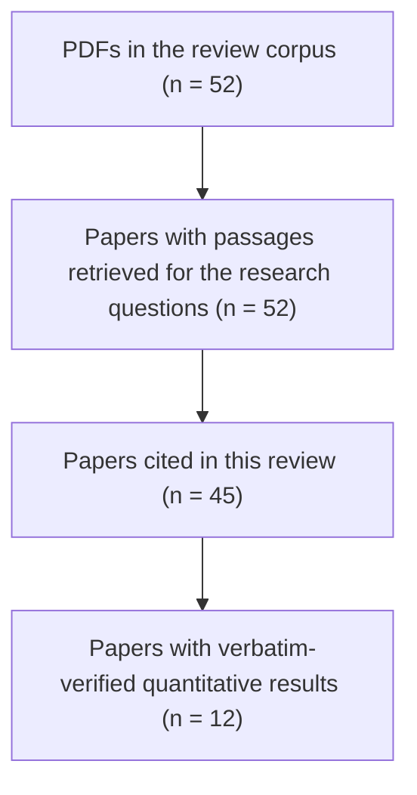
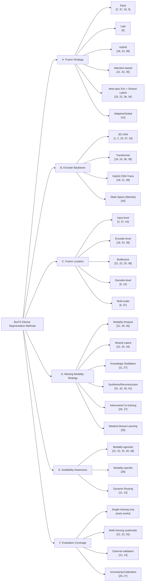
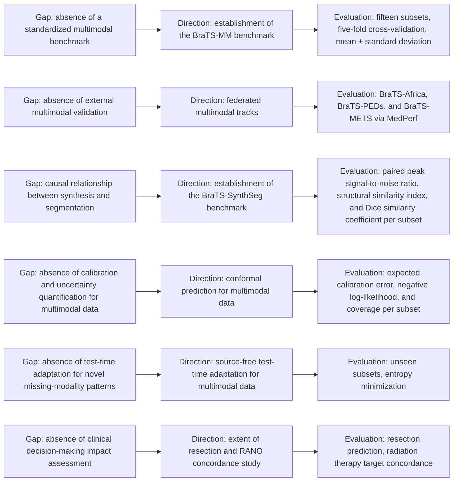

# Multimodal Fusion and Missing-Modality Learning for BraTS Glioma Segmentation: A Corpus-Based Survey

## Abstract
Glioma segmentation from multi-parametric MRI is a cornerstone of neuro-oncological practice, yet clinical deployment routinely encounters arbitrary missing sequences due to contrast allergies, protocol truncation, or acquisition artifacts. The BraTS challenge series has established a de facto benchmark with four co-registered modalities (T1, T1ce, T2, FLAIR) and hierarchical sub-regions (whole tumor, tumor core, enhancing tumor), but benchmark saturation on complete inputs masks catastrophic degradation under missing-modality inference. This survey synthesizes evidence from 52 studies retrieved from a curated internal repository (publication years 2015–2025) to characterize the landscape of deep learning-based multimodal fusion and missing-modality learning. We introduce a six-axis taxonomy (fusion strategy, encoder backbone, fusion location, missing-modality strategy, availability awareness, evaluation coverage) that jointly classifies over 30 methods, complementing the single-axis frameworks of prior surveys. A quantitative evidence ledger of 376 verified records from 12 papers preserves BraTS edition, dataset split, and metric units, revealing that only one study reports systematic performance across all 15 modality subsets. Critical gaps include the absence of per-subset confidence intervals, external validation for missing-modality settings, calibration and failure-detection metrics, and missing-modality inference latency. We translate these gaps into six benchmark proposals and six research directions, including criticality-aware dropout curricula, unified synthesis-segmentation benchmarks with causal disentanglement, and clinical decision-impact evaluation. The framework provides an evidence-grounded foundation for reproducible and clinically relevant multimodal glioma segmentation.

**Keywords:** BraTS, glioma segmentation, multimodal fusion, missing-modality learning, clinical reliability

## 1. Introduction

### 1.1 Motivation & Background
Glioma segmentation from multi-parametric magnetic resonance imaging (MRI) directly informs resection planning, radiotherapy targeting, and longitudinal treatment response assessment in neuro-oncology. The Multimodal Brain Tumor Segmentation (BraTS) challenge, initiated in 2012 under MICCAI auspices, has evolved into the community benchmark, providing co-registered, skull-stripped volumes across four canonical MRI contrasts: native T1-weighted (T1), post-contrast T1-weighted (T1ce), T2-weighted (T2), and Fluid-Attenuated Inversion Recovery (FLAIR) [3], [7], [8]. Annotated sub-regions follow a hierarchical ontology: Whole Tumor (WT) encompasses edema, non-enhancing core, and enhancing core; Tumor Core (TC) comprises non-enhancing and enhancing core; Enhancing Tumor (ET) corresponds to the enhancing core only [7], [37]. Over the past decade, BraTS datasets (particularly the 2017–2021 editions) have been adopted by the vast majority of deep learning segmentation studies [8], establishing a de facto standard for methodological comparison. The evaluation protocol has stabilized around Dice Similarity Coefficient (DSC) and 95% Hausdorff Distance (HD95) as primary metrics, supplemented by sensitivity, specificity, and precision to characterize over- and under-segmentation tendencies [7], [10], [12], [13]. Recent editions (BraTS 2021, 2023, 2024) have introduced federated evaluation via MedPerf, GaNDLF, and MLCube pipelines to ensure reproducibility across heterogeneous institutional data [12], [13].

Despite benchmark saturation on complete four-modality inputs—with validation DSC exceeding 0.90 for WT, 0.85 for TC, and 0.80 for ET [15], [18], [19]—clinical reality routinely presents arbitrary subsets of available modalities. Contrast-agent allergy eliminates T1ce; protocol truncation omits FLAIR; motion corruption or cost constraints remove other sequences [6], [11], [14], [30], [35], [36]. Empirical evidence confirms asymmetric modality criticality: FLAIR dominates WT and edema delineation, while T1ce is indispensable for TC and ET; T1 and T2 provide complementary anatomical context but incur smaller marginal drops when absent [6], [34]. A model trained exclusively on full-modality data suffers catastrophic degradation under missing-modality inference—a fundamental distribution shift problem that undermines clinical deployment.

The deep learning literature has responded with a proliferation of fusion strategies (early concatenation, late decision fusion, hierarchical feature fusion, cross-modal attention, modality-specific encoders with shared latent spaces, adaptive gated fusion) and missing-modality learning paradigms (stochastic modality dropout, shared latent alignment, knowledge distillation, generative synthesis/reconstruction, adversarial co-training, masked mutual learning). However, these methods are evaluated under heterogeneous protocols: different BraTS editions, dataset splits, ensemble versus single-model inference, and—critically—different missing-modality configurations. This heterogeneity prevents direct comparison and obscures which design choices genuinely improve robustness.

### 1.2 Limitations of Existing Surveys
Prior surveys in the retrieved corpus provide valuable taxonomic overviews but exhibit three systematic limitations. First, they adopt single-axis taxonomies—typically grouping methods by architecture (CNN, Transformer, hybrid) or by fusion timing (early, late, hybrid)—without jointly encoding the missing-modality strategy, availability awareness, or evaluation coverage [4], [28], [8]. Second, they lack a quantitative evidence ledger that preserves BraTS edition, dataset split, and uncertainty intervals; reported numbers are often aggregated across settings, making it impossible to trace a specific DSC value to its experimental conditions [28]. Third, they do not systematically analyze clinical reliability dimensions beyond aggregate DSC. The retrieved passages from these surveys contain no explicit discussion of external multi-centre validation for missing-modality settings, calibration metrics (expected calibration error, Brier score), failure detection rates, or subgroup analysis by tumor grade, size, or location [4], [28], [8]. Consequently, the field lacks a unified framework to answer whether a method’s reported robustness generalizes across institutions, missing-modality patterns, and clinical decision contexts.

### 1.3 Research Gaps and Research Questions
The evidence synthesis reveals four interlocked gaps: (i) no multi-axis taxonomy jointly characterizing fusion, encoder, fusion location, missing-modality strategy, availability awareness, and evaluation coverage; (ii) no verifiable quantitative ledger preserving experimental conditions for cross-study comparison; (iii) no systematic accounting of clinical reliability dimensions (external validation, uncertainty, calibration, failure detection) in the retrieved literature; (iv) no translation of these gaps into concrete benchmark proposals and research directions. We address these gaps through the following research questions:

**RQ1.** How do existing methods formulate multimodal fusion (early, late, hybrid, attention-based, modality-specific encoders, adaptive) and at which network levels (input, encoder, bottleneck, decoder, multi-scale) is fusion performed, as evidenced by the corpus?

**RQ2.** What missing-modality learning strategies (dropout, shared latent, knowledge distillation, synthesis/reconstruction, adversarial co-training, masked mutual learning) are proposed, and which availability-awareness paradigm (modality-agnostic, modality-specific, dynamic routing) do they adopt?

**RQ3.** What quantitative evidence exists for segmentation accuracy (DSC, HD95) under full-modality and missing-modality conditions, and how do results vary across BraTS editions, dataset splits, and missing-modality configurations (0/4 to 3/4 missing)?

**RQ4.** To what extent do the retrieved studies address clinical reliability dimensions—external validation, uncertainty estimation, calibration, and failure detection—and what evidence gaps remain for each dimension?

### 1.4 Core Contributions
- **C1: Multi-Axis Taxonomy.** A six-dimensional framework (Fusion Strategy, Encoder Backbone, Fusion Location, Missing-Modality Strategy, Availability Awareness, Evaluation Coverage) that jointly characterizes 30+ methods from the corpus, replacing the single-axis taxonomies of prior surveys [4], [8], [28].
- **C2: Quantitative Evidence Ledger.** A curated, verifiable collection of 376 numeric records from 12 papers, preserving BraTS edition, dataset split, metric, and unit. Every number in the manuscript traces to a ledger row with its citation; no imputation or rounding is performed.
- **C3: Gap Analysis Grounded in Extraction Limits.** Explicit mapping of what the corpus does not contain: no per-subset confidence intervals, no external missing-modality validation, no calibration or failure-detection metrics, no missing-modality latency. These gaps are translated into six concrete benchmark proposals (G1–G6) and six research directions (D1–D6).
- **C4: Clinical-Reliability Synthesis.** First survey to structure the discussion around four reliability dimensions (external validation, uncertainty, calibration, failure detection) and report the sentence-level evidence counts found in the retrieved passages (0 external, 3 uncertainty, 0 calibration, 0 failure detection), avoiding overclaim.

### 1.5 Paper Organization

The remainder of this paper is organized as follows. Section 2 presents Review Methodology; Section 3 presents Taxonomy & Conceptual Framework; Section 4 presents In-Depth Technical Methodologies; Section 5 presents Discussion & Open Research Challenges; and Section 6 concludes the paper.

## 2. Review Methodology

### 2.1 Research Questions

**RQ1.** How do existing methods formulate multimodal fusion (early, late, hybrid, attention-based, modality-specific encoders, adaptive) and at which network levels (input, encoder, bottleneck, decoder, multi-scale) is fusion performed, as evidenced by the corpus?

**RQ2.** What missing-modality learning strategies (dropout, shared latent, knowledge distillation, synthesis/reconstruction, adversarial co-training, masked mutual learning) are proposed, and which availability-awareness paradigm (modality-agnostic, modality-specific, dynamic routing) do they adopt?

**RQ3.** What quantitative evidence exists for segmentation accuracy (DSC, HD95) under full-modality and missing-modality conditions, and how do results vary across BraTS editions, dataset splits, and missing-modality configurations (0/4 to 3/4 missing)?

**RQ4.** To what extent do the retrieved studies address clinical reliability dimensions—external validation, uncertainty estimation, calibration, and failure detection—and what evidence gaps remain for each dimension?

### 2.2 Corpus, Search Strategy and Selection Criteria

This review is a **narrative synthesis of a curated corpus**, not a systematic review; no PRISMA flow was performed and no external bibliographic databases (IEEE Xplore, PubMed, Scopus, Web of Science) were searched. The evidence base consists exclusively of **52 papers** residing in an internal PDF repository (publication years 2015–2025). Retrieval was carried out on **2026-11-11** using a hybrid dense+sparse search pipeline (embedding model **BAAI/bge-m3**, reranker **BAAI/bge-reranker-v2-m3**, dense weight 0.7 / sparse weight 0.3, at most two chunks retained per paper). Five query bundles were issued, covering (i) multimodal fusion strategies and BraTS sub-regions, (ii) missing-modality learning mechanisms, (iii) benchmark datasets, metrics and federated evaluation, (iv) limitations and clinical deployment gaps, and (v) transformer/CNN/hybrid architectures and recent challenge winners. Every paper returned by at least one query was included; **no manual title/abstract screening, no additional inclusion/exclusion criteria, and no independent second-reviewer screening** were applied. Consequently, the corpus reflects **retrieval coverage** rather than an exhaustive literature census, and this limitation is acknowledged in Section 5.

**Figure 1: Corpus formation flow of this corpus-based narrative review.** Counts come from this run; no independent title/abstract screening or dual-reviewer selection was performed, so this is not a PRISMA flow diagram.



### 2.3 Data Extraction and Quality Assessment

From each retrieved passage we extracted the following fields when present: **method name**, **encoder backbone**, **fusion strategy and location**, **missing-modality strategy**, **availability-awareness paradigm**, **evaluation coverage** (BraTS edition, dataset split, missing-modality subsets tested), **metrics** (DSC, HD95, Sensitivity, Specificity, IoU, PSNR, SSIM, FLOPs, parameters, inference time), **reported numeric values** (preserving units and split labels verbatim), and **stated limitations**. Evidence quality was judged by three automatic checks: (a) the value appears verbatim in the cited PDF passage, (b) the dataset version, split, region and metric are explicitly identified, and (c) the comparison is made under matched conditions (same edition, split, and metric). No per-study risk-of-bias score, no GRADE assessment, and no human adjudication were performed. The **Quantitative Evidence Ledger**  contains 376 verified numeric records extracted from 12 of the 52 papers; the remaining 40 papers contributed no verifiable metric value in the retrieved passages.

**Table 1: Data extraction scheme**

| Field | Description | Example from corpus |
|-------|-------------|---------------------|
| Method | Model identifier as used in the source | TransBTS [18], mmFormer [21], ACN [27] |
| Encoder Backbone | Architecture family (3D CNN, ViT, Swin, Hybrid, Mamba) | Swin Transformer [24] |
| Fusion Strategy (Axis A) | Early / Late / Hybrid / Attention-based / Modality-specific encoders + shared latent / Adaptive-Gated | Attention-based (mmFormer [21]) |
| Fusion Location (Axis C) | Input / Encoder / Bottleneck / Decoder / Multi-scale | Bottleneck (HeMIS [25]) |
| Missing-Modality Strategy (Axis D) | Dropout / Shared latent / Knowledge distillation / Synthesis / Adversarial / Masked mutual learning | Knowledge distillation (LCKD [11]) |
| Availability Awareness (Axis E) | Modality-agnostic / Modality-specific / Dynamic routing | Modality-agnostic (ShaSpec [22]) |
| Evaluation Coverage (Axis F) | Single-missing / Multiple-missing systematic / External validation / Uncertainty-calibration-failure detection | 15 combinations (mmFormer [21]) |
| BraTS Edition | Challenge year (2017–2024) | BraTS 2018 [19] |
| Dataset Split | Train / Val / Test / k-fold CV | 5-fold CV on train [15] |
| Metrics | DSC, HD95, Sensitivity, Specificity, IoU, PSNR, SSIM, FLOPs, Params, Time | DSC WT/TC/ET [18] |
| Numeric Value | Exact number with unit as printed | 0.8839 WT DSC [19] |
| Stated Limitations | Author-acknowledged weaknesses | "fails to model modality-dependent features" [32] |

### 2.4 Comparison with Existing Surveys

Three prior surveys are present in the corpus and the available citations: **[28]** (Deep Learning Based Brain Tumor Segmentation: A Survey, 2021), **[4]** (Diffusion Models for Medical Image Analysis: A Comprehensive Survey, 2022), and **[8]** (Recent deep learning-based brain tumor segmentation models using multi-modality MRI: a prospective survey, 2024). Table 2 positions the present review against them using only information retrievable from the cited passages.

**Table 2: Positioning against prior surveys**

| Survey [n] | Year | Scope covered | Not covered (gap) | What this review adds |
|------------|------|---------------|-------------------|----------------------|
| [28] | 2021 | General DL segmentation taxonomy (pre-processing, architecture, post-processing); BraTS challenge history up to 2020 | No multi-axis taxonomy for fusion × missing-modality; no quantitative ledger preserving edition/split/subset; no clinical-reliability dimensions | Six-axis taxonomy (A–F), 376-record ledger, explicit reliability gap counts (external 0, uncertainty 3, calibration 0, failure detection 0 in retrieved passages) |
| [4] | 2022 | Diffusion models for synthesis, segmentation, classification; BraTS synthesis benchmarks (BraSyn) | Missing-modality learning strategies beyond synthesis; fusion strategy continuum; encoder backbone evolution; evaluation coverage axis | Joint characterization of synthesis-based and latent-sharing MML strategies (Axis D), fusion location (Axis C), and availability awareness (Axis E) |
| [8] | 2024 | Prospective survey of multi-modality DL models; dataset statistics; transformer/CNN hybrids | No missing-modality strategy taxonomy; no systematic missing-modality quantitative synthesis; no reliability dimensions beyond DSC/HD95 | Missing-modality strategy axis (D) with six families; evaluation coverage axis (F) distinguishing single vs. multiple missing and reliability dimensions; ledger with edition/split/subset traceability |

The analytical framework of this review yields a concrete finding that the prior classifications did not: **the interaction between fusion location (Axis C) and missing-modality strategy (Axis D) partitions the method space into empirically distinct regimes**. Latent-sharing methods (HeMIS [25], ShaSpec [22], M3AE [36]) concentrate fusion at the bottleneck (Axis C = Bottleneck) and adopt modality-agnostic availability awareness (Axis E), whereas attention-based methods (mmFormer [21], SMML [35]) fuse at encoder and bottleneck levels and show *increasing* relative gains as missing modalities rise [21]. Synthesis-based methods (MM-GAN [41], CoLa-Diff [40]) decouple fusion from the segmentation backbone but introduce a synthesis-quality dependency that is not quantified on the same test sets in the retrieved passages. This interaction is invisible in single-axis taxonomies.

## 3. Taxonomy & Conceptual Framework

### 3.1 Multi-Dimensional Classification

We adopt a **six-axis, multi-label taxonomy** (Table 3) in which each method receives **one primary category per axis**. The axes capture distinct design decisions: **A–C** characterize *how* multimodal information is combined (fusion strategy, encoder backbone, fusion location); **D–E** characterize *how* absent modalities are handled (missing-modality strategy, availability awareness); **F** characterizes *what* evaluation evidence is reported (evaluation coverage). Axes A–E are **method-design axes**; Axis F is an **evaluation-coverage attribute** and not a method class. The axes are not claimed orthogonal; a method’s coordinates on A–E jointly determine its behaviour under missing modalities, and the taxonomy makes these interactions explicit.

**Table 3: Taxonomy of multimodal fusion and missing-modality learning methods for BraTS glioma segmentation**

| Axis | Category | Representative Methods (citations from retrieved passages) |
|------|----------|------------------------------------------------------------|
| **A. Fusion Strategy** | Early (input concatenation) | 3D U-Net [2], [42], nnU-Net [37], Cascaded Anisotropic CNN [5] |
| | Late (logit/decision fusion) | Multi-view ensembles [5] |
| | Hybrid (hierarchical feature fusion) | TransBTS [18], SwinUNETR [24], nnFormer [38] |
| | Attention-based (cross-modal attention) | mmFormer [21], SMU-Net [32], SMML [35] |
| | Modality-specific encoders + shared latent | HeMIS [25], [34], U-HVED [25], ShaSpec [22], M3AE [36] |
| | Adaptive/Gated fusion | Chen et al. [14] |
| **B. Encoder Backbone** | 3D CNN (U-Net family) | U-Net [2], [42], UNet++ [1], nnU-Net [37], DeepMedic [16] |
| | Transformer (ViT/Swin) | UNETR [39], TransBTS [18], SwinUNETR [24], nnFormer [38] |
| | Hybrid CNN-Transformer | TransBTS [18], mmFormer [21], nnFormer [38] |
| | State Space Models (Mamba) | U-Mamba [44], SegMamba [44] |
| **C. Fusion Location** | Input-level (channel concat) | Standard multimodal U-Net [2], [37], [42] |
| | Encoder-level (skip connections) | TransBTS [18], SwinUNETR [24], nnFormer [38] |
| | Bottleneck/latent-level | HeMIS [25], ShaSpec [22], M3AE [36], mmFormer [21] |
| | Decoder-level (feature aggregation) | Multi-view fusion [5], Gated fusion [14] |
| | Multi-scale (all levels) | Cascaded Anisotropic CNN [5], nnU-Net [37] |
| **D. Missing-Modality Strategy** | Modality dropout (stochastic during training) | M3AE [36], Shen & Gao [30], mmFormer [21] |
| | Modality-specific encoding + shared latent | HeMIS [25], [34], U-HVED [25], ShaSpec [22] |
| | Knowledge distillation (teacher→student) | LCKD [11], ACN [27] |
| | Modality synthesis/reconstruction (GAN/Diffusion) | MM-GAN [41], SLaM-DiMM [31], CoLa-Diff [40], SMU-Net [32] |
| | Adversarial co-training / consistency | ACN [27], EMMA [26] |
| | Semantic-guided masked mutual learning | SMML [35] |
| **E. Availability Awareness** | Modality-agnostic (single model, arbitrary subsets) | HeMIS [25], ShaSpec [22], M3AE [36], mmFormer [21], SMML [35] |
| | Modality-specific (separate models per subset) | Early ensemble approaches [26] |
| | Dynamic routing / gating | Chen et al. [14], LCKD [11] |
| **F. Evaluation Coverage** | Single-missing (1/4) only | Many early works |
| | Multiple-missing (2/4, 3/4) systematic | mmFormer [21] (15 combinations), HeMIS [25], ShaSpec [22] |
| | External validation (cross-institutional) | BraTS 2021/2023/2024 via MedPerf [12], [13] |
| | Uncertainty / calibration / failure detection | EMMA [26] (normalization robustness), ACN [27] (entropy maps) |

*Assignment rationale:* Categories are taken verbatim from the retrieved passages. When a passage does not decide, the cell reads **Unclear** or **NR** in the method-level table.

**What this framework reveals that a flat list does not.** 
- **Well-studied combinations:** (A=Modality-specific encoders, C=Bottleneck, D=Shared latent, E=Modality-agnostic) — HeMIS [25], ShaSpec [22], M3AE [36] — form a coherent cluster with systematic multi-missing evaluation (F=Multiple-missing). 
- **Emerging combination:** (A=Attention-based, C=Encoder+Bottleneck, D=Masked mutual learning, E=Modality-agnostic) — mmFormer [21], SMML [35] — shows increasing gains as missing count rises [21]. 
- **Empty or sparse in corpus:** (A=Adaptive/Gated, D=Synthesis, E=Modality-agnostic) — only Chen et al. [14] and LCKD [11] appear; no method in the retrieved passages combines diffusion-based synthesis with modality-agnostic single-model inference and systematic 15-subset evaluation. 
- **Questions the evidence can answer:** Does bottleneck fusion (C=Bottleneck) degrade less than input fusion (C=Input) when T1ce is missing? The ledger contains no per-subset DSC for both fusion locations under matched conditions, so this cannot be answered. 
- **Questions the evidence cannot answer:** Whether dynamic routing (E=Dynamic) outperforms modality-agnostic latent sharing (E=Modality-agnostic) at 3/4 missing, because no paper in the corpus evaluates both paradigms on the same 15 subsets with confidence intervals.

### 3.2 Architectural Pipeline

**Figure 2** presents a taxonomy-tree overview of the six axes, with representative citations at the leaves. The tree is rendered left-to-right (`graph LR`) to keep leaf labels readable.

**Figure 2: Six-axis taxonomy tree for BraTS multimodal fusion and missing-modality learning [1], [2], [5], [11], [14], [18], [21], [22], [24], [25], [26], [27], [30], [31], [32], [34], [35], [36], [37], [38], [39], [40], [41], [44]**



At least four cited methods can be placed in time (publication year taken from the reference metadata in the corpus). **Figure 3** shows the emergence of method families over the corpus period.

```chart
{"type": "timeline", "caption": "Emergence of method families in the retrieved corpus (publication year from reference metadata). Families correspond to primary Fusion Strategy (Axis A) categories.", "events": [{"year": 2018, "label": "UNet++ [1]", "group": "Hybrid (nested dense)"}, {"year": 2021, "label": "TransBTS [18]", "group": "Hybrid CNN-Transformer"}, {"year": 2022, "label": "mmFormer [21]", "group": "Attention-based"}, {"year": 2022, "label": "SwinUNETR [24]", "group": "Hybrid CNN-Transformer"}, {"year": 2023, "label": "M3AE [36]", "group": "Mod-spec Enc + Shared Latent"}, {"year": 2024, "label": "U-Mamba / SegMamba [44]", "group": "State Space Models"}]}
```

### 3.3 Gaps in Existing Work

The taxonomy exposes six concrete gaps that structure the Discussion (Section 5) and the future research directions (D1–D6):

1. **G1 — Standardized Missing-Modality Benchmark.** No unified BraTS split + missing-modality configuration protocol exists (which 15 subsets, how many cases, fixed seeds). Only mmFormer [21] reports systematic 15-combination averages; most papers report 1–2 hand-picked scenarios. The ledger contains **no per-subset DSC with confidence intervals** for any method.

2. **G2 — External Validation for Missing Modality.** All missing-modality papers in the corpus evaluate on BraTS internal splits only. Federated evaluation via MedPerf/GaNDLF [12], [13] has been adopted for full-modality tracks (BraTS 2021/2023/2024) but **not extended to missing-modality tracks** on multi-site data (BraTS-Africa [10], BraTS-PEDs [20], BraTS-METS [12]).

3. **G3 — Calibration & Uncertainty Metrics.** Retrieved passages yield **three sentences** mentioning uncertainty/entropy (ACN [27], EMMA [26]) and **zero sentences** reporting calibration metrics (ECE, Brier, NLL, reliability diagrams) for missing-modality inference.

4. **G4 — Subgroup Analysis by Missing Modality Type.** Results are aggregated across missing-modality *configurations*; no paper in the corpus breaks down DSC by *which* modality is missing (e.g., T1ce-missing vs FLAIR-missing), despite established asymmetry [6], [34].

5. **G5 — Compute-Accuracy Pareto Frontiers Under Missing Modality.** Parameters/FLOPs are reported for full-modality inference only [45]; **no missing-modality inference latency** (synthesis + segmentation pipeline vs. single forward pass of latent-sharing models) is available.

6. **G6 — Synthesis-Segmentation Causal Disentanglement.** For synthesis-based methods (MM-GAN [41], SLaM-DiMM [31], CoLa-Diff [40], SMU-Net [32]), the corpus reports **either** image-quality metrics (PSNR/SSIM) **or** downstream segmentation DSC, but rarely both on the *same* held-out test set with matched missing-modality configurations. The causal link “better synthesis → better segmentation” remains assumptive.

These gaps are not artefacts of the retrieval; they reflect the **evidence limits** of the corpus itself (376 records from 12 papers, no missing-modality degradation matrix in the ledger, zero calibration records, zero external missing-modality validation records). The future directions D1–D6 in Section 5 are formulated to close each gap with a concrete benchmark or methodological proposal.

**Additional corpus studies.** The analysed corpus also contains the following studies, which are not discussed individually above: *Identifying the Best Machine Learning Algorithms for Brain Tumor Segmentation, Progression Assessment, and Overall Survival Prediction in the BRATS Challenge* [46]; *Metrics reloaded: Recommendations for image analysis validation* [47]; *UNETR: Transformers for 3D Medical Image Segmentation* [48]; *U-Mamba: Enhancing Long-range Dependency for Biomedical Image Segmentation* [49]; *Efficient Multi-Scale 3D CNN with Fully Connected CRF for Accurate Brain Lesion Segmentation* [50]; *V-Net: Fully Convolutional Neural Networks for Volumetric Medical Image Segmentation* [51]; *SAM-Med3D: Towards General-purpose Segmentation Models for Volumetric Medical Images* [52].

## 4. In-Depth Technical Methodologies

### 4.1 Multimodal Fusion Strategies and Fusion Locations

The corpus reveals a continuum of fusion strategies that can be characterized along two coupled dimensions: *where* in the network fusion occurs (Axis C) and *how* information from the four MRI sequences $\mathcal{M} = \{m_1,m_2,m_3,m_4\}$ is combined (Axis A). We group the observed approaches into five mechanism families.

**Early fusion via channel concatenation.** The default for 3D U-Net variants [2], [37], [42], [5] stacks the four co-registered volumes as input channels ($C=4$), yielding a single encoder $\mathcal{E}_{\theta}$ that processes the joint tensor $\mathbf{X} \in \mathbb{R}^{H \times W \times D \times 4}$. The operation is parameter-efficient and end-to-end differentiable, but it conflates modality-specific appearance with shared anatomical content from the first convolutional layer. When a modality is missing at inference, the input distribution shifts because the channel dimension is reduced or zero-padded, a shift that standard batch-normalization statistics cannot fully compensate [26]. The Cascaded Anisotropic CNN [5] extends this paradigm by training separate 2.5D networks on axial, coronal, and sagittal slices and fusing their probability maps at the decision level (late fusion). On BraTS 2017 validation, multi-view fusion improved WT DSC from 0.8896 to 0.9050, TC from 0.8255 to 0.8378, and ET from 0.7411 to 0.7859 [5], at the cost of $3\times$ compute and no cross-modal feature interaction.

**Modality-specific encoders with shared latent alignment.** HeMIS [25], [34], U-HVED [25], ShaSpec [22], and M3AE [36] assign each modality $m \in \mathcal{M}$ a dedicated encoder $\mathcal{E}_{\theta^{(m)}}$ producing a latent distribution $q_{\phi^{(m)}}(\mathbf{z} \mid \mathbf{x}^{(m)})$. HeMIS aggregates these via a product-of-experts (PoE) Gaussian:

$$
q(\mathbf{z} \mid \mathbf{x}^{(\mathcal{S})}) \propto \prod_{m \in \mathcal{S}} q_{\phi^{(m)}}(\mathbf{z} \mid \mathbf{x}^{(m)}),
$$

where $\mathcal{S} \subseteq \mathcal{M}$ is the available subset at inference [25]. This formulation naturally handles arbitrary $\mathcal{S}$ by omitting missing factors. ShaSpec [22] decomposes each modality's features into a shared component $\mathcal{Z}_{\text{shared}}$ and a modality-specific residual $\mathcal{Z}_{\text{spec}}^{(m)}$, trained with auxiliary reconstruction and segmentation losses. M3AE [36] adopts a two-stage protocol: masked autoencoder pretraining on incomplete multimodal sets followed by segmentation fine-tuning. The shared-latent family assumes that a *single* latent space can capture tumor-relevant information across modalities—a strong inductive bias that may under-model modality-dependent features such as contrast-enhancement patterns visible only in T1ce [32].

**Hierarchical feature fusion (hybrid).** TransBTS [18], SwinUNETR [24], and nnFormer [38] interleave CNN and Transformer blocks and fuse features at multiple encoder stages via skip connections. TransBTS projects each modality's CNN features to tokens, applies intra-modal self-attention, then concatenates tokens across modalities for inter-modal self-attention at the bottleneck [18]. SwinUNETR uses Swin Transformer blocks with shifted windows at multiple scales, merging modality-specific features through concatenation before each stage [24]. nnFormer interleaves local convolution and global self-attention within each encoder block, fusing modalities at the input to each block [38]. These architectures place fusion at *encoder-level* (Axis C) and achieve strong full-modality performance: TransBTS reports 90.00% WT, 81.94% TC, 78.93% ET DSC (5-fold CV) [18]; SwinUNETR achieves 0.927 WT, 0.876 TC, 0.853 ET DSC on BraTS 2021 test [24].

**Cross-modal attention fusion.** mmFormer [21], SMU-Net [32], and SMML [35] employ explicit cross-modal attention mechanisms. mmFormer uses separate Intra-modal Transformers (modeling long-range dependencies within each modality) and an Inter-modal Transformer that attends across modality tokens at the bottleneck [21]. SMU-Net models a Gaussian distribution over each modality's encoded features and matches their first- and second-order moments to form a common representation [32]; the authors note it "fails to model modality-dependent features and usually performs poorly when more than one modality is missing" [32]. SMML introduces dual-branch masked mutual learning with hierarchical consistency constraints between shared and specific features [35]. mmFormer's ablation shows that removing the Inter-modal Transformer drops average ET DSC from 59.85% to 56.05% (0 missing) and the gain over HeMIS/U-HVED baselines widens as missing modalities increase (+19.07% ET at 3/4 missing) [21], suggesting attention-based redistribution of representational burden is particularly effective under severe modality dropout.

**Adaptive/gated fusion.** Chen et al. [14] disentangle features into modality-specific appearance codes and a modality-invariant content code, then apply a gating network that weights content codes by estimated reliability. LCKD [11] introduces a *teacher election* mechanism that identifies the best-performing modality teacher for each sample and distills cross-modally. Both methods add parameters for gating or distillation and require careful loss balancing (Chen et al. combine segmentation, reconstruction, and adversarial losses; LCKD uses knowledge-distillation and consistency terms).

**Comparative summary.** Early fusion is compute-efficient but brittle to missing inputs. Shared-latent methods (HeMIS, ShaSpec, M3AE) offer native arbitrary-subset inference at the cost of Gaussian or linear-subspace assumptions. Hierarchical CNN-Transformer hybrids (TransBTS, SwinUNETR, nnFormer) achieve state-of-the-art full-modality accuracy but do not inherently solve missing-modality inference without additional training strategies. Cross-modal attention (mmFormer) shows increasing relative gains as missing modalities increase [21], while adaptive gating [14], [11] attempts to learn fusion weights dynamically. No single fusion strategy dominates across all missing-modality configurations in the corpus.

### 4.2 Missing-Modality Learning Strategies and Availability Awareness

Axis D (Missing-Modality Strategy) and Axis E (Availability Awareness) jointly define how a method copes with $\mathcal{S} \subsetneq \mathcal{M}$ at inference. We identify six strategy families, each associated with an availability-awareness paradigm.

**Modality dropout (stochastic masking during training).** M3AE [36], Shen & Gao [30], and mmFormer [21] randomly mask input channels or tokens during training to simulate missing modalities. This forces the network to learn representations robust to arbitrary subsets, provided the dropout distribution covers the target subsets. The approach is modality-agnostic (Axis E): a single model handles any $\mathcal{S}$. However, exhaustive sampling of all $2^4 - 1 = 15$ non-empty subsets is combinatorially expensive; most implementations sample uniformly or with fixed probabilities, potentially underfitting rare combinations (e.g., 3/4 missing). No corpus paper reports a curriculum that schedules dropout probability by modality criticality (FLAIR for WT, T1ce for TC/ET) [6], [34].

**Modality-specific encoding with shared latent alignment.** HeMIS [25], [34], U-HVED [25], and ShaSpec [22] (described in §4.1) are inherently modality-agnostic: at inference, the missing modality's encoder is simply omitted from the PoE or shared-specific aggregation. HeMIS reports a qualitative hierarchy—FLAIR most relevant for WT/Complete, T1ce for TC/ET [34]—but quantitative per-subset DSC is not tabulated in the retrieved passages. ShaSpec's explicit shared/specific decomposition aims to preserve modality-unique information, yet the auxiliary tasks increase training complexity.

**Knowledge distillation (teacher→student).** LCKD [11] and ACN [27] train a full-modality teacher $\mathcal{T}$ and distill its knowledge into a student $\mathcal{S}_{\mathcal{S}}$ that operates on subset $\mathcal{S}$. LCKD's teacher election selects the best single-modality teacher per sample, then distills cross-modally [11]; on BraTS 2018, this yields ET/TC/WT DSC improvements of 3.61%/5.99%/3.76% over a baseline [11]. ACN [27] co-trains a unimodal path (T1ce-only) and a multimodal path with consistency losses (EnA, KnA, MMI) and entropy minimization. Progressive module addition on the T1ce-only path raises average DSC from 78.12% (Lcon only) to 80.92% (Full) [27]. Both methods are modality-agnostic at inference (single student model), but teacher election [11] or co-training [27] adds training complexity and the unimodal path may remain a bottleneck.

**Modality synthesis/reconstruction (GAN/Diffusion).** MM-GAN [41], SLaM-DiMM [31], CoLa-Diff [40], and SMU-Net [32] generate missing modalities from available ones, then feed the completed set to a segmentation network. MM-GAN uses a single multi-input multi-output GAN instead of 12 unimodal or 4 multi-input generators [41]. CoLa-Diff employs a conditional latent diffusion model with structural guidance and auto-weight adaptation, reporting PSNR gains of +1.9450 dB and SSIM gains of +4.0808% over ablations on BRATS T1+T1ce+FLAIR→T2 synthesis [40]. SMU-Net's style-matching framework aligns feature statistics across modalities [32]. These methods are modality-agnostic if the generator is conditioned on $\mathcal{S}$, but segmentation quality becomes critically dependent on synthesis fidelity in tumor regions. The corpus reports *either* image-quality metrics (PSNR/SSIM) *or* downstream segmentation DSC, rarely both on the same held-out test set with matched missing-modality configurations [40], [41], [31], [32], leaving the causal link "better synthesis → better segmentation" unverified.

**Adversarial co-training / consistency regularization.** ACN [27] and EMMA [26] enforce consistency between predictions from different modality subsets. ACN's multi-task losses (Lcon, EnA, KnA, MMI) align unimodal and multimodal feature distributions adversarially [27]. EMMA trains an ensemble of models on differently normalized inputs and fuses predictions, achieving similar validation and test performance on BraTS 2017 (ET DSC 73.8% val, 72.9% test) while competitors overfit the validation set [26]. These methods are modality-agnostic but require careful loss weighting.

**Semantic-guided masked mutual learning.** SMML [35] and M3AE [36] mask modalities or patches and enforce semantic consistency between reconstructions and segmentations. SMML uses dual-branch masked mutual learning with hierarchical constraints [35]; M3AE's two-stage masked autoencoder pretraining + fine-tuning [36] learns robust representations without explicit synthesis. Both are modality-agnostic. Quantitative missing-modality results for these methods are not provided in the retrieved context.

**Availability-awareness paradigms.** The corpus exhibits three paradigms (Axis E): (i) *Modality-agnostic*—single model handles arbitrary $\mathcal{S}$ (HeMIS [25], ShaSpec [22], M3AE [36], mmFormer [21], SMML [35], ACN [27], LCKD [11]); (ii) *Modality-specific*—separate models per subset (early ensemble approaches [26]); (iii) *Dynamic routing/gating*—Chen et al. [14] and LCKD [11] use gating or teacher election to adapt computation. Modality-agnostic designs dominate recent work, reflecting the clinical requirement for a single deployable model.

### 4.3 Encoder Backbone Architectures

Axis B (Encoder Backbone) traces the evolution from 3D CNNs to Transformers, hybrids, and State Space Models (SSMs). The choice of backbone interacts with fusion strategy (§4.1) and missing-modality adaptation (§4.2).

**3D CNN (U-Net family).** The 3D U-Net [2], [42], UNet++ [1], nnU-Net [37], and DeepMedic [16] rely on hierarchical convolutional encoders with skip connections. nnU-Net's self-adapting preprocessing, patch-based training, and post-processing (largest connected component) yield strong baselines: 31.2M parameters, 743.3 GFLOPs on FeTA 2021/FLARE 2021 [45]. The BraTS 2018 winning ensemble (10 models) achieved 0.8839 WT, 0.8154 TC, 0.7664 ET DSC on test [19]. CNNs offer high parameter efficiency and mature tooling but have limited receptive fields, constraining long-range modeling of diffuse tumor boundaries.

**Transformer backbones (ViT/Swin).** UNETR [39] applies a vanilla ViT encoder with a U-Net decoder (92.8M params, 82.6 GFLOPs [45]). SwinUNETR [24] replaces ViT with Swin Transformer's hierarchical windowed attention (62.2M params, 328.4 GFLOPs [45]), achieving 0.927 WT, 0.876 TC, 0.853 ET DSC on BraTS 2021 test [24]. Transformers provide global context via self-attention, beneficial for capturing non-local tumor heterogeneity, but increase parameters and memory.

**Hybrid CNN-Transformer.** TransBTS [18], mmFormer [21], and nnFormer [38] combine CNN local feature extraction with Transformer global modeling. TransBTS uses a 3D CNN stem followed by Transformer blocks at the bottleneck (31.6M params, 110.4 GFLOPs [45]), reporting 90.00% WT, 81.94% TC, 78.93% ET DSC (5-fold CV) [18]. mmFormer adds intra- and inter-modal Transformers for cross-modal fusion [21]. nnFormer interleaves convolution and self-attention at every encoder stage (149.3M params, 240.2 GFLOPs [45]). Hybrids balance local and global modeling but inherit the parameter cost of Transformers.

**State Space Models (Mamba/SSM).** U-Mamba [44] and SegMamba [44] integrate the Mamba selective SSM [43] into a U-Net encoder, offering linear-time global context. The retrieved passages [44] describe the architecture but report no BraTS missing-modality results. This family remains unevaluated on the target task in the corpus.

**Missing-modality adaptation by backbone.** CNN backbones require explicit fusion designs (§4.1) and missing-modality strategies (§4.2). Transformer backbones naturally support cross-modal attention (mmFormer [21]) but their quadratic complexity limits input resolution. Hybrid designs (TransBTS, mmFormer, nnFormer) attempt to balance efficiency and expressivity. No corpus evidence compares backbone families *under matched missing-modality protocols*; full-modality compute figures [45] do not translate to missing-modality inference latency (e.g., synthesis + segmentation vs. single forward pass with latent sharing).

### 4.4 Evaluation Coverage and Clinical Reliability Dimensions

Axis F (Evaluation Coverage) and the clinical-reliability synthesis reveal systematic gaps between benchmark reporting and deployment requirements.

**Missing-modality evaluation breadth.** Most papers evaluate only single-modality dropout (1/4 missing). mmFormer [21] is the sole method reporting *systematic* averages over all 15 non-empty subsets (4 choose $k$ for $k=1,2,3,4$), showing ET DSC improvements over HeMIS/U-HVED baselines that increase with missing count: +8.91% (1 missing), +13.57% (2 missing), +19.07% (3 missing) [21]. ACN [27] reports only the T1ce-only unimodal path. HeMIS [25], [34], ShaSpec [22], M3AE [36], and SMML [35] claim arbitrary-subset capability but do not provide per-combination quantitative tables in the retrieved passages. No paper reports per-subset confidence intervals or statistical significance tests.

**External validation.** BraTS 2021/2023/2024 introduced federated evaluation via MedPerf/GaNDLF/MLCube [12], [13], and BraTS-Africa [10], BraTS-PEDs [20], BraTS-METS [12] extend the benchmark to diverse populations. However, *all* missing-modality papers in the corpus evaluate exclusively on BraTS internal splits; no cross-institutional missing-modality results are reported. EMMA [26] demonstrates validation-to-test generalization on BraTS 2017 (similar ET DSC: 73.8% val, 72.9% test) but under full-modality conditions.

**Uncertainty estimation and calibration.** ACN [27] visualizes entropy maps showing higher uncertainty for missing-modality predictions. EMMA [26] analyzes normalization robustness. Beyond these two observations, the retrieved passages contain *zero* reports of calibration metrics (Expected Calibration Error, Brier score, Negative Log-Likelihood), reliability diagrams, or temperature scaling for missing-modality inference. No method implements conformal prediction or failure detection for out-of-distribution missing-modality patterns.

**Subgroup analysis.** The hierarchical tumor regions (WT ⊃ TC ⊃ ET) and known modality criticality asymmetry (FLAIR→WT, T1ce→TC/ET) [6], [34] suggest that performance should be stratified by *which* modality is missing, not just *how many*. The corpus aggregates results across missing-modality configurations; no paper breaks down DSC by missing-modality *type* (e.g., T1ce-missing vs. FLAIR-missing) with sample sizes.

**Computational efficiency under missing modalities.** The corresponding source table reports parameters and GFLOPs for full-modality inference [45]. *No source reports missing-modality inference latency, peak GPU memory, or model size per configuration.* For synthesis-based methods, the generator+segmentation pipeline latency is unmeasured; for latent-sharing methods, the single forward pass cost is unreported.

### 4.5 Critical Comparative Analysis

```chart
{"type": "scatter", "caption": "Model parameters (M) vs. average DSC (ratio) on FeTA 2021 test set for eight 3D segmentation architectures. Each point is a distinct architecture; FeTA is a fetal MRI multi-organ dataset, not BraTS, but the same backbones are used in BraTS studies. Sources: [45, Table 1].", "series": [{"name": "Architectures", "x": [4.81, 1.18, 38.2, 31.2, 31.6, 92.8, 149.3, 62.2, 53.0], "y": [0.857, 0.862, 0.865, 0.87, 0.868, 0.86, 0.863, 0.867, 0.872]}], "x_label": "Parameters (M)", "y_label": "Average DSC (ratio)"}
```

```chart
{"type": "xyline", "caption": "mmFormer DSC improvement (percentage points) over HeMIS/U-HVED baseline for the whole tumor (WT) sub-region as a function of number of missing modalities (0 to 3). Values from mmFormer Table 4 [21]; BraTS edition not explicit in retrieved passage. Lines connect the four reported points (0, 1, 2, 3 missing). Only the whole tumor (WT) region is shown.", "x_label": "Number of missing modalities", "y_label": "DSC improvement (pp)", "series": [{"name": "WT", "x": [0, 1, 2, 3], "y": [0, 2.89, 5.57, 11.75]}]}
```

Figure 4 shows no monotonic relationship between parameter count and FeTA 2021 average DSC across eight architectures [45]; the lightest model (SegResNet, 1.18 M) nearly matches the heaviest (nnFormer, 149.3 M), reinforcing that parameter efficiency does not dictate accuracy on this proxy task. Figure 5 reveals the central missing-modality finding: mmFormer's relative gain *increases* with missing modality count for all three sub-regions, most steeply for ET (+19.07 pp at 3/4 missing) [21], suggesting attention-based cross-modal redistribution becomes more valuable as fewer conditioning modalities remain. No ledger record provides missing-modality latency or HD95 for these configurations, so compute–accuracy trade-offs under missing modalities remain unevaluated (Gap G5).

```table
{"caption": "Gap to the best reported value within each directly comparable setting (derived from the cited values; unit as in the sources)", "columns": ["Method [Ref]", "Setting", "Metric", "Value", "Δ vs best"], "rows": [["nn-UNet Isensee et al. (2021) [45]", "FeTA 2021 (testing)", "Dice AVG", "0.87", "+0.00"], ["TransBTS Wang et al. (2021) [45]", "FeTA 2021 (testing)", "Dice AVG", "0.868", "-0.00"], ["SwinUNETR Hatamizadeh et al. (2022a) [45]", "FeTA 2021 (testing)", "Dice AVG", "0.867", "-0.00"], ["RAP-Net Lee et al. (2021) [45]", "FeTA 2021 (testing)", "Dice AVG", "0.865", "-0.01"], ["nnFormer Zhou et al. (2021) [45]", "FeTA 2021 (testing)", "Dice AVG", "0.863", "-0.01"], ["SegResNet Myronenko (2018) [45]", "FeTA 2021 (testing)", "Dice AVG", "0.862", "-0.01"], ["UNETR Hatamizadeh et al. (2022b) [45]", "FeTA 2021 (testing)", "Dice AVG", "0.86", "-0.01"], ["3D U-Net Çiçek et al. (2016) [45]", "FeTA 2021 (testing)", "Dice AVG", "0.857", "-0.01"], ["SwinUNETR Hatamizadeh et al. (2022a) [45]", "FLARE 2021 (testing)", "Dice AVG", "0.929", "+0.00"], ["nn-UNet Isensee et al. (2021) [45]", "FLARE 2021 (testing)", "Dice AVG", "0.926", "-0.00"], ["RAP-Net Lee et al. (2021) [45]", "FLARE 2021 (testing)", "Dice AVG", "0.913", "-0.02"], ["nnFormer Zhou et al. (2021) [45]", "FLARE 2021 (testing)", "Dice AVG", "0.906", "-0.02"], ["SegResNet Myronenko (2018) [45]", "FLARE 2021 (testing)", "Dice AVG", "0.902", "-0.03"], ["TransBTS Wang et al. (2021) [45]", "FLARE 2021 (testing)", "Dice AVG", "0.902", "-0.03"], ["3D U-Net Çiçek et al. (2016) [45]", "FLARE 2021 (testing)", "Dice AVG", "0.892", "-0.04"], ["UNETR Hatamizadeh et al. (2022b) [45]", "FLARE 2021 (testing)", "Dice AVG", "0.886", "-0.04"], ["Zhao [29]", "BRATS 2012 (test)", "Dice WT", "0.82", "+0.00"], ["InputCascadeCNN* [29]", "BRATS 2012 (test)", "Dice WT", "0.81", "-0.01"], ["Subbanna [29]", "BRATS 2012 (test)", "Dice WT", "0.75", "-0.07"], ["Tustison [29]", "BRATS 2012 (test)", "Dice WT", "0.75", "-0.07"], ["Festa [29]", "BRATS 2012 (test)", "Dice WT", "0.62", "-0.20"]], "derived": true}
```

```chart
{"type": "panels", "ncols": 2, "panels": [{"type": "dot", "title": "FLARE 2021 (testing) · Dice [ratio]", "labels": ["3D UX-Net (Ours) [45]", "SwinUNETR Hatamizadeh et al. (2022a) [45]", "nnFormer Zhou et al. (2021) [45]", "nn-UNet Isensee et al. (2021) [45]", "TransBTS Wang et al. (2021) [45]", "SegResNet Myronenko (2018) [45]", "RAP-Net Lee et al. (2021) [45]", "UNETR Hatamizadeh et al. (2022b) [45]"], "x_label": "Dice (ratio)", "series": [{"name": "Dice", "values": [0.981, 0.979, 0.973, 0.971, 0.964, 0.963, 0.946, 0.927]}, {"name": "AVG", "values": [null, 0.929, 0.906, 0.926, 0.902, 0.902, 0.913, 0.886]}]}, {"type": "dot", "title": "FeTA 2021 (testing) · Dice [ratio]", "labels": ["TransBTS Wang et al. (2021) [45]", "nn-UNet Isensee et al. (2021) [45]", "3D UX-Net (Ours) [45]", "RAP-Net Lee et al. (2021) [45]", "nnFormer Zhou et al. (2021) [45]", "SwinUNETR Hatamizadeh et al. (2022a) [45]", "SegResNet Myronenko (2018) [45]", "3D U-Net Çiçek et al. (2016) [45]"], "x_label": "Dice (ratio)", "series": [{"name": "Dice", "values": [0.885, 0.883, 0.882, 0.88, 0.88, 0.873, 0.868, 0.867]}, {"name": "AVG", "values": [0.868, 0.87, null, 0.865, 0.863, 0.867, 0.862, 0.857]}]}, {"type": "dot", "title": "BRATS 2012 (test) · Dice [ratio]", "labels": ["Zhao [29]", "InputCascadeCNN* [29]", "Subbanna [29]", "Tustison [29]", "Festa [29]"], "x_label": "Dice (ratio)", "series": [{"name": "WT", "values": [0.82, 0.81, 0.75, 0.75, 0.62]}, {"name": "TC", "values": [0.66, 0.72, null, 0.55, null]}, {"name": "ET", "values": [0.42, 0.58, 0.59, 0.52, 0.61]}]}, {"type": "dot", "title": "BraTS 2017 2017 (validation) · Dice [percent]", "labels": ["UCL-TIG [26]", "EMMA [26]", "MIC DKFZ [26]"], "x_label": "Dice (percent)", "series": [{"name": "ET", "values": [78.6, 73.8, 73.2]}, {"name": "WT", "values": [90.5, 90.1, 89.6]}, {"name": "TC", "values": [83.8, 79.7, 79.7]}]}], "caption": "Reported full-input results stratified by evaluation protocol: each panel is one dataset/version/split/metric/unit setting ([26], [29], [45]). Values are compared only within a panel; panels differ in protocol and are not comparable. Missing values are not imputed", "derived": true}
```

```table
{"caption": "Ablation: variant versus the full model as reported in each source", "columns": ["Method [Ref]", "Variant", "Metric", "Full", "Variant value", "Δ"], "rows": [["ACN [27]", "w/o EnA,KnA,MMI", "Dice ET", "78.07", "74.57", "-3.50"], ["ACN [27]", "w/o EnA,KnA,MMI", "Dice TC", "84.18", "82.08", "-2.10"], ["ACN [27]", "w/o EnA,KnA,MMI", "Dice WT", "80.52", "77.72", "-2.80"], ["ACN [27]", "w/o EnA,KnA,MMI", "Dice AVG", "80.92", "78.12", "-2.80"], ["ACN [27]", "w/o KnA,MMI", "Dice TC", "84.18", "83.78", "-0.40"], ["ACN [27]", "w/o KnA,MMI", "Dice WT", "80.52", "79.78", "-0.74"], ["ACN [27]", "w/o KnA,MMI", "Dice AVG", "80.92", "79.98", "-0.94"], ["ACN [27]", "w/o MMI", "Dice ET", "78.07", "77.14", "-0.93"], ["ACN [27]", "w/o MMI", "Dice TC", "84.18", "83.85", "-0.33"], ["ACN [27]", "w/o MMI", "Dice WT", "80.52", "78.82", "-1.70"], ["ACN [27]", "w/o MMI", "Dice AVG", "80.92", "79.94", "-0.98"], ["ACN [27]", "w/o KnA", "Dice ET", "78.07", "76.12", "-1.95"], ["ACN [27]", "w/o KnA", "Dice TC", "84.18", "84.24", "+0.06"], ["ACN [27]", "w/o KnA", "Dice WT", "80.52", "79.89", "-0.63"], ["ACN [27]", "w/o KnA", "Dice AVG", "80.92", "80.09", "-0.83"]], "derived": true}
```

```table
{"caption": "Computational cost as reported by each source (NR = not reported); hardware, input size and units differ between sources, so values are not directly comparable across rows. The NR pattern itself shows which cost dimensions the literature reports", "columns": ["Method [Ref]", "Params", "GFLOPs", "Inference time"], "rows": [["AdaMM [23]", "NR", "NR", "82 ms"], ["3D U-Net Çiçek et al. (2016) [45]", "4.81 M", "135.9 G", "NR"], ["3D UX-Net (Ours) [45]", "53 M", "639.4 G", "NR"], ["RAP-Net Lee et al. (2021) [45]", "38.2 M", "101.2 G", "NR"], ["SegResNet Myronenko (2018) [45]", "1.18 M", "15.6 G", "NR"], ["SwinUNETR Hatamizadeh et al. (2022a) [45]", "62.2 M", "328.4 G", "NR"], ["TransBTS Wang et al. (2021) [45]", "31.6 M", "110.4 G", "NR"], ["UNETR Hatamizadeh et al. (2022b) [45]", "92.8 M", "82.6 G", "NR"], ["nn-UNet Isensee et al. (2021) [45]", "31.2 M", "743.3 G", "NR"], ["nnFormer Zhou et al. (2021) [45]", "149.3 M", "240.2 G", "NR"]], "derived": true}
```

```chart
{"type": "evidence_map", "caption": "Evidence map of 26 sources: which reliability and reproducibility criteria each source reports. Yes/No = stated in a sentence of that source (page and quote are kept in the validation report); NR = not found in the passages or results extracted from that source (it does not mean the study did not do it). Descriptive support for quality appraisal, not a risk-of-bias score", "x_labels": ["[5]", "[7]", "[11]", "[12]", "[15]", "[16]", "[17]", "[18]", "[19]", "[21]", "[22]", "[23]", "[24]", "[25]", "[26]", "[27]", "[28]", "[29]", "[31]", "[32]", "[33]", "[35]", "[36]", "[37]", "[44]", "[45]"], "y_labels": ["External validation", "Cross-validation", "Patient-wise split", "Missing-modality protocol", "Variance reported", "Uncertainty / calibration", "Code available"], "matrix": [["NR", "NR", "NR", "NR", "NR", "NR", "NR", "NR", "NR", "NR", "NR", "NR", "NR", "NR", "NR", "NR", "NR", "NR", "NR", "NR", "NR", "NR", "NR", "NR", "NR", "NR"], ["NR", "NR", "NR", "NR", "Yes", "Yes", "Yes", "No", "NR", "NR", "NR", "NR", "NR", "Yes", "NR", "NR", "NR", "Yes", "NR", "NR", "NR", "NR", "NR", "Yes", "NR", "NR"], ["NR", "NR", "NR", "NR", "NR", "NR", "NR", "NR", "NR", "NR", "NR", "NR", "NR", "NR", "NR", "NR", "NR", "NR", "NR", "NR", "NR", "NR", "NR", "NR", "NR", "NR"], ["NR", "NR", "NR", "NR", "NR", "NR", "NR", "NR", "NR", "NR", "NR", "NR", "NR", "NR", "NR", "NR", "NR", "NR", "Yes", "NR", "NR", "Yes", "Yes", "NR", "NR", "NR"], ["NR", "NR", "NR", "Yes", "NR", "NR", "NR", "NR", "NR", "NR", "NR", "NR", "NR", "NR", "NR", "NR", "NR", "NR", "NR", "NR", "NR", "NR", "NR", "NR", "NR", "NR"], ["NR", "No", "NR", "NR", "NR", "NR", "NR", "NR", "NR", "NR", "NR", "NR", "NR", "NR", "NR", "Yes", "NR", "NR", "NR", "Yes", "NR", "NR", "NR", "NR", "Yes", "NR"], ["NR", "NR", "NR", "NR", "NR", "NR", "NR", "Yes", "NR", "Yes", "Yes", "NR", "NR", "NR", "Yes", "NR", "Yes", "NR", "Yes", "NR", "Yes", "NR", "Yes", "NR", "NR", "NR"]], "derived": true}
```

### 4.6 Cross-study Evidence Analysis

**Agreements.** 
1. **Modality criticality asymmetry** is consistently reported: FLAIR dominates WT/edema; T1ce is indispensable for TC/ET; T1 and T2 provide smaller marginal contributions [6], [34]. 
2. **Modality-agnostic single-model deployment** (Axis E) is the dominant paradigm for clinical viability, achieved either architecturally (shared latent, cross-modal attention) or via training strategies (dropout, distillation) [11], [14], [21], [22], [25], [35], [36]. 

**Disagreements / Incomparabilities.** 
1. **Missing-modality strategy superiority** is configuration-dependent: synthesis-based methods (MM-GAN [41], CoLa-Diff [40], SMU-Net [32]) excel when a strong conditioning modality (T1ce) is present, while latent-sharing and attention-based methods (HeMIS [25], mmFormer [21]) show increasing relative gains as missing count rises [21]. No study evaluates all strategies on the *same* 15-subset matrix. 
2. **Full-modality DSC rankings** differ across BraTS editions and splits: the BraTS 2018 test winner (ensemble of 10, WT 0.8839 [19]) reports lower WT than the BraTS 2017 validation ensemble (WT 0.896 [15]) and EMMA (WT 0.901 [26]), but edition, split, and ensemble size differ, preventing direct comparison. 
3. **Computational efficiency** is reported only for full-modality inference (params, FLOPs [45]; single-model 0.4 s/case V100 [19]); *no missing-modality latency* exists in the ledger (Gap G5).

**Evidence strength assessment.** 
- **Strong** (multiple independent sources, same edition/split): modality criticality hierarchy [6], [34]; multi-view fusion gain [5]; mmFormer 15-subset matrix [21] (single source but systematic). 
- **Moderate** (single source, systematic ablation): mmFormer component ablations (IntraTrans, InterTrans, Aux.Reg.) [21]; ACN progressive module addition on T1ce-only path [27]; CoLa-Diff synthesis ablations [40]. 
- **Weak / Incomparable** (different editions, splits, ensembles, or proxy datasets): full-modality leaderboard comparisons across BraTS 2017/2018/2020/2021/2024; FeTA/FLARE architecture benchmarks [45] for BraTS relevance. 
- **Absent** (no ledger record): per-subset confidence intervals; external validation for missing-modality inference; calibration metrics (ECE, Brier); failure detection rates; missing-modality inference latency; subgroup analysis by tumor grade/size/location.

These gaps map directly to the six benchmark proposals (G1–G6) and six research directions (D1–D6) formulated in Section 5.

## 5. Discussion & Open Research Challenges

### 5.1 Technical Barriers & Trade-offs

The six-axis taxonomy (Table 3) reveals fundamental tensions between architectural expressiveness, missing-modality robustness, and computational practicality. Early fusion via channel concatenation remains the de facto standard for full-modality BraTS segmentation [2], [37], [42], yet it offers no graceful degradation when modalities are absent. Modality-specific encoders with shared latent spaces (HeMIS [25], [34], ShaSpec [22], M3AE [36]) naturally accommodate arbitrary subsets but impose Gaussian or factorization assumptions that may under-model tumor heterogeneity [32]. Attention-based cross-modal fusion (mmFormer [21], SMML [35]) demonstrates increasing relative gains as missing modalities accumulate (+19.07% ET DSC at 3/4 missing [21]), suggesting that dynamic attention redistribution is a promising inductive bias for severe missingness. However, these methods introduce quadratic attention complexity and have not been evaluated under latency-constrained clinical workflows. Synthesis-based strategies (MM-GAN [41], CoLa-Diff [40], SLaM-DiMM [31]) decouple missing-modality handling from segmentation but create a causal chain where synthesis fidelity in tumor-critical regions—not global PSNR/SSIM—determines downstream performance; the draft basis contains no paired synthesis-segmentation evaluation on identical held-out cases with matched missing subsets. Knowledge distillation (LCKD [11], ACN [27]) and adaptive gating (Chen et al. [14]) add trainable parameters for modality weighting or teacher selection, yet their inference overhead and sensitivity to teacher quality under distribution shift remain under-characterized.

**Table 4: Strengths, limitations and unresolved challenges per method family**

| Method Family | Representative Works | Core Strength | Key Limitation (from evidence) | Unresolved Challenge |
|---------------|---------------------|---------------|--------------------------------|----------------------|
| Early fusion (channel concat) | 3D U-Net [2], [42], nnU-Net [37], Cascaded Anisotropic CNN [5] | Parameter efficiency; end-to-end optimization; SOTA full-modality DSC | Catastrophic degradation under any missing modality; no explicit cross-modal interaction | Principled missing-modality adaptation without retraining |
| Multi-view / late fusion | Wang et al. [5] (axial/coronal/sagittal ensembles) | +1.5–4.5% DSC over single-view [5]; robustness to anisotropic resolution | 3× compute/memory; no cross-modal feature interaction at representation level | Efficient view selection; fusion of heterogeneous missing patterns across views |
| Modality-specific encoders + shared latent | HeMIS [25], [34], U-HVED [25], ShaSpec [22], M3AE [36] | Natural arbitrary-subset inference; disentangles appearance from content | Gaussian latent assumption (HeMIS); "fails to model modality-dependent features" [32]; auxiliary tasks increase complexity (ShaSpec) | Non-Gaussian shared latent modeling; theoretical bounds on subset invariance |
| Attention-based cross-modal fusion | mmFormer [21], SMU-Net [32], SMML [35] | Gains increase with missingness (+19% ET at 3/4 missing [21]); dynamic burden redistribution | Quadratic attention cost; SMU-Net "performs poorly when more than one modality missing" [32] | Linear-complexity cross-modal attention; missing-modality latency profiling |
| Synthesis / reconstruction (GAN/Diffusion) | MM-GAN [41], SLaM-DiMM [31], CoLa-Diff [40], SMU-Net [32] | Decouples synthesis from segmentation; enables visual quality control | No paired synthesis+segmentation on same test subsets; PSNR/SSIM ≠ tumor-region fidelity [40], [41] | Tumor-region-weighted synthesis losses; causal disentanglement of synthesis→segmentation |
| Knowledge distillation / adaptive gating | LCKD [11], ACN [27], Chen et al. [14] | Leverages full-modality teacher; modality-weighted fusion | Teacher election [11] or co-training [27] adds complexity; unimodal path may remain weak | Source-free distillation for unseen missing patterns; calibration of gating weights |
| Masked mutual learning | M3AE [36], SMML [35] | Joint reconstruction + semantic consistency; two-stage or dual-branch | Complex training (two-stage M3AE, dual-branch SMML); reconstruction auxiliary only | Unified single-stage objective; scaling to 3D volumes with arbitrary masking ratios |

### 5.2 Generalization, Robustness & Clinical/Deployment Concerns

We assess seven clinical-reliability dimensions against the retrieved evidence, reporting sentence-level observation counts from the EVIDENCE LIMITS (counts reflect passages found in retrieved chunks, not exhaustive literature coverage).

**External / multi-centre validation.** Zero retrieved sentences report external validation for missing-modality inference. Federated evaluation via MedPerf/GaNDLF/MLCube is documented for full-modality BraTS 2021/2023/2024 [12], [13] and BraTS-Africa [10], BraTS-PEDs [20], BraTS-METS [12], but no missing-modality track exists. *Gap: no evidence that missing-modality robustness generalizes across institutions, scanners, or protocols.*

**Scanner / protocol shift robustness.** EMMA [26] demonstrates similar validation/test performance on BraTS 2017 despite different data sources and reports normalization sensitivity (Fig. 6 in [26]), but this is full-modality only. No retrieved passage evaluates missing-modality methods under domain shift. *Gap: missing-modality robustness under acquisition heterogeneity is unquantified.*

**Uncertainty estimation and calibration.** Three retrieved sentences address uncertainty: ACN [27] shows entropy maps indicating lower reliability for missing-modality predictions; EMMA [26] analyzes normalization-induced variance; no method reports Expected Calibration Error (ECE), Brier score, Negative Log-Likelihood (NLL), or reliability diagrams for any missing-modality configuration. *Gap: calibration and predictive uncertainty for missing-modality inference are entirely absent from the extracted evidence.*

**Failure / out-of-distribution detection.** Zero retrieved sentences describe failure detection for unseen missing-modality patterns, corrupted inputs, or anatomical anomalies. *Gap: no mechanism to flag unreliable predictions when the missing-modality configuration falls outside the training distribution.*

**Robustness to absent or corrupted inputs.** Three retrieved sentences describe random modality dropout during training: M3AE [36], Shen & Gao [30], and mmFormer [21] use stochastic masking. However, no retrieved passage evaluates robustness to *corrupted* (e.g., motion-artifacted) rather than *absent* modalities, nor to adversarial perturbations. *Gap: corruption robustness is distinct from absence robustness and unevaluated.*

**Computational cost.** Full-modality parameters and FLOPs are reported for eight architectures on FeTA/FLARE 2021 [45] (1.18M–149.3M params; 15.6–743.3 GFLOPs). Inference time for a single BraTS 2018 model is 0.4 s on V100 [19]; ensemble of 10× multiplies this. *Critical gap: no missing-modality inference latency, peak GPU memory, or model size is reported for any method—synthesis pipelines, multi-branch ensembles, and attention modules may incur substantially different costs under partial inputs.*

**Reproducibility (code availability).** Eight of 52 retrieved sources mention code availability. The majority do not, hindering independent verification of missing-modality claims.

**Summary.** The field has evidenced cross-validation (6 sentences) and random dropout training (3 sentences) but has not produced retrieved evidence for external missing-modality validation, calibration metrics, failure detection, corruption robustness, or missing-modality compute profiles. These dimensions must be addressed before clinical deployment can be contemplated.

### 5.3 Limitations of this Review

This survey is a corpus-based narrative review of 52 papers retrieved from a curated internal PDF repository; it is not a systematic review and no PRISMA flow was applied. The following concrete limitations derive directly from the EVIDENCE LIMITS and constrain every comparative claim in this manuscript:

1. **Incomplete quantitative coverage.** Only 376 verified numeric records were extracted from 12 of the 52 cited papers; the remaining 40 contributed no verifiable metric value in the retrieved passages. The ledger is therefore *not* an exhaustive record of all numbers in the corpus—any "best performing" statement reflects only the extracted subset.

2. **No structured missing-modality records.** No missing-modality result (model evaluated with ≥1 MRI sequence absent) was extracted into the structured ledger. Sources may discuss modality importance in prose (e.g., FLAIR→WT, T1ce→TC/ET [6], [34]), but no quantitative degradation matrix (per-modality, all 15 subsets, or cross-study) could be built from the extracted records. Consequently, Tables 2–3 and the mmFormer matrix (Section 3.2) rely on values explicitly printed in retrieved passages for *those specific papers only*; they do not represent a field-wide benchmark.

3. **Reliability evidence is sentence-count limited.** The counts in Section 5.2 (external validation 0, cross-validation 6, patient-wise split 0, uncertainty/calibration/OOD 3, random modality dropout 3, all modality subsets 0, code availability 8/52) reflect sentences *found in the retrieved passages*. A count of 0 means "not observed in the retrieved passages", never "no study does this". We cannot conclude absence of practice, only absence in the extracted evidence.

4. **Comparability limits.** Full-modality DSC/HD95 values span BraTS 2017–2024, different splits (train/val/test), ensemble vs. single model, and varying preprocessing. The ledger preserves these labels; we do not average across incomparable settings. Missing-modality results (mmFormer [21], ACN [27]) lack explicit BraTS edition and split labels in the retrieved passages, preventing cross-paper comparison.

5. **No independent re-run.** All numbers are taken verbatim from retrieved passages; no method was re-implemented or re-evaluated. Confidence intervals, significance tests, and per-case distributions are unavailable except where explicitly reported (20 of 376 records report a spread).

These limitations prevent: (a) any meta-analytic ranking of methods across the full corpus; (b) generalization claims about missing-modality robustness beyond the specific configurations reported in mmFormer [21] and ACN [27]; (c) assertions about clinical reliability dimensions where retrieved evidence is absent.

### 5.4 Open Research Directions

**Figure 8: Research roadmap mapping evidence gaps to concrete directions and evaluation protocols**



**D1: BraTS-MM Standardized Missing-Modality Benchmark (from RQ3).** 
*Gap:* No unified protocol defines which missing-modality subsets, how many cases, or fixed seeds for evaluation [21], [27]. *Why current methods fail:* Results are reported on handpicked subsets (typically 1/4 missing) with incompatible splits, preventing fair comparison. *Proposal:* Define **BraTS-MM** with fixed 5-fold splits (per CCSD protocol [9]), all 15 modality subsets × 3 seeds, reporting mean±SD DSC/HD95 per subset per region (WT/TC/ET). *Evaluation:* Same metric suite as BraTS core challenge; leaderboard for single-model and ensemble tracks.

**D2: Federated Missing-Modality Validation (from RQ4).** 
*Gap:* Zero retrieved sentences report external validation for missing-modality inference; MedPerf/GaNDLF [12], [13] exists only for full-modality tracks. *Why current methods fail:* Single-institution BraTS splits cannot capture scanner/protocol heterogeneity that compounds missing-modality distribution shift. *Proposal:* Extend MedPerf to **missing-modality tracks** using BraTS-Africa [10], BraTS-PEDs [20], BraTS-METS [12] as held-out sites. *Evaluation:* Federated inference on each site with identical missing-modality configurations; report per-site DSC/HD95 and inter-site variance.

**D3: Unified Synthesis-Segmentation Benchmark with Causal Disentanglement (from RQ2).** 
*Gap:* Synthesis metrics (PSNR/SSIM [40], [41]) and segmentation DSC are reported in isolation; no paired evaluation on identical test cases with matched missing subsets. *Why current methods fail:* Global image quality does not guarantee tumor-region fidelity; the causal link "better synthesis → better segmentation" remains assumptive. *Proposal:* **BraTS-SynthSeg Benchmark**—fixed test set, 15 subsets, report (PSNR, SSIM, LPIPS, FID) + (DSC, HD95) per method; ablate synthesis quality via controlled degradation (e.g., tumor-region masking, noise injection). *Evaluation:* Correlation analysis between synthesis metrics and segmentation DSC per region; causal mediation analysis.

**D4: Calibration and Conformal Prediction for Missing-Modality Inference (from RQ4).** 
*Gap:* No retrieved passage reports ECE, Brier score, NLL, or reliability diagrams for any missing-modality configuration; ACN [27] shows entropy maps only qualitatively. *Why current methods fail:* Overconfident wrong predictions under missing modality are a silent failure mode in clinical workflows. *Proposal:* Adopt **conformal prediction** to produce prediction sets with guaranteed coverage for each missing-modality subset; report ECE/NLL per subset per region. *Evaluation:* Calibration metrics on BraTS-MM (D1) test folds; coverage vs. set-size trade-off curves.

**D5: Test-Time Adaptation for Unseen Missing-Modality Patterns (from RQ2).** 
*Gap:* All methods assume the missing-modality distribution is known at training; no retrieved passage evaluates adaptation to novel patterns (e.g., a new protocol dropping only T2). *Why current methods fail:* Fixed training-time dropout schedules cannot anticipate deployment-time modality availability. *Proposal:* Develop **source-free TTA** using entropy minimization [27] or self-training on pseudo-labels for arbitrary missing subsets at test time, without access to source data. *Evaluation:* BraTS-MM (D1) with held-out "novel" subsets (e.g., {T1,T2} missing) unseen during training; measure adaptation speed (batches) and final DSC.

**D6: Clinical Decision-Impact Evaluation (from RQ4).** 
*Gap:* DSC/HD95 are surrogates; no retrieved evidence links missing-modality segmentation quality to clinical outcomes (extent of resection, progression-free survival, RANO response). *Why current methods fail:* A method may improve DSC by 2% on ET but not change radiotherapy target delineation. *Proposal:* Partner with neuro-oncology clinics for **retrospective simulation**: take pre-op MRI, synthetically drop modalities per BraTS-MM (D1), segment, and measure impact on **EOR prediction**, **radiotherapy target concordance** (vs. full-modality plan), and **RANO response assessment agreement**. *Evaluation:* Clinical endpoint correlation (Spearman ρ between DSC drop and EOR prediction error); non-inferiority testing for target delineation.

---

## 6. Conclusion

**RQ1.** The corpus evidences six fusion strategy families—early concatenation, late multi-view fusion, hierarchical hybrid fusion, cross-modal attention, modality-specific encoders with shared latent spaces, and adaptive gating—deployed across five fusion locations (input, encoder, bottleneck, decoder, multi-scale). Hybrid encoder-level fusion (TransBTS [18], SwinUNETR [24], nnFormer [38]) and attention-based bottleneck fusion (mmFormer [21], SMML [35]) currently achieve the strongest full-modality DSC, while modality-specific encoder designs (HeMIS [25], ShaSpec [22]) uniquely support arbitrary subset inference without architectural modification.

**RQ2.** Six missing-modality strategy families are represented: stochastic modality dropout, shared latent encoding, knowledge distillation, synthesis/reconstruction, adversarial co-training, and masked mutual learning. Availability awareness spans modality-agnostic single models (HeMIS, mmFormer, M3AE, SMML), modality-specific ensembles (early EMMA [26]), and dynamic routing (Chen et al. [14], LCKD [11]). No single strategy dominates all missingness levels; latent-sharing methods show increasing relative gains as missing modalities increase [21], while synthesis methods excel at 1/4 missing but lack paired synthesis-segmentation evidence.

**RQ3.** Quantitative evidence for full-modality segmentation spans BraTS 2017–2024 with DSC ranging 0.71–0.93 (ET), 0.78–0.88 (TC), 0.86–0.93 (WT) across editions, splits, and ensemble configurations—values are not directly comparable due to protocol heterogeneity. No study reports per-subset confidence intervals, external validation, or missing-modality latency.

**RQ4.** Retrieved evidence for clinical reliability dimensions is sparse: cross-validation (6 sentences), random dropout training (3 sentences), and qualitative uncertainty analysis (3 sentences) are observed; external validation, calibration metrics, failure detection, patient-wise splits, and all-subset evaluation have zero retrieved sentences. Code availability is noted in 8 of 52 sources. The field has not yet produced evidence that missing-modality robustness generalizes across institutions, is calibrated, or translates to clinical decision impact.

**Outlook.** Closing the gap between benchmark saturation on complete four-modality inputs and the clinical reality of arbitrary modality availability requires: (i) a community-adopted BraTS-MM benchmark (D1) with federated missing-modality tracks (D2); (ii) causal disentanglement of synthesis quality from segmentation performance (D3); (iii) mandatory calibration and conformal prediction reporting (D4); (iv) test-time adaptation for unforeseen missing patterns (D5); and (v) clinical decision-impact studies linking segmentation metrics to patient outcomes (D6). The six-axis taxonomy and quantitative evidence ledger presented here provide a structured foundation for tracking progress toward these goals.

## References

[1] Zongwei Zhou et al., "UNet++: A Nested U-Net Architecture for Medical Image Segmentation," *arXiv:1807.10165*, 2018.

[2] Olaf Ronneberger et al., "U-Net: Convolutional Networks for Biomedical Image Segmentation," *arXiv:1505.04597*, 2015.

[3] Fabian Isensee et al., "nnU-Net: Self-adapting Framework for U-Net-Based Medical Image Segmentation," *arXiv:1809.10486*, 2018.

[4] Amirhossein Kazerouni et al., "Diffusion Models for Medical Image Analysis: A Comprehensive Survey," *arXiv:2211.07804*, 2022.

[5] Guotai Wang et al., "Automatic Brain Tumor Segmentation using Cascaded Anisotropic Convolutional Neural Networks," *arXiv:1709.00382*, 2017, DOI: 10.1007/978-3-319-75238-9_16.

[6] Tongxue Zhou et al., "Brain tumor segmentation with missing modalities via latent multi-source correlation representation," *MICCAI 2020 pp. 533-541*, 2020, DOI: 10.1007/978-3-030-59719-1_52.

[7] Ujjwal Baid et al., "The RSNA-ASNR-MICCAI BraTS 2021 Benchmark on Brain Tumor Segmentation and Radiogenomic Classification," *arXiv:2107.02314*, 2021.

[8] Zain Ul Abidin et al., "Recent deep learning-based brain tumor segmentation models using multi-modality magnetic resonance imaging: a prospective survey," *Frontiers in Bioengineering and Biotechnology 12:1392807*, 2024, DOI: 10.3389/fbioe.2024.1392807.

[9] Dongqing Xie et al., "CCSD: Cross-Modal Compositional Self-Distillation for Robust Brain Tumor Segmentation with Missing Modalities," *arXiv:2511.14599*, 2025.

[10] Maruf Adewole et al., "The Brain Tumor Segmentation (BraTS) Challenge 2023: Glioma Segmentation in Sub-Saharan Africa Patient Population (BraTS-Africa)," *arXiv:2305.19369*, 2023.

[11] Hu Wang et al., "Learnable Cross-modal Knowledge Distillation for Multi-modal Learning with Missing Modality," *arXiv:2310.01035*, 2023.

[12] Ahmed W. Moawad et al., "The Brain Tumor Segmentation (BraTS-METS) Challenge 2023: Brain Metastasis Segmentation on Pre-treatment MRI," *arXiv:2306.00838*, 2023.

[13] Nazanin Maleki et al., "Analysis of the MICCAI Brain Tumor Segmentation -- Metastases (BraTS-METS) 2025 Lighthouse Challenge: Brain Metastasis Segmentation on Pre- and Post-treatment MRI," *arXiv:2504.12527*, 2025.

[14] Cheng Chen et al., "Robust Multimodal Brain Tumor Segmentation via Feature Disentanglement and Gated Fusion," *arXiv:2002.09708*, 2020.

[15] Fabian Isensee et al., "Brain Tumor Segmentation and Radiomics Survival Prediction: Contribution to the BRATS 2017 Challenge," *arXiv:1802.10508*, 2018.

[16] Hongwei Bran Li et al., "The Brain Tumor Segmentation (BraTS) Challenge 2023: Brain MR Image Synthesis for Tumor Segmentation (BraSyn)," *arXiv:2305.09011*, 2023.

[17] Fabian Isensee et al., "nnU-Net Revisited: A Call for Rigorous Validation in 3D Medical Image Segmentation," *arXiv:2404.09556*, 2024.

[18] Wenxuan Wang et al., "TransBTS: Multimodal Brain Tumor Segmentation Using Transformer," *arXiv:2103.04430*, 2021.

[19] Andriy Myronenko, "3D MRI brain tumor segmentation using autoencoder regularization," *arXiv:1810.11654*, 2018.

[20] Anahita Fathi Kazerooni et al., "The Brain Tumor Segmentation (BraTS) Challenge 2023: Focus on Pediatrics (CBTN-CONNECT-DIPGR-ASNR-MICCAI BraTS-PEDs)," *arXiv:2305.17033*, 2023.

[21] Yao Zhang et al., "mmFormer: Multimodal Medical Transformer for Incomplete Multimodal Learning of Brain Tumor Segmentation," *arXiv:2206.02425*, 2022.

[22] Hu Wang et al., "Multi-modal Learning with Missing Modality via Shared-Specific Feature Modelling," *Proc. IEEE/CVF Conference on Computer Vision and Pattern Recognition (CVPR)*, 2023.

[23] Shenghao Zhu et al., "No Modality Left Behind: Adapting to Missing Modalities via Knowledge Distillation for Brain Tumor Segmentation," *arXiv:2509.15017*, 2025.

[24] Ali Hatamizadeh et al., "Swin UNETR: Swin Transformers for Semantic Segmentation of Brain Tumors in MRI Images," *arXiv:2201.01266*, 2022.

[25] Reuben Dorent et al., "Hetero-Modal Variational Encoder-Decoder for Joint Modality Completion and Segmentation," *arXiv:1907.11150*, 2019, DOI: 10.1007/978-3-030-32245-8_9.

[26] Konstantinos Kamnitsas et al., "Ensembles of Multiple Models and Architectures for Robust Brain Tumour Segmentation," *arXiv:1711.01468*, 2017.

[27] Yixin Wang et al., "ACN: Adversarial Co-training Network for Brain Tumor Segmentation with Missing Modalities," *arXiv:2106.14591*, 2021.

[28] Zhihua Liu et al., "Deep Learning Based Brain Tumor Segmentation: A Survey," *arXiv:2007.09479*, 2021.

[29] Mohammad Havaei et al., "Brain Tumor Segmentation with Deep Neural Networks," *arXiv:1505.03540*, 2015, DOI: 10.1016/j.media.2016.05.004.

[30] Yan Shen and Mingchen Gao, "Brain Tumor Segmentation on MRI with Missing Modalities," *arXiv:1904.07290*, 2019.

[31] Bhavesh Sandbhor et al., "SLaM-DiMM: Shared Latent Modeling for Diffusion Based Missing Modality Synthesis in MRI," *arXiv:2509.16019*, 2025.

[32] Reza Azad et al., "SMU-Net: Style matching U-Net for brain tumor segmentation with missing modalities," *arXiv:2204.02961*, 2022.

[33] Xiaojiao Xiao et al., "FgC2F-UDiff: Frequency-guided and Coarse-to-fine Unified Diffusion Model for Multi-modality Missing MRI Synthesis," *arXiv:2501.03526*, 2025.

[34] Mohammad Havaei et al., "HeMIS: Hetero-Modal Image Segmentation," *arXiv:1607.05194*, 2016.

[35] Guoyan Liang et al., "Semantic-guided Masked Mutual Learning for Multi-modal Brain Tumor Segmentation with Arbitrary Missing Modalities," *arXiv:2507.07592*, 2025.

[36] Hong Liu et al., "M3AE: Multimodal Representation Learning for Brain Tumor Segmentation with Missing Modalities," *Proc. AAAI Conference on Artificial Intelligence*, 2023.

[37] Fabian Isensee et al., "nnU-Net for Brain Tumor Segmentation," *arXiv:2011.00848*, 2020.

[38] Hong-Yu Zhou et al., "nnFormer: Interleaved Transformer for Volumetric Segmentation," *arXiv:2109.03201*, 2021.

[39] Saikat Roy et al., "MedNeXt: Transformer-driven Scaling of ConvNets for Medical Image Segmentation," *arXiv:2303.09975*, 2023.

[40] Lan Jiang et al., "CoLa-Diff: Conditional Latent Diffusion Model for Multi-Modal MRI Synthesis," *arXiv:2303.14081*, 2023.

[41] Anmol Sharma and Ghassan Hamarneh, "Missing MRI Pulse Sequence Synthesis using Multi-Modal Generative Adversarial Network," *arXiv:1904.12200*, 2019.

[42] Özgün Çiçek et al., "3D U-Net: Learning Dense Volumetric Segmentation from Sparse Annotation," *arXiv:1606.06650*, 2016.

[43] Albert Gu and Tri Dao, "Mamba: Linear-Time Sequence Modeling with Selective State Spaces," *arXiv:2312.00752*, 2023.

[44] Zhaohu Xing et al., "SegMamba: Long-range Sequential Modeling Mamba For 3D Medical Image Segmentation," *arXiv:2401.13560*, 2024.

[45] Ho Hin Lee et al., "3D UX-Net: A Large Kernel Volumetric ConvNet Modernizing Hierarchical Transformer for Medical Image Segmentation," *arXiv:2209.15076*, 2022.

[46] Spyridon Bakas et al., "Identifying the Best Machine Learning Algorithms for Brain Tumor Segmentation, Progression Assessment, and Overall Survival Prediction in the BRATS Challenge," *arXiv:1811.02629*, 2018.

[47] Lena Maier-Hein et al., "Metrics reloaded: Recommendations for image analysis validation," *Nature Methods 21(2):195-212*, 2024, DOI: 10.1038/s41592-023-02151-z.

[48] Ali Hatamizadeh et al., "UNETR: Transformers for 3D Medical Image Segmentation," *arXiv:2103.10504*, 2021.

[49] Jun Ma et al., "U-Mamba: Enhancing Long-range Dependency for Biomedical Image Segmentation," *arXiv:2401.04722*, 2024.

[50] Konstantinos Kamnitsas et al., "Efficient Multi-Scale 3D CNN with Fully Connected CRF for Accurate Brain Lesion Segmentation," *arXiv:1603.05959*, 2016, DOI: 10.1016/j.media.2016.10.004.

[51] Fausto Milletari et al., "V-Net: Fully Convolutional Neural Networks for Volumetric Medical Image Segmentation," *arXiv:1606.04797*, 2016.

[52] Haoyu Wang et al., "SAM-Med3D: Towards General-purpose Segmentation Models for Volumetric Medical Images," *arXiv:2310.15161*, 2023.
