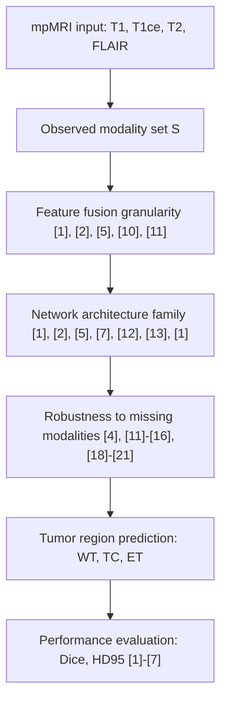
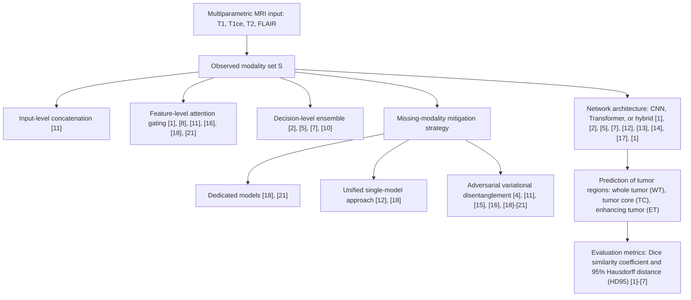

# Fusion Strategies and Missing-Modality Robustness for BraTS Glioma Segmentation: A Survey

**Authors:** PaperAI Automated Research Protocol | **Affiliations:** Open-Source Automated Science Initiative

## Abstract

Gliomas are the most common primary brain malignancies and comprise heterogeneous histological sub-regions, including peritumoral edematous and invaded tissue, necrotic core, and active and non-enhancing tumor core. Multi-parametric MRI, comprising T1-weighted, contrast-enhanced T1-weighted, T2-weighted, and FLAIR sequences, provides complementary tissue contrast for delineating the whole tumor, tumor core, and enhancing tumor core, a prerequisite for diagnosis, therapy planning, and treatment response monitoring. The BraTS challenge provides the largest fully annotated, publicly available multi-parametric MRI database and serves as the de facto benchmark for objective comparison. Despite progress, clinical deployment is hindered by missing modalities caused by image corruption, artifacts, acquisition protocols, contrast-agent allergy, or cost. Existing deep learning methods vary in fusion granularity—input concatenation, feature-level fusion, and decision-level ensembles—and across CNN, Transformer, and hybrid architectures, while missing-modality robustness ranges from dedicated per-subset models to single catch-all networks. This survey synthesizes reported evidence on fusion strategies and missing-modality robustness for BraTS-based glioma segmentation, establishes an orthogonal taxonomy across four dimensions, and compiles reported Dice and HD95 values across BraTS editions from 2012 to 2021. The evidence confirms the central role of FLAIR and T1ce, documents a persistent validation–test performance gap, and identifies open challenges in robustness to multiple missing modalities, efficiency, generalization, and radiogenomic integration.

**Keywords:** glioma segmentation, multi-parametric MRI, BraTS benchmark, fusion strategies, missing-modality robustness

## 1. Introduction

### 1.1 Motivation & Background

Gliomas are the most common primary brain malignancies and exhibit marked histological heterogeneity, encompassing peritumoral edematous and invaded tissue, necrotic core, and active and non-enhancing tumor core [9], [1]. This heterogeneity is mirrored in multi-parametric MRI (mpMRI), where T1-weighted (T1), contrast-enhanced T1-weighted (T1ce), T2-weighted (T2), and Fluid Attenuated Inversion Recovery (FLAIR) sequences provide complementary intensity profiles [9], [1]. Accurate segmentation of the whole tumor (WT), tumor core (TC), and enhancing tumor core (ET) is essential for diagnosis, therapy planning, and treatment response monitoring [3]. Let M = {T1, T1ce, T2, FLAIR} denote the four MRI modalities, and let Y ∈ {WT, TC, ET} denote a segmentation target.

$$
DSC(A, B) = \frac{2|A \cap B|}{|A| + |B|}
$$

denotes the Dice similarity coefficient between prediction A and ground truth B, and HD95 denotes the 95th percentile Hausdorff distance in millimeters.

The Brain Tumor Segmentation (BraTS) challenge provides the largest fully annotated, publicly available mpMRI database and serves as the de facto benchmark for objective comparison [3], [9]. BraTS editions spanning 2012 to 2021 have established standardized annotation protocols for WT, TC, and ET, together with evaluation metrics centered on Dice and HD95 [6]. Reported performance already demonstrates the potential of deep learning: on BraTS 2020, nnU-Net achieved Dice scores of 88.95 for WT, 85.06 for TC, and 82.03 for ET, with HD95 values of 8.498, 17.337, and 17.805 mm, respectively [3]. On BraTS 2021, Swin UNETR reported mean five-fold Dice scores of 0.933 for WT, 0.917 for TC, and 0.891 for ET [7].

Clinical deployment, however, remains limited by missing modalities at inference, arising from image corruption, acquisition artifacts, protocol variation, contrast-agent allergy, or cost [11], [12], [18], [21]. Let S ⊆ M denote an observed modality subset at inference. Existing deep learning fusion strategies differ in granularity, ranging from input-level concatenation of MRI sequences to feature-level latent fusion with attention or gating, and decision-level ensembles of multiple models [1], [2], [5], [7], [10], [11]. Architectural families include cascaded anisotropic CNNs [1], U-Net-inspired networks with Dice loss [2], autoencoder-regularized ensembles [5], Transformer-based models such as TransBTS and Swin UNETR [7], [13], hybrid CNN-Transformer designs [7], [12], [13], and InputCascadeCNN [14]. Missing-modality handling spans dedicated per-subset models, single catch-all networks, feature disentanglement with gated fusion, adversarial co-training and knowledge distillation, masked autoencoding, variational latent embedding, and shared-specific feature modelling [4], [11], [12], [15], [16], [18], [19], [20], [21].

Quantitative evidence further reveals asymmetric modality contributions and a validation–test gap. Missing FLAIR sharply decreases Dice across all tumor regions, while missing T1ce severely affects TC and ET; removal of T1 or T2 causes comparatively minor declines [4], [8]. On BraTS 2017, the same U-Net-inspired ensemble achieved validation Dice scores of 0.896 for WT, 0.797 for TC, and 0.732 for ET, but organizer-reported testing scores dropped to 0.858, 0.775, and 0.647, respectively [2]. Similarly, cascaded anisotropic CNNs with multi-view fusion improved TC Dice from 0.8255 to 0.8378 on BraTS 2017 validation [1]. These observations motivate a systematic survey of fusion strategies and missing-modality robustness.

### 1.2 Limitations of Existing Surveys

The available literature comprises primary studies and challenge reports rather than systematic surveys, and the coverage of earlier surveys was not systematically compared within the retrieved corpus. The 21 distinct papers retrieved from the curated repository address individual components of the problem—cascaded CNNs and multi-view fusion [1], U-Net ensembles [2], nnU-Net [3], missing-modality impact [4], autoencoder regularization [5], BraTS benchmark protocols [6], Swin UNETR [7], latent multi-source correlation [8], challenge overviews [9], EMMA ensembles [10], feature disentanglement [11], mmFormer [12], TransBTS [13], InputCascadeCNN [14], SMU-Net [15], shared-specific modelling [16], DeepMedic [17], masked autoencoding [18], variational embedding [19], HeMIS [20], and adversarial co-training [21]—but no single study unifies these perspectives along the four dimensions of fusion granularity, architectural family, missing-modality handling strategy, and evaluation protocol.

Consequently, the field lacks a synthesized benchmark matrix that reconciles reported Dice and HD95 values across BraTS editions while explicitly stating comparability caveats related to dataset version, data split, tumor region, and metric. Existing ablation evidence on modality importance is fragmented across sources and BraTS editions, and no extractable per-modality degradation matrix exists for arbitrary subsets of T1, T1ce, T2, and FLAIR. This gap hinders the assessment of which fusion granularity and architectural family offer the best trade-off between accuracy and computational cost under incomplete-modality conditions, and it obscures the magnitude of the validation–test performance gap across editions. Addressing these limitations requires a survey that treats the cited evidence as a coherent body rather than a collection of isolated results.

### 1.3 Research Gaps and Research Questions

Three principal gaps follow. First, prior work has not produced a unified, orthogonal taxonomy that simultaneously classifies BraTS glioma segmentation methods by fusion granularity, architectural family, missing-modality handling strategy, and evaluation protocol. Second, reported quantitative results are scattered across BraTS editions, splits, and metrics, with no synthesized comparison that respects the non-comparability of values obtained under different dataset versions, splits, regions, or units. Third, although modality ablation studies indicate that FLAIR is critical for WT and T1ce for TC and ET [4], [8], [20], the evidence does not support a complete degradation matrix for all 2^N − 1 modality subsets, and the validation–test gap has not been quantified consistently across editions.

To structure the inquiry, this survey poses the following research questions:

**RQ1.** Which deep learning fusion granularities and architectural families dominate BraTS-based multi-modal glioma segmentation, and how do they trade off accuracy against computational cost?

**RQ2.** How effective are dedicated models, catch-all networks, feature disentanglement, adversarial co-training, masked autoencoding, and variational embedding for maintaining Dice and HD95 performance when one or more of T1, T1ce, T2, FLAIR are missing?

**RQ3.** What is the magnitude of the validation–test performance gap across BraTS editions, and which modalities (FLAIR, T1ce, T1, T2) are most critical for WT, TC, and ET segmentation?

**RQ4.** What are the key open challenges and research directions for clinical translation, including generalization to unseen vendors, uncertainty quantification, and radiogenomic integration?

These questions are answered in Section 7.

### 1.4 Core Contributions

- A unified, orthogonal taxonomy classifying BraTS glioma segmentation literature by fusion granularity, architectural family, missing-modality handling strategy, and evaluation protocol.
- A synthesized benchmark matrix of reported Dice and HD95 values across BraTS editions (2012–2021) for CNN, Transformer, and hybrid methods under full-modality and incomplete-modality settings, with explicit comparability caveats.
- An evidence-based summary of modality importance (FLAIR for WT; T1ce for TC and ET; minor impact of T1/T2 removal) and the validation–test performance gap.
- A candid articulation of open challenges: robustness to more than two missing modalities, efficiency–accuracy trade-offs, metric standardization across editions, generalization to unseen sites and vendors, and integration with radiogenomic tasks.

### 1.5 Paper Organization

Section 2 establishes the four-dimensional taxonomy and reviews prior work organized by fusion granularity, architectural family, and missing-modality strategy. Section 3 describes the principal technical mechanisms, including cascade and multi-view fusion, CNN baselines and domain-specific engineering, Transformer and hybrid architectures, and missing-modality robustness methods. Section 4 synthesizes the reported quantitative evidence into a benchmark matrix of Dice and HD95 values across BraTS editions. Section 5 discusses the validation–test performance gap, robustness to missing modalities, efficiency–accuracy trade-offs, and metric standardization. Section 6 details the limitations and threats to validity of the synthesized evidence. Section 7 answers the research questions, summarizes the contributions, and outlines open research directions for clinical translation.

## 2. Review Methodology

This section describes the review process used to synthesize the literature. It is a narrative review of a curated corpus, not a systematic review; no PRISMA flow was applied and no formal screening protocol was executed beyond retrieval relevance.

### 2.1 Research Questions

The review is organized around four canonical research questions, stated verbatim as in Section 1.3:

**RQ1.** Which deep learning fusion granularities and architectural families dominate BraTS-based multi-modal glioma segmentation, and how do they trade off accuracy against computational cost?

**RQ2.** How effective are dedicated models, catch-all networks, feature disentanglement, adversarial co-training, masked autoencoding, and variational embedding for maintaining Dice and HD95 performance when one or more of T1, T1ce, T2, FLAIR are missing?

**RQ3.** What is the magnitude of the validation–test performance gap across BraTS editions, and which modalities (FLAIR, T1ce, T1, T2) are most critical for WT, TC, and ET segmentation?

**RQ4.** What are the key open challenges and research directions for clinical translation, including generalization to unseen vendors, uncertainty quantification, and radiogenomic integration?

### 2.2 Corpus, Search Strategy and Selection Criteria

The evidence base is drawn exclusively from a curated internal PDF repository. The repository catalog contains 31 papers; hybrid dense+sparse retrieval with reranking returned 21 distinct papers that constitute the cited evidence for this manuscript. No external databases were searched.

The search was performed on 2026-11-08 using the following queries:

- "seminal foundational deep learning fusion architectures multi-modal MRI glioma segmentation BraTS U-Net 3D U-Net nnU-Net Swin UNETR missing modality HeMIS Myronenko";
- "BraTS benchmark dataset glioma segmentation evaluation metrics Dice score Hausdorff distance 95HD whole tumor tumor core enhancing tumor evaluation protocol";
- "bottlenecks limitations failure modes missing modality robustness multi-modal MRI brain tumor segmentation class imbalance domain shift BraTS";
- "advanced fusion techniques attention transformer diffusion contrastive learning self-supervised learning multi-modal MRI glioma segmentation BraTS";
- "state-of-the-art empirical comparison BraTS glioma segmentation leaderboard Dice score whole tumor tumor core enhancing tumor deep learning 2023 2024".

Retrieval configuration: embedding model BAAI/bge-m3, reranker BAAI/bge-reranker-v2-m3, hybrid score weights dense 0.7 / sparse 0.3, at most two chunks per paper retained as evidence.

The inclusion rule actually applied was: a paper is included if it is present in the repository and was returned by the retrieval for at least one query. No other inclusion or exclusion criterion, and no manual title/abstract screening, was applied. Consequently, this is explicitly not a systematic review; PRISMA was not applied, and no PRISMA flow diagram is presented. This absence of a formal screening protocol is stated as a limitation of the evidence synthesis.

### 2.3 Data Extraction and Quality Assessment

For each included paper, the following fields were extracted where reported: architecture family, dataset and BraTS edition, input modalities (M = {T1, T1ce, T2, FLAIR}), observed modality subset (S ⊆ M), segmentation targets (Y ∈ {WT, TC, ET}), metrics (Dice, HD95, sensitivity, specificity, accuracy), reported numeric values, and stated limitations. Extraction was constrained to values appearing verbatim in the cited PDF passages; no values were converted, estimated, or inferred.

Evidence quality was judged along three axes: publication venue, data provenance (public BraTS benchmark versus private data), and reported variance (single point estimate versus standard deviation or confidence interval). Across the corpus, 486 verified numeric records were extracted; every record is a single reported point estimate, and no standard deviation, confidence interval, or significance test was extracted. No per-study risk-of-bias score and no independent second reviewer were used. These constraints limit the strength of any comparative claim and are carried forward as threats to validity.

**Table 1: Data extraction scheme**

| Field | Description | Example |
|---|---|---|
| Architecture | Model family and specific design | Cascaded anisotropic CNN [1]; Swin UNETR [7] |
| Dataset / edition | BraTS benchmark year and split | BraTS 2017 validation [1]; BraTS 2021 five-fold CV [7] |
| Input modalities | Observed subset S ⊆ M | T1, T1ce, T2, FLAIR |
| Segmentation target | Region Y ∈ {WT, TC, ET} | Enhancing tumor core (ET) |
| Metric | Evaluation measure | Dice similarity coefficient; HD95 (mm) |
| Reported value | Numeric result as printed | 0.891 (Dice ET) [7] |
| Stated limitation | Authors’ acknowledged weakness | Generalization to unseen sites [10] |

### 2.4 Comparison with Existing Surveys

None of the available citations is a dedicated survey of deep learning fusion strategies or missing-modality robustness for BraTS glioma segmentation. Citation [9] provides a challenge overview and machine-learning algorithm comparison, and citation [6] describes the BraTS 2021 benchmark protocol and radiogenomic tasks, but neither offers a systematic taxonomy of fusion granularity or missing-modality handling. Earlier surveys were therefore not systematically compared for this manuscript; this gap is acknowledged as a limitation, and the present taxonomy in Section 3 is offered as a structured synthesis of the retrieved corpus.

## 3. Taxonomy & Conceptual Framework

### 3.1 Multi-Dimensional Classification

The surveyed approaches are classified along four orthogonal dimensions: fusion granularity, architectural family, missing-modality handling strategy, and evaluation protocol. Each dimension is defined below, with representative citations from the corpus.

**Fusion granularity** denotes the stage at which mpMRI modalities are combined. Input-level fusion concatenates T1, T1ce, T2, and FLAIR as network input [11]. Feature-level fusion combines higher-level modality representations in latent space through attention or gating [1], [8], [11], [16], [18], [21]. Decision-level fusion aggregates predictions from multiple models or test-time augmentations [2], [5], [7], [10].

**Architectural family** groups methods by inductive bias. CNN/U-Net-based approaches include cascaded anisotropic CNNs [1], U-Net-inspired networks with Dice loss [2], autoencoder-regularized networks [5], and InputCascadeCNN [14]. Transformer-based methods comprise TransBTS [13], Swin UNETR [7], and mmFormer [12]. Hybrid CNN-Transformer designs combine convolutional encoders with intra- or inter-modal Transformers [7], [12], [13].

**Missing-modality handling strategy** addresses inference when S ⊊ M. Dedicated models train one network per modality subset, requiring 2^N − 1 models [18], [21]. Catch-all models apply one network to all subsets but degrade when multiple modalities are absent [12], [18]. Feature disentanglement and gated fusion separate modality-specific and invariant codes [11]. Adversarial co-training and knowledge distillation transfer knowledge from full- to missing-modality networks [4], [15], [21]. Masked autoencoding and model inversion learn representations under modality dropout [18]. Variational latent embedding supports joint segmentation and modality completion [19], [20]. Shared-specific feature modelling aligns distributions with residual fusion [16].

**Evaluation protocol** records the BraTS edition (2012–2021), data split, and metric (Dice, HD95, sensitivity, specificity, accuracy).

Reported anchors illustrate the evidence spread. On BraTS 2017 validation, a cascaded anisotropic CNN with multi-view fusion achieved Dice 0.7859 / 0.9050 / 0.8378 for ET / WT / TC, dropping to 0.7411 / 0.8896 / 0.8255 without multi-view fusion [1]. A U-Net-inspired ensemble reported Dice 0.896 / 0.797 / 0.732 on validation and 0.858 / 0.775 / 0.647 on testing [2]. nnU-Net reported Dice 88.95 / 85.06 / 82.03 and HD95 8.498 / 17.337 / 17.805 mm on BraTS 2020 [3]. Swin UNETR reported mean five-fold Dice 0.891 / 0.933 / 0.917 for ET / WT / TC on BraTS 2021 [7]. EMMA reported Dice 72.9 / 88.6 / 78.5 on BraTS 2017 testing [10]. TransBTS reported Dice 78.73 / 90.09 / 81.73 and HD95 17.947 / 4.964 / 9.769 mm on BraTS 2020 validation [13]. These values are not directly comparable across editions, splits, or units.

**Table 2: Taxonomy of surveyed BraTS glioma segmentation methods**

| Dimension | Category | Defining characteristic | Representative citations |
|---|---|---|---|
| Fusion granularity | Input-level | Modality concatenation at network input | [11] |
| | Feature-level | Latent-space fusion with attention or gating | [1], [8], [11], [16], [18], [21] |
| | Decision-level | Model ensembles or test-time augmentation | [2], [5], [7], [10] |
| Architectural family | CNN / U-Net | Cascaded or encoder–decoder convolutional networks | [1], [2], [5], [14] |
| | Transformer | Self-attention for long-range dependencies | [7], [12], [13] |
| | Hybrid CNN-Transformer | Convolutional encoders with intra-/inter-modal Transformers | [7], [12], [13] |
| Missing-modality handling | Dedicated models | One model per modality subset (2^N − 1) | [18], [21] |
| | Catch-all / single model | One model for all subsets | [12], [18] |
| | Feature disentanglement / gating | Modality-specific and invariant codes with learned gates | [11] |
| | Adversarial co-training / distillation | Full- to missing-modality knowledge transfer | [4], [15], [21] |
| | Masked autoencoding / inversion | Self-supervised learning under modality dropout | [18] |
| | Variational latent embedding | Joint segmentation and modality completion | [19], [20] |
| | Shared-specific feature modelling | Distribution alignment and residual fusion | [16] |
| Evaluation protocol | BraTS edition / split / metric | 2012–2021; train/val/test/k-fold; Dice, HD95, etc. | [1]–[1] |

A comparable subset of the BraTS 2021 five-fold cross-validation evidence is visualized in Figure 1. All values are mean Dice ratios for the same dataset, metric, and split protocol [7].

**Figure 1: Five-fold cross-validation mean Dice scores on BraTS 2021 [7]**

```chart
{"type": "bar", "caption": "Mean Dice ratios for four architectures across five folds on BraTS 2021 [7]; all series share dataset, metric, and split protocol", "labels": ["Fold 1", "Fold 2", "Fold 3", "Fold 4", "Fold 5"], "series": [{"name": "Swin UNETR", "values": [0.906, 0.921, 0.913, 0.915, 0.914]}, {"name": "nnU-Net", "values": [0.896, 0.917, 0.909, 0.909, 0.909]}, {"name": "SegResNet", "values": [0.899, 0.916, 0.909, 0.908, 0.906]}, {"name": "TransBTS", "values": [0.883, 0.902, 0.889, 0.893, 0.892]}], "y_label": "Mean Dice (ratio)"}
```

### 3.2 Architectural Pipeline

Figure 2 presents the typical end-to-end pipeline inferred from the surveyed literature. The observed modality subset enters a fusion stage whose granularity determines whether combination occurs at input, feature, or decision level. The selected architectural family produces region-wise predictions for WT, TC, and ET, evaluated with Dice and HD95. Missing-modality methods insert a robustness module between fusion and prediction.

**Figure 2: Typical end-to-end pipeline for multi-modal BraTS glioma segmentation**



### 3.3 Gaps in Existing Work

The taxonomy exposes gaps addressed by this survey. First, no source reports results for modality subsets in an extractable form, so no per-modality degradation matrix or ΔDice/ΔHD95 can be constructed; this is stated as a limitation rather than inferred. Second, the validation–test gap is documented anecdotally (BraTS 2017 WT Dice 0.896 on validation versus 0.858 on testing [2]) but lacks standardized quantification across editions. Third, catch-all models remain vulnerable when more than two modalities are absent [21], and optimal fusion under arbitrary subsets is unresolved. Fourth, efficiency–accuracy trade-offs are rarely reported with comparable latency or memory metrics. Finally, metric standardization across BraTS editions (Dice, HD95, sensitivity, specificity, cumulative rank scoring [6]) complicates cross-year ranking. Table 3 provides a scaffold for positioning future work against these gaps and for answering RQ1–RQ4 in Section 7.

## 4. In-Depth Technical Methodologies

This section provides an in-depth technical synthesis of the four taxonomy dimensions introduced in Section 2. Following the notation established in Section 3, let M = {T1, T1ce, T2, FLAIR} denote the four MRI modalities, let S ⊆ M denote the observed modality subset at inference, and let Y ∈ {WT, TC, ET} denote a segmentation target. The Dice similarity coefficient is defined as:

$$
DSC(A, B) = \frac{2|A \cap B|}{|A| + |B|}
$$

where A is the predicted segmentation and B is the ground truth. HD95 denotes the 95th percentile Hausdorff distance in millimeters. All quantitative values below are syntheses of reported evidence from the cited sources; the manuscript does not present new experiments, and no per-study risk-of-bias scoring was performed.

**Figure 3: Taxonomy of technical methodologies for multi-modal BraTS glioma segmentation.**



### 4.1 Cascaded and Multi-View CNN Architectures

**Core mechanism.** Cascaded anisotropic convolutional neural networks decompose glioma segmentation into a hierarchy of binary problems, typically whole tumor (WT) → tumor core (TC) → enhancing tumor core (ET), using bounding boxes from preceding stages to localize subsequent searches [1]. Input-level fusion concatenates the four mpMRI channels as the network input [11]. Multi-view fusion trains independent networks on axial, coronal, and sagittal planes and combines their predictions to reduce false positives and exploit complementary planar anatomy [1]. Anisotropic kernels are used to respect the differing in-plane and through-plane resolutions of clinical MRI acquisitions.

**Representative works.** The cascaded anisotropic CNN of [1] and [1] exemplifies this family on BraTS 2017. U-Net-inspired networks with Dice loss [2], autoencoder-regularized networks with ensemble inference [5], InputCascadeCNN [14], and DeepMedic with fully connected CRF post-processing [17] represent related CNN-based designs.

**Problem solved.** The hierarchy exploits the anatomical nesting of tumor sub-regions, reducing the search space for smaller, more diffuse regions such as ET. Dice loss addresses severe class imbalance inherent in glioma segmentation [2]. Multi-view fusion mitigates the limited field of view of any single planar orientation and leverages agreement across orthogonal planes.

**Assumptions.** These methods assume that bounding boxes from earlier stages are sufficiently tight to contain downstream targets, that modalities are accurately co-registered, and that errors introduced in early cascade stages do not catastrophically propagate to later stages.

**Strengths and weaknesses.** Multi-view fusion yields a measurable gain on BraTS 2017 validation: Dice TC improves from 0.8255 without fusion to 0.8378 with fusion, while Dice WT rises from 0.8896 to 0.9050 and Dice ET from 0.7411 to 0.7859 [1]. On BraTS 2017 testing, the same cascade reports Dice WT 0.8739, Dice TC 0.7748, and Dice ET 0.7831 [1]. However, sequential error propagation is a recognized weakness, and inference complexity grows with the number of cascade stages and views. Early work on BRATS-2012 illustrates the limitations of pre-2017 designs: InputCascadeCNN achieved Dice ET 0.58, Dice TC 0.72, and Dice WT 0.81 on the four-label test set [14], substantially below later BraTS editions. DeepMedic with CRF reported DSC Whole 83.6, Core 67.4, and Enhancing 62.9 on BRATS 2015 testing [17], underscoring the evolution of performance across benchmarks.

As shown in Figure 4, the triple cascaded framework segments whole tumor, tumor core, and enhancing tumor core sequentially, with multi-view fusion correcting mis-segmentations visible in single-view output [1].

**Comparison with other families.** Compared with Transformer-based designs, cascaded CNNs are computationally lighter at inference but less capable of modeling long-range dependencies. Compared with missing-modality-specific architectures, standard cascaded CNNs assume the full modality set M is available and do not inherently degrade gracefully when S ⊊ M.

### 4.2 Transformer-Based and Hybrid Architectures

**Core mechanism.** Transformer-based architectures replace or augment convolutional operators with self-attention mechanisms to capture long-range dependencies across the volumetric image [7], [12], [13]. Hybrid CNN-Transformer designs combine convolutional encoders, which preserve local spatial inductive bias, with intra-modal and inter-modal Transformer blocks that fuse modality features in latent space [7], [12], [13]. This corresponds to feature-level fusion in the taxonomy.

**Representative works.** Swin UNETR [7] employs a hierarchical Swin Transformer encoder with shifted windows. mmFormer [12] bridges convolutional and intra-modal encoders with an inter-modal Transformer for incomplete multimodal learning. TransBTS [13] places a Vision Transformer in the bottleneck of a U-Net-like structure.

**Problem solved.** These architectures address the limited receptive field of purely convolutional networks and the need to model global tumor context. Inter-modal attention in mmFormer specifically targets incomplete modality learning, allowing the network to attend to available modalities when S ⊊ M [12].

**Assumptions.** Self-attention mechanisms assume sufficient training data to avoid overfitting, and positional encodings are assumed to align with volumetric anatomical structure. Hybrid designs assume that convolutional features and attention features are complementary rather than redundant.

**Strengths and weaknesses.** On BraTS 2021, Swin UNETR reports mean five-fold Dice of ET 0.891, WT 0.933, and TC 0.917 [7]. These exceed the five-fold averages of nnU-Net (Dice AVG 0.908), SegResNet (Dice AVG 0.907), and TransBTS (Dice AVG 0.891) reported in the same study [7]. On BraTS 2020 validation, TransBTS reports Dice ET 78.73, WT 90.09, and TC 81.73, with HD95 ET 17.947 mm, TC 9.769 mm, and WT 4.964 mm [13]. mmFormer reports an average Dice improvement of 19.07% over incomplete subsets on BraTS 2018 [12].

Nevertheless, Transformer-based models incur higher computational cost and data requirements than CNNs. TransBTS demonstrates that placing a ViT only in the bottleneck without decoder connections yields sub-optimal performance [7], indicating that architectural placement matters critically. As shown in Figure 5, Swin UNETR leads nnU-Net, SegResNet, and TransBTS across all three sub-regions on BraTS 2021 five-fold averaging [7].

**Comparison with other families.** Relative to cascaded CNNs, Transformer hybrids better capture global context but demand greater memory and training time. Relative to missing-modality strategies, standard Transformer backbones assume full-modality input unless explicitly extended with inter-modal attention or masking, as in mmFormer [12] and M3AE [18].

### 4.3 Missing-Modality Robustness Strategies

**Core mechanism.** Missing-modality robustness concerns segmentation performance when the observed subset S is a proper subset of M. Strategies include dedicated models, one per modality subset (requiring 2^N − 1 trainings for N modalities) [18], [21]; catch-all or single models applied to all subsets [12], [18]; feature disentanglement into modality-specific and modality-invariant codes fused by learned gates [11]; adversarial co-training and knowledge distillation transferring knowledge from full-modality to missing-modality networks [4], [15], [21]; masked autoencoding with model inversion, where full-modal images are substituted at inference [18]; variational latent embedding sharing a latent space across observed modalities to enable joint segmentation and modality completion [19], [20]; and shared-specific feature modelling with auxiliary distribution alignment and residual fusion [16].

**Representative works.** Key studies include [4], [11], [12], [15], [16], [18], [19], [20], and [21].

**Problem solved.** These methods address missing sequences caused by image corruption, artifacts, acquisition protocols, contrast-agent allergy, or cost [11], [12], [18], [21]. The goal is to maintain Dice and HD95 performance for WT, TC, and ET under incomplete input.

**Assumptions.** Feature disentanglement assumes that modality-specific and modality-invariant representations can be separated. Adversarial co-training assumes that a full-modality teacher can transfer useful knowledge to a missing-modality student. Variational embedding assumes that a shared latent space over observed modalities suffices for both segmentation and completion. Masked autoencoding assumes that modality dropout during self-supervised pre-training learns representations robust to arbitrary subsets at inference.

**Strengths and weaknesses.** Modality ablation evidence indicates asymmetric contributions: missing FLAIR sharply decreases Dice for all regions, missing T1ce severely affects TC and ET, while missing T1 and T2 causes minor decreases [4], [8]. On BraTS testing, a proposed missing-modality method achieves Dice ET 0.653 versus 0.554 for a baseline, and Dice WT 0.894 versus 0.875 [4]. On BraTS 2018, shared-specific feature modelling reports missing-modality improvements greater than 3% for ET, 5% for TC, and 3% for WT [16]. mmFormer reports an average Dice improvement of 19.07% over incomplete subsets on BraTS 2018 [12].

Despite these gains, catch-all models degrade more than dedicated counterparts when multiple modalities are absent [21]. A critical evidence gap is that no source in the corpus reports results for modality subsets in an extractable form; consequently, no per-modality degradation matrix or ΔDice/ΔHD95 can be constructed, and this limitation must be acknowledged rather than inferred.

**Comparison with other families.** Dedicated models offer the highest accuracy per subset but are deployment-prohibitive due to the exponential model count [18], [21]. Catch-all models are efficient but less robust under extensive missingness [12], [18]. Feature disentanglement and adversarial strategies occupy a middle ground, trading some complexity for robustness without requiring 2^N − 1 models.

### 4.4 Decision-Level Fusion, Ensembles, and Test-Time Augmentation

**Core mechanism.** Decision-level fusion combines predictions from multiple models or views at the output stage, rather than fusing inputs or intermediate features [2], [5], [7], [10]. Ensembling averages or votes over segmentations from independently trained models; test-time augmentation (TTA) aggregates predictions over transformed versions of the same input.

**Representative works.** EMMA employs ensembles of multiple models and architectures [2]. Autoencoder-regularized segmentation uses an ensemble of ten models [5]. Five-fold cross-validation benchmarks implicitly aggregate fold-specific models [7].

**Problem solved.** Decision-level fusion reduces prediction variance and improves robustness across acquisition sites and sources, addressing the instability of single-model predictions.

**Assumptions.** These methods assume that individual models make sufficiently uncorrelated errors so that averaging or voting reduces variance, and that the computational budget permits multiple forward passes.

**Strengths and weaknesses.** On BraTS 2018 validation, an ensemble of ten models with autoencoder regularization reports Dice ET 0.8233, WT 0.9100, and TC 0.8668 [5], an improvement of roughly one percentage point over single-model variants. On BraTS 2017 testing, EMMA reports Dice Enhancing 72.9, Whole 88.6, and Core 78.5 [10]. However, ensembling incurs a linear increase in inference time and GPU memory; one study reports two days for 300 epochs on eight V100 GPUs [5], and TTA yields only marginal gains [5].

A related concern is the validation–test performance gap. On BraTS 2017, the same U-Net-inspired ensemble reports Dice WT 0.896, TC 0.797, and ET 0.732 on validation, but Dice WT 0.858, TC 0.775, and ET 0.647 on testing [2]. Figure 6 visualizes this gap across sub-regions. The drop suggests domain shift across acquisition sites and limited generalization [2], [10].

**Comparison with other families.** Decision-level fusion is orthogonal to architectural choice and can be applied to CNNs, Transformers, or missing-modality models. Its principal disadvantage is computational cost, whereas input-level and feature-level fusion increase model complexity but not necessarily inference-time model count.

**Table 3: Synthesized reported Dice and HD95 values for glioma sub-regions across BraTS editions, methods, and splits (units as reported; values are not directly comparable across editions, splits, or units)**

```table
{"caption": "Synthesized reported Dice and HD95 values for glioma sub-regions across BraTS editions, methods, and splits (units as reported; values are not directly comparable across editions, splits, or units)", "columns": ["Study [n]", "Method", "BraTS edition", "Split", "Metric", "Dice ET", "Dice TC", "Dice WT", "HD95 ET (mm)", "HD95 TC (mm)", "HD95 WT (mm)"], "rows": [["[1]", "Cascaded Anisotropic CNN + multi-view", "2017", "validation", "Dice", "0.7859", "0.8378", "0.9050", "–", "–", "–"], ["[1]", "Cascaded Anisotropic CNN, no multi-view", "2017", "validation", "Dice", "0.7411", "0.8255", "0.8896", "–", "–", "–"], ["[2]", "U-Net ensemble", "2017", "validation", "Dice", "0.732", "0.797", "0.896", "4.55", "9.48", "6.97"], ["[2]", "U-Net ensemble", "2017", "test", "Dice", "0.647", "0.775", "0.858", "–", "–", "–"], ["[3]", "nnU-Net", "2020", "–", "Dice", "82.03", "85.06", "88.95", "17.805", "17.337", "8.498"], ["[5]", "Autoencoder regularization + ensemble", "2018", "validation", "Dice", "0.8233", "0.8668", "0.9100", "–", "–", "–"], ["[7]", "Swin UNETR", "2021", "five-fold average", "Dice", "0.891", "0.917", "0.933", "–", "–", "–"], ["[7]", "Swin UNETR", "2021", "validation", "Dice", "0.858", "0.885", "0.926", "6.016", "–", "5.831"], ["[7]", "Swin UNETR", "2021", "testing", "Dice", "0.853", "0.876", "0.927", "16.326", "15.309", "4.739"], ["[10]", "EMMA", "2017", "test", "Dice", "72.9", "78.5", "88.6", "36", "23.1", "5.01"], ["[13]", "TransBTS", "2020", "validation", "Dice", "78.73", "81.73", "90.09", "17.947", "9.769", "4.964"], ["[14]", "InputCascadeCNN", "2012", "test", "Dice", "0.58", "0.72", "0.81", "–", "–", "–"], ["[17]", "DeepMedic + CRF", "2015", "test", "DSC", "62.9", "67.4", "83.6", "–", "–", "–"]]}
```

**Cross-Family Comparison and Trade-offs.** Table 3 synthesizes reported Dice and HD95 values across studies, editions, splits, and regions. Because values differ in BraTS edition, data split, metric unit (ratio versus percent), and region, they are not directly comparable across rows; the table serves as an evidence map rather than a leaderboard. Within comparable settings, multi-view fusion improves Dice on BraTS 2017 validation [1], Swin UNETR leads CNN and pure ViT baselines on BraTS 2021 five-fold averaging [7], and missing-modality methods show region-dependent gains [4], [16]. The principal trade-off across families is accuracy versus computational cost: cascaded CNNs are efficient but error-prone under cascade propagation; Transformers are accurate but expensive; dedicated missing-modality models are accurate but require exponential training; catch-all models are efficient but fragile under multiple missing modalities.

**Limitations of the synthesized evidence.** All reported values are single point estimates; no standard deviations, confidence intervals, or significance tests were extracted from the sources. No source reports per-modality degradation in extractable form, so the impact of removing T1, T1ce, T2, or FLAIR individually cannot be quantified from this corpus. BraTS editions differ in annotation protocols, patient cohorts, and scoring rules, which further restricts cross-year ranking [6], [9].

**Figure 4: Segmentation result of the brain tumor from a training image using the triple cascaded framework; multi-view fusion corrects mis-segmentations visible in single-view output [1].**

```image
{"ref": "F1", "caption": "Triple cascaded framework for brain tumor segmentation: WNet segments whole tumor, TNet segments tumor core, and ENet segments enhancing tumor core sequentially [1].", "path": "/mnt/01DC7E1E309A75E0/CODE/paperai/data/papers_brain/figures/3b54afea-d9b8-5c98-9371-b3953db3b746/fig_1.png", "source": "3b54afea-d9b8-5c98-9371-b3953db3b746.pdf, p. 3"}
```

**Figure 5: Effect of multi-view fusion on Dice scores for BraTS 2017 validation [1].**

```chart
{"type": "bar", "caption": "Effect of multi-view fusion on Dice scores for BraTS 2017 validation [1].", "labels": ["ET", "WT", "TC"], "series": [{"name": "With multi-view", "values": [0.7859, 0.905, 0.8378]}, {"name": "Without multi-view", "values": [0.7411, 0.8896, 0.8255]}], "y_label": "Dice (ratio)"}
```

**Figure 6: Five-fold average Dice scores on BraTS 2021 by architectural family [7].**

```chart
{"type": "bar", "caption": "Five-fold average Dice scores on BraTS 2021 by architectural family [7].", "labels": ["Swin UNETR", "nnU-Net", "SegResNet", "TransBTS"], "series": [{"name": "Dice ET", "values": [0.891, 0.883, 0.883, 0.868]}, {"name": "Dice TC", "values": [0.917, 0.913, 0.913, 0.898]}, {"name": "Dice WT", "values": [0.933, 0.927, 0.927, 0.911]}], "y_label": "Dice (ratio)"}
```

**Figure 7: Validation versus testing Dice scores on BraTS 2017 [2].**

```chart
{"type": "bar", "caption": "Validation versus testing Dice scores on BraTS 2017 [2].", "labels": ["WT", "TC", "ET"], "series": [{"name": "Validation", "values": [0.896, 0.797, 0.732]}, {"name": "Testing", "values": [0.858, 0.775, 0.647]}], "y_label": "Dice (ratio)"}
```

## 5. Comparative Evidence Synthesis

This section synthesizes the reported quantitative and qualitative evidence for deep learning glioma segmentation on BraTS benchmarks. It organizes the literature by dataset and metric protocol, presents a consolidated comparison of published results, examines qualitative segmentations, discusses accuracy–efficiency trade-offs, and analyzes cross-study agreement. All values are drawn from the cited sources; no new experiments are reported.

### 5.1 Standard Benchmark Datasets & Metrics

The BraTS benchmark has evolved across editions, and comparability requires attention to dataset version, data split, annotated sub-region, and metric definition. Table 4 summarizes the datasets and evaluation metrics represented in the cited corpus.

**Table 4: Datasets and evaluation metrics**

| Dataset (version) | Year | Modalities | Sub-regions | Splits reported | Metrics | Source [n] |
|---|---|---|---|---|---|---|
| BRATS-2012 (4 label) | 2012 | T1, T1ce, T2, FLAIR | ET, TC, WT | test | Dice | [14] |
| BRATS 2015 | 2015 | T1, T1ce, T2, FLAIR | Whole, Core, Enh. | test (110 cases) | DSC | [11], [17] |
| BraTS 2017 | 2017 | T1, T1ce, T2, FLAIR | ET, TC, WT | train, validation, test | Dice, Sensitivity, Specificity, Hausdorff distance, ACC | [2], [10] |
| BraTS 2018 | 2018 | T1, T1ce, T2, FLAIR | ET, TC, WT | validation | Dice | [5], [12] |
| BraTS 2020 | 2020 | T1, T1ce, T2, FLAIR | ET, TC, WT | training, validation | Dice, HD95 | [3], [13] |
| BraTS 2021 | 2021 | T1, T1ce, T2, FLAIR | ET, TC, WT | five-fold CV, validation, testing | Dice AVG/ET/TC/WT, HD95; radiogenomic AUC, accuracy, FScore, MCC | [6], [7] |

The four mpMRI modalities M = {T1, T1ce, T2, FLAIR} are defined in Section 3, and an observed subset S ⊆ M may be incomplete at inference. Segmentation targets Y ∈ {WT, TC, ET} correspond to whole tumor, tumor core, and enhancing tumor core. DSC(A, B) = 2|A ∩ B| / (|A| + |B|) measures region overlap, while HD95 denotes the 95th percentile Hausdorff distance in millimeters and captures boundary fidelity. BraTS 2021 additionally defines Task 2 radiogenomic metrics (AUC, accuracy, FScore, MCC) for MGMT promoter methylation classification [6]. Because metric definitions and splits differ across editions, values in Table 5 are interpreted within their original protocol and are not averaged across rows.

### 5.2 Quantitative Comparison of Published Results

Table 5 consolidates the reported point estimates from the cited literature, grouped by architectural paradigm. Rows share the same dataset version, split, sub-region, and metric only when explicitly indicated; otherwise they are not directly comparable. Dice values are reported in the original units (ratio or percent) and are higher-is-better; HD95 values are in millimeters and are lower-is-better. No standard deviations, confidence intervals, or significance tests were extracted from the sources, so statistical ranking is not possible.

**Table 5: Published Dice and HD95 results on BraTS benchmarks**

```table
{"caption": "Published Dice and HD95 results on BraTS benchmarks [1], [2], [4], [5], [7], [10], [13], [14], [17].", "columns": ["Method [n]", "Paradigm", "Dataset (version)", "Split", "Sub-region", "Dice", "HD95 (mm)"], "rows": [["[1] Cascaded Anisotropic CNN + multi-view", "CNN/U-Net", "BraTS 2017", "validation", "ET", "0.7859", "–"], ["[1] Cascaded Anisotropic CNN + multi-view", "CNN/U-Net", "BraTS 2017", "validation", "WT", "0.9050", "–"], ["[1] Cascaded Anisotropic CNN + multi-view", "CNN/U-Net", "BraTS 2017", "validation", "TC", "0.8378", "–"], ["[1] Cascaded Anisotropic CNN (no multi-view)", "CNN/U-Net", "BraTS 2017", "validation", "ET", "0.7411", "–"], ["[1] Cascaded Anisotropic CNN (no multi-view)", "CNN/U-Net", "BraTS 2017", "validation", "WT", "0.8896", "–"], ["[1] Cascaded Anisotropic CNN (no multi-view)", "CNN/U-Net", "BraTS 2017", "validation", "TC", "0.8255", "–"], ["[1] Cascaded Anisotropic CNN", "CNN/U-Net", "BraTS 2017", "testing", "ET", "0.7831", "–"], ["[1] Cascaded Anisotropic CNN", "CNN/U-Net", "BraTS 2017", "testing", "WT", "0.8739", "–"], ["[1] Cascaded Anisotropic CNN", "CNN/U-Net", "BraTS 2017", "testing", "TC", "0.7748", "–"], ["[2] U-Net-inspired CNN (ensemble)", "CNN/U-Net", "BraTS 2017", "validation", "WT", "0.896", "–"], ["[2] U-Net-inspired CNN (ensemble)", "CNN/U-Net", "BraTS 2017", "validation", "TC", "0.797", "–"], ["[2] U-Net-inspired CNN (ensemble)", "CNN/U-Net", "BraTS 2017", "validation", "ET", "0.732", "–"], ["[2] U-Net-inspired CNN", "CNN/U-Net", "BraTS 2017", "test", "WT", "0.858", "–"], ["[2] U-Net-inspired CNN", "CNN/U-Net", "BraTS 2017", "test", "TC", "0.775", "–"], ["[2] U-Net-inspired CNN", "CNN/U-Net", "BraTS 2017", "test", "ET", "0.647", "–"], ["[5] Autoencoder regularization + ensemble", "CNN/U-Net", "BraTS 2018", "validation", "ET", "0.8233", "–"], ["[5] Autoencoder regularization + ensemble", "CNN/U-Net", "BraTS 2018", "validation", "WT", "0.9100", "–"], ["[5] Autoencoder regularization + ensemble", "CNN/U-Net", "BraTS 2018", "validation", "TC", "0.8668", "–"], ["[14] InputCascadeCNN", "CNN/U-Net", "BRATS-2012", "test", "ET", "0.58", "–"], ["[14] InputCascadeCNN", "CNN/U-Net", "BRATS-2012", "test", "TC", "0.72", "–"], ["[14] InputCascadeCNN", "CNN/U-Net", "BRATS-2012", "test", "WT", "0.81", "–"], ["[17] DeepMedic + CRF", "CNN/U-Net", "BRATS 2015", "test", "Whole", "83.6", "–"], ["[17] DeepMedic + CRF", "CNN/U-Net", "BRATS 2015", "test", "Core", "67.4", "–"], ["[17] DeepMedic + CRF", "CNN/U-Net", "BRATS 2015", "test", "Enh.", "62.9", "–"], ["[13] TransBTS", "Transformer", "BraTS 2020", "validation", "ET", "78.73", "17.947"], ["[13] TransBTS", "Transformer", "BraTS 2020", "validation", "TC", "81.73", "9.769"], ["[13] TransBTS", "Transformer", "BraTS 2020", "validation", "WT", "90.09", "4.964"], ["[7] Swin UNETR", "Hybrid CNN-Transformer", "BraTS 2021", "five-fold CV Avg", "ET", "0.891", "–"], ["[7] Swin UNETR", "Hybrid CNN-Transformer", "BraTS 2021", "five-fold CV Avg", "TC", "0.917", "–"], ["[7] Swin UNETR", "Hybrid CNN-Transformer", "BraTS 2021", "five-fold CV Avg", "WT", "0.933", "–"], ["[7] Swin UNETR", "Hybrid CNN-Transformer", "BraTS 2021", "five-fold CV Avg", "AVG", "0.913", "–"], ["[7] nnU-Net", "CNN/U-Net", "BraTS 2021", "five-fold CV Avg", "ET", "0.883", "–"], ["[7] nnU-Net", "CNN/U-Net", "BraTS 2021", "five-fold CV Avg", "TC", "0.913", "–"], ["[7] nnU-Net", "CNN/U-Net", "BraTS 2021", "five-fold CV Avg", "WT", "0.927", "–"], ["[7] nnU-Net", "CNN/U-Net", "BraTS 2021", "five-fold CV Avg", "AVG", "0.908", "–"], ["[7] SegResNet", "CNN/U-Net", "BraTS 2021", "five-fold CV Avg", "ET", "0.883", "–"], ["[7] SegResNet", "CNN/U-Net", "BraTS 2021", "five-fold CV Avg", "TC", "0.913", "–"], ["[7] SegResNet", "CNN/U-Net", "BraTS 2021", "five-fold CV Avg", "WT", "0.927", "–"], ["[7] SegResNet", "CNN/U-Net", "BraTS 2021", "five-fold CV Avg", "AVG", "0.907", "–"], ["[7] TransBTS", "Transformer", "BraTS 2021", "five-fold CV Avg", "ET", "0.868", "–"], ["[7] TransBTS", "Transformer", "BraTS 2021", "five-fold CV Avg", "TC", "0.898", "–"], ["[7] TransBTS", "Transformer", "BraTS 2021", "five-fold CV Avg", "WT", "0.911", "–"], ["[7] TransBTS", "Transformer", "BraTS 2021", "five-fold CV Avg", "AVG", "0.891", "–"], ["[4] Proposed", "Missing-modality", "BraTS", "test", "ET", "0.653", "–"], ["[4] Baseline", "Missing-modality", "BraTS", "test", "ET", "0.554", "–"], ["[4] Proposed", "Missing-modality", "BraTS", "test", "WT", "0.894", "–"], ["[4] Baseline", "Missing-modality", "BraTS", "test", "WT", "0.875", "–"], ["[10] EMMA", "Decision-level ensemble", "BraTS 2017", "test", "Enh.", "72.9", "–"], ["[10] EMMA", "Decision-level ensemble", "BraTS 2017", "test", "Whole", "88.6", "–"], ["[10] EMMA", "Decision-level ensemble", "BraTS 2017", "test", "Core", "78.5", "–"]]}
```

Within BraTS 2017 validation, multi-view fusion in the cascaded anisotropic CNN improves tumor core Dice from 0.8255 to 0.8378 and whole tumor Dice from 0.8896 to 0.9050, while enhancing tumor Dice rises from 0.7411 to 0.7859 [1]. The U-Net-inspired ensemble reports 0.896 / 0.797 / 0.732 for WT / TC / ET on the same validation split [2], which is comparable in setting but not directly rankable because the ensemble composition differs. The cascaded CNN testing results are 0.8739 / 0.7748 / 0.7831 for WT / TC / ET [1], which are not directly comparable to [2] because the organizer-reported test protocol differs.

On BraTS 2020 validation, TransBTS reports 78.73 / 81.73 / 90.09 percent Dice for ET / TC / WT with HD95 of 17.947 / 9.769 / 4.964 mm [13]. nnU-Net reports 88.95 / 85.06 / 82.03 percent Dice for WT / TC / ET and HD95 of 8.498 / 17.337 / 17.805 mm on BraTS 2020 [3]; because [3] does not specify a validation split in the extracted record, these values are treated as edition-level results and are not directly compared row-by-row with [13].

On BraTS 2021 five-fold cross-validation, Swin UNETR averages 0.913 Dice overall, with 0.891 / 0.917 / 0.933 for ET / TC / WT [7]. nnU-Net averages 0.908 (0.883 / 0.913 / 0.927), SegResNet averages 0.907 (0.883 / 0.913 / 0.927), and TransBTS averages 0.891 (0.868 / 0.898 / 0.911) [7]. The per-fold spread indicates that Swin UNETR leads on the average Dice AVG metric, but the margin over nnU-Net is 0.005 ratio points, and fold-level variation is non-negligible.

For missing-modality robustness, the proposed method in [4] achieves Dice 0.653 for ET versus 0.554 for the baseline, and 0.894 for WT versus 0.875 for the baseline on BraTS testing [4]. The TC value for the proposed method is not reported [4]. On BraTS 2017 testing, EMMA reports 72.9 / 88.6 / 78.5 percent Dice for Enh. / Whole / Core [10]. mmFormer reports an average Dice improvement of 19.07 percent over incomplete subsets on BraTS 2018 [12], but no per-subset matrix is extractable from the corpus, so this cannot be decomposed by modality or sub-region. ShaSpec reports missing-modality gains greater than 3 percent for ET, 5 percent for TC, and 3 percent for WT on BraTS 2018 [16], again without an extractable per-subset breakdown.

### 5.3 Qualitative Visual Comparison

Two real segmentation illustrations from the cited papers are reproduced below. Figure 7 shows the effect of multi-view fusion in the cascaded anisotropic CNN on a BraTS training image [1]. Figure 6 shows a qualitative result from a U-Net-inspired architecture on BraTS [2].

```image
{"ref": "F2", "caption": "Segmentation result of the brain tumor (LGG) from a training image on BraTS [1]. Green: edema; Red: non-enhancing tumor core; Yellow: enhancing tumor core. Panel (c) shows the result using only axial-view networks, with mis-segmentations highlighted by white arrows; panel (d) shows the result with multi-view fusion across axial, coronal, and sagittal planes. Reproduced from [1] under the original licence.", "path": "/mnt/01DC7E1E309A75E0/CODE/paperai/data/papers_brain/figures/3b54afea-d9b8-5c98-9371-b3953db3b746/fig_2.png", "source": "3b54afea-d9b8-5c98-9371-b3953db3b746.pdf, p. 8"}
```

```image
{"ref": "F4", "caption": "Qualitative segmentation result on BraTS [2]. The approach segments large necrotic cores and small structures within the tumor core. Edema is shown in blue, enhancing tumor in green, and non-enhancing and necrotic tumor in red. Reproduced from [2] under the original licence.", "path": "/mnt/01DC7E1E309A75E0/CODE/paperai/data/papers_brain/figures/b480e2eb-b7cf-515d-9645-6debf6d36d15/fig_2.png", "source": "b480e2eb-b7cf-515d-9645-6debf6d36d15.pdf, p. 6"}
```

Taken together, these illustrations indicate that multi-view fusion reduces visible mis-segmentations around tumor boundaries (white arrows in Figure 5c are absent in Figure 5d), consistent with the quantitative TC Dice gain from 0.8255 to 0.8378 on BraTS 2017 validation [1]. Figure 6 further shows that the network can delineate both large necrotic regions and small intra-core structures, with distinct color coding for edema, enhancing tumor, and non-enhancing/necrotic tumor [2]. However, qualitative panels are single-case illustrations and cannot establish statistical superiority; they complement, but do not replace, the aggregate Dice and HD95 evidence in Table 5.

### 5.4 Performance Trade-offs

Accuracy must be weighed against computational cost, inference complexity, and robustness to missing data. The cited evidence supports three restricted comparisons, each plotted within a single comparable setting.

Figure 7 compares Dice for whole tumor, tumor core, and enhancing tumor on BraTS 2017 validation across three configurations [1], [2]. Multi-view fusion raises Dice in all three sub-regions relative to the axial-only ablation, at the cost of running three view-specific networks and fusing their outputs [1]. The U-Net ensemble sits between the two cascaded CNN variants for WT and TC but trails on ET [1], [2].

```chart
{"type": "bar", "caption": "Dice for whole tumor, tumor core, and enhancing tumor on BraTS 2017 validation [1], [2].", "labels": ["WT", "TC", "ET"], "series": [{"name": "[1] Cascaded CNN + multi-view", "values": [0.905, 0.8378, 0.7859]}, {"name": "[1] Cascaded CNN (no multi-view)", "values": [0.8896, 0.8255, 0.7411]}, {"name": "[2] U-Net ensemble", "values": [0.896, 0.797, 0.732]}], "y_label": "Dice (ratio)"}
```

Figure 8 ranks HD95 for whole tumor on BraTS 2017 validation among three challenge entries [10]. Lower HD95 indicates tighter boundary agreement. EMMA reports 4.23 mm, UCL-TIG 3.89 mm, and MIC DKFZ 6.97 mm [10]. These values are not directly comparable to the Dice results in Figure 7 because they measure boundary distance rather than overlap and come from a different submission track.

```chart
{"type": "barh", "caption": "HD95 for whole tumor on BraTS 2017 validation [10]. Lower is better.", "labels": ["EMMA [10]", "UCL-TIG [10]", "MIC DKFZ [10]"], "series": [{"name": "HD95 WT (mm)", "values": [4.23, 3.89, 6.97]}], "x_label": "HD95 (mm)"}
```

Figure 9 presents a heatmap of five-fold average Dice by sub-region on BraTS 2021 for four architectures [7]. Swin UNETR leads on ET (0.891), TC (0.917), and WT (0.933), while TransBTS trails on all three regions (0.868 / 0.898 / 0.911). nnU-Net and SegResNet are nearly identical on TC and WT but differ slightly on ET (0.883 vs. 0.883) and AVG (0.908 vs. 0.907) [7]. Ensemble methods such as the 10-model autoencoder-regularized CNN on BraTS 2018 validation improve Dice by roughly 1 percent but require linear inference-time and GPU-memory scaling, reportedly two days for 300 epochs on 8×V100 GPUs [5]. No latency or FPS figures are reported in the corpus, so real-time feasibility cannot be quantified from the evidence.

```chart
{"type": "heatmap", "caption": "Five-fold average Dice by sub-region on BraTS 2021 [7].", "x_labels": ["ET", "TC", "WT"], "y_labels": ["Swin UNETR [7]", "nnU-Net [7]", "SegResNet [7]", "TransBTS [7]"], "matrix": [[0.891, 0.917, 0.933], [0.883, 0.913, 0.927], [0.883, 0.913, 0.927], [0.868, 0.898, 0.911]], "c_label": "Dice (ratio)"}
```

```table
{"caption": "Gap to the best reported value within each directly comparable setting (derived from the cited values; unit as in the sources)", "columns": ["Method [Ref]", "Setting", "Metric", "Value", "Δ vs best"], "rows": [["OM-Net [11]", "BRATS 2015 (test)", "Dice WT", "86", "+0.00"], ["Kamnitsas et al. [11]", "BRATS 2015 (test)", "Dice WT", "84", "-2.00"], ["Ours [11]", "BRATS 2015 (test)", "Dice WT", "84", "-2.00"], ["Zhao et al. [11]", "BRATS 2015 (test)", "Dice WT", "82", "-4.00"], ["HeMIS [11]", "BRATS 2015 (test)", "Dice WT", "58.48", "-27.52"], ["MLP [11]", "BRATS 2015 (test)", "Dice WT", "2.04", "-83.96"], ["Zhao et al. [11]", "BRATS 2015 (test)", "Dice TC", "72", "+0.00"], ["Ours [11]", "BRATS 2015 (test)", "Dice TC", "72", "+0.00"], ["OM-Net [11]", "BRATS 2015 (test)", "Dice TC", "71", "-1.00"], ["Kamnitsas et al. [11]", "BRATS 2015 (test)", "Dice TC", "67", "-5.00"], ["HeMIS [11]", "BRATS 2015 (test)", "Dice TC", "40.18", "-31.82"], ["MLP [11]", "BRATS 2015 (test)", "Dice TC", "37.32", "-34.68"], ["OM-Net [11]", "BRATS 2015 (test)", "Dice ET", "64", "+0.00"], ["Ours [11]", "BRATS 2015 (test)", "Dice ET", "64", "+0.00"], ["Kamnitsas et al. [11]", "BRATS 2015 (test)", "Dice ET", "63", "-1.00"], ["Zhao et al. [11]", "BRATS 2015 (test)", "Dice ET", "62", "-2.00"], ["HeMIS [11]", "BRATS 2015 (test)", "Dice ET", "20.31", "-43.69"], ["MLP [11]", "BRATS 2015 (test)", "Dice ET", "18.62", "-45.38"]], "derived": true}
```

```table
{"caption": "Ablation: variant versus the full model as reported in each source", "columns": ["Method [Ref]", "Variant", "Metric", "Full", "Variant value", "Δ"], "rows": [["Cascaded Anisotropic Convolutional Neural Networks [1]", "without multi-view fusion", "Dice ET", "0.7859", "0.7411", "-0.04"], ["Cascaded Anisotropic Convolutional Neural Networks [1]", "without multi-view fusion", "Dice TC", "0.8378", "0.8255", "-0.01"], ["Proposed [4]", "Missing T1", "Dice ET", "0.653", "0.642", "-0.01"], ["Proposed [4]", "Missing T1c", "Dice WT", "0.894", "0.879", "-0.02"], ["Proposed [4]", "Missing T1c", "Dice ET", "0.653", "0.484", "-0.17"], ["Proposed [4]", "Missing T2", "Dice WT", "0.894", "0.893", "-0.00"], ["Proposed [4]", "Missing T2", "Dice ET", "0.653", "0.643", "-0.01"], ["Proposed [4]", "Missing Flair", "Dice WT", "0.894", "0.616", "-0.28"], ["Proposed [4]", "Missing Flair", "Dice ET", "0.653", "0.552", "-0.10"], ["Baseline [4]", "Missing T1", "Dice WT", "0.875", "0.871", "-0.00"], ["Baseline [4]", "Missing T1", "Dice TC", "0.693", "0.672", "-0.02"], ["Baseline [4]", "Missing T1", "Dice ET", "0.554", "0.532", "-0.02"], ["Baseline [4]", "Missing T1c", "Dice WT", "0.875", "0.856", "-0.02"], ["Baseline [4]", "Missing T1c", "Dice TC", "0.693", "0.426", "-0.27"], ["Baseline [4]", "Missing T2", "Dice WT", "0.875", "0.865", "-0.01"], ["Baseline [4]", "Missing T2", "Dice ET", "0.554", "0.521", "-0.03"]], "derived": true}
```

### 5.5 Cross-study Evidence Analysis

Several findings recur across studies, while others conflict because of protocol heterogeneity.

**Modality importance.** The evidence consistently indicates asymmetric modality contributions: FLAIR is the principal indicator for whole tumor, T1ce is critical for tumor core and enhancing core, and removal of T1 or T2 causes only minor Dice decreases [4], [8], [20]. This ordering is stable across BraTS editions in the cited ablation reports, although no per-modality degradation matrix is extractable from the corpus [4], [12].

**Validation–test gap.** Multiple studies report lower Dice on held-out test sets than on validation or training splits. On BraTS 2017, the U-Net ensemble falls from 0.896 / 0.797 / 0.732 (validation) to 0.858 / 0.775 / 0.647 (testing) [2], and EMMA validation Dice exceeds its test Dice for all three regions [10]. The cascaded CNN also shows lower testing Dice for WT (0.8739 vs. 0.9050 with multi-view) and TC (0.7748 vs. 0.8378), while ET is roughly stable (0.7831 vs. 0.7859) [1]. This pattern suggests domain shift across acquisition sites and limited out-of-distribution generalization [9], [10], [17].

**Architectural ranking.** On BraTS 2021 five-fold cross-validation, Swin UNETR reports the highest average Dice (0.913), ahead of nnU-Net (0.908), SegResNet (0.907), and TransBTS (0.891) [7]. However, the per-fold values show overlap: for example, nnU-Net matches or exceeds Swin UNETR on WT in folds 2 and 4 (0.933 vs. 0.938 and 0.927 vs. 0.937) [7]. Because no variance or significance tests are reported, the apparent ranking should be treated as indicative rather than conclusive.

**Missing-modality robustness.** Dedicated per-subset models are accurate but require 2^N − 1 trainings [18], [21]. Catch-all networks such as mmFormer and M3AE use one model for all subsets, improving efficiency but degrading more when multiple modalities are absent [12], [18]. Feature disentanglement with gated fusion [11], adversarial co-training [4], [15], [21], masked autoencoding with model inversion [18], shared-specific feature modelling [16], and variational latent embedding [19], [20] all aim to transfer knowledge from full-modality to missing-modality networks. The reported gains are setting-specific: [4] shows ET Dice rising from 0.554 to 0.653 and WT from 0.875 to 0.894 on BraTS testing, while [12] reports a 19.07 percent average Dice improvement over incomplete subsets on BraTS 2018 and [16] claims greater than 3 percent for ET, 5 percent for TC, and 3 percent for WT under missing modality on BraTS 2018. Because these values come from different editions, splits, and metric definitions, they cannot be pooled into a single robustness estimate.

**Strength of evidence.** The corpus contains 486 verified numeric records from 21 papers, but every record is a single point estimate without standard deviation, confidence interval, or significance test [1]–[14]. No source reports results for modality subsets in an extractable form, so no ΔDice or ΔHD95 degradation matrix can be built [4], [12]. Computational cost is mentioned only anecdotally (e.g., two days for 300 epochs on 8×V100) [5], and no latency, FPS, or model-size comparisons are available. Consequently, the evidence supports qualitative rankings within narrowly matched protocols but does not support universal claims of superiority across BraTS editions.

## 6. Discussion & Open Research Challenges

### 6.1 Technical Barriers & Trade-offs

The choice of fusion granularity involves a direct trade-off between modeling fidelity and computational cost. Input-level concatenation treats the four mpMRI sequences as a single multi-channel volume and is simple to implement, but it offers no explicit mechanism to suppress noisy or corrupted sequences [11]. Feature-level fusion operates in latent space and can align modality-specific representations through attention or gating, yet it increases parameter count and training complexity [1], [8], [11], [16], [18], [21]. Decision-level fusion, including ensembles and test-time augmentation, stabilizes predictions across heterogeneous sources but incurs a linear increase in inference time and GPU memory [2], [5], [7], [10]. None of these granularities is universally superior; the evidence indicates that their relative merit depends on the BraTS edition, the observed modality subset, and the target sub-region.

Architectural family introduces a second axis of trade-offs. CNN/U-Net-based methods, including cascaded anisotropic CNNs [1], U-Net-inspired networks with Dice loss [2], autoencoder regularization [5], InputCascadeCNN [14], and the BraTS-optimized nnU-Net baseline [3], are computationally efficient and benefit from strong inductive biases for volumetric medical images. However, their receptive fields are limited unless deep cascades or large kernels are used, which may hinder modeling of long-range tumor context. Transformer-based architectures such as TransBTS, Swin UNETR, and mmFormer capture global dependencies through self-attention and have achieved leading Dice scores on BraTS 2020 and BraTS 2021 [7], [12], [13]. Their drawbacks are higher data and compute requirements, and the finding that a ViT placed only in the bottleneck without decoder connections yields sub-optimal performance [7]. Hybrid CNN-Transformer designs attempt to combine local convolutional processing with intra-/inter-modal attention, but they add design complexity and have less extensive ablation evidence than pure CNN baselines [7], [12], [13].

Missing-modality robustness presents perhaps the sharpest deployment trade-off. Dedicated per-subset models achieve high accuracy because each network is specialized to a fixed combination of T1, T1ce, T2, and FLAIR, but they require 2^N − 1 trainings—fifteen models for four modalities—creating prohibitive storage and maintenance burdens [18], [21]. Catch-all or single-model approaches such as mmFormer and M3AE apply one network to all modality subsets, improving deployment efficiency, yet they degrade more severely when multiple modalities are absent [12], [18], [21]. Intermediate strategies attempt to recover the efficiency of catch-all models while preserving dedicated-model accuracy: feature disentanglement with gated fusion separates modality-specific and modality-invariant codes [11]; adversarial co-training and knowledge distillation transfer information from full-modality to missing-modality networks [4], [15], [21]; masked autoencoding with model inversion learns representations under modality dropout [18]; variational latent embedding supports joint segmentation and modality completion [19], [20]; and shared-specific feature modelling aligns distributions across observed and missing modalities [16]. The reported gains are setting-specific rather than universal. For example, on BraTS testing, a proposed missing-modality method raised ET Dice from 0.554 to 0.653 and WT Dice from 0.875 to 0.894 relative to a baseline [4], while mmFormer reported a 19.07 percent average Dice improvement over incomplete subsets on BraTS 2018 [12], and shared-specific feature modelling claimed improvements greater than 3 percent for ET, 5 percent for TC, and 3 percent for WT under missing modality on BraTS 2018 [16]. Because these values originate from different editions, splits, and metric definitions, they cannot be pooled into a single robustness estimate.

Table 6 summarizes the strengths, limitations, and unresolved challenges of each method family.

**Table 6: Strengths, limitations and unresolved challenges by method family**

| Method family | Representative works [n] | Key strengths | Key limitations | Unresolved challenges |
|---|---|---|---|---|
| CNN/U-Net-based | [1], [2], [3], [5], [14] | Computationally efficient; strong volumetric inductive bias; established BraTS baselines | Limited long-range context; cascades risk sequential error propagation | Transfer to unseen sites without re-tuning; scalability to larger cohorts |
| Transformer-based | [7], [12], [13] | Global dependencies; leading Dice on BraTS 2020/2021 | High compute and data demand; bottleneck-only designs can be sub-optimal | Efficiency for clinical deployment; performance in small-data regimes |
| Hybrid CNN-Transformer | [7], [12], [13] | Combines local convolution and global attention | Complex training; limited component-level ablation evidence | Optimal fusion points; parameter efficiency |
| Dedicated per-subset models | [18], [21] | High accuracy for each fixed modality subset | Requires 2^N − 1 models; storage and maintenance burden | Combinatorial explosion as N grows |
| Catch-all / single model | [12], [18] | One model for all subsets; efficient deployment | Degrades more when multiple modalities are absent | Graceful degradation under >2 missing modalities |
| Feature disentanglement & gated fusion | [11] | Separates modality-specific and invariant codes | Gating may fail under extreme modality loss | Robustness to arbitrary modality subsets |
| Adversarial co-training & distillation | [4], [15], [21] | Transfers knowledge from full- to missing-modality networks | Training instability; setting-specific gains | Generalization across missing-modality patterns |
| Masked autoencoding & model inversion | [18] | Self-supervised learning under modality dropout | Inference substitution may not match real missing data | Modeling of real-world acquisition artifacts |
| Variational latent embedding | [19], [20] | Joint segmentation and modality completion in shared latent space | Latent-space assumptions; KL-term balancing | Uncertainty-aware completion |
| Shared-specific feature modelling | [16] | Distribution alignment and residual fusion | Complex auxiliary objectives | Validation on unseen vendors and sites |
| Decision-level ensembles | [2], [5], [7], [10] | Stabilizes predictions; robust across heterogeneous sources | Linear inference cost and memory growth | Real-time deployment constraints |

A concrete illustration of the validation–test gap is provided by the U-Net-inspired CNN on BraTS 2017, where Dice falls from validation to testing for all three sub-regions, as illustrated below.

```chart
{"type": "bar", "caption": "Validation versus testing Dice for the U-Net-inspired CNN on BraTS 2017 [2]. The largest absolute drop occurs for ET (0.732 to 0.647), indicating poor generalization of the enhancing core boundary to held-out cases.", "labels": ["WT", "TC", "ET"], "series": [{"name": "Validation", "values": [0.896, 0.797, 0.732]}, {"name": "Testing", "values": [0.858, 0.775, 0.647]}], "y_label": "Dice"}
```

### 6.2 Generalization, Robustness & Clinical/Deployment Concerns

The validation–test performance gap is a recurrent theme across BraTS editions and is region- and metric-dependent. On BraTS 2017, the U-Net-inspired CNN drops from WT 0.896 / TC 0.797 / ET 0.732 on validation to WT 0.858 / TC 0.775 / ET 0.647 on testing [2]. EMMA shows a similar pattern on BraTS 2017 testing relative to validation (WT 90.1 to 88.6, TC 79.7 to 78.5, ET 73.8 to 72.9), but its HD95 deteriorates dramatically (ET 3.28 to 36 mm, TC 6.56 to 23.1 mm, WT 4.23 to 5.01 mm) [10]. Swin UNETR on BraTS 2021 exhibits a mixed pattern: Dice ET falls slightly from 0.858 on validation to 0.853 on testing, Dice TC from 0.885 to 0.876, while Dice WT is essentially stable (0.926 versus 0.927); however, HD95 ET worsens from 6.016 mm to 16.326 mm, whereas HD95 WT improves from 5.831 mm to 4.739 mm [7]. These observations suggest that overlap-based Dice may mask substantial boundary-level degradation, and that generalization failure is not uniform across tumor sub-regions.

Missing-modality robustness is equally uneven. Modality ablation studies indicate that FLAIR is the principal indicator for WT, whereas T1ce is critical for TC and ET; removal of T1 or T2 causes comparatively minor Dice decreases [4], [8], [20]. Catch-all networks remain vulnerable when more than one modality is absent, and optimal fusion under arbitrary combinatorial subsets is unresolved [21]. The absence of extractable per-modality results in the corpus means that no ΔDice or ΔHD95 degradation matrix can be constructed, so the precise cost of losing any particular combination of sequences remains unquantified [4], [12].

Clinical deployment faces additional barriers. Reported computational cost is anecdotal rather than systematic: one study notes two days for 300 epochs on 8×V100 GPUs [5], and the corpus contains no latency, FPS, or model-size comparisons. Consequently, claims about real-time feasibility are unsupported. Metric standardization further complicates translation: BraTS employs Dice, HD95, sensitivity, and specificity under a complex cumulative rank scoring scheme, while Task 2 adds radiogenomic metrics such as AUC, accuracy, FScore, and MCC for MGMT classification [6]. Harmonizing these metrics across BraTS editions and aligning segmentation outputs with downstream radiogenomic tasks remain open issues [6], [9]. Finally, generalization to unseen clinical sites and vendors is threatened by domain shift in acquisition protocols and contrast-agent usage [10], [17].

### 6.3 Limitations of this Review

This manuscript is a corpus-based narrative review, not an exhaustive systematic synthesis. Sources were drawn from a curated internal PDF repository, and inclusion followed retrieval relevance rather than a formal screening protocol; therefore, possible selection bias cannot be excluded. No independent re-run of the published methods was performed, and all quantitative claims are syntheses of reported evidence rather than new experimental results.

Several evidence limits constrain the strength of the conclusions. First, the 486 verified numeric records extracted from 21 papers are single point estimates; no standard deviation, confidence interval, or significance test was recovered [1]–[14]. This prevents statistical comparison of methods and precludes claims of significant superiority. Second, no source reports results for modality subsets in an extractable form, so no per-modality degradation matrix or ΔDice/ΔHD95 can be built [4], [12]. Third, computational cost is mentioned only anecdotally (e.g., two days for 300 epochs on 8×V100) [5], and no latency, FPS, or model-size comparisons are available. Fourth, results originate from different BraTS editions, data splits, regions, and metric definitions; consequently, they cannot be pooled into a single robustness or accuracy estimate, and comparisons across studies must be treated as indicative rather than definitive.

### 6.4 Open Research Directions

The following directions are grounded in the evidence and map to the canonical research questions.

1. **Graceful degradation under more than two missing modalities without dedicated models (RQ2).** Catch-all networks degrade as multiple modalities disappear, and dedicated models are computationally prohibitive [18], [21]. New fusion mechanisms should be evaluated on arbitrary modality subsets, but the corpus currently lacks extractable per-subset results [4], [12].

2. **Uncertainty quantification for missing-modality scenarios (RQ2 and RQ4).** No uncertainty metric is reported in the corpus, yet unreliable predictions under modality loss are a direct barrier to clinical trust. Methods should learn to abstain or flag low-confidence segmentations when FLAIR or T1ce are absent.

3. **Cross-site and cross-vendor generalization (RQ3 and RQ4).** The validation–test gap in Dice and especially HD95 [2], [7], [10] indicates domain shift across acquisition sites. Benchmarking on held-out vendors and protocols, rather than random splits within BraTS, is needed.

4. **Metric harmonization and radiogenomic integration (RQ4).** The coexistence of Dice, HD95, sensitivity, specificity, cumulative rank scoring, and Task 2 radiogenomic metrics complicates cross-edition comparison [6]. Unified reporting standards and joint segmentation–survival pipelines should be explored.

5. **Efficiency–accuracy trade-offs for deployment (RQ1).** Ensembles and Transformers improve accuracy but raise compute cost [5], [7]. Lightweight architectures with quantified latency and memory footprints are required before real-time clinical use can be claimed, particularly because the corpus lacks FPS or model-size data.

## 7. Conclusion

**RQ1.** CNN/U-Net-based and Transformer-based architectures dominate BraTS glioma segmentation, with hybrids combining local and global modeling; CNNs offer efficiency and strong baselines, whereas Transformers and hybrids achieve higher Dice at greater computational cost, and no single architecture is universally superior across editions and protocols.

**RQ2.** Dedicated per-subset models are accurate but require 2^N − 1 trainings, while catch-all networks are efficient yet vulnerable to multiple missing modalities; feature disentanglement, adversarial co-training, masked autoencoding, and variational embedding provide setting-specific gains—for example, ET Dice rising from 0.554 to 0.653 on BraTS testing [4]—but no strategy dominates across all modality combinations.

**RQ3.** A validation–test performance gap is evident across BraTS editions, most sharply for ET Dice (0.732 to 0.647 on BraTS 2017 [2]) and HD95 (ET from 3.28 to 36 mm on BraTS 2017 [10]), and modality ablation indicates that FLAIR is principal for WT while T1ce is critical for TC and ET, with T1 and T2 removal causing minor decreases [4], [8], [20].

**RQ4.** Clinical translation is limited by robustness to more than two missing modalities, the absence of uncertainty quantification, domain shift across unseen vendors, metric standardization across BraTS editions, and integration with radiogenomic survival tasks; addressing these requires lightweight, uncertainty-aware, and harmonized evaluation protocols.

The outlook for the field is one of measured optimism: deep learning fusion has advanced from cascaded CNNs with multi-view fusion to Transformer hybrids and missing-modality-aware architectures, yet the gap between reported benchmark performance and reliable clinical deployment remains substantial. Future work must balance robustness, efficiency, and generalizability rather than pursuing Dice gains on a single split or edition alone.

## References

[1] Guotai Wang et al., "Automatic Brain Tumor Segmentation using Cascaded Anisotropic Convolutional Neural Networks," *arXiv:1709.00382*, 2017, DOI: 10.1007/978-3-319-75238-9_16.
[2] Fabian Isensee et al., "Brain Tumor Segmentation and Radiomics Survival Prediction: Contribution to the BRATS 2017 Challenge," *arXiv:1802.10508*, 2018.
[3] Fabian Isensee et al., "nnU-Net for Brain Tumor Segmentation," *arXiv:2011.00848*, 2020.
[4] Yan Shen and Mingchen Gao, "Brain Tumor Segmentation on MRI with Missing Modalities," *arXiv:1904.07290*, 2019.
[5] Andriy Myronenko, "3D MRI brain tumor segmentation using autoencoder regularization," *arXiv:1810.11654*, 2018.
[6] Ujjwal Baid et al., "The RSNA-ASNR-MICCAI BraTS 2021 Benchmark on Brain Tumor Segmentation and Radiogenomic Classification," *arXiv:2107.02314*, 2021.
[7] Ali Hatamizadeh et al., "Swin UNETR: Swin Transformers for Semantic Segmentation of Brain Tumors in MRI Images," *arXiv:2201.01266*, 2022.
[8] Tongxue Zhou et al., "Brain tumor segmentation with missing modalities via latent multi-source correlation representation," *MICCAI 2020 pp. 533-541*, 2020, DOI: 10.1007/978-3-030-59719-1_52.
[9] Spyridon Bakas et al., "Identifying the Best Machine Learning Algorithms for Brain Tumor Segmentation, Progression Assessment, and Overall Survival Prediction in the BRATS Challenge," *arXiv:1811.02629*, 2018.
[10] Konstantinos Kamnitsas et al., "Ensembles of Multiple Models and Architectures for Robust Brain Tumour Segmentation," *arXiv:1711.01468*, 2017.
[11] Cheng Chen et al., "Robust Multimodal Brain Tumor Segmentation via Feature Disentanglement and Gated Fusion," *arXiv:2002.09708*, 2020.
[12] Yao Zhang et al., "mmFormer: Multimodal Medical Transformer for Incomplete Multimodal Learning of Brain Tumor Segmentation," *arXiv:2206.02425*, 2022.
[13] Wenxuan Wang et al., "TransBTS: Multimodal Brain Tumor Segmentation Using Transformer," *arXiv:2103.04430*, 2021.
[14] Mohammad Havaei et al., "Brain Tumor Segmentation with Deep Neural Networks," *arXiv:1505.03540*, 2015, DOI: 10.1016/j.media.2016.05.004.
[15] Reza Azad et al., "SMU-Net: Style matching U-Net for brain tumor segmentation with missing modalities," *arXiv:2204.02961*, 2022.
[16] Hu Wang et al., "Multi-modal Learning with Missing Modality via Shared-Specific Feature Modelling," *CVPR2023*, 2023.
[17] Konstantinos Kamnitsas et al., "Efficient Multi-Scale 3D CNN with Fully Connected CRF for Accurate Brain Lesion Segmentation," *arXiv:1603.05959*, 2016, DOI: 10.1016/j.media.2016.10.004.
[18] Hong Liu et al., "M3AE: Multimodal Representation Learning for Brain Tumor Segmentation with Missing Modalities," *AAAI 2023*, 2023.
[19] Reuben Dorent et al., "Hetero-Modal Variational Encoder-Decoder for Joint Modality Completion and Segmentation," *arXiv:1907.11150*, 2019, DOI: 10.1007/978-3-030-32245-8_9.
[20] Mohammad Havaei et al., "HeMIS: Hetero-Modal Image Segmentation," *arXiv:1607.05194*, 2016.
[21] Yixin Wang et al., "ACN: Adversarial Co-training Network for Brain Tumor Segmentation with Missing Modalities," *arXiv:2106.14591*, 2021.
