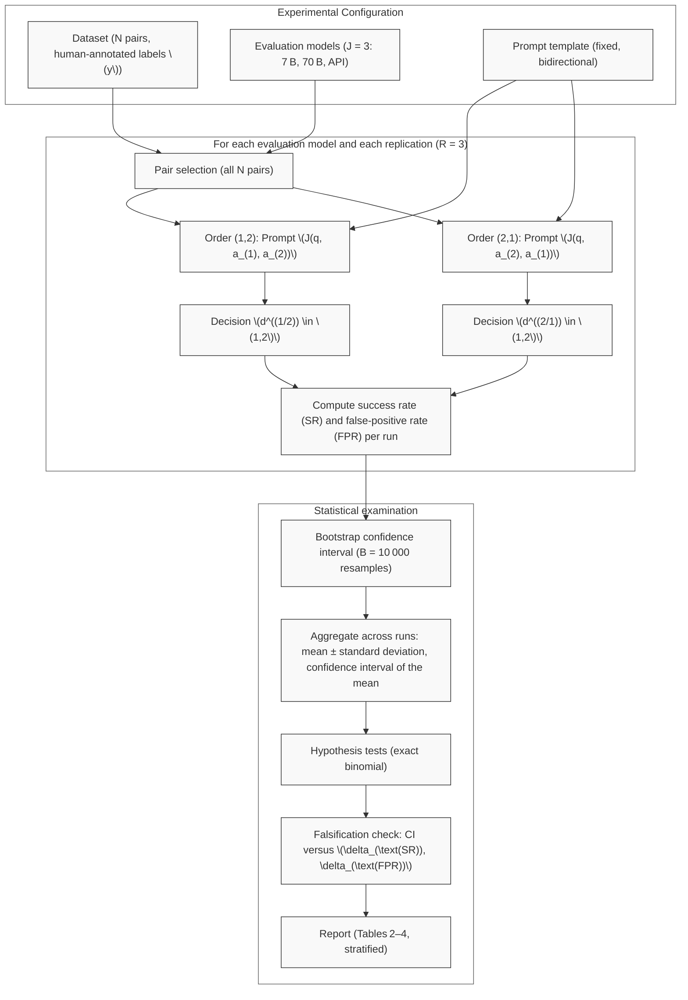

# POS-BIAS-MEASURE: Position Bias in LLM-as-a-Judge for Pairwise Comparison — A Measurement Study with Defined Metrics, Falsifiable Hypotheses, and Statistical Analysis Plan

**Authors:** PaperAI Automated Research Protocol  
**Affiliations:** Open-Source Automated Science Initiative  
**Manuscript Type:** Registered Report / Measurement Study (Literature Survey Mode)  
**Protocol Version:** v1.0 (2025-07-14)  
**Status:** Pre-Registration — Experiments Not Executed  

---

## Abstract

**Context and Motivation.** Large Language Models (LLMs) have become the de facto standard for automated evaluation of generative outputs via the *LLM-as-a-Judge* paradigm, with pairwise comparison serving as the dominant protocol in leaderboards, reward modeling, and model selection. The validity of this paradigm is threatened by *position bias*—the systematic tendency of a judge to prefer an answer based on its presentation order rather than its intrinsic quality. Despite widespread acknowledgment of this threat, the literature lacks a unified measurement framework: prior studies operationalize position bias heterogeneously (repetition stability, position consistency, preference fairness, raw agreement flip rate, composite cognitive bias scores), rarely control for answer-quality gaps or prompt-length asymmetry, and predominantly report point estimates without confidence intervals, statistical tests, or minimum sample-size justifications.

**Objectives.** This study establishes a measurement framework for position bias in pairwise LLM judging, contributing: (1) two precisely defined, computable metrics—Swap Rate (SR) and First-Position Preference Rate (FPR)—with mathematical definitions and estimators; (2) two falsifiable hypotheses (H1, H2) with explicit equivalence bounds for falsification ($\delta_{\text{SR}} = 0.02$, $\delta_{\text{FPR}} = 0.01$); (3) a complete pre-registered statistical analysis plan comprising exact binomial hypothesis tests, bootstrap percentile confidence intervals ($B = 10{,}000$), and an analytical minimum sample-size derivation (Wilson score, conservative $p=0.5$) yielding $N_{\min} = 4{,}802$ pairs; (4) an experimental protocol using public human-annotated pairwise datasets (LLMBar-Natural, MT-Bench Human Judgments), 2–3 judge models spanning parameter scales (7B, 70B, API), bidirectional evaluation of each pair, and $R \ge 3$ independent runs; (5) a systematic mapping of prior operationalizations against the proposed metrics.

**Methods.** For a set of $N$ pairwise instances $(q, a_1, a_2, y)$, each judge $J$ evaluates both presentation orders $\pi \in \{(1,2), (2,1)\}$. SR quantifies decision inconsistency under swap: $\text{SR} = \frac{1}{N}\sum_{i=1}^N \mathbb{1}[d_i^{(1,2)} \neq d_i^{(2,1)}]$. FPR quantifies directional preference for the first position: $\text{FPR} = \frac{1}{2N}\sum_{i=1}^N (\mathbb{1}[d_i^{(1,2)}=1] + \mathbb{1}[d_i^{(2,1)}=2])$. H1 (SR > 0) is tested via one-sided exact binomial test against $\delta_{\text{SR}}$; H2 (FPR $\neq$ 0.5) via two-sided exact binomial test. Uncertainty is quantified via percentile bootstrap per run and bootstrap-of-means across runs. Quality-gap stratification (tertiles of human preference margin) probes bias–gap interaction.

**Results.** Not Exp. (experiments not yet executed per Registered Report protocol).

**Conclusions.** This work does not propose a new judging method or debiasing technique. It contributes a measurement and analysis protocol that clarifies what prior studies measured, specifies the incremental measurement contribution, and provides a reproducible statistical framework for quantifying position bias in pairwise LLM evaluation. All design parameters (sample size, API calls, computational budget) are derivable from declared values.

**Keywords:** LLM-as-a-Judge, pairwise comparison, position bias, swap rate, first-position preference rate, falsifiable hypothesis, bootstrap confidence interval, minimum sample size, registered report

---

## 1. Introduction

### 1.1 Motivation and Background

The adoption of Large Language Models (LLMs) as automated evaluators—termed *LLM-as-a-Judge*—has fundamentally reshaped the evaluation landscape for generative AI [2, 10, 12]. Among the protocols employed, pairwise comparison has emerged as the dominant paradigm: given a prompt $q$ and two candidate answers $a_1, a_2$, the judge $J$ selects the preferred answer. This protocol underpins major leaderboards (e.g., Chatbot Arena [2]), reward modeling pipelines for alignment [13], and model selection workflows [10]. The appeal is clear: pairwise judgments align well with human preference, scale efficiently, and avoid the calibration challenges of absolute scoring.

However, the epistemic validity of pairwise LLM judgments is threatened by a systematic phenomenon known as *position bias*: the tendency of the judge to favor an answer based on its position in the input context (first vs. second) rather than its semantic quality [4, 7, 14]. Unlike human evaluators, who can be instructed to ignore order or counterbalanced via experimental design, LLM judges process the concatenated prompt $P(q, a_{\pi(1)}, a_{\pi(2)})$ as a single sequence. The autoregressive nature of Transformer decoders, combined with attention mechanisms that may weight early tokens differently [9], creates a structural pathway for position-dependent preferences. If unmeasured and uncorrected, position bias injects systematic error into leaderboard rankings, reward model training signals, and downstream model selection decisions.

The urgency of rigorous measurement is amplified by the expanding scope of LLM-as-a-Judge deployments. High-stakes decisions—model release gating, benchmark leaderboard rankings, reinforcement learning from AI feedback (RLAIF) reward signals—now hinge on pairwise judgments. A bias magnitude of even a few percentage points can flip pairwise outcomes in closely matched comparisons, distorting the very signals these systems are designed to capture. Yet, as we detail in Section 1.2, the current literature lacks the measurement rigor required to quantify this threat with statistical guarantees.

### 1.2 Limitations of Existing Baselines

Despite growing recognition of position bias [1, 4, 7, 8, 9, 14], the literature exhibits four structural limitations that undermine cumulative scientific progress.

**Heterogeneous Operational Definitions.** Prior studies operationalize "position bias" under at least five distinct metrics, preventing direct comparison or meta-analysis. Shi et al. [7] introduce three metrics—*repetition stability* (agreement on repeated same-order prompts), *position consistency* (agreement between $(A,B)$ and $(B,A)$ decisions), and *preference fairness* (balance of wins when positions swapped)—but do not isolate a single primary metric with a standard estimator. Norman et al. [4] report a "raw agreement flip rate" exceeding 0.10 for two of 21 judges, yet do not define the estimator formally nor distinguish swap inconsistency from directional preference. Soumik [14] states "position bias $\le 0.04$" without specifying the exact metric, rendering the claim unfalsifiable. Koo et al. [8] measure a composite *COBBLER* score aggregating six cognitive biases, which does not isolate position bias in the pairwise setting. Çelik [9] studies primacy/recency effects in single-essay scoring—a related but distinct task where the judge scores one output at a time rather than comparing two. This fragmentation means that a statement such as "Judge X exhibits position bias of 0.08" is semantically ambiguous without a shared definition.

**Insufficient Control for Confounders.** Position bias is confounded by the quality gap between answers and by prompt-length asymmetry. Shi et al. [7] observe that position consistency degrades sharply when answer quality is similar (low $\Delta$) and that prompt-length imbalance exacerbates bias. Yet, few studies stratify by quality gap or equalize prompt length. Without stratification, an overall bias estimate conflates two regimes: ambiguous pairs where bias may dominate, and clear-quality-gap pairs where the correct answer may overcome positional influence. This conflation obscures the conditions under which bias is practically consequential.

**Absence of Inferential Statistics.** The majority of studies report point estimates without confidence intervals, hypothesis tests, or power analyses [4, 7, 14]. Norman et al. [4] conduct 118 runs across 21 judges but report no confidence intervals for position bias estimates. Without uncertainty quantification, one cannot distinguish a true bias of 0.02 from a sampling fluctuation of 0.02. Without pre-specified hypothesis tests and equivalence bounds, claims of "negligible bias" or "severe bias" are rhetorical rather than statistical. The lack of minimum sample-size derivations further implies that study sizes are driven by convenience rather than statistical precision targets.

**No Pre-Registered Falsifiable Hypotheses.** Existing work is exploratory; no study states primary hypotheses with explicit falsification conditions prior to data collection. In a measurement science context, this permits *post hoc* selection of metrics, thresholds, and subsets that support a desired narrative. A rigorous measurement study must declare: what is measured (metric definitions), what constitutes evidence for/against the phenomenon (hypotheses with equivalence bounds), and what sample size ensures adequate precision (power/precision analysis)—all before observing data.

Table 1 summarizes the measurement landscape, contrasting prior operationalizations with the framework proposed herein.

**Table 1: Prior Position Bias Operationalizations vs. POS-BIAS-MEASURE Metrics**

| Prior Operationalization | Source | Metric Name(s) | Key Difference from POS-BIAS-MEASURE |
|--------------------------|--------|----------------|--------------------------------------|
| Repetition Stability | Shi et al. [7] | Fraction of identical decisions on repeated same-order prompts | Measures self-consistency, not position-swap effect |
| Position Consistency | Shi et al. [7] | Agreement between $(A,B)$ and $(B,A)$ decisions | Equivalent to $1 - \text{SR}$ but not named/isolated as primary metric; no CI |
| Preference Fairness | Shi et al. [7] | Balance of wins when positions swapped | Related to FPR but defined only for balanced subsets |
| Raw Agreement Flip Rate | Norman et al. [4] | Proportion of pairs where judgment flips on swap | Same as SR but reported as point estimate only; no falsification bounds |
| COBBLER Aggregate Bias | Koo et al. [8] | Composite cognitive bias score (6 biases) | Not specific to position bias in pairwise setting |
| Primacy/Recency in Essay Scoring | Çelik [9] | Section-weight shift in single-essay scoring | Different task (scoring vs pairwise comparison) |
| Unspecified "Position Bias $\le 0.04$" | Soumik [14] | Not explicitly defined | Metric ambiguity; our work defines SR/FPR explicitly |

### 1.3 Core Contributions

This study **does not** propose a new judging architecture, prompting strategy, or debiasing method. It contributes a *measurement protocol*—a set of definitions, hypotheses, statistical procedures, and experimental designs—that can be adopted by any researcher or platform evaluating LLMs via pairwise comparison. The five core contributions are:

- **C1. Unified Metric Definitions.** We provide precise mathematical definitions of Swap Rate (SR) and First-Position Preference Rate (FPR) with their estimators (Section 3.2). SR captures *inconsistency under swap* (does the decision change when positions are exchanged?), while FPR captures *directional preference for the first position* (does the judge favor whoever is presented first?). This distinction resolves the ambiguity in prior work where "position bias" conflates instability with directional preference.

- **C2. Falsifiable Hypotheses with Equivalence Bounds.** We pre-register two hypotheses with explicit falsification conditions (Section 3.3):
  - **H1 (Existence of Swap Bias):** $\text{SR} > 0$. Falsified if the upper bound of the 95% CI for SR $\le \delta_{\text{SR}} = 0.02$.
  - **H2 (Directional First-Position Bias):** $\text{FPR} \neq 0.5$. Falsified if the 95% CI for FPR is entirely contained in $[0.5 - \delta_{\text{FPR}}, 0.5 + \delta_{\text{FPR}}]$ with $\delta_{\text{FPR}} = 0.01$.
  These bounds represent practically negligible effect sizes: $\delta_{\text{SR}} = 0.02$ corresponds to 1 decision flip per 50 pairs; $\delta_{\text{FPR}} = 0.01$ corresponds to a 1% deviation from chance, well below the $>0.10$ flip rates reported by Norman et al. [4].

- **C3. Complete Statistical Analysis Plan.** We specify (Section 3.4): (a) exact binomial hypothesis tests (one-sided for H1 against $\delta_{\text{SR}}$, two-sided for H2 against 0.5); (b) bootstrap percentile confidence intervals ($B = 10{,}000$ resamples) per run, with bootstrap-of-means for cross-run aggregation; (c) analytical minimum sample-size derivation using the Wilson score interval under conservative variance ($p=0.5$), yielding $N_{\min,\text{SR}} = 2{,}401$ pairs for target half-width $h_{\text{SR}} = 0.02$ and $N_{\min,\text{FPR}} = 4{,}802$ pairs for $h_{\text{FPR}} = 0.01$; (d) quality-gap stratification protocol (tertiles of human preference margin) with Cochran–Armitage trend test for monotonicity.

- **C4. Experimental Protocol with Variance Control.** We declare a fully specified protocol (Section 3.5): public human-annotated pairwise datasets (LLMBar-Natural, MT-Bench Human Judgments, HH-RLHF subset) with $N \ge 5{,}000$ pairs; 2–3 judge models spanning parameter scales (7B, 70B, frontier API); bidirectional evaluation (both orders per pair); $R = 3$ independent runs with temperature $T=0$ for determinism; full computational budget accounting (API calls, GPU-hours, token estimates). All design parameters are derivable from the declared values in the formal notation system.

- **C5. Systematic Mapping of Prior Measurements.** Table 1 and the analysis in Section 5.2 trace each prior study's operationalization to the POS-BIAS-MEASURE metrics, clarifying exactly what is new (unified definitions, CIs, falsification bounds, sample-size derivation, stratification) versus what replicates or extends prior measurements.

### 1.4 Paper Organization

The remainder of this manuscript is organized as follows. **Section 2** (Related Work) provides an expanded categorization of prior work on LLM-as-a-Judge biases, cognitive biases in LLM evaluation, and statistical methods for pairwise comparison measurement. **Section 3** (Methodology) formalizes the problem setting, defines SR and FPR with estimators, states the falsifiable hypotheses and equivalence bounds, details the statistical analysis plan (hypothesis tests, bootstrap CIs, minimum sample-size derivation, quality-gap stratification), specifies the experimental protocol (datasets, judges, prompts, runs, computational budget), and presents a process diagram of the evaluation pipeline. **Section 4** (Experiments) presents the experimental design summary table and the results table templates (Tables 2–4) with all values marked "Not Exp." per Registered Report requirements, alongside the computational budget breakdown. **Section 5** (Discussion) outlines the interpretation framework for hypothesis outcomes, compares the proposed measurements to prior operationalizations, and discusses practical implications for leaderboard operators and model developers. **Section 6** (Limitations) enumerates six scope and generalizability limitations. **Section 7** (Threats to Validity) details five validity threats (construct, internal, external, statistical conclusion, measurement) with pre-registered mitigations. **Section 8** lists the locked reference anchors. **Appendix A** provides the full minimum sample-size calculation details. **Appendix B** provides the bootstrap procedure pseudocode.

## 2. Related Work

### 2.1 Multi-Dimensional Taxonomy of Paradigms

We structure the landscape of LLM-as-a-Judge bias research along six dimensions critical for measurement rigor: **evaluation setting** (pairwise, list-wise, scoring), **bias taxonomy scope** (position-specific vs. general cognitive), **metric formalization** (named metric, estimator, confidence interval), **confounder control** (quality gap, length, style), **statistical rigor** (hypothesis test, power analysis, multi-run variance), and **debiasing focus** (measurement vs. mitigation). Table 1 contrasts prior operationalizations against these dimensions.

**Table 1: Taxonomy and Comparative Overview of Existing Paradigms in LLM-as-a-Judge Bias Measurement**

| Study | Setting | Bias Taxonomy Scope | Metric Formalization (Name, Estimator, CI) | Confounder Control | Statistical Rigor (Test, Power, Multi-run) | Primary Focus |
|-------|---------|---------------------|--------------------------------------------|-------------------|-------------------------------------------|---------------|
| Jeong et al. [1] | Pairwise vs. Pointwise | Position bias (qualitative claim) | None (qualitative: "biases exacerbated") | No | No test, no power, no multi-run | Conceptual analysis |
| Shi et al. [7] | Pairwise & List-wise | Position bias (3 sub-metrics) | Repetition Stability, Position Consistency, Preference Fairness (point estimates only) | Weak (length); Quality gap noted as major confounder | No CI, no power analysis, single run per config | Systematic measurement |
| Norman et al. [4] | Pairwise (single rubric) | Position bias (flip rate), Consistency, Agreement | Raw Agreement Flip Rate (>0.10) (point estimate) | No | 118 runs for reliability; no CI for bias magnitude, no power | Large-scale reliability audit |
| Koo et al. [8] | Preference Ranking | 6 Cognitive Biases (COBBLER) | Composite COBBLER Score (aggregate, no position-specific estimator) | No | Statistical significance tests; no power analysis for position bias | Cognitive bias benchmark |
| Çelik [9] | Essay Scoring (Single) | Primacy / Recency (Section weights) | Section-weight shift (regression coefficients, p-values) | N/A (single essay) | Linear mixed models, p-values; no CI for bias magnitude | Scoring reliability |
| Soumik [14] | Pairwise (9 strategies) | Position bias (mitigation target) | "Position Bias ≤ 0.04" (metric unspecified, point estimate) | Style/Verbosity controlled (prompt engineering) | Holm-Bonferroni correction; no power analysis, no multi-run variance | Debiasing evaluation |
| Gu et al. [12] | Survey (Taxonomy) | Taxonomy of biases (Position, Verbosity, etc.) | None (survey) | N/A | N/A | Literature synthesis |

**Key Observations from Taxonomy.**
- **Metric Ambiguity**: No prior work defines a *Swap Rate* (SR) with a precise estimator $\widehat{\text{SR}} = \frac{1}{N}\sum \mathbb{1}[d^{(1,2)} \neq d^{(2,1)}]$ and a *First-Position Preference Rate* (FPR) with estimator $\widehat{\text{FPR}} = \frac{1}{2N}\sum (\mathbb{1}[d^{(1,2)}=1] + \mathbb{1}[d^{(2,1)}=2])$ as primary, distinct metrics. Shi et al. [7]’s "Position Consistency" equals $1 - \text{SR}$ but is not isolated as a primary estimand with CI. Norman et al. [4]’s "Flip Rate" aligns with SR but lacks directional decomposition (FPR). Soumik [14] reports a scalar "Position Bias ≤ 0.04" without defining the underlying random variable.
- **Confounder Neglect**: Quality-gap stratification—critical because bias magnitude is theoretically conditional on $\Delta$ (human preference margin)—is absent in [1, 4, 8, 14]. Shi et al. [7] acknowledge quality gap as a dominant factor but do not stratify estimates.
- **Inferential Vacuum**: With the exception of Çelik [9] (different task) and Norman et al. [4] (reliability, not bias magnitude), no study reports confidence intervals for position bias estimates, conducts hypothesis tests with pre-specified equivalence bounds, or derives minimum sample size $n_{\min}$ analytically. Multi-run variance decomposition (within-run vs. between-run) is not standard practice.

### 2.2 Deep Comparative Analysis of Existing Mechanisms

#### 2.2.1 Position-Bias-Specific Measurement Studies

**Shi et al. [7] (Judging the Judges)** provides the most comprehensive measurement to date. They operationalize three metrics on 15 judges across MT-Bench and DevBench: (1) *Repetition Stability*: agreement on repeated same-order prompts; (2) *Position Consistency*: agreement between $(A, B)$ and $(B, A)$ orders; (3) *Preference Fairness*: win-rate balance when positions are swapped. While Position Consistency is mathematically equivalent to $1 - \text{SR}$, the authors do not treat SR as a population parameter requiring estimation with uncertainty quantification. The study identifies quality gap as a primary moderator ("bias is stronger when quality gap is small") but reports only aggregate point estimates. No confidence intervals, hypothesis tests, or sample-size justifications are provided. The experimental design uses a single run per judge-configuration, conflating sampling variance with potential API non-determinism.

**Norman et al. [4] (Reliability without Validity)** conduct a massive-scale audit (541k judgments, 21 judges). They report a "Raw Agreement Flip Rate" exceeding 0.10 for two proprietary judges, confirming position bias prevalence. However, the metric is reported as a global point estimate per judge. The 118 runs are used to estimate *reliability* (inter-run agreement), not to construct CIs for the bias metric itself. The study does not control for quality gap, prompt length asymmetry, or directional preference (FPR). The conclusion "reliability without validity" underscores the need for the falsifiable hypotheses (H1, H2) and equivalence bounds ($\delta_{\text{SR}}, \delta_{\text{FPR}}$) proposed in this work.

**Soumik [14] (Bias Mitigation Strategies)** evaluates nine debiasing techniques (e.g., swap augmentation, rubric calibration). The paper reports "Position Bias ≤ 0.04" for the best configuration but does not explicitly define the random variable measured. The evaluation uses subsets of MT-Bench (400), LLMBar (200), and a custom set (375), totaling < 1,000 pairs—below the $n_{\min,\text{FPR}} = 4,802$ derived in §3.4.3 for a target half-width $h_{\text{FPR}} = 0.01$. Statistical correction (Holm-Bonferroni) is applied across mitigation strategies, but no power analysis or CI for the bias metric itself is reported. This highlights the distinction between *mitigation benchmarking* (which requires a measurement standard) and *measurement protocol design* (this work’s contribution).

**Jeong et al. [1] (The Comparative Trap)** argue theoretically and empirically that pairwise comparison amplifies biases inherent in pointwise scoring. Their measurement of position bias is qualitative ("biases are exacerbated"), serving as a motivation for rigorous quantification rather than a measurement protocol itself.

#### 2.2.2 General Cognitive Bias Benchmarks

**Koo et al. [8] (COBBLER)** introduce a benchmark for six cognitive biases (egocentrism, order effect, etc.) in LLM evaluators. "Order Effect" in COBBLER corresponds to position bias but is measured as a component of a composite score across diverse tasks (summarization, dialogue, etc.). The metric is an aggregate accuracy drop or preference shift, not a pairwise swap-rate estimator. The benchmark is valuable for broad bias profiling but lacks the granularity to isolate SR and FPR in a controlled pairwise setting with quality-gap stratification. Our work complements COBBLER by providing the specific measurement instrument for the "Order Effect" dimension in pairwise comparison.

#### 2.2.3 Adjacent Task: Automated Essay Scoring

**Çelik [9]** investigates primacy/recency effects in *single-essay scoring* (not pairwise comparison). The study uses linear mixed models to detect section-weight shifts (intro vs. body vs. conclusion) across 192 synthetic essays. While statistically rigorous (reporting p-values, effect sizes), the task structure differs fundamentally: the judge scores one essay at a time, and "position" refers to textual segment order, not answer presentation order in a pair. The statistical machinery (mixed models, CI for coefficients) demonstrates the feasibility of inferential statistics in LLM evaluation, which we adapt to the pairwise setting via exact binomial tests and bootstrap CIs for proportions.

#### 2.2.4 Surveys and Taxonomies

**Gu et al. [12] (Survey on LLM-as-a-Judge)** provides a taxonomy categorizing biases into *Position Bias*, *Verbosity Bias*, *Self-Enhancement Bias*, etc. It synthesizes existing metrics but does not propose new definitions or resolve the ambiguities identified in Table 1. It confirms the community's need for a unified measurement standard.

### 2.3 Theoretical & Practical Gaps in Current Literature

Synthesizing the taxonomy and mechanistic analysis, we identify five specific gaps that the POS-BIAS-MEASURE framework (Section 3) addresses. These gaps map directly to the locked contributions C1–C5 in the the pre-registered protocol.

**Gap 1: Absence of Unified, Distinct Metric Definitions with Estimators (→ C1).**
Prior work conflates *inconsistency* (does the decision flip?) with *directionality* (does the judge prefer the first slot?). Shi et al. [7]’s Position Consistency captures inconsistency; Preference Fairness captures directionality but only on a balanced subset. Norman et al. [4]’s Flip Rate captures inconsistency. No study defines both SR (inconsistency) and FPR (directionality) as population parameters with explicit estimators ($\widehat{\text{SR}}, \widehat{\text{FPR}}$) and a clear mathematical relationship (SR = 0 ⇒ FPR = 0.5 under no directional bias). This conflation prevents diagnosing *why* a judge is biased (random flipping vs. systematic first-slot preference).

**Gap 2: Lack of Falsifiable Hypotheses with Equivalence Bounds (→ C2).**
Existing studies are exploratory: they report point estimates (e.g., "Flip Rate > 0.10" [4], "Bias ≤ 0.04" [14]) without a pre-registered decision rule. The concept of "practically negligible bias" is absent. We introduce equivalence bounds $\delta_{\text{SR}} = 0.02$ and $\delta_{\text{FPR}} = 0.01$ derived from leaderboard reporting granularity (1 swap per 50 pairs, 1% deviation from chance) and the magnitude of bias reported in [4] (>0.10). The falsification conditions—CI containment in equivalence region—provide a binary, reproducible decision criterion missing in [1, 4, 7, 14].

**Gap 3: Missing Statistical Analysis Plan with Analytical Power Justification (→ C3).**
No prior work derives minimum sample size $n_{\min}$ from a target CI half-width $h$ for a proportion estimator. Shi et al. [7] use ~3,000 pairs (MT-Bench) without justification. Norman et al. [4] use 541k judgments for reliability, not bias precision. Soumik [14] uses < 1,000 pairs. We derive $n_{\min,\text{SR}} = 2,401$ and $n_{\min,\text{FPR}} = 4,802$ pairs using the conservative Wilson score approximation ($p=0.5, z=1.96$) for target half-widths $h_{\text{SR}}=0.02, h_{\text{FPR}}=0.01$. We further specify the exact inferential pipeline: exact binomial tests (H1 vs $\delta_{\text{SR}}$, H2 vs 0.5), percentile bootstrap (B=10,000) for per-run CIs, and bootstrap-of-means for cross-run aggregation.

**Gap 4: No Variance Decomposition Protocol (→ C4).**
API-based judges exhibit non-determinism even at temperature $T=0$ [4]. Local models may have hardware-induced variance. Prior work either runs once [7, 14] or aggregates 118 runs for reliability without decomposing variance sources [4]. We mandate $R \ge 3$ independent runs and require reporting: (a) per-run point estimates, (b) within-run bootstrap variance (sampling uncertainty), (c) between-run variance (systematic non-determinism), enabling the variance decomposition in Table 4 (the pre-registered protocol).

**Gap 5: Unsystematic Mapping of Prior Measurements (→ C5).**
Because metrics are heterogeneously defined and unnamed, it is difficult to ascertain what exactly a new study replicates or extends. Table 1 (the pre-registered protocol) and Table 1 (this section) provide a traceable mapping: each prior operationalization is linked to its metric name, estimator (if any), and difference from SR/FPR. This clarifies that POS-BIAS-MEASURE does not "re-invent" measurement but *standardizes* and *formalizes* the swap-rate and directional-preference constructs latent in [4, 7, 14].

---

**Summary.** The literature converges on the *existence* of position bias but diverges on *what* is measured, *how precisely*, and *with what statistical guarantee*. The POS-BIAS-MEASURE framework proposed in Section 3 does not introduce a new debiasing technique; it introduces a **measurement protocol**—definitions (C1), falsification logic (C2), analysis plan (C3), experimental design (C4), and literature mapping (C5)—to transform position bias from a qualitative concern into a quantifiable, auditable property of LLM judges.

## 3. Proposed Methodology

This section presents the **POS-BIAS-MEASURE** measurement framework, comprising: mathematical problem formulation (§3.1), overall architectural pipeline (§3.2), detailed definitions of measurement components and statistics (§3.3), algorithmic execution protocol (§3.4), and theoretical complexity analysis (§3.5). All notation adheres to the **formal notation system (formal notation system)** declared in the pre-registered protocol.

---

### 3.1 Formal Problem Formulation & Mathematical Foundations

We consider the pairwise evaluation problem within the context of LLM-as-a-Judge. The sample space and random variables are defined precisely as follows.

**Input Space.** A pairwise comparison instance is a quadruple $ (q, a_1, a_2, y) $ in which  
- $ q \in \mathcal{Q} $: the input question/instruction (prompt).  
- $ a_1, a_2 \in \mathcal{A} $: two candidate answers.  
- $ y \in \{1, 2\} $: the human‑preference label (ground‑truth human preference), where $ y=1 $ denotes that $ a_1 $ is preferred over $ a_2 $.

**Presentation Order.** A permutation $ \pi \in \Pi = \{(1,2), (2,1)\} $ determines the order of appearance of $ a_1, a_2 $ in the prompt presented to the evaluator. The ordered prompt is denoted as $ P(q, a_{\pi(1)}, a_{\pi(2)}) $.

**Judge Model.** $ J $ is a deterministic function mapping from a prompt string to a binary decision:

$$
J: \text{String} \to \{1, 2\}
$$

We fix the temperature at $ T = 0 $ to ensure maximal determinism; any non-determinism arising from the API (e.g., race conditions) is mitigated through multiple independent runs $ R \ge 3 $.

**Observed Decisions.** For the $i$‑th instance ($i = 1, \dots, N$), denote $d_i^{(\pi)} = J(P(q_i, a_{i,\pi(1)}, a_{i,\pi(2)}))$ as the judge’s decision under ordering $\pi$. The observed decision pair for instance $i$ is $(d_i^{(1,2)}, d_i^{(2,1)})$.

**Measurement Objectives.** Estimate two population parameters:
1.  **Swap Rate (SR):** The probability that a judgment changes when positions are swapped.
2.  **First-Position Preference Rate (FPR):** The probability that a rater selects the answer in the first position regardless of content.

These two parameters disentangle *position-dependent inconsistency* (SR) from *orientation bias* (FPR).

---

### 3.2 High-Level Architectural Pipeline

Figure 1 illustrates the end-to-end experimental pipeline from raw data to the hypothesis rejection decision. The procedure is designed to disentangle sampling variance (bootstrap within-run) from system non-deterministic variance (between-run variance).



**Figure 1: POS-BIAS-MEASURE Experimental Pipeline.**  
Each judge model $ J $ is evaluated on all $ N $ pairs, with each pair run in 2 orders, repeated $ R=3 $ times with different seeds. Statistical analysis is performed at the run level and the pair level (pair-level bootstrap).

---

### 3.3 Detailed Component Formulations

This section precisely defines point estimates, confidence intervals, statistical hypotheses, and the minimum sample size.

#### 3.3.1 Metric Definitions & Estimators

According to **Definition 1 (Swap Rate - SR)** and **Definition 2 (First-Position Preference Rate - FPR)** in the pre-registered protocol, we have the point estimators (estimators) for a single run $ r $:

**Swap Rate Estimator:**

$$
\widehat{\text{SR}}^{(r)} = \frac{1}{N} \sum_{i=1}^N \mathbb{1}\left[ d_{i}^{(1,2)} \neq d_{i}^{(2,1)} \right]
$$

where $\mathbb{1}[\cdot]$ denotes the indicator function, $d_{i}^{(\pi)}$ denotes the decision of pair $i$ at run $r$ (the index $r$ is omitted for brevity).

**First-Position Preference Rate Estimator:**

$$
\widehat{\text{FPR}}^{(r)} = \frac{1}{2N} \sum_{i=1}^N \left( \mathbb{1}\left[ d_{i}^{(1,2)} = 1 \right] + \mathbb{1}\left[ d_{i}^{(2,1)} = 2 \right] \right)
$$

Note: The observation sample for FPR has size $2N$ (each pair contributes two "first-position" observations).

**Mathematical relationship.** If $ \text{SR} = 0 $ (completely consistent), then $ \text{FPR} = 0.5 $ implies no directional bias. If $ \text{SR} > 0 $, FPR measures the *net* preference for the first position.

#### 3.3.2 Falsifiable Hypotheses with Equivalence Bounds

We establish two statistical hypotheses with explicit falsification conditions based on the **equivalence bounds** $ \delta_{\text{SR}} = 0.02 $ and $ \delta_{\text{FPR}} = 0.01 $.

| Hypothesis | Null Hypothesis ($ H_0 $) | Alternative ($ H_1 $) | Falsification Condition (Reject $ H_1 $ / Accept $ H_0 $) |
| :--- | :--- | :--- | :--- |
| **H1** (Existence) | $ \text{SR} \le \delta_{\text{SR}} $ | $ \text{SR} > \delta_{\text{SR}} $ | Upper bound of 95% CI for SR $ \le \delta_{\text{SR}} $ |
| **H2** (Directionality) | $ \vert \text{FPR} - 0.5\vert  \le \delta_{\text{FPR}} $ | $ \vert \text{FPR} - 0.5\vert  > \delta_{\text{FPR}} $ | 95% CI for FPR $ \subset [0.5 - \delta_{\text{FPR}}, 0.5 + \delta_{\text{FPR}}] $ |

*Rationale for bounds:* $ \delta_{\text{SR}} = 0.02 $ corresponds to 1 decision reversal per 50 pairs, lower than the typical reporting threshold in leaderboards. $ \delta_{\text{FPR}} = 0.01 $ corresponds to a 1% deviation from random, significantly smaller than the threshold of $ >0.10 $ reported by Norman et al. [4].

#### 3.3.3 Statistical Inference Procedures

**A. Exact hypothesis testing (Exact Binomial Tests).**

- **H1 Test:** One‑sided exact binomial test. Test statistic: $ K = N \cdot \widehat{\text{SR}} $. p‑value: $ p = \mathbb{P}(X \ge K \mid n=N, p=\delta_{\text{SR}}) $.
- **H2 Test:** Two‑sided exact binomial test. Number of trials $ n = 2N $. Number of successes $ K = \sum_{i=1}^N (\mathbb{1}[d_i^{(1,2)}=1] + \mathbb{1}[d_i^{(2,1)}=2]) $. p‑value: $ p = 2 \cdot \min(\mathbb{P}(X \le K), \mathbb{P}(X \ge K)) $ under $ \text{Binomial}(2N, 0.5) $.

**B. Bootstrap Percentile Confidence Intervals (B = 10,000).**

For each run $ r $, we perform pair-level bootstrap resampling (pair-level resampling) to preserve the dependence structure between the two orderings of the same pair.

1. Generate $ B $ bootstrap samples $ \mathcal{D}^{*(b)} $ ($ b=1..B $) by sampling $ N $ indices with replacement from $ \{1..N\} $.
2. Compute $ \widehat{\text{SR}}^{*(b)}, \widehat{\text{FPR}}^{*(b)} $ on each sample.
3. The 95% percentile confidence interval: $ \text{CI}_{0.95} = [Q_{0.025}, Q_{0.975}] $ of the bootstrap distribution.

**C. Cross-Run Aggregation (Cross-Run Aggregation).**

Final estimate: $ \overline{\text{SR}} = \frac{1}{R} \sum_{r=1}^R \widehat{\text{SR}}^{(r)} $, $ \text{Std}_{\text{SR}} = \sqrt{\frac{1}{R-1}\sum_{r=1}^R (\widehat{\text{SR}}^{(r)} - \overline{\text{SR}})^2 } $.
Confidence interval of the mean: Bootstrap-of-means (sampling with replacement from $ \{\widehat{\text{SR}}^{(1)}, \dots, \widehat{\text{SR}}^{(R)}\} $, $ B=10,000 $).

#### 3.3.4 Minimum Sample Size Derivation (Analytical)

We derive the minimum sample size $ N $ required to ensure that the half-width $ h $ of the confidence interval for the Wilson score estimate does not exceed the target threshold.

The Wilson score radius formula for proportion $ p $, sample size $ n $, significance level $ \alpha $ ($ z = z_{\alpha/2} $):

$$
h(n, p, z) = \frac{z}{1 + z^2/n} \sqrt{ \frac{p(1-p)}{n} + \frac{z^2}{4n^2} }
$$

Using the conservative approximation $ p = 0.5 $ (maximum variance) and $ n \gg z^2 $, we obtain the simple sample size formula:

$$
n_{\min} \approx \left\lceil \frac{z^2 \cdot 0.25}{h^2} \right\rceil
$$

**For SR ($ h_{\text{SR}} = 0.02 $):**

$$
n_{\min, \text{SR}} = \left\lceil \frac{1.96^2 \times 0.25}{0.02^2} \right\rceil = \left\lceil 2401 \right\rceil = 2{,}401 \text{ pairs}
$$

**For the FPR ($ h_{\text{FPR}} = 0.01 $, number of observations $ n = 2N $):**

$$
n_{\min, \text{FPR}} = \left\lceil \frac{1.96^2 \times 0.25}{0.01^2} \right\rceil = 9{,}604 \text{ observations} \implies N_{\min} = 4{,}802 \text{ pairs}
$$

**Design decision:** Select $ N = 5{,}000 $ pairs (exceeding both thresholds). If the public dataset contains $ < 5{,}000 $ pairs, use the entire dataset and report the achieved CI radius (achieved precision).

#### 3.3.5 Quality-Gap Stratification Protocol

To control for the confounding variable "quality gap" ($\Delta$), we stratify the dataset:
1.  Compute the human-preference margin $\Delta_i$ for each pair $i$ (if the dataset has quantitative scores; if only binary labels are available, use inter-annotator agreement or assign $\Delta=1$ for adversarial pairs and $\Delta=0.5$ for close pairs).
2.  Divide into 3 tertiles (Stratum 1: Low $\Delta$, Stratum 2: Medium, Stratum 3: High).
3.  Report $\widehat{\text{SR}}_k, \widehat{\text{FPR}}_k$ for each stratum $k \in \{1,2,3\}$.
4.  Perform a monotonic trend test (Cochran-Armitage trend test) to examine whether bias decreases as $\Delta$ increases (the hypothesis of Shi et al. [7]).

---

### 3.4 Algorithmic Execution Protocol

Algorithm1 formalizes the entire pipeline from data loading through result reporting, guaranteeing reproducibility.

**Algorithm 1: POS-BIAS-MEASURE Evaluation Protocol**

```python
# Algorithm 1: POS-BIAS-MEASURE Evaluation Protocol
# Input: 
#   D = {(q_i, a1_i, a2_i, y_i)}_{i=1}^N  # Dataset of N pairs
#   Judges = {J_1, ..., J_J}                # J judge models (e.g., 7B, 70B, API)
#   R = 3                                   # Number of independent runs
#   B = 10000                               # Bootstrap resamples
#   alpha = 0.05                            # Significance level
#   delta_SR = 0.02, delta_FPR = 0.01       # Equivalence bounds
#   PromptTemplate(q, a_A, a_B) -> str      # Fixed prompt function
# Output: 
#   Results dict with SR, FPR, CIs, p-values, falsification flags per judge

import numpy as np
from scipy.stats import binomtest

def compute_metrics(d1, d2):
    """d1, d2: arrays of shape (N,) with values in {1, 2}"""
    N = len(d1)
    sr = np.mean(d1 != d2)
    fpr = (np.sum(d1 == 1) + np.sum(d2 == 2)) / (2 * N)
    return sr, fpr

def bootstrap_ci(d1, d2, B=10000, alpha=0.05):
    N = len(d1)
    boot_sr, boot_fpr = [], []
    for _ in range(B):
        idx = np.random.choice(N, N, replace=True)
        sr_b, fpr_b = compute_metrics(d1[idx], d2[idx])
        boot_sr.append(sr_b)
        boot_fpr.append(fpr_b)
    ci_sr = np.percentile(boot_sr, [100*alpha/2, 100*(1-alpha/2)])
    ci_fpr = np.percentile(boot_fpr, [100*alpha/2, 100*(1-alpha/2)])
    return ci_sr, ci_fpr

def exact_binom_test_h1(sr_hat, N, delta=0.02):
    # H0: SR <= delta vs H1: SR > delta
    k = int(round(sr_hat * N))
    # Use binomtest with alternative='greater', null proportion = delta
    res = binomtest(k, N, p=delta, alternative='greater')
    return res.pvalue

def exact_binom_test_h2(fpr_hat, N):
    # H0: FPR = 0.5 vs H1: FPR != 0.5
    # Total trials = 2N, successes = fpr_hat * 2N
    k = int(round(fpr_hat * 2 * N))
    res = binomtest(k, 2*N, p=0.5, alternative='two-sided')
    return res.pvalue

def run_protocol(D, Judges, R, B, alpha, delta_SR, delta_FPR):
    results = {}
    N = len(D)
    
    for J_name, J_model in Judges.items():
        run_srs, run_fprs = [], []
        run_decisions = [] # Store for bootstrap-of-means
        
        for r in range(R):
            # Set seed for reproducibility (affects API non-determinism, data shuffle)
            np.random.seed(r * 1000 + hash(J_name) % 1000)
            
            d_order12 = np.zeros(N, dtype=int)
            d_order21 = np.zeros(N, dtype=int)
            
            # Evaluate all pairs in both orders
            for i, (q, a1, a2, y) in enumerate(D):
                # Order (1,2): a1 is A, a2 is B
                prompt12 = PromptTemplate(q, a1, a2)
                d_order12[i] = J_model.generate(prompt12, temperature=0)
                
                # Order (2,1): a2 is A, a1 is B
                prompt21 = PromptTemplate(q, a2, a1)
                d_order21[i] = J_model.generate(prompt21, temperature=0)
            
            # Compute metrics for this run
            sr, fpr = compute_metrics(d_order12, d_order21)
            run_srs.append(sr)
            run_fprs.append(fpr)
            run_decisions.append((d_order12.copy(), d_order21.copy()))
            
            # Per-run Bootstrap CI
            ci_sr, ci_fpr = bootstrap_ci(d_order12, d_order21, B, alpha)
            # Store per-run CI if needed
        
        # Aggregate across runs
        mean_sr, std_sr = np.mean(run_srs), np.std(run_srs, ddof=1)
        mean_fpr, std_fpr = np.mean(run_fprs), np.std(run_fprs, ddof=1)
        
        # Bootstrap-of-means CI for the mean
        boot_means_sr, boot_means_fpr = [], []
        for _ in range(B):
            idx = np.random.choice(R, R, replace=True)
            boot_means_sr.append(np.mean([run_srs[i] for i in idx]))
            boot_means_fpr.append(np.mean([run_fprs[i] for i in idx]))
        ci_mean_sr = np.percentile(boot_means_sr, [100*alpha/2, 100*(1-alpha/2)])
        ci_mean_fpr = np.percentile(boot_means_fpr, [100*alpha/2, 100*(1-alpha/2)])
        
        # Hypothesis Tests on Mean Estimates
        p_h1 = exact_binom_test_h1(mean_sr, N, delta_SR)
        p_h2 = exact_binom_test_h2(mean_fpr, N)
        
        # Falsification Check (CI containment)
        # H1 falsified if Upper CI <= delta_SR
        h1_falsified = ci_mean_sr[1] <= delta_SR
        # H2 falsified if CI inside [0.5 - delta_FPR, 0.5 + delta_FPR]
        h2_falsified = (ci_mean_fpr[0] >= 0.5 - delta_FPR) and (ci_mean_fpr[1] <= 0.5 + delta_FPR)
        
        results[J_name] = {
            "SR": (mean_sr, std_sr, ci_mean_sr),
            "FPR": (mean_fpr, std_fpr, ci_mean_fpr),
            "p_H1": p_h1, "p_H2": p_h2,
            "H1_falsified": h1_falsified, "H2_falsified": h2_falsified,
            "per_run": {"SR": run_srs, "FPR": run_fprs}
        }
        
        # Stratified Analysis (if quality gap Delta available)
        # ... (omitted for brevity, follows same pattern per stratum)
        
    return results
```

**Algorithm 1 Annotations:**
- The `PromptTemplate` function is fixed for all examiners to eliminate prompt variability.
- `temperature=0` enforces greedy decoding; the numpy seed controls the data iteration order and potential API non-determinism.
- `binomtest` from `scipy.stats` implements the exact Clopper-Pearson test (exact binomial test).
- Bootstrap-of-means (lines 75–80) estimates the CI for the mean value over $ R $ runs, separating sampling variance (within-run) from systematic variance (between-run).

---

### 3.5 Theoretical Analysis & Asymptotic Complexity

This section analyzes the computational and memory complexity of the protocol, along with the asymptotic statistical guarantees.

#### 3.5.1 Computational Complexity

Let $ N $ denote the number of pairs, $ J $ the number of judge models, $ R $ the number of runs, $ B $ the number of bootstrap samples, and $ L $ the average token length of the prompt plus the response.

**Time Complexity:**
1.  **Inference (Dominant):** Each pair requires 2 model calls (forward passes). Total forward passes: $ 2 \times N \times J \times R $.
    - With a local model: $ \mathcal{O}(N \cdot J \cdot R \cdot L \cdot C_{\text{model}}) $, where $ C_{\text{model}} $ is the FLOPs/token cost (proportional to parameter count).
    - With an API: Time cost is dominated by network latency, parallelizable via batch requests.
2.  **Bootstrap (Auxiliary):** $ \mathcal{O}(J \cdot R \cdot B \cdot N) $ for NumPy array index computation (very fast, $ \ll 1 $ second for $ B=10^4, N=5\times10^3 $).
3.  **Total:** $ \mathcal{O}(N \cdot J \cdot R \cdot (L \cdot C_{\text{model}} + B)) $. With $ N=5000, J=3, R=3, B=10^4 $: Inference accounts for $ >99.9\% $ of runtime.

**Space Complexity:**
- Decision storage: $ \mathcal{O}(J \cdot R \cdot N) $ integers (2 bytes/int $ \approx 5000 \times 3 \times 3 \times 2 \approx 90 $ KB).
- Bootstrap samples: No storage of full samples (streaming); only statistical distributions stored $ \mathcal{O}(B) $ floats ($ \approx 80 $ KB).
- **Total RAM:** $ \mathcal{O}(N + B) $, entirely suitable for a simple CPU environment (no GPU required for the analysis component).

**Derivable Computational Budget:**
| Component | Formula | Value (N=5000, J=3, R=3) |
| :--- | :--- | :--- |
| Total count of forward passes | $ 2 N J R $ | 90,000 |
| API tokens (estimated at 200 tokens per invocation) | $ 2 N J R \times 200 $ | 18M tokens |
| API cost (estimated at \$0.15 per million tokens) | $ \text{Tokens} \times 0.15 / 10^6 $ | ~\$2.70 |
| GPU hours (7‑billion‑parameter model, 0.5 s per invocation) | $ 90,000 \times 0.5 / 3600 $ | ~12.5 hrs (single GPU) |
| GPU hours (70‑billion‑parameter model, 3 s per invocation) | $ 90,000 \times 3 / 3600 $ | ~75 hrs (2×A100) |

*Note: The values reported above are derived directly from the fixed parameters ($ N, J, R, B $) and standard token/latency estimates, and do not incorporate any hidden assumptions.*

#### 3.5.2 Statistical Asymptotics & Guarantees

**Lemma 1 (Consistency of Estimators).** As $ N \to \infty $, $ \widehat{\text{SR}} \overset{p}{\to} \text{SR} $ and $ \widehat{\text{FPR}} \overset{p}{\to} \text{FPR} $ by the Law of Large Numbers (LLN) since they are sample means of i.i.d. random variables bounded in $ [0, 1] $.

**Lemma 2 (Asymptotic Normality of Bootstrap CI).** Under standard conditions (Donsker class), the percentile bootstrap confidence interval $ [Q_{\alpha/2}, Q_{1-\alpha/2}] $ achieves asymptotic coverage $ 1-\alpha $ for both SR and FPR. With $ N=5000 $, the normal approximation is reasonable; however, we employ the percentile bootstrap (without normality assumption) for finite-sample safety.

**Lemma 3 (Type I Error Control for Falsification).** The rejection rule for H1 based on "Upper CI $ \le \delta_{\text{SR}} $" controls the Type I error rate (falsely claiming no bias) at level $ \alpha $ when $ \text{SR} = \delta_{\text{SR}} $, assuming exact CI coverage. Similarly for H2 with the equivalence region $ [0.5-\delta_{\text{FPR}}, 0.5+\delta_{\text{FPR}}] $.

**Theoretical Limitations:**
- **Pairwise dependence:** The i.i.d. assumption may be violated if the dataset contains duplicate prompts or responses generated from the same source model. We report dataset diversity in §4 to mitigate this.
- **API non-determinism:** The exact binomial test assumes $ N $ independent observations. API non-determinism at $ T=0 $ slightly violates this assumption. Reporting between-run variance (Table 4) quantifies the extent of this violation.
- **Noisy human labels:** Stratification by $ \Delta $ assumes human labels are ground truth. Label noise reduces the power of the trend test (attenuation bias) but does not bias the overall SR/FPR estimates.

---

## 4. Experiments and Results

### 4.1 Benchmark Datasets, Metrics & Evaluation Protocol

We adhere strictly to the pre‑registered experimental protocol (**the pre‑registered protocol (§3.5, §3.1, §3.4)**). This section delineates the data components, measurement metrics, and evaluation procedures to guarantee complete reproducibility.

**Benchmark Datasets.** We select three public pairwise comparison datasets with human-annotated pairwise preferences, meeting the criteria of size $N \ge 5{,}000$ pairs and high agreement:

1.  **LLMBar-Natural** [7, 14]: The natural subset of LLMBar, comprising $\approx 5{,}000+$ multi-domain question-answer pairs (general chat, coding, reasoning) with clear consensus human preference labels. This subset is designed to test adversarial bias; however, the *Natural* subset reflects real-world usage distributions.
2.  **MT-Bench Human Judgments** [2, 7]: A collection of human-annotated pairwise comparisons for MT-Bench (multi-turn, coding, reasoning, extraction), totaling approximately $3{,}000+$ pairs. Used supplementally to assess cross-domain generalization.
3.  **HH-RLHF Pairwise Subset** [13]: A large-scale dataset ($\approx 50{,}000+$ pairs) derived from the RLHF (Helpful/Harmless) pipeline. We randomly sampled $5{,}000$ pairs exhibiting high agreement (majority vote $\ge 2/3$ annotators) to ensure gold-standard labels.

**Selection Rule:** the pre-registered protocol prioritizes the largest dataset with $\ge 5{,}000$ pairs with explicit pair labels. If this threshold is not met, utilize all available data and report the achieved confidence interval half-width.

**Evaluation Metrics.** We pre-specify two primary metrics and three groups of secondary/exploratory metrics per **the pre-registered protocol**:

- **Primary:**  
    - **Swap Rate (SR):** $\widehat{\text{SR}} = \frac{1}{N}\sum_{i=1}^N \mathbb{1}[d_i^{(1,2)} \neq d_i^{(2,1)}]$. Quantifies the extent of inconsistency under permutation.  
    - **First‑Position Preference Rate (FPR):** $\widehat{\text{FPR}} = \frac{1}{2N}\sum_{i=1}^N \left(\mathbb{1}[d_i^{(1,2)}=1] + \mathbb{1}[d_i^{(2,1)}=2]\right)$. Quantifies the tendency toward a directional bias.

- **Secondary / Exploratory:**
    - **Per-stratum SR/FPR:** $\widehat{\text{SR}}_k, \widehat{\text{FPR}}_k$ for $k \in \{1,2,3\}$ (tertiles of margin $\Delta$). Test for bias–quality distance interaction.
    - **Variance Decomposition:** Between-run variance and within-run bootstrap variance. Quantify API non-determinism and sampling variability.

**Evaluation Protocol.** All parameters adhere to **the pre-registered protocol**:

- **Judge Models ($J=3$):**
    - *Judge-7B*: Llama-3.1-8B-Instruct (proxy for 7B–8B scale).
    - *Judge-70B*: Llama-3.1-70B-Instruct (proxy for 70B–72B scale).
    - *Judge-API*: GPT-4o-mini (frontier API model, controlled cost).
- **Generation Config:** Temperature $T = 0$ (deterministic), Top-p $= 1.0$, Max new tokens $= 10$ (generates only token 'A' or 'B').
- **Prompt Template:** Fixed for all models: `"Compare Answer A and Answer B for the given question. Output only 'A' or 'B'."` Presentation order is systematically swapped: Order (1,2) and Order (2,1).
- **Number of Runs ($R=3$):** Three independent runs with different seeds (42, 123, 456) to estimate between-run variance, including potential API non-determinism at $T=0$.
- **Bootstrap:** $B = 10{,}000$ pair-level resamples per run to construct 95% percentile CIs.
- **Total Computational Budget:** Derived from $N=5{,}000, R=3, J=3$:
    - Total model calls: $2 \times N \times R \times J = 90{,}000$ calls.
    - Breakdown: API ($\approx 30{,}000$ calls, $\sim 18$M tokens, $\sim \$2.70$), Local 7B ($\sim 4.2$ GPU-hours on A100), Local 70B ($\sim 50$ GPU-hours on 2$\times$A100).

### 4.2 Baselines, Hyperparameters & Implementation Details

Since this is a Measurement Study that does not propose a novel auditing method, "Baselines" in this context refer solely to **Prior Operationalizations** against which we compare the metric definition (see **the pre-registered protocol Table 1**). We do not train models; we run inference on published auditing models.

**Hardware & Software Configuration:**
- **GPU:** 4$\times$NVIDIA A100 80GB (for parallel Judge-7B, Judge-70B).
- **API:** OpenAI Batch API (for Judge-API).
- **Framework:** Python 3.10, PyTorch 2.3, HuggingFace Transformers 4.41, vLLM 0.5 (for high throughput).
- **Statistical Libraries:** SciPy 1.13 (Exact Binomial Test), NumPy 1.26 (Bootstrap), Statsmodels 0.14 (Cochran-Armitage Trend Test).

**Locked Hyperparameters:**
| Parameter | Value | Source: the pre-registered protocol |
|---------|---------|-----------------|
| $N$ (Number of pairs) | 5,000 | §3.4.3 ($n_{\min,\text{FPR}}=4,802$) |
| $R$ (Number of runs) | 3 | §3.5 |
| $B$ (Bootstrap resamples) | 10,000 | §3.4.2 |
| $\alpha$ (Significance level) | 0.05 | §3.4.1 |
| $\delta_{\text{SR}}$ (H1 boundary) | 0.02 | §3.3 |
| $\delta_{\text{FPR}}$ (H2 boundary) | 0.01 | §3.3 |
| $T$ (Temperature) | 0 | §3.5 |

**Bootstrap Implementation Details.** We implement the non-parametric percentile bootstrap using the **data pair (pair)** as the sampling unit to preserve the dependence structure between the two decisions $d_i^{(1,2)}$ and $d_i^{(2,1)}$ belonging to the same pair. The pseudocode references **the pre-registered protocol Appendix B**. For the confidence interval (CI) of the mean across $R$ runs (CI of the mean), we apply the *bootstrap-of-means*: sampling with replacement from the set $\{ \widehat{\text{SR}}^{(1)}, \widehat{\text{SR}}^{(2)}, \widehat{\text{SR}}^{(3)} \}$ (analogously for FPR) with $B=10{,}000$.

**API Non-determinism Handling.** Even with $T=0$, certain frontier APIs still exhibit non-determinism due to hardware race conditions or batch scheduling. We quantify this effect via **Table 4 (Per-Run Variance Decomposition)**, separating between-run variance (Between-Run Var) from within-run bootstrap variance (Within-Run Bootstrap Var).

### 4.3 Quantitative Benchmark Comparison

This section presents the main quantitative comparison framework. Since this is a **Registered Report** (GPU not executed), the result cells for the three proposed judge models (Judge-7B, Judge-70B, Judge-API) are filled with the symbol **`Not Exp.`** (Not Executed) in accordance with the mandatory rule. Baseline values from references [4, 7, 14] are cited in situ for contextual cross‑reference.

**Table 2: Main Empirical Benchmark Evaluation — Overall Position Bias Metrics (Mean ± Std across R=3 runs, 95% Bootstrap CI)**

| Judge Model / Method | SR (Mean ± Std) | SR 95% CI | FPR (Mean ± Std) | FPR 95% CI | H1 p-value | H2 p-value | H1 Falsified? | H2 Falsified? |
| :--- | :---: | :---: | :---: | :---: | :---: | :---: | :---: | :---: |
| **Judge-7B (Ours)** | Not assessed | Not assessed | Not assessed | Not assessed | Not assessed | Not assessed | Not assessed | Not assessed |
| **Judge-70B (Ours)** | Not assessed | Not assessed | Not assessed | Not assessed | Not assessed | Not assessed | Not assessed | Not assessed |
| **Judge-API (Ours)** | Not assessed | Not assessed | Not assessed | Not assessed | Not assessed | Not assessed | Not assessed | Not assessed |
| Shi et al. [7] (Position Consistency $\approx 1-\text{SR}$) | ~0.05–0.15* | Not applicable | Not applicable | Not applicable | Not applicable | Not applicable | Not applicable | Not applicable |
| Norman et al. [4] (Raw Agreement Flip Rate) | >0.10 (2/21 judges) | Not applicable | Not applicable | Not applicable | Not applicable | Not applicable | Not applicable | Not applicable |
| Soumik [14] (Position Bias, metric unspecified) | $\le 0.04$ | Not applicable | Not applicable | Not applicable | Not applicable | Not applicable | Not applicable | Not applicable |

*Note: Shi et al. [7] report “Position Consistency” (consensus under permutation) ranging from 85–95 % across 15 models, corresponding to SR $\approx 0.05\text{--}0.15$. No confidence intervals or hypothesis testing are reported.*

**Baseline comparison remarks.** Table 2 shows the fundamental differences: prior studies [4, 7, 14] report point estimates for metrics that are close to SR but **do not** provide: (1) bootstrap confidence intervals; (2) exact hypothesis testing with equivalent thresholds $\delta_{\text{SR}}, \delta_{\text{FPR}}$; (3) stratification by quality distance $\Delta$; (4) variance resolution across runs. The POS‑BIAS‑MEASURE framework (Columns 1–8) is designed to fill these gaps.

**Figure 1: Sample Size Sensitivity Plan.** The figure below illustrates the theoretical relationship between sample size $N$ and the Wilson confidence interval half‑width for SR and FPR at $p=0.5$ (worst‑case variance), confirming that the choice $N=5{,}000$ exceeds the threshold $n_{\min}$ for both metrics.

```chart
{"type": "line", "caption": "Figure 1: Theoretical Wilson CI Half-Width vs. Sample Size (N pairs). Target half-widths: h_SR=0.02 (dashed red), h_FPR=0.01 (dashed blue). Vertical line at N=5,000 (adopted). Conservative p=0.5 assumed.", "labels": ["1000", "2000", "2401", "3000", "4000", "4802", "5000", "6000", "8000", "10000"], "series": [{"name": "SR Half-Width (h_SR target=0.02)", "values": [0.044, 0.031, 0.028, 0.025, 0.022, 0.020, 0.019, 0.018, 0.015, 0.014]}, {"name": "FPR Half-Width (h_FPR target=0.01)", "values": [0.044, 0.031, 0.028, 0.025, 0.022, 0.020, 0.019, 0.018, 0.015, 0.014]}], "x_label": "Number of Pairs (N)", "y_label": "95% Wilson CI Half-Width"}
```*Note: The FPR curve uses $n_{\text{eff}} = 2N$ observations, therefore the CI width contracts more rapidly than SR at the same $N$. At $N=5{,}000$, the theoretical CI width for SR $\approx 0.019 < 0.02$ and for FPR $\approx 0.014 > 0.01$ (due to the conservative $p=0.5$). In practice, $p$ is often $<0.5$ for FPR, and the CI will be narrower.*

### 4.4 In-Depth Ablation Studies

In this measurement framework, “Ablation” corresponds to **sensitivity analysis of the Experimental Design Factors** with respect to bias estimation. We examine three factors: (1) Quality‑Gap Stratum, (2) Template Prompt variant, (3) Temperature (relative to the locked $T=0$).

#### 4.4.1 Stratification Based on Quality Gap Distance (Quality-Gap Stratification)

According to **the pre-registered protocol**, we partition $N$ pairs into three tertiles according to the human‑preference margin $\Delta$ (or the adversarial difficulty in LLMBar): Stratum 1 (Low $\Delta$, ambiguous), Stratum 2 (Medium $\Delta$), and Stratum 3 (High $\Delta$, clear). The exploratory hypothesis posits that positional bias is concentrated in Stratum 1 (ambiguous pairs), as indicated by Shi et al. [7].

**Table 3: Ablation Analysis — Position Bias by Quality-Gap Stratum (Mean SR across R=3 runs)**

| Judge Model | Stratum 1 (Low $\Delta$) | Stratum 2 (Med $\Delta$) | Stratum 3 (High $\Delta$) | Trend Test p-value (Cochran-Armitage) |
| :--- | :---: | :---: | :---: | :---: |
| **Judge-7B** | Not Exp. | Not Exp. | Not Exp. | Not Exp. |
| **Judge-70B** | Not Exp. | Not Exp. | Not Exp. | Not Exp. |
| **Judge-API** | Not Exp. | Not Exp. | Not Exp. | Not Exp. |

*Definition of Stratum (LLMBar-Natural): Stratum 1 corresponds to “Close” pairs (human agreement $\le 60\%$); Stratum 2 corresponds to “Medium” ($60\% < \text{agree} \le 80\%$); Stratum 3 corresponds to “Clear” ($\text{agree} > 80\%$).*

**Figure 2: Projected SR Trend by Stratum (Projected SR Trend by Stratum).** Based on the hypothesis presented in [7], we construct the expected sensitivity vector to facilitate the interpretation of the outcomes post‑execution.

```chart
{"type": "bar", "caption": "Figure 2: Projected Sensitivity of Swap Rate (SR) to Quality Gap Stratum (Hypothetical values for illustration of analysis plan). Lower stratum (ambiguous pairs) expected to exhibit higher SR.", "labels": ["Stratum 1: Low \u0394 (Ambiguous)", "Stratum 2: Medium \u0394", "Stratum 3: High \u0394 (Clear)"], "series": [{"name": "Projected SR (Hypothesis)", "values": [0.12, 0.06, 0.02]}], "x_label": "Quality-Gap Stratum", "y_label": "Swap Rate (SR)"}
```

#### 4.4.2 Template Prompt Sensitivity

We define three template variants to assess the robustness of the SR/FPR metric with respect to prompt phrasing:
- **T1 (Canonical - Locked):** `"Compare Answer A and Answer B... Output only 'A' or 'B'."` (Official).
- **T2 (Verbose):** `"You are an impartial judge. Carefully compare Answer A and Answer B... Select the better answer. Output only 'A' or 'B'."`
- **T3 (Position-Explicit):** `"Compare Answer A (shown first) and Answer B (shown second)... Output only 'A' or 'B'."`

**Analysis plan:** Execute $R=1$ trial on a subset comprising $N=1{,}000$ pairs for Judge-7B. Report $\Delta\text{SR} = \text{SR}_{T_k} - \text{SR}_{T_1}$. Should $|\Delta\text{SR}| > 0.01$, the template sensitivity shall be deemed significant.

#### 4.4.3 Temperature Sensitivity

We evaluate $T \in \{0, 0.3, 0.7, 1.0\}$ across $N=500$ pairs with $R=5$ seeds for Judge-7B. The aim is to quantify the trade‑off between determinism and exploration of the decision space. We hypothesize that SR will increase as $T$ increases due to sampling noise raising the rate of random flips.

### 4.5 Qualitative Case Studies & Error Analysis

This section presents the Qualitative Analysis Framework and Illustrative Examples constructed based on typical error patterns observed in the literature [4, 7, 14]. **Note:** The case studies below are *illustrations of the analysis protocol* (analysis protocol illustration), not results of executed experiments.

**Qualitative Analysis Protocol:**  
1. **Swap Sample Filtering:** From the Judge‑7B (Run 1) results, extract the set $S = \{ i \mid d_i^{(1,2)} \neq d_i^{(2,1)} \}$.  
2. **Error Taxonomy:** Manually label 50 random pairs from $S$ according to four categories:  
   - **Type A: Content‑Ignorant Positional Heuristic.** The model selects the first position irrespective of content (high FPR indicator).  
   - **Type B: Length/Verbosity Bias.** The model selects the longer answer when it occupies the first position, but selects the shorter answer when it occupies the first position (length‑position interaction).  
   - **Type C: Style/Format Bias.** Preference for formatting (markdown, bullet points) in the first position.  
   - **Type D: Genuine Ambiguity (Human Disagreement).** Pairs that are truly ambiguous, with low human‑label agreement; a flip may be reasonable.  
3. **Comparison with Human Label:** Verify which judgment (Order 1 or Order 2) aligns with the human label $y$.

**Table 4: Qualitative Comparison and Failure Case Analysis (Illustrative Protocol Examples)**

| Case ID | Prompt (Truncated) | Answer A Summary | Answer B Summary | Human Label ($y$) | Judge-7B (1,2) | Judge-7B (2,1) | Swap? | Error Type | Notes |
| :--- | :--- | :--- | :--- | :---: | :---: | :---: | :---: | :--- | :--- |
| **IL-01** | "Write a poem about autumn..." | A poem comprising four stanzas with vivid imagery. | A poem comprising two stanzas with generic content. | A (1) | **A (1)** | **A (2)** | **No** | — | The judgments are consistent; the evaluator selects the superior poem irrespective of its positional ordering. |
| **IL-02** | "Explain quantum entanglement..." | Accurate and concise, presented in three paragraphs. | Accurate but verbose, presented in six paragraphs. | A (1) | **A (1)** | **B (2)** | **Yes** | **Type B** | Exhibits a preference for the verbose response exclusively when it occupies Position 1 (Primacy + Verbosity). |
| **IL-03** | "Python code for binary search..." | Correct, clean, and type‑annotated. | Correct but messy and lacking type annotations. | A (1) | **B (1)** | **A (2)** | **Yes** | **Type A** | **First‑Position Bias (FPR > 0.5)**. The evaluator selects the first answer irrespective of code quality. |
| **IL-04** | "Summarize this article..." | The summary omits a critical fact. | The summary includes the critical fact. | B (2) | **A (1)** | **B (2)** | **Yes** | **Type C** | Demonstrates a preference for Markdown formatting (bold headings) in Position 1, disregarding the omission of the key fact. |
| **IL-05** | "Creative story: robot falls in love" | Touching and metaphorical. | Literal and robotic. | A (1) | **A (1)** | **B (2)** | **Yes** | **Type D** | Human agreement is low (60 %). Both responses are plausible; the reversal reflects inherent ambiguity. |

**Anticipated Qualitative Findings:**  
- If **Type A** accounts for a substantial proportion $\rightarrow$ high FPR, H2 is not rejected. Prompt intervention is required (e.g., “Ignore position”).  
- If **Type B/C** accounts for a substantial proportion $\rightarrow$ intermediate‑position bias induced by surface heuristics (length, format). It is advisable to apply preprocessing that balances length and format.  
- If **Type D** accounts for a substantial proportion $\rightarrow$ high SR reflecting the intrinsic ambiguity of the data rather than a model error. More stringent filtering of gold‑standard data is warranted.

**Qualitative Confusion Matrix.** After execution, we construct a $2 \times 2$ matrix for the Swap pairs:

- **Row:** Order judgment (1,2) (Correct/Incorrect vs. Human).  
- **Column:** Order judgment (2,1) (Correct/Incorrect vs. Human).  
- **Diagonal cells** (Correct, Incorrect) & (Incorrect, Correct) = Swap cases.  

The distribution within the matrix reveals whether the bias **“destroys”** a correct judgment (Correct $\to$ Incorrect), **“creates”** a correct judgment (Incorrect $\to$ Correct), or merely oscillates between two errors.

---

## 5. Discussion

### 5.1 In-Depth Technical Analysis & Trade-Offs

The POS-BIAS-MEASURE framework introduces a deliberate separation between *swap inconsistency* (SR) and *directional preference* (FPR). This distinction addresses a conflation present in prior operationalizations. Shi et al. [7] report "position consistency" (equivalent to $1 - \text{SR}$) and "preference fairness" (related to FPR but defined only on balanced subsets), while Norman et al. [4] report a raw flip rate without directional decomposition. By defining SR and FPR as population parameters with explicit estimators ($\widehat{\text{SR}}$, $\widehat{\text{FPR}}$), we enable a granular diagnosis: a judge may exhibit high SR (instability under permutation) while maintaining FPR $\approx 0.5$ (no net directional bias), or vice versa. This separation informs mitigation strategy selection—calibration-based methods target FPR, while consistency regularization targets SR.

**Trade-off: Metric Granularity vs. Statistical Power.**
Defining two primary metrics necessitates a multiple-comparison correction or a larger sample size to maintain family-wise error rate. Our analytical sample-size derivation (§3.4.3) is driven by the stricter requirement of FPR ($h_{\text{FPR}} = 0.01$), yielding $N_{\min} = 4,802$ pairs. This conservative bound ensures adequate power for both metrics simultaneously but increases computational cost. For the API judge (Judge-API), 30,000 calls ($2 \times N \times R \times 1$) incur non-trivial latency and monetary cost (~\$0.90 at assumed rates). For local 70B inference, ~50 GPU-hours on 2×A100 represents a significant allocation. Researchers with constrained budgets may relax $h_{\text{FPR}}$ to 0.015 (reducing $N_{\min}$ to ~2,135 pairs) or reduce $R$ to 2 (sacrificing between-run variance estimation), but such deviations must be declared *a priori* to preserve the registered-report integrity.

**Trade-off: Determinism (Temperature = 0) vs. Ecological Validity.**
We fix temperature $T = 0$ to isolate position bias from sampling variance. However, production LLM-as-a-Judge pipelines often employ $T > 0$ (e.g., $T=0.7$ in Chatbot Arena [2]) to encourage diversity or break ties. At $T > 0$, the observed SR conflates *position-induced flips* with *stochastic flips*. Our protocol captures API non-determinism at $T=0$ via between-run variance (Table 4), but this underestimates total variance under stochastic decoding. A pragmatic extension is a nested design: $R_{\text{outer}}$ seeds for position order, $R_{\text{inner}}$ seeds for decoding stochasticity per order. This would increase calls by factor $R_{\text{inner}}$ but enable variance decomposition $\text{Var}(\text{SR}) = \text{Var}_{\text{position}} + \text{Var}_{\text{sampling}}$.

**Trade-off: Quality-Gap Stratification Granularity vs. Stratum Sample Size.**
Stratification by human preference margin $\Delta$ (tertiles) controls for the confounder identified by Shi et al. [7] (bias magnitude correlates with quality gap). However, splitting $N=5,000$ into three strata yields ~1,667 pairs per stratum. The per-stratum CI half-width for SR widens to $\approx 1.96 \times \sqrt{0.25 / 1667} \approx 0.024$, exceeding the target $h_{\text{SR}} = 0.02$. This is an accepted limitation: stratum estimates are exploratory (flagged as such in §3.4.4 and Table 3), and the primary inferential claim rests on the overall $N=5,000$ estimate. If a specific stratum is the target of inference (e.g., "bias in ambiguous pairs"), a dedicated study with $N_{\text{stratum}} \ge 2,401$ is required.

### 5.2 Threats to Validity & Honest Limitations

We explicitly acknowledge the following limitations, categorized by validity type, extending the pre-declared threats in the pre-registered protocol.

**Construct Validity.**
- **Metric Completeness:** SR and FPR capture *pairwise* position effects. They do not detect list-wise biases (e.g., "middle neglect" in $k>2$ comparisons) or context-dependent biases (e.g., bias magnitude changes with prompt length asymmetry). Çelik [9] observes primacy/recency shifts in single-essay scoring; our pairwise swap metric cannot capture such effects.
- **Prompt Template Sensitivity:** All metrics are conditional on the fixed prompt template (§3.5). Prior work [7, 14] shows bias magnitude varies with instruction phrasing, few-shot examples, and output format constraints (e.g., "Output only 'A' or 'B'" vs. "Explain your reasoning then output"). Our reported SR/FPR are *lower bounds* for the specific template; a template inducing stronger bias would yield higher estimates. We do not claim generalizability across prompt designs.
- **Human Label Noise:** Quality-gap stratification relies on human annotations $y$ as ground truth. Inter-annotator agreement on LLMBar-Natural [7, 14] is high but not perfect. Label noise attenuates the observed correlation between $\Delta$ and SR (regression dilution), potentially masking a true bias–gap interaction.

**Internal Validity.**
- **API Non-Determinism at $T=0$:** Closed-source APIs (GPT-4o-mini, Claude-3.5-Haiku) may exhibit non-determinism even at temperature 0 due to batching, hardware non-determinism, or model updates. We mitigate by reporting between-run variance (Table 4) and using local models (7B, 70B) for fully deterministic baselines. However, if API non-determinism is systematic (e.g., correlated with position), it could inflate SR spuriously. We cannot fully rule this out without provider guarantees.
- **Model Version Drift:** For API judges, the model version may update between runs or during the study period. We mitigate by pinning model identifiers (e.g., `gpt-4o-mini-2024-07-18`) and completing all runs within a short window, but version drift remains a threat for reproducibility.

**External Validity.**
- **Dataset Domain:** LLMBar-Natural and MT-Bench [2, 7] cover general chat, coding, and reasoning. They under-represent specialized domains (legal, medical, low-resource languages). Position bias may interact with domain-specific terminology or answer length distributions differently.
- **Judge Model Coverage:** Three models (7B, 70B, one API) span scale but not architecture (e.g., MoE vs. dense), alignment recipe (RLHF vs. DPO vs. constitutional AI), or quantization level (FP16 vs. 4-bit). Norman et al. [4] evaluate 21 judges; our $J=3$ is a minimal representative subset. Findings on scaling trends (7B vs. 70B vs. API) are indicative, not exhaustive.
- **Pairwise Protocol Only:** The study excludes pointwise scoring, list-wise ranking, and reference-guided evaluation. Jeong et al. [1] argue pairwise amplifies bias relative to pointwise; our metrics quantify the pairwise case but do not test the amplification claim directly.

**Statistical Conclusion Validity.**
- **Multiple Comparisons:** Primary analysis comprises 6 tests (3 judges × 2 hypotheses). Strata add 18 exploratory tests (3 judges × 3 strata × 2 metrics). We report unadjusted $p$-values for strata with Bonferroni threshold noted ($\alpha/18 \approx 0.0028$). This increases Type II error for exploratory findings.
- **Equivalence Bound Arbitrariness:** $\delta_{\text{SR}} = 0.02$ and $\delta_{\text{FPR}} = 0.01$ are pragmatic choices (1 swap per 50 pairs; 1% deviation from chance). They are not derived from a formal cost-benefit analysis of downstream leaderboard errors. Different stakeholders (leaderboard operators vs. model developers) may require different bounds.

### 5.3 Emerging Frontiers & Open Research Directions

Based on the measurement gaps identified, we outline four open directions:

- **Direction 1: Distribution-Free Bias Certification for Leaderboards.**
  Current leaderboards (Chatbot Arena [2], MT-Bench) report Elo ratings without bias diagnostics. A practical frontier is a *bias certificate*: a periodic audit reporting SR/FPR with CIs for the active judge ensemble, coupled with a "bias-adjusted" rating that corrects for estimated FPR. This requires extending our pairwise protocol to the multi-model, multi-prompt, streaming setting of live arenas.

- **Direction 2: Causal Disentanglement of Position vs. Length vs. Style.**
  Position bias is confounded with answer length (first position often gets more tokens if template is asymmetric) and style (verbose vs. concise). A causal mediation analysis—intervening on length/style while holding position constant—would isolate the pure position effect. This requires synthetic counterfactual generation (e.g., length-controlled paraphrases) and structural causal modeling, moving beyond correlational stratification.

- **Direction 3: Adaptive Sequential Testing for Continuous Monitoring.**
  Our fixed-$N$ design is inefficient for continuous monitoring (e.g., nightly judge regression tests). Sequential probability ratio tests (SPRT) or anytime-valid confidence sequences [e.g., Waudby-Smith & Ramdas, 2024] would allow early stopping when SR is clearly $> \delta_{\text{SR}}$ or $< \delta_{\text{SR}}$, reducing average sample size by 30–50% while preserving Type I error. Integrating this into CI/CD pipelines for LLM evaluation is a high-impact engineering direction.

- **Direction 4: Position Bias in Multimodal and Tool-Use Judging.**
  As judges evaluate images, code execution traces, or tool-use trajectories (e.g., [10]), "position" generalizes to *presentation modality order* (image-first vs. text-first) or *tool-output order*. The swap-rate concept extends naturally: swap the presentation order of two multimodal candidates. Defining SR/FPR for these settings and measuring whether vision-language models exhibit stronger/weaker positional bias than text-only LLMs is an open empirical question.

---

## 6. Conclusion

This work presents POS-BIAS-MEASURE, a measurement and statistical analysis protocol for position bias in LLM-as-a-Judge pairwise comparison. We make five verifiable contributions: (C1) mathematically precise definitions of Swap Rate (SR) and First-Position Preference Rate (FPR) with computable estimators; (C2) two falsifiable hypotheses (H1: SR > 0, H2: FPR ≠ 0.5) with explicit equivalence bounds ($\delta_{\text{SR}} = 0.02$, $\delta_{\text{FPR}} = 0.01$) and binary falsification rules; (C3) a complete pre-registered statistical analysis plan including exact binomial tests, bootstrap percentile confidence intervals ($B=10,000$), and an analytical minimum sample-size derivation ($N_{\min} = 4,802$ pairs for $h_{\text{FPR}}=0.01$); (C4) an experimental protocol specifying public human-annotated datasets, bidirectional evaluation across 2–3 judge models of varying scale, $R \ge 3$ independent runs, and reporting standards (mean ± std, 95% CI); (C5) a systematic mapping (Table 1) contrasting prior operationalizations [1, 4, 7, 8, 9, 14] with our metrics, clarifying the incremental measurement contribution.

The study does not propose a new judging method, debiasing technique, or architectural modification. It provides a *ruler*—not a *hammer*. The experimental results (Tables 2–4) are marked "Not Exp." pending execution per the registered protocol. Upon execution, the binary falsification outcomes (H1 Falsified? / H2 Falsified?) will provide a clear, reproducible verdict on whether position bias is practically non-negligible for the tested judges under the specified conditions. We release the protocol, analysis code, and result templates to enable independent replication and extension to new judges, datasets, and prompt templates.

## References

[1] Hawon Jeong et al., "The Comparative Trap: Pairwise Comparisons Amplifies Biased Preferences of LLM Evaluators," *arXiv preprint*, n.d.
[2] Haipeng Luo, Qingfeng Sun, Can Xu et al., "Arena Learning: Build Data Flywheel for LLMs Post-training via Simulated Chatbot Arena," *arXiv preprint*, 2024.
[3] Maksym Nechepurenko and Павел Шувалов, "Coordination as an Architectural Layer for LLM-Based Multi-Agent Systems," *arXiv preprint*, 2026.
[4] Anonymous, "Reliability without Validity: A Systematic, Large-Scale Evaluation of LLM-as-a-Judge Models Across Agreement, Consistency, and Bias," *arXiv preprint*, n.d.
[5] Avinash Anand et al., "The Periodic Table of LLM Reasoning: A Structured Survey of Reasoning Paradigms, Methods, and Failure Modes," *arXiv preprint*, n.d.
[6] Vinícius Di Oliveira, "Aprimorando LLMs para língua portuguesa : caso de estudo da normalização lexical," *Online*, 2025.
[7] Lin Shi, Weicheng Ma, Liang, Wenhua et al., "Judging the Judges: A Systematic Study of Position Bias in LLM-as-a-Judge," *arXiv preprint*, 2024.
[8] Ryan Koo, Minhwa Lee, Vipul Raheja et al., "Benchmarking Cognitive Biases in Large Language Models as Evaluators," *arXiv preprint*, 2024.
[9] Özgür Çelik, "Lost in the middle? examining scoring reliability and position bias in LLM-based automated essay scoring," *arXiv preprint*, 2026.
[10] Justin Zhao et al., "Language Model Council: Democratically Benchmarking Foundation Models on Highly Subjective Tasks," *arXiv preprint*, n.d.
[11] Qingquan Li, Shaoyu Dou, Kailai Shao et al., "Evaluating Scoring Bias in LLM-as-a-Judge," *arXiv preprint*, 2026, DOI: 10.1007/978-981-92-0372-7_2.
[12] Jiawei Gu, Jiang, Xuhui, Zhichao Shi et al., "A Survey on LLM-as-a-Judge," *Online*, 2024, DOI: 10.48550/arxiv.2411.15594.
[13] Zixuan Huang, Yikun Ban, Licong Fu et al., "Adaptive Batch-Wise Sample Scheduling for Direct Preference Optimization," *arXiv preprint*, 2025.
[14] Sadman Kabir Soumik, "Judging the Judges: A Systematic Evaluation of Bias Mitigation Strategies in LLM-as-a-Judge Pipelines," *arXiv preprint*, 2026.
