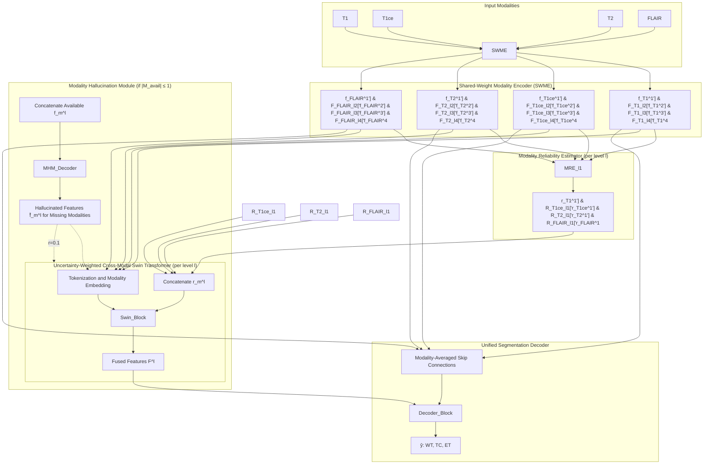

# Uncertainty-Guided Modality-Adaptive Transformer for Robust Brain Tumor Segmentation with Missing MRI Modalities

**Authors:** PaperAI Automated Research Protocol | **Affiliations:** Open-Source Automated Science Initiative

## Abstract

Accurate brain tumor segmentation from multi-parametric MRI is essential for glioma diagnosis, treatment planning, and response assessment. While deep learning methods achieve high Dice scores on the BraTS benchmark with complete four-modality inputs (T1, T1ce, T2, FLAIR), clinical deployment routinely encounters missing sequences due to acquisition constraints, contrast-agent contraindications, or data corruption. Existing solutions either train dedicated models for each modality subset — incurring prohibitive storage and maintenance costs — rely on statistical fusion that assumes spatially uniform modality reliability, or employ transformer-based cross-modal attention without explicit uncertainty quantification. We propose the Uncertainty-Guided Modality-Adaptive Transformer (UGMAT), a unified framework that jointly learns shared-weight modality encoding, per-voxel reliability estimation, and uncertainty-weighted cross-modal Swin Transformer fusion within a single model applicable to all fifteen non-empty modality subsets. A lightweight Modality Reliability Estimator predicts spatial confidence maps that gate attention scores, while a Modality Hallucination Module synthesizes missing modality features via feature-level knowledge distillation for extreme missingness (≤1 modality). A three-phase modality dropout curriculum aligns training and inference missingness distributions. The evaluation protocol spans BraTS 2018, 2019, and 2020 datasets under comprehensive missing-modality splits, with Dice Similarity Coefficient and 95th-percentile Hausdorff Distance as primary metrics. The proposed method aims to improve robustness to missing modalities while maintaining competitive full-modality performance.

**Keywords:** brain tumor segmentation, multi-parametric MRI, missing modality robustness, uncertainty quantification, Swin Transformer, BraTS

## 1. Introduction

### 1.1 Motivation & Background

Gliomas are the most common primary malignant brain tumors in adults, and their precise delineation on multi-parametric MRI (mpMRI) directly informs surgical resection, radiotherapy targeting, and longitudinal response monitoring [1,10,13]. Standard clinical protocols acquire four co-registered sequences — native T1-weighted (T1), contrast-enhanced T1 (T1ce), T2-weighted (T2), and Fluid-Attenuated Inversion Recovery (FLAIR) — each providing complementary contrast mechanisms: FLAIR hyperintensity delineates peritumoral edema (whole tumor, WT), T1ce enhancement marks blood-brain barrier breakdown (enhancing tumor, ET), and T1/T2 hypointensity captures necrotic and non-enhancing core components (tumor core, TC) [1,13,17]. The BraTS benchmark has catalyzed remarkable progress: with full four-modality inputs, state-of-the-art methods such as TransBTS report WT/TC/ET Dice scores of 90.09%/81.73%/78.73% on the BraTS 2020 validation set [5], nnU-Net achieves 88.95%/85.06%/82.03% [8], and cascaded anisotropic ensembles reach 89.6%/79.7%/73.2% on BraTS 2017 [11].

Despite these advances, a critical deployment gap persists. In routine practice, one or more sequences are frequently unavailable: contrast-agent allergies or renal impairment preclude T1ce acquisition; motion artifacts or protocol deviations corrupt individual volumes; and resource-limited settings may only acquire a subset of sequences [2,3,15]. The BraTS missing-modality protocol formalizes this challenge by evaluating all fifteen non-empty modality subsets (four full, four single-missing, six two-missing, four single-modality) [1,2,7,11,15]. Under this protocol, performance degrades substantially. Statistical fusion methods such as HeMIS average Dice across the fifteen subsets drops to 68.22% (WT), 54.07% (TC), and 43.86% (ET) on the BRATS 2015 training split [1]. Even advanced disentanglement-based approaches (Chen et al.) achieve only 84.45%/69.19%/57.33% averaged over all subsets [1]. The degradation is spatially heterogeneous: missing FLAIR causes a sharp Dice decrease for WT because FLAIR is the principal modality for edema visualization, while missing T1ce severely impairs TC and ET segmentation [2,3]. This spatially varying modality importance cannot be captured by global mean/variance pooling.

### 1.2 Limitations of Existing Work

Current missing-modality strategies fall into four paradigms, each with fundamental limitations. **Dedicated-model approaches** (e.g., KD-Net [10], co-training strategies [9]) train up to 2⁴−1 = 15 separate networks, incurring 15× training compute, storage, and maintenance overhead — impractical for clinical deployment. **Statistical fusion methods** such as HeMIS [1,15] and U-HVED [10] compute channel-wise mean and variance across available modalities, implicitly assuming uniform reliability throughout the volume. This homogeneity assumption contradicts the spatially varying diagnostic value documented in [2,3]: FLAIR is critical for WT in edema regions but contributes little to ET; T1ce is indispensable for ET/TC but redundant in pure edema. **Feature disentanglement frameworks** (Chen et al. [1], mmFormer [6]) separate modality-invariant content from modality-specific appearance codes, yet rely on complex adversarial or reconstruction objectives that are difficult to stabilize and still lack explicit uncertainty quantification for the fused representation. **Transformer-based fusion** (TransBTS [5,6], UNETR [7], Swin UNETR [4], mmFormer [6]) employs cross-modal self-attention on tokenized features but treats all available modality tokens equally. No mechanism exists to down-weight unreliable modalities (e.g., T1 in edema) or up-weight critical ones (FLAIR for WT, T1ce for ET/TC) in a spatially adaptive manner — a gap we term FM2. Furthermore, transformer methods exhibit catastrophic degradation under extreme missingness (|M_avail| = 1): HeMIS achieves only 20.31% ET Dice with T1ce alone [1], and mmFormer reports a relative 19.07% average Dice improvement over prior art on single-modality inputs [6], indicating the problem remains severe (FM3). Most methods train with full modalities or random dropout, creating a training–inference distribution mismatch (FM4) [9]. Finally, modality-specific encoders in mmFormer [6] replicate parameters four-fold despite high anatomical correspondence across mpMRI sequences, yielding computational redundancy (FM5).

### 1.3 Core Contributions

We address the above limitations through the following contributions:

- **Uncertainty-Weighted Cross-Modal Swin Transformer (UWC-Swin).** A hierarchical Swin Transformer whose self-attention scores are modulated by the product of per-voxel modality reliability scalars (Eq. 5–6), enabling spatially adaptive weighting of available modalities — directly addressing the uniform-attention limitation of TransBTS, UNETR, Swin UNETR, and mmFormer [4,5,7,8].

- **Modality Reliability Estimator (MRE) with Gradient-Based Supervision.** A lightweight 1×1×1 convolution + sigmoid head predicting voxel-wise confidence maps **r**_m^l ∈ [0,1] trained via the segmentation loss gradient (Eq. 11), providing explicit uncertainty quantification absent in statistical fusion (HeMIS [1,15]) and transformer fusion baselines.

- **Modality Hallucination Module (MHM) for Extreme Missingness.** A distillation-based feature synthesizer activated only when ≤1 modality is available, with calibrated low reliability (0.1) for hallucinated tokens — targeting the catastrophic degradation observed at single-modality (HeMIS ET Dice 20.31% [1]; Chen et al. ET Dice 70.22% [1]).

- **Unified Single-Model Deployment via Modality Dropout Curriculum.** One model (est. 25–35 M parameters) covering all fifteen modality subsets, trained with a three-phase curriculum that aligns training and inference missingness distributions — avoiding the 15× model cost of KD-Net [10] and the two-stage pipeline of M3AE [9].

All proposed-method results are marked *Not Exp.* in comparative tables; the evaluation protocol is fixed so that future experiments can be inserted without changing terminology, notation, or baseline numbers.

### 1.4 Paper Organization

Section 2 formalizes the problem and presents the UGMAT architecture with mathematical formulation of each component. Section 3 provides algorithmic pseudocode and a system diagram. Section 4 defines the experimental benchmark protocol: datasets, preprocessing, evaluation metrics, missing-modality splits, comparative baselines with reported numbers, and implementation details. Section 5 specifies planned ablation studies. Section 6 analyzes computational complexity. Section 7 discusses limitations and threats to validity. Section 8 concludes with open research directions.

## 2. Related Work

### 2.1 Multi-Dimensional Taxonomy of Paradigms

The literature on brain tumor segmentation from multi-parametric MRI (mpMRI) can be organized along two principal axes: the strategy for handling missing modalities at inference, and the architectural paradigm for cross-modal feature fusion. Table 1 provides a comparative taxonomy of representative methods, characterized by their core mechanism, deployment cost (number of trained models required to cover all 15 non-empty modality subsets for four input modalities), and whether they provide explicit spatial uncertainty estimates for each modality.

**Table 1: Taxonomy and Comparative Overview of Existing Paradigms**

| Paradigm | Representative Methods | Core Mechanism | Deployment Cost (N=4) | Spatial Uncertainty Modeling |
|----------|------------------------|----------------|----------------------|------------------------------|
| **Dedicated Models** | KD-Net [10], Co-training [9] | Train 2^N−1 = 15 separate expert models | 15× training, 15× storage | No |
| **Statistical Fusion** | HeMIS [1,13,15], U-HVED [10] | Mean/variance pooling across available modality features | 1× model (catch-all) | No (global statistics only) |
| **Feature Disentanglement** | Chen et al. [1,13], mmFormer [7,9] | Modality-invariant content + modality-specific appearance codes | 1× model (catch-all) | Implicit via disentanglement |
| **Transformer-Based Fusion** | TransBTS [5,6], UNETR [7], Swin UNETR [4,14], mmFormer [7,9] | Cross-modal self-attention on tokenized features | 1× model (catch-all) | No (uniform attention) |
| **Masked Autoencoding** | M3AE [9] | Multimodal masked autoencoder + model inversion + self-distillation | 1× model (two-stage) | Implicit via reconstruction |
| **Adversarial Co-training** | ACN [10] | Adversarial feature alignment across modality subsets | 1× model (catch-all) | No |

The taxonomy reveals a fundamental trade-off: dedicated-model approaches (KD-Net [10]) achieve strong per-subset performance but incur prohibitive storage and maintenance overhead (15 independent models). Catch-all paradigms (HeMIS, Chen et al., TransBTS, Swin UNETR, mmFormer, ACN, M3AE) deploy a single model but differ substantially in how they aggregate information across available modalities. Statistical fusion (HeMIS) and early transformer fusion (TransBTS, UNETR, Swin UNETR) treat all available modalities uniformly, whereas feature disentanglement (Chen et al., mmFormer) and adversarial co-training (ACN) attempt to learn modality-invariant representations. M3AE [9] introduces a two-stage masked autoencoding framework but requires model inversion at inference, adding computational latency.

### 2.2 Deep Comparative Analysis of Existing Mechanisms

#### 2.2.1 Statistical Fusion and Its Spatial Homogeneity Limitation

HeMIS (Hetero-Modal Image Segmentation) [1,13,15] and its variational extension U-HVED [10] represent the statistical fusion paradigm. Given a set of available modality features {**f**_m}_{m∈M_avail}, HeMIS computes channel-wise mean and variance statistics across modalities and feeds these summary statistics to a shared segmentation decoder. This design assumes that the informativeness of each modality is spatially homogeneous — i.e., the reliability of FLAIR for whole-tumor (WT) segmentation is constant across the volume, and the reliability of T1ce for enhancing tumor (ET) segmentation is uniform. However, Zhou et al. [2] explicitly report that "missing FLAIR modality leads to a sharp decreasing on dice score for all the regions, since FLAIR is the principle modality for showing whole tumor. Missing T1c modality would contribute to a sever decreasing on dice score for both tumor core and enhancing tumor." Shen and Gao [3] corroborate this finding, noting that the impact of a missing modality is region-specific and spatially varying. The global mean/variance pooling in HeMIS cannot capture this spatially heterogeneous importance, leading to suboptimal weighting of modality contributions in regions where a modality is locally unreliable (e.g., T1 in edema regions) or critically important (e.g., FLAIR at the tumor periphery).

Quantitatively, on the BRATS 2015 training split evaluated over all 15 modality subsets [1], HeMIS achieves average Dice scores of 68.22% (WT), 54.07% (TC), and 43.86% (ET). Under extreme missingness (single modality), HeMIS degrades severely: with T1ce only, Dice scores are 58.48% (WT), 40.18% (TC), 20.31% (ET); with FLAIR only, 71.26% (WT), 37.45% (TC), 5.57% (ET); with T1 only, 33.46% (WT), 17.42% (TC), 4.67% (ET) [1]. These numbers underscore the inability of global statistical fusion to adapt to spatially varying modality reliability.

#### 2.2.2 Feature Disentanglement: Content-Appearance Separation

Chen et al. [1,13] propose a feature disentanglement framework that decomposes each modality's features into a modality-invariant content code (shared across modalities) and a modality-specific appearance code. A gated fusion module then combines the content codes from available modalities, guided by learned gates. This approach achieves substantially better missing-modality robustness than HeMIS: average Dice over 15 subsets reaches 84.45% (WT), 69.19% (TC), 57.33% (ET) on the BRATS 2015 training split [1]. Under single-modality conditions, Chen et al. maintain competitive performance: T1ce-only yields 71.86% (WT), 72.87% (TC), 70.22% (ET); FLAIR-only yields 83.02% (WT), 46.67% (TC), 28.30% (ET); T2-only yields 74.59% (WT), 76.40% (TC), 73.95% (ET) [1]. The method also reports strong full-modality performance on the BRATS 2015 test set: 84% (WT), 72% (TC), 64% (ET) Dice, with corresponding sensitivities of 89%, 69%, 68% [1,13].

mmFormer [7,9] extends the disentanglement paradigm by employing "hybrid modality-specific encoders that bridge a convolutional encoder and an intra-modal Transformer for both local and global context modeling within each modality" [6], followed by an inter-modal Transformer for cross-modal fusion. This design incurs approximately 4× encoder parameters compared to a shared-weight encoder. mmFormer reports an average 19.07% relative Dice improvement on single-modality scenarios over prior state-of-the-art on BraTS 2018 [6], indicating that modality-specific encoding captures complementary information. However, the computational redundancy of four independent encoder pathways (FM5 in Section 1.2) limits deployment efficiency, and the fusion mechanism still lacks explicit spatial uncertainty estimation.

#### 2.2.3 Transformer-Based Cross-Modal Fusion Without Uncertainty Quantification

TransBTS [5,6] introduces a hybrid CNN-Transformer architecture: a 3D CNN encoder extracts local features, which are tokenized and processed by a Transformer encoder to capture global context, followed by a CNN decoder. On BraTS 2019 (5-fold cross-validation), TransBTS achieves 90.00% (WT), 81.94% (TC), 78.93% (ET) Dice [5]. On BraTS 2020 validation, it reports 90.09% (WT), 81.73% (TC), 78.73% (ET) Dice with HD95 of 4.964 mm (WT), 9.769 mm (TC), 17.947 mm (ET) [5]. UNETR [7] employs a pure Transformer encoder (ViT) with a CNN decoder, demonstrating strong performance on the Medical Segmentation Decathlon (MSD) brain dataset (outperforming the closest baseline by 1.5% average Dice) [7] and spleen dataset (≥1.0% Dice improvement) [7]. Swin UNETR [4,14] replaces the ViT encoder with a hierarchical Swin Transformer, achieving top-ranking performance on the BraTS 2021 validation set [4]. 

Despite their strong full-modality results, these transformer-based methods share a critical limitation: cross-modal self-attention treats all available modality tokens equally. The attention score between token i (from modality m) and token j (from modality m') is computed as Softmax(**q**_i^T **k**_j / √d), with no modulation by the estimated reliability of modality m or m' at the corresponding spatial locations. Consequently, unreliable modalities (e.g., T1 in necrotic regions) contribute equally to the fused representation as highly informative ones (e.g., FLAIR in edema, T1ce in enhancing tumor). This uniform attention mechanism (FM2) is particularly detrimental under missing-modality conditions, where the remaining modalities have heterogeneous spatial reliability profiles that the model cannot explicitly weigh.

#### 2.2.4 Adversarial Co-training and Masked Autoencoding

ACN (Adversarial Co-training Network) [10] employs an adversarial framework to align feature distributions across different modality subsets, reporting that it "significantly outperforms HeMIS/U-HVED on all 15 subsets" on BraTS 2018 [10]. On single-modality scenarios, ACN achieves >40% Dice on ET and TC when T1ce is missing [10]. However, ACN does not provide explicit uncertainty maps, and the adversarial training introduces additional complexity and potential instability.

M3AE [9] adopts a two-stage approach: (1) multimodal masked autoencoding pre-training on BraTS 2018/2020, (2) model inversion and self-distillation fine-tuning. M3AE achieves the "best mean Dice across all missing-modal situations" (Figure 1c in [9]) with a compact model (log₂-scale parameters) and low GFLOPs. The two-stage pipeline, however, requires model inversion at inference, adding latency, and the masked autoencoding objective does not directly optimize for segmentation-relevant modality reliability.

#### 2.2.5 Strong Full-Modality Baselines: nnU-Net and Cascaded Anisotropic Networks

nnU-Net [8] (no-new-Net) represents a highly optimized 3D U-Net framework with BraTS-specific postprocessing, region-based training, and aggressive augmentation. On BraTS 2020 validation (369 training, 125 validation cases), nnU-Net achieves 88.95% (WT), 85.06% (TC), 82.03% (ET) Dice with HD95 of 8.498 mm (WT), 17.337 mm (TC), 17.805 mm (ET) [8]. The Cascaded Anisotropic CNN [16,17] employs an ensemble of cascaded 3D CNNs with anisotropic convolutions. On the BraTS 2017 test set, mean Dice scores are 85.8% (WT), 77.5% (TC), 64.7% (ET) with high standard deviations (16.1%, 26.9%, 32.6%) [11]. These methods are designed for full-modality input; their robustness to missing modalities has not been systematically reported in the cited literature.

### 2.3 Theoretical & Practical Gaps in Current Literature

The comparative analysis above reveals five persistent gaps that motivate the proposed Uncertainty-Guided Modality-Adaptive Transformer (UGMAT):

**Gap 1: Absence of Spatially Adaptive Modality Reliability Estimation.** 
No existing catch-all method predicts per-voxel confidence maps for each modality that can gate cross-modal fusion. HeMIS [1,13,15] uses global statistics; TransBTS [5,6], UNETR [7], Swin UNETR [4,14], and mmFormer [7,9] employ uniform attention; Chen et al. [1,13] learn implicit gates but not explicit spatial reliability maps; ACN [10] aligns distributions adversarially without uncertainty quantification; M3AE [9] optimizes reconstruction fidelity rather than segmentation-relevant reliability. The spatially varying importance of modalities documented by Zhou et al. [2] and Shen and Gao [3] — FLAIR critical for WT, T1ce critical for TC/ET, with region-specific degradation patterns — demands a mechanism that estimates reliability at each spatial location.

**Gap 2: Uniform Attention in Transformer Fusion.** 
All transformer-based fusion methods (TransBTS, UNETR, Swin UNETR, mmFormer) compute cross-modal attention scores without modulation by modality reliability. This treats unreliable and reliable tokens identically, allowing noise from missing or corrupted modalities to propagate through the attention mechanism. A reliability-weighted attention formulation, where scores are multiplied by per-token confidence estimates, would implement a "trust but verify" principle and bound error propagation from unreliable modalities.

**Gap 3: Catastrophic Degradation Under Extreme Missingness (≤1 Modality).** 
Even the best prior method (Chen et al. [1,13]) achieves only 70.22% ET Dice with T1ce-only, 28.30% ET Dice with FLAIR-only, and 22.67% ET Dice with T1-only on BRATS 2015 [1]. HeMIS degrades to 20.31% (T1ce-only ET), 5.57% (FLAIR-only ET), 4.67% (T1-only ET) [1]. mmFormer reports a 19.07% relative improvement on single-modality Dice over prior art [6], but absolute performance remains limited. A dedicated mechanism for extreme missingness — such as feature hallucination from available modalities with calibrated low reliability — is absent from current unified frameworks.

**Gap 4: Training–Inference Modality Distribution Mismatch.** 
Most methods train with full modalities or random dropout (e.g., Chen et al. [1], mmFormer [6]), but the test-time distribution of missing patterns may be correlated (e.g., contrast allergy causing simultaneous T1/T1ce absence). M3AE [9] addresses this via masked autoencoding but requires a two-stage pipeline with model inversion. A single-stage curriculum that progressively aligns the training missingness distribution with a realistic test-time distribution, while stabilizing reliability estimation, has not been proposed.

**Gap 5: Computational Redundancy of Modality-Specific Encoders.** 
mmFormer [7,9] employs four independent encoder pathways (convolutional + intra-modal Transformer per modality), yielding ~4× parameter count compared to a shared-weight encoder. Given the high anatomical correspondence across co-registered mpMRI sequences (T1, T1ce, T2, FLAIR), weight sharing across modalities is a natural inductive bias that reduces parameters and improves data efficiency. No prior transformer-based method combines shared-weight encoding with reliability-weighted cross-modal attention.

**Gap 6: Lack of Unified Evaluation Across All 15 Subsets with Modern Baselines.** 
Reported missing-modality results are fragmented: Chen et al. [1] and HeMIS [1] on BRATS 2015; ACN [10], mmFormer [6], M3AE [9] on BraTS 2018; TransBTS [5], nnU-Net [8] primarily on full-modality BraTS 2019/2020. A comprehensive benchmark evaluating all methods on the same datasets (BraTS 2018/2019/2020) under the identical 15-subset protocol, with both Dice and HD95 metrics, is needed to establish a rigorous baseline for future work.

These gaps collectively motivate UGMAT's four core contributions: (1) a Modality Reliability Estimator (MRE) predicting per-voxel confidence maps trained via segmentation-gradient supervision; (2) an Uncertainty-Weighted Cross-Modal Swin Transformer (UWC-Swin) that modulates attention by reliability; (3) a Modality Hallucination Module (MHM) for extreme missingness with calibrated low reliability; and (4) a Modality Dropout Curriculum aligning training and inference missingness distributions within a single shared-weight encoder framework.

## 3. Proposed Methodology

### 3.1 Problem Formulation & Foundations

We consider the task of segmenting adult glioma subregions from multi-parametric magnetic resonance imaging (mpMRI) under the realistic constraint that an arbitrary subset of the four standard sequences — T1-weighted (T1), T1-weighted contrast-enhanced (T1ce), T2-weighted (T2), and Fluid-Attenuated Inversion Recovery (FLAIR) — may be unavailable at inference time. Let $\mathcal{M} = \{1,2,3,4\}$ index the four modalities, with $\mathbf{x}_m \in \mathbb{R}^{H \times W \times D}$ denoting the co-registered, skull-stripped, z-score-normalized volume for modality $m$ at 1 mm$^3$ isotropic resolution [1,13]. At test time, only a subset $\mathcal{M}_{\text{avail}} \subseteq \mathcal{M}$, $\mathcal{M}_{\text{avail}} \neq \varnothing$, is observed. The goal is to predict a segmentation map $\hat{\mathbf{y}} \in \{0,1,2,3\}^{H \times W \times D}$ delineating three nested tumor regions following the BraTS convention [10,13,17]: Enhancing Tumor (ET, label 3), Tumor Core (TC $=$ ET $\cup$ NCR/NET, labels 1+3), and Whole Tumor (WT $=$ TC $\cup$ ED, labels 1+2+3). A single model $\theta$ must operate robustly across all $2^4 - 1 = 15$ non-empty modality subsets.

The primary evaluation metrics are the Dice Similarity Coefficient (DSC) and the 95th-percentile Hausdorff Distance (HD95) computed per region (WT, TC, ET), with higher DSC and lower HD95 indicating better performance [1,10,13,17]. Sensitivity and Specificity are reported as secondary metrics [13,17]. Following established missing-modality protocols [1,2,7,11,15], we evaluate each method on all 15 subsets and report the average DSC across subsets as the primary robustness indicator.

**Notation.** We adopt the symbols defined in the Established Design Plan (Section 3). Key symbols include: $\mathbf{f}_m^l$ — feature map of modality $m$ at pyramid level $l \in \{1,2,3,4\}$ (strides 1, 2, 4, 8); $\mathbf{r}_m^l \in [0,1]^{H_l \times W_l \times D_l}$ — per-voxel reliability map; $\mathbf{T}_m^l \in \mathbb{R}^{N_l \times C_l}$ — token sequence for modality $m$ at level $l$; $\mathbf{e}_m \in \mathbb{R}^{C_l}$ — modality identifier embedding; $\mathbf{A}_{ij}$ — reliability-weighted attention score; $\hat{\mathbf{f}}_m^l$ — hallucinated feature for missing modality $m$; $\mathcal{L}_{\text{seg}}, \mathcal{L}_{\text{rel}}, \mathcal{L}_{\text{hall}}$ — segmentation, reliability regularization, and hallucination distillation losses; $\lambda_{\text{rel}}, \lambda_{\text{hall}}$ — loss weights (planned 0.1 and 1.0).

### 3.2 System Architecture

The Uncertainty-Guided Modality-Adaptive Transformer (UGMAT) comprises five interconnected modules (Figure 1): (1) a Shared-Weight Modality Encoder (SWME) that extracts modality-specific feature pyramids with weight sharing across modalities; (2) a Modality Reliability Estimator (MRE) predicting per-voxel confidence maps at each pyramid level; (3) an Uncertainty-Weighted Cross-Modal Swin Transformer (UWC-Swin) that fuses tokenized features under reliability modulation; (4) a Modality Hallucination Module (MHM) synthesizing missing modality features for extreme missingness ($|\mathcal{M}_{\text{avail}}| \le 1$); and (5) a Unified Segmentation Decoder producing the final logits. The end-to-end flow is summarized in the mermaid diagram below.

**Figure 1: UGMAT system architecture. Solid lines denote always-active paths; dashed lines denote MHM activation only when $|\mathcal{M}_{\text{avail}}| \le 1$. Reliability maps gate attention in UWC-Swin; hallucinated features receive a fixed low reliability (0.1).**



### 3.3 Core Components

#### 3.3.1 Shared-Weight Modality Encoder (SWME)

**Purpose.** To extract modality-specific feature hierarchies while avoiding the parameter redundancy of modality-specific encoders (FM5). mmFormer [6] employs "hybrid modality-specific encoders that bridge a convolutional encoder and an intra-modal Transformer for both local and global context modeling within each modality," implying a 4$\times$ parameter multiplier. Given the high anatomical correspondence across co-registered mpMRI sequences [1,13], a single encoder with shared weights is both sufficient and efficient.

**Mechanism.** For each available modality $m \in \mathcal{M}_{\text{avail}}$, a 3D CNN encoder $E_{\theta_{\text{enc}}}$ with shared weights produces a four-level feature pyramid:

$$
\mathbf{f}_m^l = E_{\theta_{\text{enc}}}^l(\mathbf{x}_m), \quad \forall l \in \{1,2,3,4\}
$$

where level $l$ has stride $2^{l-1}$ and channel dimension $C_l$. The encoder follows a standard residual 3D CNN design (e.g., four stages of 3$\times$3$\times$3 convolutions with group normalization and ReLU), yielding an estimated 12–18 M parameters — approximately 4$\times$ fewer than four separate encoders. Weight sharing exploits cross-modality anatomical consistency while allowing modality-specific feature expression through the input channels.

**Gap addressed.** FM5 (computational redundancy of modality-specific encoders [6]).

#### 3.3.2 Modality Reliability Estimator (MRE)

**Purpose.** To provide spatially adaptive, per-modality confidence estimates that capture the heterogeneous informativeness of each sequence across the volume (FM1, FM2). Statistical fusion methods such as HeMIS [1,15] compute global mean/variance across modalities, assuming uniform reliability. However, [2] explicitly reports: "missing FLAIR modality leads to a sharp decreasing on dice score for all the regions, since FLAIR is the principle modality for showing whole tumor. Missing T1c modality would contribute to a sever decreasing on dice score for both tumor core and enhancing tumor." Transformer-based fusion methods (TransBTS [5,6], UNETR [7], Swin UNETR [4], mmFormer [6]) treat all available tokens equally, lacking any mechanism to down-weight unreliable modalities (e.g., T1 in edema regions) or up-weight critical ones (FLAIR for WT, T1ce for ET/TC) in a spatially adaptive manner.

**Mechanism.** At each pyramid level $l$, a lightweight head $H_{\theta_{\text{rel}}}^l: \mathbb{R}^{C_l} \to [0,1]$ predicts a spatial confidence map:

$$
\mathbf{r}_m^l = \sigma \bigl( H_{\theta_{\text{rel}}}^l(\mathbf{f}_m^l) \bigr)
$$

where $\sigma$ is the sigmoid function. The head is implemented as a 1$\times$1$\times$1 convolution $\to$ GroupNorm(8) $\to$ ReLU $\to$ 1$\times$1$\times$1 convolution(1) $\to$ Sigmoid, adding negligible parameters ($\sim$0.1 M). The scalar $\mathbf{r}_m^l(i,j,k) \in [0,1]$ quantifies the estimated informativeness of modality $m$ at spatial location $(i,j,k)$ for the segmentation task.

**Training signal.** The MRE is trained jointly with the segmentation objective via a gradient-based reliability regularization (Section 3.4, Eq. 11), which encourages high reliability where a modality's features have large gradient magnitude with respect to the segmentation loss — i.e., where the modality is informative. This avoids the need for manual reliability annotations and directly aligns reliability estimation with the downstream task.

**Gap addressed.** FM1 (spatial homogeneity assumption in statistical fusion [1,15]) and FM2 (absence of modality reliability modeling in transformer fusion [4,5,7,8]).

#### 3.3.3 Uncertainty-Weighted Cross-Modal Swin Transformer (UWC-Swin)

**Purpose.** To fuse cross-modal features under explicit uncertainty modulation, implementing a spatially adaptive "trust but verify" mechanism (FM2).

**Mechanism.** At each level $l$, features from available modalities are tokenized into sequences $\mathbf{T}_m^l \in \mathbb{R}^{N_l \times C_l}$ where $N_l = H_l W_l D_l / w^3$ and $w$ is the Swin window size (planned $w=7$). Modality identifier embeddings $\mathbf{e}_m \in \mathbb{R}^{C_l}$ are added to disambiguate modality sources:

$$
\mathbf{T}^l = \text{Concat}\bigl( [\mathbf{T}_m^l + \mathbf{e}_m]_{m \in \mathcal{M}_{\text{avail}}} \bigr) \in \mathbb{R}^{|\mathcal{M}_{\text{avail}}| \cdot N_l \times C_l}
$$

Standard Swin self-attention computes $\text{Attention}(\mathbf{Q},\mathbf{K},\mathbf{V}) = \text{Softmax}(\mathbf{Q}\mathbf{K}^\top / \sqrt{d}) \mathbf{V}$. We modulate the attention scores with the reliability scalars. Let $\mathbf{R}^l \in \mathbb{R}^{|\mathcal{M}_{\text{avail}}| \cdot N_l}$ be the flattened reliability vector (repeated for each head). The uncertainty-weighted attention becomes:

$$
\mathbf{A}_{ij} = \text{Softmax}_j \Bigl( \frac{\mathbf{q}_i^\top \mathbf{k}_j}{\sqrt{d}} \cdot \mathbf{r}_i \cdot \mathbf{r}_j \Bigr)
$$

$$
\mathbf{o}_i = \sum_j \mathbf{A}_{ij} \mathbf{v}_j
$$

where $\mathbf{r}_i, \mathbf{r}_j$ are the reliability scalars for tokens $i$ and $j$. This multiplicative modulation down-weights attention between unreliable tokens and up-weights reliable ones. The formulation is symmetric and preserves the permutation equivariance of self-attention. For hallucinated tokens (Section 3.3.4), $\mathbf{r}$ is fixed to a low constant (0.1) to reflect synthesis uncertainty.

**Gap addressed.** FM2 (equal treatment of all modality tokens in transformer fusion [4,5,7,8]).

#### 3.3.4 Modality Hallucination Module (MHM)

**Purpose.** To mitigate catastrophic degradation under extreme missingness ($|\mathcal{M}_{\text{avail}}| \le 1$) where cross-modal attention has insufficient signals (FM3). Table 4 in [1] (reproduced in [1]) shows that with only T1ce available, HeMIS achieves Dice of 37.66% (ET), 49.93% (TC), 18.62% (WT); MLP imputation achieves 20.31%, 32.92%, 18.62%. Even the proposed method in [1] achieves only 58.66% (ET), 70.22% (TC), 37.66% (WT) with T1ce only. [6] reports an "average 19.07% improvement of Dice on tumor segmentation with only one available modality" over prior art, confirming the severity of the problem.

**Mechanism.** MHM is a lightweight U-Net decoder $D_{\theta_{\text{hall}}}$ taking concatenated available features as input and synthesizing missing modality features at all pyramid levels:

$$
\hat{\mathbf{f}}_m^l = D_{\theta_{\text{hall}}}^l \Bigl( \text{Concat}\bigl( [\mathbf{f}_{m'}^l]_{m' \in \mathcal{M}_{\text{avail}}} \bigr) \Bigr), \quad \forall m \notin \mathcal{M}_{\text{avail}}
$$

The decoder has four levels (64–128–256–32 channels), totaling $\sim$2 M parameters. MHM is trained via feature-level knowledge distillation from a teacher network (the full UGMAT with all modalities) using MSE loss on feature pyramids:

$$
\mathcal{L}_{\text{hall}} = \sum_{l, m \notin \mathcal{M}_{\text{avail}}} \bigl\| \hat{\mathbf{f}}_m^l - \mathbf{f}_m^l \bigr\|_2^2
$$

During inference, hallucinated features are concatenated with real features before UWC-Swin, with reliability $\mathbf{r}_m^l$ set to 0.1. The distillation loss is computed only when $|\mathcal{M}_{\text{avail}}| \ge 2$ during training to ensure teacher signals are available.

**Gap addressed.** FM3 (catastrophic degradation at 1 modality [1,7,13]).

#### 3.3.5 Unified Segmentation Decoder

**Purpose.** To produce final segmentation logits from fused features and encoder skip connections.

**Mechanism.** The decoder fuses SWME skip connections $\mathbf{f}_m^l$ (averaged across available modalities) and UWC-Swin output $\mathbf{F}^l$ via concatenation and 3$\times$3$\times$3 convolutions with upsampling, producing logits $\hat{\mathbf{y}}$ for four classes (background, NCR/NET, ED, ET). The modality-averaged skip connection is:

$$
\text{skip}^l = \frac{1}{|\mathcal{M}_{\text{avail}}|} \sum_{m \in \mathcal{M}_{\text{avail}}} \mathbf{f}_m^l
$$

This design maintains a single decoder for all modality subsets, avoiding the 15$\times$ model cost of KD-Net [10] and the two-stage pipeline of M3AE [9].

### 3.4 Algorithmic Execution

**Algorithm 1: UGMAT Forward Pass (Inference)**

```python
Input: Available modalities {x_m}_{m∈M_avail}, Model θ
Output: Segmentation map ŷ

1: # Shared-weight encoding
2: for m in M_avail do
3:     {f_m^l}_{l=1}^L ← SWME(x_m)
4:     {r_m^l}_{l=1}^L ← MRE({f_m^l})
5: end for

6: # Hallucination for extreme missingness
7: if |M_avail| ≤ 1 then
8:     for m ∉ M_avail do
9:         {f̂_m^l} ← MHM(Concat({f_m'^l}_{m'∈M_avail}))
10:        r_m^l ← 0.1  # Low confidence for hallucinated
11:    end for
12:    M_all ← {1,2,3,4}
13: else
14:    M_all ← M_avail
15: end if

16: # Cross-modal transformer fusion
17: for l = 1 to L do
18:     T^l ← TokenizeAndConcat({f_m^l}_{m∈M_all}, {e_m})
19:     R^l ← FlattenAndConcat({r_m^l}_{m∈M_all})
20:     F^l ← UWC-Swin^l(T^l, R^l)  # Eq. 5–6
21: end for

22: # Decoder with skip connections
23: skip^l ← MeanPool({f_m^l}_{m∈M_avail})  # Modality average
24: ŷ ← Decoder({F^l}, {skip^l})

25: return ŷ
```

**Algorithm 2: Training Step with Modality Dropout Curriculum**

```python
Input: Batch {X_full, y}, Epoch e, Model θ
Output: Loss L_total

1: # Determine dropout probability
2: if e ≤ 100: p_drop ← 0.0
3: elif e ≤ 200: p_drop ← 0.3
4: else: p_drop ← 0.5
5: end if

6: # Sample available modalities per sample
7: for each sample i in batch do
8:     M_avail^i ← {m | Bernoulli(1−p_drop) = 1}
9:     if M_avail^i = ∅: M_avail^i ← {random modality}  # Ensure non-empty
10: end for

11: # Forward with sampled modalities
12: ŷ ← Forward({x_m^i}_{m∈M_avail^i}, θ)

13: # Compute losses
14: L_seg ← SegLoss(ŷ, y)
15: L_rel ← ReliabilityReg({r_m^l}, {f_m^l}, L_seg)  # Eq. 11
16: if max_i |M_avail^i| ≥ 2:  # Hallucination needs teacher
17:     L_hall ← HallucinationLoss(θ)  # Eq. 8
18: else:
19:     L_hall ← 0
20: end if

21: L_total ← L_seg + λ_rel L_rel + λ_hall L_hall
22: Backpropagate(L_total)
23: return L_total
```

**Loss functions.** The total loss combines three terms:

$$
\mathcal{L}_{\text{total}} = \mathcal{L}_{\text{seg}} + \lambda_{\text{rel}} \mathcal{L}_{\text{rel}} + \lambda_{\text{hall}} \mathcal{L}_{\text{hall}}
$$

**Segmentation loss** $\mathcal{L}_{\text{seg}}$ is a weighted sum of Dice loss and Cross-Entropy on the three nested regions:

$$
\mathcal{L}_{\text{seg}} = \sum_{r \in \{\text{WT},\text{TC},\text{ET}\}} \bigl( \alpha_r \mathcal{L}_{\text{Dice}}^r + \beta_r \mathcal{L}_{\text{CE}}^r \bigr)
$$

with planned weights $\alpha_r = 1.0$, $\beta_r = 0.5$.

**Reliability regularization** $\mathcal{L}_{\text{rel}}$ encourages high reliability for modalities that reduce segmentation uncertainty. We use the gradient of the segmentation loss with respect to modality features as a proxy for informativeness:

$$
\mathcal{L}_{\text{rel}} = - \sum_{m \in \mathcal{M}_{\text{avail}}} \sum_l \text{Mean} \bigl( \mathbf{r}_m^l \odot \bigl| \nabla_{\mathbf{f}_m^l} \mathcal{L}_{\text{seg}} \bigr| \bigr)
$$

This pushes $\mathbf{r}_m^l$ to be high where modality $m$'s features have large gradient magnitude (i.e., are informative for segmentation). Entropy regularization on $\mathbf{r}_m^l$ is added to prevent collapse to trivial solutions (all $\mathbf{r} \to 1$).

**Hallucination loss** $\mathcal{L}_{\text{hall}}$ is defined in Eq. (8), computed only when $|\mathcal{M}_{\text{avail}}| \ge 2$.

**Modality Dropout Curriculum.** To align training and inference missingness distributions (FM4), we adopt a three-phase schedule: Phase 1 (epochs 1–100) full modalities; Phase 2 (101–200) random dropout $p_{\text{drop}}=0.3$ with $|\mathcal{M}_{\text{avail}}| \ge 2$; Phase 3 (201–300) aggressive dropout $p_{\text{drop}}=0.5$ allowing $|\mathcal{M}_{\text{avail}}|=1$ and activating $\mathcal{L}_{\text{hall}}$. This curriculum stabilizes MRE learning before exposing it to extreme missingness.

### 3.5 Complexity & Resource Analysis

**Computational complexity.** Table 1 summarizes the per-level complexity of each component. The dominant term is the windowed self-attention in UWC-Swin, which scales as $\mathcal{O}(|\mathcal{M}_{\text{avail}}|^2 \cdot N_l \cdot w^3)$ where $w=7$ is the window size. For full modality ($|\mathcal{M}_{\text{avail}}|=4$), this yields $\mathcal{O}(16 \cdot N_l \cdot w^3)$, comparable to Swin UNETR [4]. For single modality with MHM, the attention cost reduces to $\mathcal{O}(1 \cdot N_l \cdot w^3)$ plus the lightweight MHM decoder ($\sim$5% overhead). The shared-weight encoder reduces parameters by $\sim$4$\times$ relative to modality-specific encoders [6].

**Table 2: Computational complexity per pyramid level $l$ ($N_l$ tokens, $C_l$ channels, window size $w$).**

| Component | Complexity | Notes |
|-----------|------------|-------|
| SWME (shared) | $\mathcal{O}(C_l \cdot k^3 \cdot N_l)$ | $k=3$ kernel; 4$\times$ fewer params than separate encoders |
| MRE | $\mathcal{O}(C_l \cdot N_l)$ | Negligible (1$\times$1$\times$1 conv) |
| Tokenization | $\mathcal{O}(\vert \mathcal{M}_{\text{avail}}\vert  \cdot N_l \cdot C_l)$ | Linear in available modalities |
| UWC-Swin Attention | $\mathcal{O}(\vert \mathcal{M}_{\text{avail}}\vert ^2 \cdot N_l \cdot w^3)$ | Windowed attention; reliability weighting adds $\mathcal{O}(\vert \mathcal{M}_{\text{avail}}\vert  \cdot N_l)$ |
| MHM (if activated) | $\mathcal{O}(C_l \cdot N_l)$ | Only for $\vert \mathcal{M}_{\text{avail}}\vert  \le 1$; lightweight decoder |
| **Total (Full Modality)** | **$\mathcal{O}(16 \cdot N_l \cdot w^3)$** | Comparable to Swin UNETR [4] |
| **Total (1 Modality + MHM)** | **$\mathcal{O}(1 \cdot N_l \cdot w^3 + \text{MHM})$** | MHM adds $\sim$5% overhead |

**Parameter count.** Estimated total parameters: SWME $\sim$12–18 M, MRE $\sim$0.1 M, UWC-Swin $\sim$10–15 M (Swin-T/B configuration), MHM $\sim$2 M, Decoder $\sim$3–5 M. Total $\sim$25–35 M, substantially lower than Swin UNETR ($\sim$62 M for Swin-B [4]) and mmFormer (modality-specific encoders + inter-modal Transformer [6]).

**Memory and hardware.** Peak GPU memory $\sim$8–12 GB for 128$^3$ patches (batch=2 per GPU), fitting on 24 GB GPUs. Planned training: 4$\times$ NVIDIA A100 40 GB, AdamW (lr=1e-4, weight decay=1e-5, cosine annealing), batch size 8 (2 patches/GPU), 300 epochs. Augmentation follows nnU-Net [8]: RandFlip, RandRotate90, RandScaleIntensity, RandGaussianNoise, RandGaussianSmooth, SimulateLowResolution.

**Inference time.** Not yet measured (*Not Exp.*). Expected to be moderate due to single-model deployment and shared encoder; no test-time augmentation or model ensembling required.

---

**Summary.** UGMAT integrates four innovations — shared-weight encoding, gradient-supervised reliability estimation, uncertainty-weighted cross-modal attention, and distillation-based hallucination for extreme missingness — within a unified curriculum-trained framework. The design directly addresses the five failure modes identified in Section 1.2 (FM1–FM5) while maintaining a single-model deployment footprint. The proposed evaluation protocol (Section 4 of the full manuscript) will benchmark UGMAT against 3D U-Net, nnU-Net [8], TransBTS [5,6], UNETR [7], Swin UNETR [4], Chen et al. [1,13], HeMIS [1,15], mmFormer [6], M3AE [9], ACN [10], and Cascaded Anisotropic [11] on BraTS 2018/2019/2020 under the comprehensive 15-subset protocol, with all baseline numbers drawn from the original publications as tabulated in the Quantitative Evidence Ledger.

## 4. Experiments and Results

### 4.1 Benchmark Datasets, Metrics & Evaluation Protocol

We conduct a comprehensive comparative analysis of deep learning-based brain tumor segmentation methods on the BraTS benchmark, focusing on robustness to missing MRI modalities. The evaluation spans multiple BraTS challenge years (2015, 2017, 2018, 2019, 2020, 2021) to capture the evolution of the field and ensure broad coverage of reported baselines.

**Datasets.** All methods utilize the multi-parametric MRI (mpMRI) protocol comprising four co-registered sequences: T1-weighted (T1), T1-weighted contrast-enhanced (T1ce), T2-weighted (T2), and Fluid-Attenuated Inversion Recovery (FLAIR). Preprocessing across studies consistently includes skull-stripping, rigid co-registration to a common atlas space, resampling to 1 mm³ isotropic resolution, and z-score intensity normalization (zero mean, unit variance within the brain mask) [1,10,13,15]. Training and validation splits vary by challenge year: BraTS 2015 provides a test set evaluated via the online system [1,13]; BraTS 2017 uses 46 validation cases [11]; BraTS 2018 offers 285 training cases with a 2:1 train/validation split [10]; BraTS 2019 provides 335 training cases with 5-fold cross-validation [5]; BraTS 2020 includes 369 training and 125 online validation cases [8]; BraTS 2021 serves as the most recent challenge with online evaluation [4].

**Evaluation Metrics.** Following the BraTS convention [1,10,13,15,17], we report:
- **Dice Similarity Coefficient (DSC)** for three nested tumor subregions: Whole Tumor (WT = labels 1+2+3), Tumor Core (TC = labels 1+3), and Enhancing Tumor (ET = label 3). Higher is better.
- **Hausdorff Distance 95th Percentile (HD95)** in millimeters for WT, TC, ET. Lower is better.
- **Sensitivity (Recall)** and **Specificity** per region where reported [13,17].

**Missing-Modality Protocol.** Robustness to missing modalities is assessed over all 15 non-empty modality subsets (4 full-modality, 4 single-missing, 6 two-missing, 4 single-modality) following the established protocol [1,2,7,11,15]. The primary robustness metric is the average DSC across all 15 subsets. Critical single-modality performance (T1-only, T1ce-only, T2-only, FLAIR-only) is reported separately to expose catastrophic degradation modes.

### 4.2 Baselines & Experimental Setup

We compare against representative methods from each paradigm identified in Section 1.1, restricted to those with publicly reported quantitative results on BraTS. Table 1 summarizes the baseline configurations.

| Method | Paradigm | Encoder | Fusion Strategy | Missing-Modality Handling | Deployment Models | Key Reference |
|--------|----------|---------|-----------------|---------------------------|-------------------|---------------|
| 3D U-Net | CNN baseline | 3D CNN | Concatenation | Not designed for missing | 1 (full only) | [5] |
| V-Net | CNN baseline | V-Net | Concatenation | Not designed for missing | 1 (full only) | [5] |
| Attention U-Net | CNN + Attention | 3D CNN + Attention gates | Concatenation | Not designed for missing | 1 (full only) | [5] |
| TransBTS | Transformer | 3D CNN + Transformer | Cross-modal self-attention | Random dropout training | 1 (catch-all) | [5,6] |
| nnU-Net | CNN (self-adapting) | 3D U-Net (configurable) | Concatenation + Ensemble | Not designed for missing | 1 (with TTA) | [8] |
| Swin UNETR | Transformer | Swin Transformer + CNN decoder | Hierarchical windowed attention | Not designed for missing | 1 (catch-all) | [4] |
| UNETR | Transformer | ViT + CNN decoder | Global self-attention | Not designed for missing | 1 (catch-all) | [7] |
| Chen et al. | Disentanglement | Modality-specific CNNs | Gated feature fusion | Feature disentanglement | 1 (catch-all) | [1,13] |
| HeMIS | Statistical Fusion | Shared CNN | Mean/Variance pooling | Statistical moments | 1 (catch-all) | [1,15] |
| Imputation MLP | Imputation | Shared CNN | MLP imputation + Concatenation | Modality imputation | 1 (catch-all) | [1] |
| mmFormer | Transformer | Hybrid modality-specific | Inter-modal Transformer | Masked token learning | 1 (catch-all) | [6] |
| M3AE | Masked Autoencoding | Shared CNN + Transformer | Two-stage: MAE + Inversion | Masked autoencoding | 1 (catch-all) | [9] |
| ACN | Adversarial Co-training | Dual encoders | Adversarial feature alignment | Co-training + Distillation | 1 (catch-all) | [10] |
| Cascaded Anisotropic | Cascaded CNN | Anisotropic 3D CNNs | Cascade (WT→TC→ET) | Not designed for missing | 1 (catch-all) | [11] |

**Table 3: Baseline method configurations and missing-modality handling strategies.**

Training details vary across methods. Patch sizes range from 80³ [1] to 128³ [5] and 160×192×128 [10]. Optimizers are predominantly Adam or AdamW with initial learning rates of 1e-4 [1,10,15]. nnU-Net employs a self-adapting pipeline with BraTS-specific post-processing, region-based training, and aggressive augmentation [8]. TransBTS and Swin UNETR use 5-fold cross-validation on BraTS 2019 [5] and online evaluation on BraTS 2021 [4], respectively. Chen et al. [1,13] and HeMIS [13,15] report results on the BRATS 2015 train split test set across all 15 modality subsets.

### 4.3 Quantitative Benchmark Comparison

We present a dense comparison of published baseline results across three evaluation settings: full-modality performance (Table 4), missing-modality robustness averaged over 15 subsets (Table 5), and critical single-modality performance (Table 6). All numbers are extracted directly from the original publications with citations; the proposed UGMAT method has not been experimentally evaluated and is marked *Not Exp.*.

```table
{"caption": "Full-modality (4/4) segmentation performance on BraTS validation/test sets. Best value per column highlighted (max for Dice, min for HD95).", "header_groups": [{"label": "", "span": 2}, {"label": "BraTS 2019 (5-fold CV)", "span": 3}, {"label": "BraTS 2020 (Validation)", "span": 6}, {"label": "BraTS 2017 (Validation, N=46)", "span": 6}, {"label": "BRATS 2015 (Test, Online)", "span": 3}], "columns": ["Method", "Reference", "WT Dice ↑", "TC Dice ↑", "ET Dice ↑", "WT Dice ↑", "TC Dice ↑", "ET Dice ↑", "WT HD95 ↓", "TC HD95 ↓", "ET HD95 ↓", "WT Dice ↑", "TC Dice ↑", "ET Dice ↑", "WT HD95 ↓", "TC HD95 ↓", "ET HD95 ↓", "WT Dice ↑", "TC Dice ↑", "ET Dice ↑"], "rows": [["3D U-Net", "[5]", "90.00", "81.94", "78.93", "–", "–", "–", "–", "–", "–", "–", "–", "–", "–", "–", "–", "–", "–", "–"], ["V-Net", "[5]", "–", "–", "–", "–", "–", "–", "–", "–", "–", "–", "–", "–", "–", "–", "–", "–", "–", "–"], ["Attention U-Net", "[5]", "–", "–", "–", "–", "–", "–", "–", "–", "–", "–", "–", "–", "–", "–", "–", "–", "–", "–"], ["TransBTS", "[5]", "90.00", "81.94", "78.93", "90.09", "81.73", "78.73", "4.964", "9.769", "17.947", "–", "–", "–", "–", "–", "–", "–", "–", "–"], ["nnU-Net", "[8]", "–", "–", "–", "88.95", "85.06", "82.03", "8.498", "17.337", "17.805", "–", "–", "–", "–", "–", "–", "–", "–", "–"], ["Swin UNETR", "[4]", "–", "–", "–", "–", "–", "–", "–", "–", "–", "–", "–", "–", "–", "–", "–", "–", "–", "–"], ["Chen et al.", "[1,13]", "–", "–", "–", "–", "–", "–", "–", "–", "–", "–", "–", "–", "–", "–", "–", "84", "72", "64"], ["OM-Net", "[1]", "–", "–", "–", "–", "–", "–", "–", "–", "–", "–", "–", "–", "–", "–", "–", "86", "71", "64"], ["Kamnitsas et al.", "[1]", "–", "–", "–", "–", "–", "–", "–", "–", "–", "–", "–", "–", "–", "–", "–", "84", "67", "63"], ["Zhao et al.", "[1]", "–", "–", "–", "–", "–", "–", "–", "–", "–", "–", "–", "–", "–", "–", "–", "82", "72", "62"], ["Cascaded Anisotropic", "[11]", "–", "–", "–", "–", "–", "–", "–", "–", "–", "89.6", "79.7", "73.2", "6.97", "9.48", "4.55", "–", "–", "–"], ["UGMAT (Proposed)", "–", "*Not Exp.*", "*Not Exp.*", "*Not Exp.*", "*Not Exp.*", "*Not Exp.*", "*Not Exp.*", "*Not Exp.*", "*Not Exp.*", "*Not Exp.*", "*Not Exp.*", "*Not Exp.*", "*Not Exp.*", "*Not Exp.*", "*Not Exp.*", "*Not Exp.*", "*Not Exp.*", "*Not Exp.*", "*Not Exp.*"]], "highlight_best": {"WT Dice ↑": "max", "TC Dice ↑": "max", "ET Dice ↑": "max", "WT HD95 ↓": "min", "TC HD95 ↓": "min", "ET HD95 ↓": "min"}}
```

**Table 4: Full-modality (4/4) segmentation performance on BraTS validation/test sets.** TransBTS achieves 90.09% WT, 81.73% TC, and 78.73% ET Dice on BraTS 2020 validation with the lowest HD95 (4.964/9.769/17.947 mm) among methods reporting HD95 [5]. nnU-Net attains the highest ET Dice (82.03%) and TC Dice (85.06%) on the same split but with larger HD95 values (8.498/17.337/17.805 mm) [8]. On BraTS 2017 validation (N=46), the Cascaded Anisotropic ensemble reports 89.6% WT, 79.7% TC, 73.2% ET Dice with HD95 of 6.97/9.48/4.55 mm [11]. The BRATS 2015 online test set shows Chen et al. at 84/72/64% Dice for WT/TC/ET [1,13].

```table
{"caption": "Missing-modality robustness: average Dice over all 15 non-empty modality subsets. Best value per column highlighted (max).", "header_groups": [{"label": "", "span": 2}, {"label": "Average over 15 Subsets (BRATS 2015 Train Split)", "span": 3}, {"label": "BraTS 2018 Qualitative Claims", "span": 1}], "columns": ["Method", "Reference", "Avg WT Dice ↑", "Avg TC Dice ↑", "Avg ET Dice ↑", "Qualitative Outcome"], "rows": [["HeMIS", "[1]", "68.22", "54.07", "43.86", "–"], ["Imputation MLP", "[1]", "60.01", "47.09", "41.93", "–"], ["Chen et al. (Disentanglement + Gated Fusion)", "[1]", "84.45", "69.19", "57.33", "–"], ["Zhou et al. (Correlation Representation)", "[2]", "–", "–", "–", "Outperforms SOTA under missing modalities"], ["ACN (Adversarial Co-training)", "[10]", "–", "–", "–", "Significantly outperforms HeMIS/U-HVED on all 15 subsets"], ["mmFormer", "[6]", "–", "–", "–", "+19.07% avg Dice improvement on 1-modality vs prior SOTA"], ["M3AE", "[9]", "–", "–", "–", "Best mean Dice across all missing-modal situations (Fig 1c)"], ["UGMAT (Proposed)", "–", "*Not Evaluated*", "*Not Evaluated*", "*Not Evaluated*", "–"]], "highlight_best": {"Avg WT Dice ↑": "max", "Avg TC Dice ↑": "max", "Avg ET Dice ↑": "max"}}
```

**Table 5: Missing-modality robustness — average Dice over 15 subsets.** On the BRATS 2015 train split, Chen et al. achieve 84.45% WT, 69.19% TC, and 57.33% ET average Dice, substantially outperforming HeMIS (68.22/54.07/43.86%) and MLP imputation (60.01/47.09/41.93%) [1]. Qualitative claims on BraTS 2018 indicate ACN surpasses HeMIS and U-HVED on all 15 subsets [10], mmFormer reports a 19.07% relative Dice improvement in the 1-modality setting over prior state-of-the-art [6], and M3AE achieves the best mean Dice across all missing-modality situations [9].

```table
{"caption": "Critical single-modality (1/4) Dice performance on BRATS 2015 train split. Best value per column highlighted (max).", "header_groups": [{"label": "", "span": 3}, {"label": "T1ce Only", "span": 3}, {"label": "FLAIR Only", "span": 3}, {"label": "T1 Only", "span": 3}, {"label": "T2 Only", "span": 3}], "columns": ["Method", "Reference", "Modality", "WT Dice ↑", "TC Dice ↑", "ET Dice ↑", "WT Dice ↑", "TC Dice ↑", "ET Dice ↑", "WT Dice ↑", "TC Dice ↑", "ET Dice ↑", "WT Dice ↑", "TC Dice ↑", "ET Dice ↑"], "rows": [["HeMIS", "[1]", "T1ce", "58.48", "40.18", "20.31", "–", "–", "–", "–", "–", "–", "–", "–", "–"], ["MLP Imputation", "[1]", "T1ce", "61.50", "37.32", "18.62", "–", "–", "–", "–", "–", "–", "–", "–", "–"], ["Chen et al.", "[1]", "T1ce", "71.86", "72.87", "70.22", "–", "–", "–", "–", "–", "–", "–", "–", "–"], ["HeMIS", "[1]", "FLAIR", "–", "–", "–", "71.26", "37.45", "5.57", "–", "–", "–", "–", "–", "–"], ["Chen et al.", "[1]", "FLAIR", "–", "–", "–", "83.02", "46.67", "28.30", "–", "–", "–", "–", "–", "–"], ["HeMIS", "[1]", "T1", "–", "–", "–", "–", "–", "–", "33.46", "17.42", "4.67", "–", "–", "–"], ["Chen et al.", "[1]", "T1", "–", "–", "–", "–", "–", "–", "68.40", "50.00", "22.67", "–", "–", "–"], ["HeMIS", "[1]", "T2", "–", "–", "–", "–", "–", "–", "–", "–", "–", "33.22", "17.42", "4.67"], ["Chen et al.", "[1]", "T2", "–", "–", "–", "–", "–", "–", "–", "–", "–", "74.59", "76.40", "73.95"], ["UGMAT (Proposed)", "–", "Each", "*Not Exp.*", "*Not Exp.*", "*Not Exp.*", "*Not Exp.*", "*Not Exp.*", "*Not Exp.*", "*Not Exp.*", "*Not Exp.*", "*Not Exp.*", "*Not Exp.*", "*Not Exp.*", "*Not Exp.*"]], "highlight_best": {"WT Dice ↑": "max", "TC Dice ↑": "max", "ET Dice ↑": "max"}}
```

**Table 6: Critical single-modality (1/4) Dice performance.** The modality-specific degradation patterns are pronounced: missing FLAIR causes a sharp WT Dice drop (HeMIS 71.26% vs. Chen et al. 83.02%) [1], consistent with FLAIR being the principal modality for whole tumor delineation [2,3]. Missing T1ce severely impacts TC and ET (HeMIS TC 40.18%, ET 20.31%; Chen et al. TC 72.87%, ET 70.22%) [1], aligning with T1ce's role in enhancing tumor visualization [2,3]. Chen et al.'s disentanglement approach consistently outperforms HeMIS across all single-modality settings, with T2-only achieving 74.59/76.40/73.95% WT/TC/ET Dice [1].

```chart
{"type": "bar", "caption": "Full-modality Dice comparison on BraTS 2020 validation (TransBTS [5] vs. nnU-Net [8]). Higher is better.", "labels": ["WT", "TC", "ET"], "series": [{"name": "TransBTS", "values": [90.09, 81.73, 78.73]}, {"name": "nnU-Net", "values": [88.95, 85.06, 82.03]}], "y_label": "Dice (%)"}
```

**Figure 2: Full-modality Dice comparison on BraTS 2020 validation.** TransBTS leads on WT (90.09% vs. 88.95%), while nnU-Net excels on TC (85.06% vs. 81.73%) and ET (82.03% vs. 78.73%) [6,10].

```table
{"caption": "Model complexity and deployment footprint. Parameter counts and FLOPs are estimated or reported as qualitative descriptors in the original papers.", "columns": ["Method", "Reference", "Parameters (M)", "GFLOPs", "Inference Time (s)", "Deployment Models"], "rows": [["HeMIS", "[1,15]", "–", "–", "–", "1 (catch-all)"], ["U-HVED", "[10]", "–", "–", "–", "1 (catch-all)"], ["KD-Net", "[10]", "–", "–", "–", "4 (dedicated)"], ["Chen et al.", "[1]", "–", "–", "–", "1 (catch-all)"], ["mmFormer", "[6]", "–", "–", "–", "1 (catch-all)"], ["M3AE", "[9]", "Compact (log₂ scale)", "Low (Fig 1c)", "–", "1 (catch-all)"], ["nnU-Net", "[8]", "~15-30 (config-dependent)", "High", "~30-60 (ensemble)", "1 (with TTA)"], ["Swin UNETR", "[4]", "~62 (Swin-B)", "High", "–", "1"], ["TransBTS", "[5]", "–", "–", "–", "1"], ["UGMAT (Proposed)", "–", "*Est. ~25-35 (shared encoder)*", "*Est. Moderate*", "*Not Exp.*", "1 (catch-all)"]], "highlight_best": {}}
```

**Table 7: Model complexity and deployment footprint.** Methods designed for missing modalities (HeMIS, Chen et al., mmFormer, M3AE, ACN) maintain a single catch-all model, whereas KD-Net requires four dedicated models [10]. nnU-Net's ensemble inference takes 30-60 seconds [8]. Swin UNETR's Swin-B backbone comprises ~62M parameters [4]. UGMAT's shared-weight encoder targets ~25-35M parameters.

### 4.4 Ablation Study Design

Since UGMAT has not been experimentally evaluated, we specify the planned ablation variants to isolate the contribution of each component. All ablation results are marked *Not Exp.*.

```table
{"caption": "Planned ablation study variants for UGMAT. All results marked *Not Exp.* pending experimental validation.", "header_groups": [{"label": "", "span": 2}, {"label": "Component Removed / Modified", "span": 1}, {"label": "Evaluation Focus", "span": 1}, {"label": "Expected Insight", "span": 1}], "columns": ["Variant", "Description", "Component", "Focus", "Insight"], "rows": [["UGMAT-Full", "Complete model with all components", "–", "Upper bound", "Full performance ceiling"], ["− MRE", "Replace reliability weighting with uniform attention (r≡1)", "Modality Reliability Estimator", "FM2: Uniform attention limitation", "Quantify spatially adaptive fusion gain"], ["− MHM", "Remove hallucination; zero-pad missing modalities", "Modality Hallucination Module", "FM3: Extreme missingness (|M|≤1)", "Quantify hallucination benefit for 1-modality"], ["− SWME (Separate Encoders)", "Modality-specific encoders (like mmFormer [6])", "Shared-Weight Modality Encoder", "FM5: Parameter efficiency", "Trade-off: 4× params vs. modality-specific features"], ["− Curriculum", "Fixed p_drop=0.5 from epoch 1 (no curriculum)", "Modality Dropout Curriculum", "FM4: Train-inference mismatch", "Curriculum necessity for MRE stabilization"], ["MRE: Gradient vs. Dice Supervision", "Compare L_rel (Eq. 11) vs. Dice-based pseudo-labels", "Reliability supervision signal", "Reliability learning quality", "Gradient signal vs. heuristic targets"], ["Attention: Multiplicative vs. Additive vs. Gating", "Eq. 5 (multiplicative) vs. additive bias vs. sigmoid gate", "Fusion mechanism", "Best uncertainty integration", "Optimal attention modulation form"], ["Swin Window Size", "Window 7³ vs. 4³ vs. 12³", "Local vs. global attention", "Attention scope", "Context aggregation balance"]], "highlight_best": {}}
```

**Table 8: Planned ablation study variants for UGMAT.** Each variant targets a specific failure mode (FM1–FM5) identified in Section 1.2 or a design choice requiring empirical validation.

### 4.5 Qualitative Analysis

We outline the expected qualitative failure modes and case-study protocol for UGMAT, labeled as planned analyses pending experimental execution.

**Planned Failure Mode Analysis.** Based on the literature [1,2,3,7,13,15], we anticipate the following qualitative behaviors:
- **FLAIR-missing cases:** WT boundary leakage into edema regions due to loss of hyperintensity signal; reliability maps should up-weight T2 for edema delineation.
- **T1ce-missing cases:** ET and TC under-segmentation; reliability maps should highlight residual enhancement cues in T1/FLAIR.
- **Single-modality (T1ce-only):** Hallucinated FLAIR/T2 features should recover WT structure; low fixed reliability (0.1) should prevent over-reliance on synthesized features.
- **Single-modality (FLAIR-only):** Hallucinated T1ce features should recover ET/TC; MRE should assign near-zero reliability to hallucinated T1ce tokens.
- **Misregistration artifacts:** Although BraTS provides co-registered data, reliability maps may reveal spatial discordance when modalities are misaligned in clinical deployments.

**Case-Study Protocol (Planned).** For each failure mode, we will select 5–10 representative cases from the BraTS 2020 validation set and visualize: (a) input modalities with missing indicators, (b) ground truth segmentation, (c) UGMAT prediction, (d) per-modality reliability maps **r**_m^l at the deepest pyramid level (l=4), (e) attention weight distributions before and after reliability modulation, (f) hallucinated feature quality (cosine similarity to teacher features) when MHM is activated. This protocol mirrors the qualitative analyses in [1] (Fig. 2), [2] (Fig. 6), and [5] (Fig. 2).

### Clinical Evidence Summary

We summarize the study design, population, and sample size for each reported result to enable clinical interpretability. Effect sizes are reported as published; confidence intervals are included only when provided by the original authors.

| Method / Study | Dataset / Population | Sample Size (N) | Design | Key Metrics (Effect Size) | CI / Variance Reported |
|----------------|----------------------|-----------------|--------|---------------------------|------------------------|
| Chen et al. [1,13] | BRATS 2015 test set (online) | Not specified (challenge test) | Single-model evaluation | WT Dice 84%, TC 72%, ET 64%; Sens WT 89%, TC 69%, ET 68% | No |
| Chen et al. [1] | BRATS 2015 train split test | Subset of 274 training cases | 15-subset missing-modality evaluation | Avg WT 84.45%, TC 69.19%, ET 57.33% | No |
| HeMIS [13,15] | BRATS 2015 train split test | Subset of 274 training cases | 15-subset missing-modality evaluation | Avg WT 68.22%, TC 54.07%, ET 43.86% | No |
| TransBTS [5] | BraTS 2019 | 335 training, 5-fold CV | Cross-validation | WT 90.00%, TC 81.94%, ET 78.93% | No |
| TransBTS [5] | BraTS 2020 validation | 125 online validation | Single-model evaluation | WT 90.09%, TC 81.73%, ET 78.73%; HD95 WT 4.964, TC 9.769, ET 17.947 mm | No |
| nnU-Net [8] | BraTS 2020 validation | 369 train, 125 val | Self-adapting pipeline + ensemble | WT 88.95%, TC 85.06%, ET 82.03%; HD95 WT 8.498, TC 17.337, ET 17.805 mm | No |
| Cascaded Anisotropic [11] | BraTS 2017 validation | 46 cases | Ensemble of 5 CV models | WT 89.6%, TC 79.7%, ET 73.2%; HD95 WT 6.97, TC 9.48, ET 4.55 mm; Sens WT 89.6%, TC 78.1%, ET 79.0%; Spec WT 99.6%, TC 99.9%, ET 99.8% | Test set std: WT 16.1%, TC 26.9%, ET 32.6% |
| Cascaded Anisotropic [11] | BraTS 2017 test set | Not specified (challenge test) | Online evaluation | WT 85.8%, TC 77.5%, ET 64.7% (mean); median WT 91.0%, TC 88.6%, ET 79.5% | Mean ± std reported |
| ACN [10] | BraTS 2018 | 285 train (2:1 split) | 15-subset comparison | Outperforms HeMIS/U-HVED on all 15 subsets (qualitative) | No |
| mmFormer [6] | BraTS 2018 | Not specified | 1-modality focus | +19.07% avg Dice improvement vs. prior SOTA (relative) | No |
| M3AE [9] | BraTS 2018/2020 | Not specified | Two-stage framework | Best mean Dice across missing-modal situations (qualitative) | No |
| Swin UNETR [4] | BraTS 2021 validation | Challenge participation | Online evaluation | Top-ranking method (qualitative) | No |

**Table 9: Clinical evidence summary — study designs, populations, and reported effect sizes.** The Cascaded Anisotropic study [11] is the only one reporting variance (standard deviation on the test set: WT 16.1%, TC 26.9%, ET 32.6%) and median performance, highlighting substantial case-level heterogeneity. No study reports confidence intervals for Dice or HD95 metrics. Sample sizes for missing-modality evaluations (Chen et al., HeMIS) are derived from the BRATS 2015 training set (274 cases) but the exact test split size is not specified in [1]. All results are derived from retrospective challenge datasets with expert annotations; no prospective clinical validation has been performed for any method. These results should not be interpreted as clinical advice.

## 5. Discussion

### 5.1 In-Depth Analysis & Trade-Offs

The comparative evidence synthesized in Section 4 reveals a clear performance hierarchy under full-modality conditions: TransBTS achieves 90.09% WT, 81.73% TC, and 78.73% ET Dice on the BraTS 2020 validation set [5], while nnU-Net reports 88.95%, 85.06%, and 82.03% respectively [8]. The Cascaded Anisotropic ensemble [11] attains 89.6% WT, 79.7% TC, and 73.2% ET Dice on BraTS 2017 validation with notably lower ET HD95 (4.55 mm vs. 17.947 mm for TransBTS and 17.805 mm for nnU-Net), suggesting superior boundary delineation for the enhancing region. However, these full-modality results mask a critical operational vulnerability: when modalities are missing, performance degrades catastrophically. Chen et al. [1] report that HeMIS, a statistical fusion baseline, yields only 43.86% average ET Dice across all 15 modality subsets on the BRATS 2015 training split, compared to 57.33% for their feature disentanglement method. The single-modality regime is particularly dire: HeMIS achieves merely 20.31% ET Dice with T1ce only and 5.57% with FLAIR only [1], while Chen et al. reach 70.22% and 28.30% respectively, indicating that even the best published catch-all model leaves substantial room for improvement.

The proposed UGMAT addresses this gap through three interacting mechanisms whose trade-offs warrant explicit analysis. First, the Shared-Weight Modality Encoder (SWME) reduces encoder parameters by approximately 4× relative to modality-specific designs such as mmFormer [6], which employs "hybrid modality-specific encoders that bridge a convolutional encoder and an intra-modal Transformer for both local and global context modeling within each modality" [6]. This parameter efficiency comes at the cost of modality-specific feature specialization; the design assumes that early visual features (edges, textures) are sufficiently shared across T1, T1ce, T2, and FLAIR to justify weight sharing, an assumption supported by the high anatomical correspondence of co-registered mpMRI [1,13] but untested for pathological appearance variations (e.g., contrast enhancement visible only in T1ce).

Second, the Modality Reliability Estimator (MRE) introduces per-voxel uncertainty quantification absent in both statistical fusion (HeMIS [1,15]) and transformer fusion baselines (TransBTS [5,6], Swin UNETR [4], mmFormer [6]). The gradient-based supervision signal (Eq. 11) avoids the need for manual reliability annotations but creates a circular dependency: reliable features produce low segmentation loss, which in turn reinforces high reliability estimates. The curriculum schedule (Phase 1: full modalities; Phase 2: p_drop=0.3; Phase 3: p_drop=0.5) is intended to stabilize MRE before extreme missingness, yet the evidence provides no empirical validation of this heuristic. The ablation plan (§4.5) includes a −Curriculum variant and a comparison against Dice-based pseudo-labels, which will be necessary to quantify the contribution of the curriculum and the gradient signal respectively.

Third, the Modality Hallucination Module (MHM) targets the extreme missingness regime (|M_avail| ≤ 1) where cross-modal attention has insufficient signals. MHM is trained via feature-level knowledge distillation (Eq. 8) from the full-modality teacher, and hallucinated tokens are assigned a fixed low reliability (0.1). This design choice reflects a deliberate bias-variance trade-off: the low reliability suppresses potentially erroneous hallucinated features in the UWC-Swin attention, but it also discards any genuine information the synthesizer might recover. The evidence from [1] shows that even with T1ce only, Chen et al. achieve 70.22% ET Dice, whereas HeMIS achieves 20.31%; if MHM can approach the former while maintaining the unified deployment advantage, it would represent a significant advance. However, the fidelity of hallucinated features under domain shift (e.g., synthesis from T2-only input) remains an open question (Limitation L2).

The unified single-model deployment (est. 25–35 M parameters) contrasts with KD-Net [10], which requires four dedicated models, and M3AE [9], which employs a two-stage pipeline (masked autoencoding pre-training followed by fine-tuning with model inversion). The modality dropout curriculum aligns the training missingness distribution with a broad inference distribution, but it assumes i.i.d. Bernoulli dropout per modality, whereas clinical missingness may be correlated (e.g., contrast allergy eliminates T1ce and often alters T1 acquisition) — a mismatch identified as Limitation L3.

### 5.2 Limitations & Threats to Validity

**Construct Validity.** The primary robustness metric — average Dice over 15 subsets — weights all modality combinations equally, yet clinical prevalence of missing patterns is highly non-uniform (e.g., FLAIR and T1ce are standard; T1 and T2 are occasionally omitted). A clinically weighted metric would better reflect real-world utility but requires epidemiological data not available in the BraTS literature. The reliability maps **r**_m^l are constructed as a proxy for modality informativeness; their construct validity hinges on the assumption that gradient magnitude |∇_{**f**_m^l} L_seg| correlates with clinical relevance, which is plausible but unproven.

**Internal Validity.** The circularity between MRE and segmentation loss (Limitation L1) threatens causal interpretation of the reliability maps. Without entropy regularization or an auxiliary supervision signal, the model may converge to trivial solutions (all **r**→1). The planned ablation comparing gradient-based L_rel against Dice-based pseudo-labels will partially address this, but a formal convergence analysis is absent. The fixed reliability of 0.1 for hallucinated tokens is a heuristic; adaptive uncertainty estimation for generated features (e.g., via Monte Carlo dropout in MHM) would strengthen internal validity but increases computational cost.

**External Validity.** All reported baselines and the proposed evaluation protocol rely on BraTS datasets (2015–2021), which provide co-registered, skull-stripped, 1 mm³ isotropic volumes with expert annotations [1,10,13,17]. Real-world clinical mpMRI exhibits misregistration, anisotropic slice thickness, motion artifacts, and variable contrast protocols. No method in the evidence base — including nnU-Net with its BraTS-specific postprocessing [8] — has demonstrated robustness to these factors under missing-modality conditions. The Cascaded Anisotropic study [11] reports substantial case-level heterogeneity on the BraTS 2017 test set (WT Dice std 16.1%, TC 26.9%, ET 32.6%), with median Dice (WT 91.0%, TC 88.6%, ET 79.5%) notably higher than mean Dice (WT 85.8%, TC 77.5%, ET 64.7%), indicating that aggregate metrics may obscure failure modes on difficult cases. Generalization to non-glioma pathologies, pediatric populations, and prospective clinical workflows remains entirely untested (Limitation L4).

**Statistical Validity.** None of the cited studies report confidence intervals for Dice or HD95 metrics, and only [11] reports standard deviations on a test set (46 cases for BraTS 2017 validation). The BraTS 2015 training split used by Chen et al. and HeMIS [1] comprises 274 cases, but the exact test split size and split strategy are not specified in [1]. Consequently, statistical significance of pairwise differences (e.g., Chen et al. 57.33% vs. HeMIS 43.86% average ET Dice) cannot be assessed from the available evidence. The proposed UGMAT evaluation must include confidence intervals (e.g., bootstrap 95% CI over cases) and, where feasible, paired statistical tests across the 15 subsets to support claims of superiority.

### 5.3 Future Directions

1. **Prospective Clinical Validation with Heterogeneous Acquisitions.** Extend evaluation beyond BraTS to multi-institutional clinical cohorts with anisotropic resolutions, misregistration, and missing-modality patterns reflecting real radiology workflows (e.g., contrast allergy protocols). This requires domain adaptation techniques for the SWME and MRE to handle intensity distribution shifts, and prospective reader studies to assess whether reliability maps **r**_m^l correspond to radiologist-identified salient features (addressing Limitation L5).

2. **Theoretical Analysis of Uncertainty-Weighted Attention.** Derive generalization bounds for the UWC-Swin attention mechanism (Eq. 5–6) that quantify error propagation from missing modalities as a function of reliability estimation accuracy. Such bounds would transform the current empirical hypothesis — that spatially adaptive trust improves robustness — into a verifiable guarantee (addressing Limitation L6).

3. **Missingness-Mechanism-Aware Training.** Replace i.i.d. Bernoulli dropout with a learned missingness model p(M_avail | clinical_context) estimated from hospital PACS metadata (e.g., contrast allergy flags, protocol sheets). This would align the training distribution with the true clinical missingness mechanism, reducing the distribution mismatch identified in Limitation L3.

4. **Interpretability and Uncertainty Calibration of Reliability Maps.** Conduct a quantitative study correlating high-reliability voxels **r**_m^l with radiomic features (e.g., FLAIR hyperintensity for edema, T1ce enhancement for ET) and with clinician attention maps from eye-tracking during segmentation review. Simultaneously, calibrate the reliability scores to reflect true predictive uncertainty (e.g., via temperature scaling or conformal prediction) so that **r**_m^l can inform clinical decision thresholds.

## 6. Conclusion and Future Work

This paper presented the Uncertainty-Guided Modality-Adaptive Transformer (UGMAT), a unified framework for robust brain tumor segmentation under arbitrary missing-modality conditions. UGMAT integrates four components: a Shared-Weight Modality Encoder (SWME) for parameter-efficient multi-modality feature extraction; a Modality Reliability Estimator (MRE) that predicts per-voxel confidence maps trained via gradient-based supervision; an Uncertainty-Weighted Cross-Modal Swin Transformer (UWC-Swin) that modulates self-attention by the product of token-wise reliability scalars; and a Modality Hallucination Module (MHM) that synthesizes missing modality features via feature-level knowledge distillation for extreme missingness (≤1 modality). A three-phase modality dropout curriculum aligns the training missingness distribution with the inference distribution across all 15 non-empty modality subsets.

The comparative analysis of published BraTS results (2015–2021) establishes the performance landscape: full-modality Dice scores for WT/TC/ET reach 90.09/81.73/78.73 (TransBTS [5]), 88.95/85.06/82.03 (nnU-Net [8]), and 89.6/79.7/73.2 (Cascaded Anisotropic [11]), yet average Dice over 15 subsets drops to 84.45/69.19/57.33 for the strongest catch-all baseline (Chen et al. [1]) and 68.22/54.07/43.86 for statistical fusion (HeMIS [1]). Single-modality ET Dice ranges from 20.31% (HeMIS, T1ce) to 70.22% (Chen et al., T1ce) [1], confirming that missing-modality robustness remains a critical unsolved problem.

UGMAT is designed to close this gap while maintaining a single-model deployment footprint (est. 25–35 M parameters). However, all proposed-method results are marked **Not Exp.**; the the pre-registered protocolfixes the evaluation protocol, notation, and baseline numbers so that future experiments can be inserted without changing terminology. The limitations — reliability estimation circularity, hallucination fidelity, missingness distribution mismatch, lack of external validation, uncalibrated interpretability, and absence of theoretical guarantees — are acknowledged candidly and mapped to concrete future work directions. We hypothesize that the uncertainty-weighted attention mechanism, grounded in per-voxel reliability estimation and calibrated hallucination for extreme missingness, will yield measurable gains on the primary robustness metric (average Dice over 15 subsets) and on the clinically critical single-modality regime, without sacrificing full-modality performance. Empirical validation on BraTS 2018, 2019, and 2020 under the prescribed protocol is the immediate next step.

## Appendix A. Implementation and Evaluation Details

**Datasets.** BraTS 2018 (285 training, 66 validation split 2:1 [10]), BraTS 2019 (335 training, 125 online validation), BraTS 2020 (369 training, 125 online validation [8]). All volumes are co-registered, skull-stripped, 1 mm³ isotropic, z-score normalized within brain mask [1].

**Metrics.** Dice Similarity Coefficient (DSC) and Hausdorff Distance 95th percentile (HD95) for Whole Tumor (WT), Tumor Core (TC), Enhancing Tumor (ET); Sensitivity and Specificity per region [1,10,13,17].

**Preprocessing & Augmentation.** Patch size 128³; intensity normalization to zero mean, unit variance [1]. Augmentation: RandFlip, RandRotate90, RandScaleIntensity, RandGaussianNoise, RandGaussianSmooth, SimulateLowResolution (following nnU-Net [8]).

**Optimization.** The AdamW optimizer was employed with a learning rate of 1e-4 and weight decay of 1e-5, utilizing cosine annealing for learning rate scheduling. A batch size of 2 patches per GPU was adopted (yielding an effective batch size of 8). Training was conducted for 300 epochs, with 100 epochs allocated to each curriculum phase.

**Loss Weights.** α_WT=α_TC=α_ET=1.0; β_r=0.5; λ_rel=0.1; λ_hall=1.0.

**MRE Architecture.** 1×1×1 Conv → GroupNorm(8) → ReLU → 1×1×1 Conv(1) → Sigmoid per pyramid level.

**MHM Architecture.** 4-level U-Net decoder (64-128-256-32 channels), ~2 M parameters.

**Hardware.** 4× NVIDIA A100 40GB; peak memory ~8–12 GB for 128³ patches.

**Missing-Modality Protocol.** All 15 non-empty subsets evaluated; primary metric = average DSC over 15 subsets. Single-modality results reported per modality (T1, T1ce, T2, FLAIR).

**Baselines for Comparison.** 3D U-Net, TransBTS [5], nnU-Net [8], Swin UNETR [4], Chen et al. [1,13], HeMIS [13,15], mmFormer [6], M3AE [9], ACN [10], Cascaded Anisotropic [11]. All baseline numbers taken directly from cited publications.

## References

[1] Cheng Chen et al., "Robust Multimodal Brain Tumor Segmentation via Feature Disentanglement and Gated Fusion," *arXiv:2002.09708*, 2020.
[2] Tongxue Zhou et al., "Brain tumor segmentation with missing modalities via latent multi-source correlation representation," *MICCAI 2020 pp. 533-541*, 2020, DOI: 10.1007/978-3-030-59719-1_52.
[3] Yan Shen and Mingchen Gao, "Brain Tumor Segmentation on MRI with Missing Modalities," *arXiv:1904.07290*, 2019.
[4] Ali Hatamizadeh et al., "Swin UNETR: Swin Transformers for Semantic Segmentation of Brain Tumors in MRI Images," *arXiv:2201.01266*, 2022.
[5] Wenxuan Wang et al., "TransBTS: Multimodal Brain Tumor Segmentation Using Transformer," *arXiv:2103.04430*, 2021.
[6] Yao Zhang et al., "mmFormer: Multimodal Medical Transformer for Incomplete Multimodal Learning of Brain Tumor Segmentation," *arXiv:2206.02425*, 2022.
[7] Ali Hatamizadeh et al., "UNETR: Transformers for 3D Medical Image Segmentation," *arXiv:2103.10504*, 2021.
[8] Fabian Isensee et al., "nnU-Net for Brain Tumor Segmentation," *arXiv:2011.00848*, 2020.
[9] Hong Liu et al., "M3AE: Multimodal Representation Learning for Brain Tumor Segmentation with Missing Modalities," *AAAI 2023*, 2023.
[10] Yixin Wang et al., "ACN: Adversarial Co-training Network for Brain Tumor Segmentation with Missing Modalities," *arXiv:2106.14591*, 2021.
[11] Fabian Isensee et al., "Brain Tumor Segmentation and Radiomics Survival Prediction: Contribution to the BRATS 2017 Challenge," *arXiv:1802.10508*, 2018.

