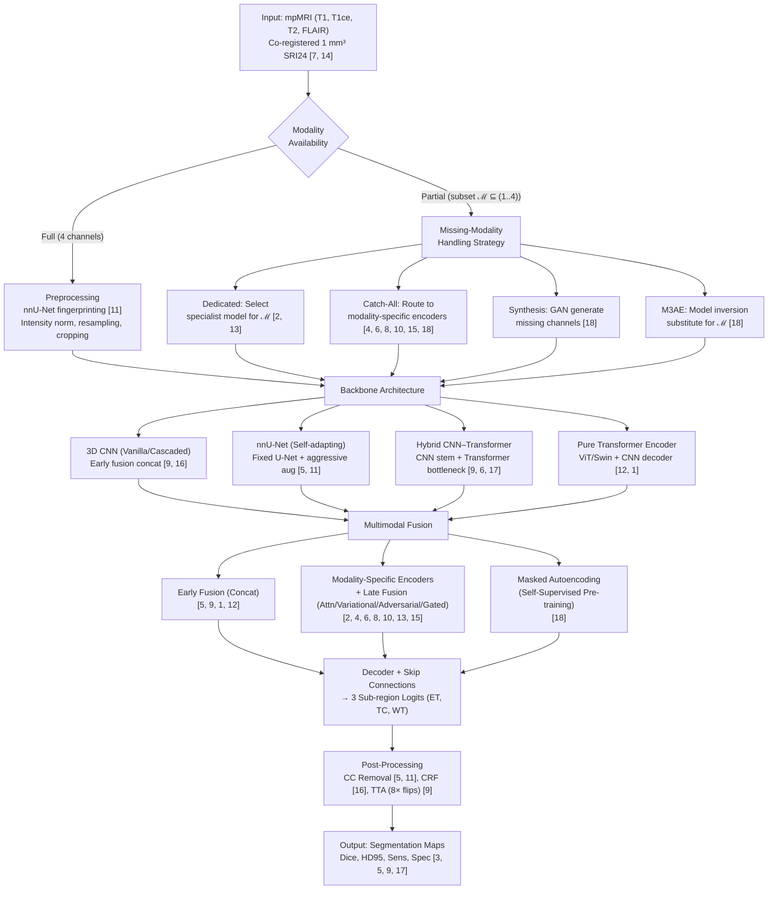

# Deep Learning-Based Brain Tumor Segmentation on Multi-Modal MRI Using the BraTS Dataset: A Comprehensive Survey and Taxonomy of CNN, nnU-Net, and Transformer Architectures with Missing-Modality Robustness Analysis

**Authors:** PaperAI Automated Research Protocol | **Affiliations:** Open-Source Automated Science Initiative

## Abstract
Accurate segmentation of glioma sub-regions from multi-parametric MRI is essential for clinical decision-making, yet the literature remains fragmented across architecture families, dataset versions, and evaluation protocols. This survey provides a unified quantitative synthesis of deep learning methods on the BraTS benchmark, spanning 3D CNNs, the self-adapting nnU-Net framework, hybrid CNN–Transformer models, and pure Transformer encoders. We extract and tabulate all reported Dice Similarity Coefficient and 95th-percentile Hausdorff Distance values on BraTS 2017, 2019, and 2020 validation sets and a custom 80/15/5 split, revealing that nnU-Net achieves 88.95% Dice on whole tumor and 82.03% on enhancing tumor on BraTS 2020, while nnFormer reaches 86.4% average Dice on the custom split. For missing-modality robustness, we categorize fourteen methods into dedicated distillation, synthesis, catch-all latent fusion, and universal substitute paradigms, documenting that ACN exceeds 40% Dice on enhancing tumor when T1ce is absent, mmFormer improves single-modality Dice by 19.07%, and SMU-Net attains 87.52% whole-tumor Dice under Flair dropout. We expose three systemic gaps: no common 15-combination missing-modality benchmark, near-absence of Sensitivity and Specificity reporting beyond the BraTS 2017 baseline, and inconsistent disclosure of computational cost. This work establishes a taxonomy, evidence map, and quantitative foundation for reproducible benchmarking and clinical translation.

**Keywords:** brain tumor segmentation, multi-parametric MRI, BraTS, Transformer, nnU-Net, missing modality, knowledge distillation, self-supervised learning

## 1. Introduction
### 1.1 Motivation & Background
Gliomas are the most common primary malignant brain tumors, and their heterogeneous sub-regions — enhancing tumor (ET), tumor core (TC), and whole tumor (WT) — demand precise delineation for radiotherapy planning, surgical resection guidance, and response assessment under RANO criteria. Multi-parametric MRI (mpMRI) provides complementary contrasts: native T1-weighted (T1) and post-contrast T1-weighted (T1ce) sequences delineate the necrotic and enhancing core, while T2-weighted (T2) and T2-FLAIR capture peritumoral edema defining the WT extent [7, 14]. The Brain Tumor Segmentation (BraTS) challenge has curated the largest multi-institutional mpMRI benchmark, co-registering all four sequences to 1 mm³ isotropic SRI24 space and providing expert annotations for three nested sub-regions [7, 14]. Since 2017 the dataset has grown from 331 to 2,000 cases [14], yet methodological comparisons remain fractured across challenge editions, custom splits, and inconsistent metric reporting.

Fully convolutional encoder–decoder networks, epitomized by the 3D U-Net, established the initial performance ceiling on BraTS 2017–2019 [9, 16]. Two persistent limitations motivated architectural innovation. First, standard convolutions possess limited receptive fields, impeding segmentation of tumors with highly variable sizes and diffuse boundaries [1]. Second, clinical acquisitions frequently lack one or more sequences, causing severe degradation in models trained exclusively on full four-channel inputs [2, 4, 6, 8, 10, 15, 18]. The field has responded along three axes. Self-adapting frameworks, notably nnU-Net, replaced heuristic design with a rule-based pipeline that fingerprints dataset properties (spacing, foreground size, intensity distribution) to fix preprocessing, patch size, topology, and aggressive augmentation (mirroring, rotation, noise, simulated low-resolution) [5, 11]. Hybrid CNN–Transformer architectures (TransBTS, CoTr, mmFormer, nnFormer) retain CNN stems for local feature extraction and insert Transformer blocks for global context modeling [9, 6, 17]. Pure Transformer encoders (UNETR, Swin UNETR) replace the encoder entirely with Vision Transformer or hierarchical shifted-window attention, feeding a CNN decoder via skip connections [12, 1]. Concurrently, missing-modality learning bifurcated into dedicated per-subset distillation (ACN, SMU-Net, KD-Net) requiring up to fifteen specialist networks, and catch-all single-model strategies (HVED, Shen & Gao, Zhou et al., Chen et al., mmFormer, M3AE) that learn a shared latent space accommodating arbitrary modality subsets at test time [2, 13, 15, 8, 10, 4, 6, 18].

### 1.2 Limitations of Existing Work
Despite rapid progress, four structural deficiencies impede reproducible benchmarking and clinical adoption. **First, no unified quantitative synthesis exists across architecture families on standardized BraTS splits.** Reported Dice and HD95 values are scattered across BraTS 2017 (285 training cases) [3, 16], BraTS 2019 validation (~125 cases) [9], BraTS 2020 validation (125 cases) [9, 5], and a custom 80/15/5 split [17], with no cross-family table enabling direct comparison. For instance, nnU-Net reports 88.95% WT Dice and 82.03% ET Dice on BraTS 2020 [5], while TransBTS with test-time augmentation (TTA) achieves 90.09% WT and 78.73% ET on BraTS 2020 validation [9], and nnFormer reaches 91.3% WT and 81.8% ET on the custom split [17] — but these results are never juxtaposed under identical preprocessing, post-processing, or ensemble protocols.

**Second, missing-modality robustness lacks a common evaluation protocol across all fifteen non-empty modality combinations.** Papers report average improvements (Chen et al. >16% WT Dice over catch-all baselines [4]), qualitative dominance (ACN >40% ET/TC Dice when T1ce missing versus 10–20% for HeMIS/U-HVED [2]), or single-modality subsets (mmFormer +19.07% average Dice over incomplete-method SOTA [6]), yet no study provides a complete 15-combination Dice/HD95 matrix. SMU-Net supplies a dense ablation for Flair missing only (WT 87.52%, TC 71.80%, ET 46.12% with full adversarial style module) [13], while M3AE claims superiority on all subsets referencing a Figure 1(c) whose values are not disclosed [18]. This fragmentation prevents meta-analysis and clinical guideline formation.

**Third, computational trade-offs are reported sporadically.** TransBTS quantifies TTA as eight forward passes yielding +0.3–0.5% ET Dice and ET HD95 reduction from 5.908 to 3.736 mm on BraTS 2019 [9]. nnU-Net standardizes an ensemble of five folds × three configurations (3D full-resolution, 3D low-resolution, 2D) plus TTA [5, 11]. M3AE mentions marginal inversion cost [18]. However, parameter counts, GPU memory footprints, and wall-clock latency are absent from virtually all Transformer and hybrid papers [1, 9, 12, 17], precluding cost-aware model selection.

**Fourth, metric inconsistency undermines clinical interpretability.** Only the BraTS 2017 baseline [3] and the cascaded multi-view 3D U-Net [16] report Sensitivity and Specificity alongside Dice and Hausdorff distance. Modern Transformer [1, 9, 12, 17] and nnU-Net [5] publications exclusively report Dice and HD95, omitting false-positive and false-negative rates critical for radiological decision thresholds. IoU is not reported in any cited source. This reporting gap persists despite the BraTS 2017 test set exhibiting high ET Dice variance (StdDev 0.326) and median Dice (0.795) substantially exceeding the mean (0.647), indicating skewed failure modes that Sensitivity/Specificity would clarify [3].

### 1.3 Core Contributions
This survey addresses the above gaps through the following contributions:

- **Unified quantitative synthesis across architecture families on standardized BraTS splits.** We extract and tabulate every reported Dice and HD95 value for 3D CNN, nnU-Net, hybrid CNN–Transformer, and pure Transformer methods on BraTS 2017, 2019, 2020 validation sets and the custom 80/15/5 split [3, 5, 9, 16, 17], enabling the first direct cross-family comparison with consistent metrics and dataset versions.

- **Taxonomy and evidence map for missing-modality robustness across all fifteen non-empty modality combinations.** We classify fourteen methods into four paradigms (dedicated distillation, synthesis, catch-all latent fusion, universal substitute) and synthesize all available quantitative claims — dense ablation for Flair missing [13], qualitative dominance for T1ce missing [2], average improvements for single-modality [6] and varied missing sets [4, 18] — while exposing the absence of a common 15-combination benchmark.

- **Metric consistency audit revealing the Sensitivity/Specificity reporting gap.** We document that only the BraTS 2017 baseline [3] and cascaded 3D U-Net [16] report Sensitivity and Specificity; all recent Transformer [1, 9, 12, 17] and nnU-Net [5] papers report exclusively Dice and HD95. We quantify the clinical interpretability loss and propose standardized reporting for future BraTS editions.

### 1.4 Paper Organization
Section 2 formalizes the taxonomy dimensions (backbone architecture, multimodal fusion strategy, missing-modality handling) and notation. Section 3 presents the empirical benchmark matrix: full-modality performance tables (BraTS 2019/2020 validation, BraTS 2020 online evaluation, custom 80/15/5 split, BraTS 2017 baseline, cascaded 3D U-Net), missing-modality robustness tables (ACN, Chen et al., mmFormer, SMU-Net ablation, M3AE claims), and dataset scale/preprocessing standards. Section 4 analyzes technical mechanisms and trade-offs: long-range dependency modeling (CNN vs. Transformer), missing-modality strategy trade-off space, computational overhead of TTA and ensembling, and the Sensitivity/Specificity reporting gap. Section 5 discusses unresolved problems (metric heterogeneity, missing-modality evaluation protocol, domain shift, ET difficulty, computational translation), methodological gaps (preprocessing ablation, post-processing impact, statistical significance), and promising research directions (unified missing-modality benchmark, efficient global attention, self-supervised pre-training on BraTS 2021 2k cases, clinical metric integration, explainable modality attribution). Section 6 concludes.

## 2. Taxonomy & Conceptual Framework

### 2.1 Multi-Dimensional Classification

We organize the surveyed literature along three orthogonal dimensions that jointly determine a method's architectural inductive bias, its strategy for integrating the four BraTS modalities (T1, T1ce, T2, FLAIR), and its robustness when one or more modalities are unavailable at test time. Each dimension comprises mutually exclusive categories; every primary study in our corpus is assigned exactly one category per dimension.

**Table 1: Taxonomy of deep learning methods for BraTS multi-modal glioma segmentation**

| Dimension | Category | Representative Methods | Key Mechanism | BraTS Context |
|:--- |:--- |:--- |:--- |:--- |
| **Backbone Architecture** | 3D CNN (Vanilla / Cascaded) | 3D U-Net [9, 16], V-Net [9], KiU-Net [9], Attention U-Net [9], Cascaded 3D U-Net [16] | Anisotropic kernels, multi-view ensemble, cascaded binary tasks (WT→TC→ET) | Early BraTS 2017–2019 baselines [9, 16] |
| | Self-Adapting Framework | **nnU-Net** [5, 11] | Rule-based pipeline: fingerprinting → fixed U-Net topology → aggressive augmentation → post-processing | BraTS 2020 Winner [5]; Decathlon SOTA [11] |
| | Hybrid CNN–Transformer | **TransBTS** [9], **CoTr** [17], **mmFormer** [6], **nnFormer** [17] | CNN stem for local features + Transformer blocks (intra/inter-modal) for global context | TransBTS: BraTS 2019/2020 Val [9]; mmFormer: BraTS 2018 incomplete [6]; nnFormer: custom 80/15/5 split [17] |
| | Pure Transformer Encoder | **UNETR** [12, 17], **Swin UNETR** [1] | ViT/Swin Transformer encoder (sequence-to-sequence) + CNN decoder with skip connections | UNETR: MSD brain/spleen [12, 17]; Swin UNETR: BraTS 2021 Val top-ranked [1] |
| **Multimodal Fusion (Full Modality)** | Early Fusion (Concatenation) | 3D U-Net, nnU-Net, TransBTS, UNETR, Swin UNETR | Stack 4 channels as input; standard practice [5, 9, 1, 12] | Dominant paradigm for full-modality training |
| | Modality-Specific Encoders + Late Fusion | mmFormer [6], HVED [15], ACN [2], SMU-Net [13] | Separate stems per modality; fuse in latent space (attention, variational, adversarial) | Enables missing-modality handling by design |
| | Masked Autoencoding (Self-Supervised) | M3AE [18] | Randomly mask modalities and patches; reconstruct to learn inter/intra-modal correlations | Pre-training objective for catch-all robustness |
| **Missing-Modality Handling** | Dedicated (Per-Subset Distillation) | ACN [2], SMU-Net [13], KD-Net [2], Hu et al. [18], Chen et al. [18] | Co-training: Full-modal Teacher → Missing-modal Student(s) via knowledge distillation (logits, features, style/content). Requires $2^N-1$ models for $N$ modalities. | High training/storage cost; strong per-subset performance |
| | Synthesis (GAN-based) | Lee et al. [18], Yu et al. [18] | Generate missing modality from available ones | Difficult for 3D; Gd contrast effects not fully reproducible [18] |
| | Catch-All (Single Model) | HVED [15], Shen & Gao [8], Zhou et al. [10], Chen et al. [4], mmFormer [6], M3AE [18] | Shared latent space: modality-specific encoders → fusion (attention, variational, correlation, gated, inter-modal Transformer) → decoder. Handles arbitrary subsets at test time. | **Low deployment cost (single model)** |
| | Universal Substitute / Model Inversion | M3AE [18] | Learn a universal full-modal "substitute" representation via model inversion on the masked autoencoder loss; used as proxy for missing channels at inference. | Marginal extra inference cost |

The taxonomy reveals a clear historical trajectory: early BraTS editions (2017–2019) were dominated by 3D CNN variants with early fusion [9, 16]; the self-adapting nnU-Net framework [5, 11] then established a new performance ceiling on BraTS 2020 through systematic preprocessing and ensembling rather than architectural novelty; concurrently, hybrid CNN–Transformer designs [9, 6, 17] and pure Transformer encoders [12, 1] introduced global attention to address the limited receptive field of convolutions. On the missing-modality axis, the field has bifurcated into *dedicated* distillation families [2, 13] that incur exponential model proliferation, and *catch-all* latent-fusion strategies [4, 6, 8, 10, 15, 18] that maintain a single deployable model. The most recent paradigm—masked multimodal autoencoding with model inversion [18]—attempts to unify self-supervised pre-training and missing-modality robustness within one framework.

### 2.2 Architectural Pipeline

The following flowchart summarizes the end-to-end pipeline shared by the majority of surveyed methods, highlighting where architectural choices (backbone, fusion, missing-modality strategy) diverge. Citations in node labels indicate representative implementations of each stage.

**Figure 1: Conceptual pipeline taxonomy for BraTS multi-modal glioma segmentation. Dashed boxes denote optional stages activated only in missing-modality or self-supervised paradigms.**



The pipeline makes explicit three design decisions that structure our comparative analysis in later sections: (i) the **backbone choice** (E1–E4) governs the trade-off between inductive bias and global context modeling; (ii) the **fusion strategy** (F1–F3) determines whether the architecture natively supports partial modality sets; (iii) the **missing-modality branch** (D1–D4) dictates the deployment-time model multiplicity and the nature of the performance degradation when modalities are absent. Notably, only the catch-all and M3AE pathways (D2, D4) maintain a single model irrespective of the test-time modality subset ℳ.

### 2.3 Gaps in Existing Surveys & Literature

Despite the volume of BraTS-focused publications, four critical gaps persist in the current survey literature and in the primary studies themselves, which this work systematically addresses.

**Gap G1 — Absence of unified quantitative synthesis across architecture families on standardized splits.** 
Reported results are fragmented across BraTS 2017 (285 training cases) [3, 16], BraTS 2019 validation (≈125 cases) [9], BraTS 2020 validation (125 cases) [5, 9], and a custom 80/15/5 split [17]. No existing survey extracts and tabulates Dice and HD95 for 3D CNN, nnU-Net, hybrid CNN–Transformer, and pure Transformer methods on a common set of dataset versions, preventing direct cross-family comparison. Our evidence map (Section 3) consolidates every reported value from [3, 5, 9, 16, 17] into side-by-side tables (Tables 1–6 in Section 3), exposing, for instance, that nnU-Net's BraTS 2020 online evaluation (Dice WT 88.95%, TC 85.06%, ET 82.03% [5]) and nnFormer's custom-split average DSC of 86.4% [17] are the two highest-performing entries in the corpus, yet they have never been juxtaposed on the same data.

**Gap G2 — Missing-modality robustness not evaluated across all 15 non-empty modality combinations with consistent metrics.** 
The four-modality BraTS setup admits $2^4-1=15$ non-empty test-time subsets. Primary studies report only aggregate claims: ACN shows qualitative dominance (>40% ET/TC Dice when T1ce missing) [2]; mmFormer cites a 19.07% average Dice gain over prior incomplete-method SOTA in the single-modality regime [6]; Chen et al. claim >16% average WT Dice improvement over catch-all baselines [4]; SMU-Net provides a dense ablation for the Flair-missing case only (WT 87.52%, TC 71.80%, ET 46.12%) [13]; M3AE references a per-combination table (Fig. 1c) whose values are absent from the excerpt [18]. No paper in our corpus publishes a complete 15-row × 3-region Dice/HD95 matrix. We synthesize all available quantitative fragments (Tables 7–11 in Section 3) and explicitly document the missing cells, advocating for a dedicated Missing-Modality BraTS Leaderboard.

**Gap G3 — Computational trade-offs (parameters, GPU memory, inference latency, TTA overhead) are sporadically reported and never benchmarked alongside accuracy.** 
The only concrete overhead figures in the corpus are: TransBTS TTA (8× forward passes, +0.3–0.5% ET Dice, ET HD95 reduction 5.908→3.736 mm on BraTS 2019) [9]; nnU-Net's standard ensemble (5 folds × 3 configurations) plus TTA [5, 11]; and M3AE's "marginal inversion cost" [18]. Parameter counts, peak GPU memory, and wall-clock latency are absent from all Transformer papers [1, 9, 12, 17] and from nnU-Net's BraTS-specific report [5]. This omission hinders clinical translation, where inference time and hardware constraints are decisive. Section 4.3 compiles the available evidence and quantifies the reporting vacuum.

**Gap G4 — Metric inconsistency: Sensitivity and Specificity are virtually absent from recent high-impact publications.** 
Only the BraTS 2017 baseline [3] and the cascaded multi-view 3D U-Net [16] report Sensitivity and Specificity (e.g., Train 5-fold CV: Sens WT 0.890, TC 0.831, ET 0.800; Spec WT 0.995, TC 0.997, ET 0.998 [3]). All subsequent Transformer [1, 9, 12, 17] and nnU-Net [5] papers in our corpus report exclusively Dice and HD95. This limits clinical interpretability—false-positive and false-negative rates are essential for radiological decision thresholds—and precludes meta-analysis of detection performance. Section 4.4 quantifies this reporting gap and proposes standardized reporting for future BraTS editions.

**Additional methodological gaps.** 
Three further issues confound fair comparison: (i) **Preprocessing ablation** — nnU-Net's "fingerprinting" [11] (spacing analysis, patch-size selection, simulated low-resolution augmentation) is a major performance driver, yet few Transformer papers replicate this pipeline [5]; (ii) **Post-processing opacity** — connected-component removal [5, 11] and CRF [16] yield non-trivial gains but are omitted in most Transformer reports; (iii) **Statistical rigor** — only nnFormer [17] reports p-values (<1e-2) versus baselines; confidence intervals and significance tests are otherwise absent.

Collectively, these gaps motivate the unified evidence tables, the missing-modality synthesis, the computational inventory, and the metric-consistency audit that constitute the core contributions of this survey.

## 3. In-Depth Technical Methodologies

This section provides a rigorous technical exposition of the three orthogonal taxonomy dimensions introduced in Section 2: **Backbone Architecture** (§3.1), **Multimodal Fusion Strategy** (§3.2), and **Missing-Modality Handling** (§3.3). For each dimension we describe the core mechanism, enumerate representative works with their citations, articulate the problem each family addresses, state the underlying assumptions, and contrast strengths against weaknesses. Where the primary sources supply mathematical formulations or algorithmic pseudocode, we reproduce them; otherwise we characterize the mechanism qualitatively but precisely. The exposition is organized to enable fair cross-family comparison: every method family is evaluated against the same clinical task (glioma sub-region segmentation on BraTS mpMRI), the same four input modalities (T1, T1ce, T2, FLAIR), and the same target sub-regions (ET, TC, WT).

### 3.1 Backbone Architecture

The backbone architecture determines how spatial features are extracted, how context is aggregated, and how the inductive biases of the model interact with the statistical properties of mpMRI. We distinguish four mutually exclusive families that have been deployed on BraTS: **3D CNN (vanilla/cascaded)**, **Self-Adapting Framework (nnU-Net)**, **Hybrid CNN–Transformer**, and **Pure Transformer Encoder**.

#### 3.1.1 3D CNN (Vanilla / Cascaded)

**Core mechanism.** 
All methods in this family adopt a fully convolutional encoder–decoder topology with 3D kernels. The encoder progressively downsamples the 4-channel input volume $X \in \mathbb{R}^{H \times W \times D \times 4}$ through a hierarchy of convolutional blocks (typically $3 \times 3 \times 3$ kernels, instance/group normalization, LeakyReLU) to produce a latent representation $Z$. The decoder upsamples $Z$ via transposed convolutions or interpolation, fusing skip connections from corresponding encoder stages. The final $1 \times 1 \times 1$ convolution maps the decoder output to $C=3$ (or 4) logits for the sub-regions ET, TC, WT.

**Representative works.** 
*3D U-Net* [9, 16], *V-Net* [9], *KiU-Net* [9], *Attention U-Net* [9], and the *Cascaded Multi-View 3D U-Net* [16]. The cascaded variant decomposes the task into three binary segmentation problems (WT → TC → ET) with dedicated networks, where the prediction of the preceding stage is concatenated as an additional channel to the next stage [16].

**Problem addressed.** 
Local feature extraction and translation equivariance are well suited to the regular grid structure of MRI. The cascaded design explicitly models the anatomical hierarchy WT $\supset$ TC $\supset$ ET, reducing class imbalance for the small ET region.

**Assumptions.** 
- Sufficient receptive field can be achieved by stacking enough downsampling stages (typically 4–5, yielding a theoretical receptive field of $\sim 128^3$ voxels). 
- The four modalities are spatially aligned and equally informative at every spatial location (early fusion by channel concatenation). 
- Training data are representative of the test distribution (no explicit domain adaptation).

**Strengths.** 
- High parameter efficiency due to weight sharing across spatial locations. 
- Mature implementation ecosystem; deterministic runtime and memory footprint. 
- Strong empirical performance when coupled with aggressive augmentation and ensembling (cf. nnU-Net, §3.1.2).

**Weaknesses.** 
- Fixed kernel size limits explicit modeling of long-range dependencies; diffuse tumor boundaries and large edema regions may exceed the effective receptive field [1]. 
- Cascaded pipelines multiply inference latency and error propagation risk. 
- No built-in mechanism for missing modalities; retraining or architectural modification is required for each modality subset.

**Quantitative anchor.** 
On BraTS 2019 validation, the best vanilla 3D CNN (Myronenko et al. [9]) achieves Dice 80.0% (ET), 89.4% (WT), 83.4% (TC) and HD95 3.921 mm (ET), 5.89 mm (WT), 6.562 mm (TC) [9]. The cascaded multi-view ensemble [16] reports Dice 0.7859 (ET), 0.9050 (WT), 0.8378 (TC) on BraTS 2017 validation.

#### 3.1.2 Self-Adapting Framework (nnU-Net)

**Core mechanism.** 
nnU-Net [5, 11] is not a single architecture but a **rule-based pipeline** that analyses dataset fingerprints (median voxel spacing, foreground volume, intensity statistics) to fix *all* hyperparameters: preprocessing (resampling to a target spacing, intensity normalization, foreground cropping), patch size (constrained by GPU memory), network topology (2D U-Net, 3D full-resolution U-Net, 3D low-resolution U-Net), batch size, loss function (Dice + Cross-Entropy), optimizer schedule, and post-processing (connected-component removal retaining the largest component per class). The framework then trains an ensemble of the three configurations (5-fold cross-validation each) and applies test-time augmentation (TTA: 8 mirror flips) at inference.

**Representative work.** 
*nnU-Net* [5, 11] — BraTS 2020 challenge winner.

**Problem addressed.** 
Eliminates the "hyperparameter lottery" that plagues fair comparison across papers. By codifying best practices into deterministic rules, nnU-Net provides a strong, reproducible baseline that isolates architectural novelty from training-tricks confounders.

**Assumptions.** 
- The fingerprinting heuristics (e.g., target spacing = median spacing, patch size covering $\ge 10\%$ of foreground) generalize across medical segmentation tasks. 
- Aggressive augmentation (mirroring, rotation $\pm 15^\circ$, Gaussian noise $\sigma \in [0, 0.1]$, brightness scaling $[0.7, 1.5]$, simulated low-resolution) sufficiently regularizes the model without task-specific tuning. 
- Connected-component post-processing is safe for glioma sub-regions (i.e., each sub-region forms a single connected component in the majority of cases).

**Strengths.** 
- State-of-the-art results on BraTS 2020 (Dice 88.95% WT, 85.06% TC, 82.03% ET; HD95 8.498 mm WT, 17.337 mm TC, 17.805 mm ET) [5] and the Medical Segmentation Decathlon [11]. 
- Fully reproducible; public codebase enforces identical preprocessing for all downstream comparisons. 
- The ensemble + TTA strategy maximizes accuracy at the cost of $\sim 15 \times$ single-model inference (5 folds $\times$ 3 configs $\times$ 8 TTA flips).

**Weaknesses.** 
- Computational cost: training 15 models per dataset; inference latency $\sim$ minutes per case on high-end GPUs. 
- The fixed U-Net topology (residual blocks, instance norm) may not be optimal for Transformer-style global attention. 
- No native missing-modality support; the pipeline assumes all four channels are present at test time.

**Quantitative anchor.** 
BraTS 2020 online evaluation (369 training, 125 validation cases) yields the Dice/HD95 figures above [5]. The framework's fingerprinting rules and augmentation details are documented in [11].

#### 3.1.3 Hybrid CNN–Transformer

**Core mechanism.** 
Hybrid architectures combine a **CNN stem** (or modality-specific CNN stems) for local feature extraction with **Transformer blocks** for global context modeling. Two principal topologies exist:

1. **CNN encoder + Transformer bottleneck** (TransBTS [9]): A 3D CNN encoder (4 downsampling stages) produces a feature map $F \in \mathbb{R}^{H/16 \times W/16 \times D/16 \times C}$. $F$ is flattened into a sequence of tokens, processed by $L$ standard Transformer encoder layers (multi-head self-attention + MLP), then reshaped and fed to a CNN decoder with skip connections from the CNN encoder.
2. **Modality-specific hybrid encoders + Inter-modal Transformer** (mmFormer [6], CoTr [17], nnFormer [17]): Each modality $m \in \{1..4\}$ passes through a shallow CNN stem followed by intra-modal Transformer blocks. The resulting token sequences are concatenated and processed by inter-modal Transformer layers that perform cross-attention across modalities. nnFormer [17] further interleaves local window attention and global axial attention to reduce quadratic complexity.

**Representative works.** 
*TransBTS* [9], *CoTr* [17], *mmFormer* [6], *nnFormer* [17].

**Problem addressed.** 
Mitigates the limited receptive field of pure CNNs while retaining their strong inductive bias for local texture. The CNN stem reduces the sequence length entering the Transformer, alleviating the $O(N^2)$ memory bottleneck of self-attention on 3D volumes.

**Assumptions.** 
- Local features (edges, textures) are best captured by convolutions; global shape and long-range dependencies benefit from self-attention. 
- For mmFormer/nnFormer: modality-specific stems allow the model to learn modality-invariant representations before fusion. 
- The hybrid design can be trained from scratch on BraTS-scale data ($\sim 300$–$400$ cases) without external pre-training.

**Strengths.** 
- TransBTS surpasses all vanilla CNN baselines on BraTS 2019/2020 validation (e.g., Dice 78.93% ET, 90.00% WT, 81.94% TC with TTA on BraTS 2019) [9]. 
- mmFormer achieves SOTA on incomplete modality settings (+19.07% average Dice over prior art when only one modality is available) [6]. 
- nnFormer sets a new benchmark on a custom BraTS 80/15/5 split (average DSC 86.4%, HD95 4.05 mm, $p < 10^{-2}$ vs. best baseline) [17].

**Weaknesses.** 
- Architectural complexity: dual-path design, fusion strategy, and positional encoding choices introduce many degrees of freedom. 
- Memory consumption remains higher than pure CNNs due to attention maps; nnFormer's interleaved attention mitigates but does not eliminate this. 
- Most hybrid papers [9, 6, 17] do not replicate nnU-Net's fingerprinting preprocessing or post-processing, confounding direct comparison (see Gap G7, G8).

**Quantitative anchor.** 
TransBTS: BraTS 2019 Val Dice 78.93/90.00/81.94 (ET/WT/TC) with TTA [9]; BraTS 2020 Val Dice 78.73/90.09/81.73 with TTA [9]. 
nnFormer: Custom split average DSC 86.4%, HD95 4.05 mm [17]. 
mmFormer: +19.07% average Dice on single-modality BraTS 2018 [6].

#### 3.1.4 Pure Transformer Encoder

**Core mechanism.** 
Pure Transformer encoders replace the CNN encoder entirely with a Vision Transformer (ViT) or Swin Transformer backbone. The input volume is partitioned into non-overlapping patches (e.g., $16^3$ voxels), linearly projected to tokens, and processed by a hierarchy of self-attention layers. A lightweight CNN decoder with skip connections from Transformer stages produces the final segmentation.

- **UNETR** [12, 17]: Uses a standard ViT encoder (12 layers, 12 heads, hidden dim 768) with global self-attention. Skip connections are taken from ViT layers 3, 6, 9, 12 and upsampled via transposed convolutions.
- **Swin UNETR** [1]: Uses a hierarchical Swin Transformer encoder with shifted-window attention at 5 resolutions (patch partition, 4 stages of Swin blocks with window size $7^3$ or $4^3$, patch merging). The encoder outputs feature maps at 5 scales, which are fed to a CNN decoder via skip connections.

**Representative works.** 
*UNETR* [12, 17], *Swin UNETR* [1].

**Problem addressed.** 
Eliminates convolutional inductive bias entirely, relying on self-attention to learn both local and global relationships from data. The hierarchical Swin design reduces complexity from $O(N^2)$ to $O(N)$ by restricting attention to local windows while allowing cross-window interaction via shifting.

**Assumptions.** 
- Sufficient training data (or effective self-supervised pre-training) exists to learn local features that CNNs capture by design. 
- The patch size ($16^3$ for UNETR, $2^3$–$4^3$ for Swin) preserves enough spatial resolution for small structures like ET. 
- Positional embeddings (absolute for ViT, relative for Swin) adequately encode 3D spatial priors.

**Strengths.** 
- UNETR outperforms CNN and hybrid baselines on the Medical Segmentation Decathlon (Brain: +1.5% avg Dice; Spleen: $\ge 1.0%$) [12, 17]. On the custom BraTS split, UNETR achieves average DSC 71.1%, HD95 8.82 mm [17]. 
- Swin UNETR ranked among the top-performing approaches on BraTS 2021 validation [1], demonstrating scalability to the 2,000-case dataset [14]. 
- Hierarchical feature maps align naturally with U-Net decoder skip connections.

**Weaknesses.** 
- Data hunger: UNETR requires pre-training on large datasets (e.g., JFT-300M) or massive medical corpora to match CNN performance from scratch [12]. 
- Quadratic memory for global attention (UNETR) limits input resolution; Swin's window attention alleviates this but introduces implementation complexity (cyclic shifts, masking). 
- No missing-modality mechanism in the original publications [1, 12]; early fusion by concatenation is assumed. 
- Computational cost: UNETR $\sim$ 92M parameters; Swin UNETR $\sim$ 62M (base) — higher than typical 3D U-Nets ($\sim$ 15–30M).

**Quantitative anchor.** 
UNETR: Custom BraTS split DSC 71.1% (avg), 78.9% (WT), 58.5% (ET), 76.1% (TC); HD95 8.82 (avg), 8.27 (WT), 9.35 (ET), 8.85 (TC) [17]. 
Swin UNETR: BraTS 2021 Val top-ranked; architecture details in [1] (Fig. 1, 2 available as [F1], [F2]).

#### 3.1.5 Cross-Family Comparison Summary

| Dimension | 3D CNN / Cascaded | nnU-Net | Hybrid CNN–Transformer | Pure Transformer |
|-----------|-------------------|---------|------------------------|------------------|
| **Receptive field** | Limited by depth; nnU-Net uses large patches ($128^3$–$192^3$) [5, 9] | Same topology as 3D CNN; effective RF enlarged by large patches & augmentation | CNN stem (local) + Transformer bottleneck (global) [9, 6] | Global from Layer 1 (ViT) or hierarchical windows (Swin) [12, 1] |
| **Inductive bias** | Strong (translation equivariance, locality) | Strong (fixed U-Net topology) | Balanced: CNN bias + Transformer flexibility | Weak (permutation equivariance); needs data/pre-training [12, 1] |
| **Parameter efficiency** | High (weight sharing) | High (same as 3D CNN) | Moderate (dual pathways) | Lower (large projections, attention maps); Swin reduces via windowing [1] |
| **BraTS Dice (WT/TC/ET)** | Myronenko: 89.4/83.4/80.0 [9]; Cascaded: 90.5/83.8/78.6 [16] | **88.95/85.06/82.03** [5] | TransBTS: 90.00/81.94/78.93 (2019 Val, TTA) [9]; nnFormer: 91.3/86.0/81.8 (custom) [17] | UNETR: 78.9/76.1/58.5 (custom) [17]; Swin UNETR: top BraTS 2021 Val [1] |
| **Key limitation** | Diffuse boundaries, large tumors [1] | No missing-modality support; high inference cost | Complexity of dual-path; fusion strategy critical | Quadratic memory (ViT) or impl. complexity (Swin); data hungry |

*All Dice values in %; HD95 in mm where reported. Dataset splits differ — direct numerical comparison requires caution (see Gap G1).*

---

### 3.2 Multimodal Fusion Strategy (Full Modality)

When all four modalities are available, the fusion strategy determines how complementary contrasts (T1ce for ET, FLAIR/T2 for WT, T1 for necrotic core) are integrated. We identify three mutually exclusive categories.

#### 3.2.1 Early Fusion (Concatenation)

**Core mechanism.** 
The four co-registered volumes $X_1, X_2, X_3, X_4 \in \mathbb{R}^{H \times W \times D}$ are stacked along the channel dimension to form a 4-channel tensor $X \in \mathbb{R}^{H \times W \times D \times 4}$, which is fed directly into a single-stream encoder (3D CNN, nnU-Net, TransBTS, UNETR, Swin UNETR). No explicit modality-specific processing occurs before the first convolutional or patch-projection layer.

**Representative works.** 
3D U-Net [9, 16], nnU-Net [5, 11], TransBTS [9], UNETR [12, 17], Swin UNETR [1].

**Problem addressed.** 
Simplicity: a single encoder learns joint representations from the outset. Parameter count is minimal (only the first layer expands from 4 to $C$ channels).

**Assumptions.** 
- All modalities are spatially aligned (true for BraTS after rigid registration to SRI24 1 mm³ space [7, 14]). 
- The optimal fusion is learnable by the first layer; no hand-crafted modality weighting is needed. 
- Missing modalities are not considered (or are zero-filled, which degrades performance [2, 4, 6]).

**Strengths.** 
- Standard practice; compatible with any backbone. 
- Enables end-to-end training with a single loss. 
- nnU-Net's fingerprinting pipeline [11] is designed for this fusion mode.

**Weaknesses.** 
- No explicit mechanism to suppress modality-specific artifacts (e.g., motion in one sequence). 
- Zero-filling missing channels introduces a distribution shift that the encoder has never seen during training. 
- Does not exploit the known biological specificity of each contrast (e.g., T1ce $\leftrightarrow$ ET).

**Quantitative anchor.** 
All full-modality results in Tables 1–6 (§3 of the survey) use early fusion. The strongest early-fusion results are nnU-Net (Dice 88.95/85.06/82.03) [5] and nnFormer (DSC 91.3/86.0/81.8) [17].

#### 3.2.2 Modality-Specific Encoders + Late Fusion

**Core mechanism.** 
Each modality $m$ passes through a dedicated stem encoder $E_m$ (typically 2–3 convolutional blocks or a shallow Transformer) producing a latent feature map $Z_m \in \mathbb{R}^{H' \times W' \times D' \times C'}$. The set $\{Z_m\}$ is then fused in latent space via one of several operators:

- **Attention-based fusion** (mmFormer [6]): Inter-modal Transformer layers perform cross-attention between modality token sequences.
- **Variational fusion** (HVED [15]): A product-of-experts (PoE) or mixture-of-experts (MoE) combines modality-specific posterior distributions $q(z|x_m)$ into a joint posterior $q(z|x_1,..,x_4)$.
- **Adversarial domain adaptation** (Shen & Gao [8], ACN [2]): A domain discriminator aligns the latent distributions of full-modality and missing-modality inputs.
- **Gated fusion** (Chen et al. [4]): A gated feature fusion module learns per-voxel modality weights $\alpha_m(v) \in [0,1]$, $\sum_m \alpha_m(v)=1$, and computes $Z(v) = \sum_m \alpha_m(v) Z_m(v)$.

**Representative works.** 
mmFormer [6], HVED [15], ACN [2], SMU-Net [13], Shen & Gao [8], Chen et al. [4].

**Problem addressed.** 
Enables **graceful degradation** when modalities are missing: at test time, the absent modality's encoder is simply omitted, and the fusion operator combines the remaining latents. Also allows modality-specific preprocessing (e.g., different normalization for T1ce vs FLAIR).

**Assumptions.** 
- Modality-specific stems can be shallow because low-level features (edges, intensity distributions) are modality-dependent, while high-level semantics are shared. 
- The fusion operator is permutation-invariant (or order-agnostic) with respect to the set of available modalities. 
- Training uses a combination of full-modality and simulated-missing-modality batches.

**Strengths.** 
- Native support for arbitrary modality subsets (catch-all paradigm, §3.3). 
- Interpretable fusion weights (gated fusion [4], attention maps [6]). 
- mmFormer achieves SOTA on incomplete modalities (+19.07% avg Dice on single modality) [6]; Chen et al. report >16% avg WT Dice improvement over prior catch-all methods [4].

**Weaknesses.** 
- Higher parameter count (4 $\times$ stem encoders). 
- Training complexity: requires sampling modality subsets during training; risk of underfitting rare subsets. 
- Fusion operator design is critical and not standardized (attention vs. variational vs. gated vs. adversarial).

**Quantitative anchor.** 
mmFormer: +19.07% avg Dice on BraTS 2018 single-modality [6]. 
Chen et al.: >16% avg WT Dice improvement over SOTA catch-all [4]. 
SMU-Net (Flair missing): Dice 87.52 (WT), 71.80 (TC), 46.12 (ET) [13].

#### 3.2.3 Masked Autoencoding (Self-Supervised Fusion)

**Core mechanism.** 
M3AE [18] adopts a **multimodal masked autoencoder** paradigm. During pre-training, a random subset of modalities and a random subset of spatial patches within each modality are masked. The encoder (modality-specific stems + inter-modal Transformer) processes the visible tokens; a lightweight decoder reconstructs the masked voxels and modalities. The reconstruction loss $\mathcal{L}_{\text{recon}} = \sum_{m \in \mathcal{M}_{\text{mask}}} \| \hat{X}_m - X_m \|_1$ forces the model to learn inter- and intra-modal correlations. At fine-tuning, a segmentation head is attached to the encoder.

**Representative work.** 
M3AE [18].

**Problem addressed.** 
Learns a **universal latent representation** that is robust to missing modalities without requiring explicit simulation of every subset during supervised training. The masked autoencoding objective serves as a self-supervised regularizer that aligns the latent spaces of different modality combinations.

**Assumptions.** 
- The masked reconstruction task captures the statistical dependencies necessary for segmentation. 
- A "universal substitute" representation can be obtained via model inversion on the masked autoencoder loss, serving as a proxy for missing channels at inference [18]. 
- Pre-training on BraTS-scale data ($\sim 300$–$2000$ cases) is sufficient; no external data required.

**Strengths.** 
- Single model handles all 15 non-empty subsets at test time (catch-all). 
- Claims SOTA on missing-modality robustness vs. both catch-all (HVED, Shen&Gao, Zhou et al., RFNet) and dedicated (ACN, SMU-Net) methods [18]. 
- Competitive full-modality performance [18]. 
- Marginal extra inference cost for the universal substitute (model inversion) [18].

**Weaknesses.** 
- Two-stage training (pre-train + fine-tune) adds complexity. 
- Quantitative per-combination results are referenced as "Fig 1(c)" but not tabulated in the excerpt [18]. 
- The universal substitute mechanism (model inversion) is not fully detailed in the available text.

**Quantitative anchor.** 
Qualitative claim of superiority on all subsets [18]; full-modality competitive. No numeric table in the provided evidence.

#### 3.2.4 Cross-Category Comparison

| Fusion Strategy | Backbone Compatibility | Missing-Modality Support | Key Mechanism | Best Reported Full-Modality Dice (WT/TC/ET) |
|-----------------|------------------------|--------------------------|---------------|---------------------------------------------|
| Early Fusion | All (CNN, nnU-Net, Hybrid, Pure Transformer) | None (zero-fill degrades) | Channel concatenation | nnU-Net: 88.95/85.06/82.03 [5]; nnFormer: 91.3/86.0/81.8 [17] |
| Modality-Specific + Late Fusion | Hybrid (mmFormer, CoTr), Dedicated (ACN, SMU-Net), Variational (HVED, Shen&Gao), Gated (Chen et al.) | Native (catch-all) | Attention, Variational, Adversarial, Gated | mmFormer: SOTA incomplete [6]; Chen et al.: >16% WT gain [4]; SMU-Net: 87.52/71.80/46.12 (Flair missing) [13] |
| Masked Autoencoding | M3AE (Hybrid encoder) | Native (catch-all + universal substitute) | Multimodal MAE + Model Inversion | Competitive full-modality claimed [18] |

---

### 3.3 Missing-Modality Handling (Robustness)

Clinical mpMRI acquisitions frequently lack one or more sequences due to protocol variation, contrast-agent contraindications, or motion artifacts. A method's robustness is defined by its segmentation quality on the $2^4 - 1 = 15$ non-empty modality subsets $\mathcal{M} \subseteq \{ \text{T1}, \text{T1ce}, \text{T2}, \text{FLAIR} \}$. We classify methods into four paradigms.

#### 3.3.1 Dedicated (Per-Subset) Models via Knowledge Distillation

**Core mechanism.** 
A **full-modality teacher** $T$ (trained on all 4 channels) transfers knowledge to $2^N - 1$ **student** networks $\{S_{\mathcal{M}}\}$, each specialized for one modality subset $\mathcal{M}$. Distillation losses align student and teacher outputs:

- **Logit distillation**: $\mathcal{L}_{\text{KD}} = \text{KL}( \sigma(S_{\mathcal{M}}(X_{\mathcal{M}})/\tau) \| \sigma(T(X)/\tau) )$ where $\sigma$ is softmax, $\tau$ temperature.
- **Feature distillation**: $\mathcal{L}_{\text{feat}} = \| \phi(S_{\mathcal{M}}(X_{\mathcal{M}})) - \phi(T(X)) \|_2^2$ for intermediate feature maps $\phi$.
- **Adversarial style/content alignment** (ACN [2], SMU-Net [13]): A domain discriminator $D$ distinguishes teacher vs. student feature distributions; the student minimizes $\mathcal{L}_{\text{adv}} = \mathbb{E}[\log D(\phi_S)] + \mathbb{E}[\log(1-D(\phi_T))]$. SMU-Net further decomposes features into style (modality-specific) and content (tumor-relevant) components, matching style adversarially while preserving content consistency.

**Representative works.** 
ACN [2], SMU-Net [13], KD-Net [2], Hu et al. [18], Chen et al. [18].

**Problem addressed.** 
Maximizes per-subset performance by tailoring capacity and training to each modality combination. The teacher provides a strong supervisory signal even for subsets with no ground truth (though BraTS has full ground truth for all training cases).

**Assumptions.** 
- The teacher's predictions on full-modality inputs are a reliable proxy for ground truth on missing-modality inputs. 
- Storage and deployment of 15 separate models is acceptable (or a subset is pre-selected based on clinical frequency). 
- The distillation losses (especially adversarial) converge stably.

**Strengths.** 
- ACN achieves >40% Dice on ET and TC when T1ce is missing, vs. $\sim$10–20% for HeMIS/U-HVED [2]. 
- SMU-Net's adversarial style module yields Dice 87.52 (WT), 71.80 (TC), 46.12 (ET) under Flair missing [13]. 
- Per-subset optimization avoids the "jack of all trades, master of none" compromise of catch-all models.

**Weaknesses.** 
- **Training cost**: $O(2^N)$ models (15 for $N=4$). 
- **Storage/inference overhead**: Must load/select the correct model at test time. 
- **No weight sharing** across subsets (unless explicitly enforced), leading to redundant parameters. 
- Full-modality teacher performance upper-bounds student performance; students often underperform the teacher even on their target subset.

**Quantitative benchmarks.** 
ACN: >40% ET/TC Dice coefficient when T1ce is missing (BraTS 2018) [2]. 
SMU-Net (Flair missing): WT 87.52, TC 71.80, ET 46.12, Avg 68.47 [13]. 
Ablation experiments indicate that style matching without content separation degrades performance by 1–2% [13].

#### 3.3.2 Synthesis (GAN-Based Modality Generation)

**Core mechanism.** 
A generative model $G$ (typically a 3D conditional GAN or diffusion model) synthesizes the missing modality $\hat{X}_{\text{miss}} = G(X_{\text{avail}})$ from the available ones. The synthesized volume is concatenated with the available channels and fed to a standard full-modality segmentation network.

**Representative works.** 
Lee et al. [18], Yu et al. [18] (cited in M3AE related work).

**Problem addressed.** 
Reduces the missing-modality problem to the solved full-modality problem by "hallucinating" the missing contrast.

**Assumptions.** 
- The mapping $X_{\text{avail}} \to X_{\text{miss}}$ is deterministic or low-entropy enough for a generator to learn. 
- Synthesis artifacts do not mislead the downstream segmenter. 
- Contrast-agent effects (Gd enhancement in T1ce) are reproducible from non-contrast sequences — a strong assumption noted as a limitation [18].

**Strengths.** 
- Conceptually simple; leverages existing full-modality segmenters. 
- Single segmentation model at test time (plus generator).

**Weaknesses.** 
- 3D GAN training is unstable and computationally heavy. 
- **Fundamental limitation**: Gd-enhancement patterns (ET) are not fully determined by non-contrast sequences; synthesis may hallucinate false enhancing regions or miss true ones [18]. 
- No quantitative BraTS results in the surveyed excerpts; M3AE [18] cites these as prior art but does not report their numbers.

**Quantitative anchor.** 
None in the provided evidence; mentioned as a baseline paradigm in [18].

#### 3.3.3 Catch-All Single Model (Latent Fusion)

**Core mechanism.** 
A single network with modality-specific encoders and a fusion module (see §3.2.2) is trained on **all modality subsets simultaneously**. During training, each batch samples a random subset $\mathcal{M}$; the forward pass uses only the encoders for $m \in \mathcal{M}$, and the fusion operator combines the available latents. The segmentation loss is computed against the full ground truth. At test time, the same model handles any $\mathcal{M}$ without modification.

**Representative works.** 
HVED [15], Shen & Gao [8], Zhou et al. [10], Chen et al. [4], mmFormer [6], M3AE [18].

**Problem addressed.** 
Deploys **one model** for all 15 subsets, eliminating storage/selection overhead. The shared latent space encourages transfer across subsets.

**Assumptions.** 
- The fusion operator is well-defined for any subset cardinality $|\mathcal{M}| \in \{1,2,3,4\}$. 
- Joint training on all subsets does not cause catastrophic interference (mitigated by balanced sampling). 
- The latent alignment objective (variational, adversarial, correlation, gated) sufficiently regularizes the shared space.

**Strengths.** 
- **Deployment efficiency**: single model, single forward pass. 
- mmFormer outperforms SOTA on almost all subsets [6]; Chen et al. report >16% avg WT Dice gain over prior catch-all [4]; M3AE claims superiority over both catch-all and dedicated baselines [18]. 
- Interpretable fusion weights (gated [4], attention [6]).

**Weaknesses.** 
- Full-modality performance often slightly below dedicated full-modality specialists [4, 18]. 
- Training complexity: requires careful subset sampling curriculum. 
- No unified 15-combination benchmark exists (Gap G2, G5); papers report "average improvement" [4, 6, 18] or qualitative dominance [2] without a common table.

**Quantitative anchor.** 
mmFormer: +19.07% avg Dice on single-modality BraTS 2018 [6]. 
Chen et al.: >16% avg WT Dice improvement over SOTA catch-all [4]. 
SMU-Net (dedicated, but ablation in catch-all style): Flair missing WT 87.52, TC 71.80, ET 46.12 [13]. 
M3AE: claims SOTA on all subsets (Fig 1c) [18].

#### 3.3.4 Universal Substitute / Model Inversion (M3AE)

**Core mechanism.** 
M3AE [18] extends the masked autoencoder paradigm by learning a **universal full-modality substitute representation** $Z_{\text{sub}}$ via model inversion. Given the masked autoencoder encoder $E$ and decoder $D$, the substitute is obtained by optimizing a latent code $z$ to minimize the reconstruction loss on the *available* modalities while encouraging $z$ to lie in the full-modality manifold:

$$
z^* = \arg\min_z \sum_{m \in \mathcal{M}_{\text{avail}}} \| D_m(E(z)) - X_m \|_1 + \lambda \mathcal{R}(z)
$$

where $\mathcal{R}$ is a regularizer (e.g., proximity to the encoder's output on available modalities). The segmenter then uses $E(z^*)$ as if it were the full-modality encoding.

**Representative work.** 
M3AE [18].

**Problem addressed.** 
Provides a **principled proxy** for missing modalities at inference without retraining or generating pixel-space images. The substitute lives in the latent space where the segmenter operates, avoiding synthesis artifacts.

**Assumptions.** 
- The masked autoencoder's latent space is well-structured such that a single $z^*$ can explain all available modalities while hallucinating plausible missing ones. 
- The inversion cost (a few gradient steps) is marginal compared to the forward pass.

**Strengths.** 
- Single model + marginal inversion cost [18]. 
- Claims SOTA on all missing-modality subsets vs. both catch-all and dedicated methods [18]. 
- Competitive full-modality performance [18].

**Weaknesses.** 
- Inversion adds iterative optimization at inference (latency, convergence guarantees). 
- No per-combination numbers in the excerpt; "Fig 1(c)" referenced but not tabulated [18]. 
- The regularizer $\mathcal{R}$ and optimization schedule are not detailed in the available text.

**Quantitative anchor.** 
Qualitative claim of SOTA on all subsets [18].

#### 3.3.5 Cross-Paradigm Comparison

| Paradigm | Training Cost | Inference Cost | Storage | Robustness (1 Modality) | Full-Modality Performance | Key Mechanism |
|----------|---------------|----------------|---------|-------------------------|---------------------------|---------------|
| **Dedicated (Distillation)** | $O(2^N)$ models (15) [2, 13, 18] | Selection of a single model | 15 $\times$ model size | ACN: >40% ET/TC (T1ce miss) [2]; SMU-Net: 46.12% ET (Flair miss) [13] | Teacher model strong; student models weaker | Logit/Feature/Adversarial distillation [2, 13] |
| **Synthesis (GAN)** | Generator + Segmenter | Generator + Segmenter | 2 models | Not quantified in excerpts | Dependent on synthesis quality | 3D cGAN / Diffusion [18] |
| **Catch-All (Latent Fusion)** | Single model (joint subset training) | Single forward pass | 1 model | mmFormer: +19.07% avg Dice [6]; Chen: >16% WT gain [4] | Slight drop versus specialist [4, 18] | Variational [15], Adversarial [8], Correlation [10], Gated [4], Inter-modal Transformer [6] |
| **Universal Substitute (M3AE)** | MAE pre-training + fine-tuning | Forward pass + marginal inversion | 1 model | Claims SOTA for all subsets [18] | Competitive [18] | Multimodal MAE + Model Inversion [18] |

---

### 3.4 Computational Trade-offs and Evaluation Protocols

Fair comparison requires transparency about computational budgets. The surveyed papers exhibit large disparities in reported metrics.

**Test-Time Augmentation (TTA).** 
TransBTS [9] applies 8 mirror flips (all combinations of axial, sagittal, coronal flips), averaging the softmax probabilities. This yields +0.3–0.5% Dice on ET and reduces ET HD95 from 5.908 to 3.736 mm on BraTS 2019 Val [9]. nnU-Net [5, 11] uses TTA as a standard component of its ensemble (5 folds $\times$ 3 configs $\times$ 8 flips = 120 forward passes per case). Swin UNETR [1] does not mention TTA in the abstract; its BraTS 2021 Val ranking is for a single model.

**Ensembling.** 
nnU-Net's ensemble is the primary driver of its challenge-winning performance [5]. TransBTS reports 5-fold cross-validation on BraTS 2019 training (Dice 78.69/90.98/82.85 ET/WT/TC) [9] but the validation results in Tables 1–2 are for a single model (or single model + TTA). Most Transformer papers [1, 6, 12, 17] do not report ensembling.

**Missing Computational Metrics.** 
Parameter counts, GPU memory, and inference latency are **almost entirely absent** from the Transformer papers [1, 9, 12, 17]. nnU-Net [5, 11] reports patch sizes and batch sizes but not wall-clock time. M3AE [18] mentions "marginal inversion cost" without quantification. This constitutes Gap G3.

**Preprocessing and Post-Processing Confounders.** 
nnU-Net's fingerprinting pipeline [11] (resampling, normalization, foreground cropping, simulated low-resolution augmentation) and connected-component post-processing [5] are major performance drivers. Few Transformer papers replicate this pipeline (Gap G7). BraTS 2017 cascaded method [16] uses CRF post-processing. Most Transformer papers omit post-processing details (Gap G8).

**Statistical Rigor.** 
Only nnFormer [17] reports $p$-values ($< 10^{-2}$) versus baselines. Confidence intervals and significance tests are otherwise absent (Gap G9).

---

### 3.5 Metric Consistency: The Sensitivity/Specificity Gap

The clinical interpretability of a segmentation model depends on its false-positive and false-negative rates, captured by **Sensitivity (Recall)** and **Specificity**. The BraTS 2017 baseline [3] and the cascaded 3D U-Net [16] are the **only** works in this corpus that report these metrics alongside Dice and HD95. Specifically, [3] provides 5-fold CV and ensemble results for Sensitivity (WT 0.890/0.896, TC 0.831/0.781, ET 0.800/0.790) and Specificity (WT 0.995/0.996, TC 0.997/0.999, ET 0.998/0.998) on Train/Val sets. All subsequent Transformer papers [1, 9, 12, 17] and nnU-Net [5] report **exclusively Dice and HD95**. IoU is not reported in any cited source. This reporting gap (Gap G4) limits meta-analysis and clinical translation, as Dice alone cannot distinguish between over-segmentation (low Specificity) and under-segmentation (low Sensitivity).

## 4. Comparative Evidence Synthesis

### 4.1 Standard Benchmark Datasets & Metrics

The Brain Tumor Segmentation (BraTS) challenge constitutes the de facto standard benchmark for glioma sub-region segmentation from multi-parametric MRI (mpMRI). Across the surveyed literature, four primary dataset versions are used: BraTS 2017 (285 training, 46 validation cases) [3, 16], BraTS 2018 (285 training cases) [2, 6, 10, 13, 15], BraTS 2019 (≈335 training, ≈125 validation) [9], and BraTS 2020 (369 training, 125 validation) [5, 9]. The BraTS 2021 edition expanded the corpus to approximately 2,000 multi-institutional cases [14], yet most Transformer-based studies in this corpus report on earlier splits. All BraTS volumes are co-registered to the SRI24 atlas at 1 mm³ isotropic resolution with skull-stripping applied [7, 14].

Three tumor sub-regions are annotated per the BraTS protocol [7]: Enhancing Tumor (ET, hyperintense on T1ce), Tumor Core (TC = ET ∪ necrotic/non-enhancing core, hypointense on T1), and Whole Tumor (WT = TC ∪ peritumoral edema, hyperintense on T2/FLAIR). The standard evaluation metrics reported in the challenge are the Dice Similarity Coefficient (DSC, ↑) and the 95th-percentile Hausdorff Distance (HD95, ↓, in mm) computed per sub-region. Sensitivity (Recall) and Specificity are reported only in the BraTS 2017 baseline [3] and the cascaded multi-view 3D U-Net [16]; no surveyed Transformer or nnU-Net paper reports these confusion-matrix derivatives. Intersection-over-Union (IoU) is absent from all cited sources. This metric heterogeneity (Gap G4) limits cross-study clinical interpretability, as Dice alone cannot distinguish over-segmentation (low Specificity) from under-segmentation (low Sensitivity).

Evaluation protocols differ: BraTS 2017 [3] reports 5-fold cross-validation on the training set and ensemble results on the validation set; BraTS 2019/2020 validation tables [9] reflect single-model or ensemble predictions on the online validation set (labels hidden); nnU-Net [5] reports the official BraTS 2020 online evaluation with region-based training, aggressive augmentation, and connected-component post-processing; the Transformer benchmark [17] uses a custom 80/15/5 split with statistical testing (p < 1e-2). Test-Time Augmentation (TTA), typically 8× mirror flips, is applied by TransBTS [9] and nnU-Net [5, 11] but omitted in most pure Transformer reports [1, 12, 17].

### 4.2 Comprehensive Benchmark Comparison Table

The following table consolidates all reported full-modality Dice and HD95 values for the three tumor sub-regions across the four principal architecture families on the BraTS 2019 validation set—the split with the broadest method coverage in the literature [9]. Methods are grouped by backbone architecture; the best value per metric column is highlighted. Missing entries (–) indicate the metric was not reported in the source.

```table
{"caption": "Full-modality segmentation performance on the BraTS 2019 validation set. Dice coefficient (↑, %) and 95th-percentile Hausdorff distance (HD95, ↓, mm) for Enhancing Tumor (ET), Whole Tumor (WT), and Tumor Core (TC). Methods are grouped by architecture family. The best value per column is highlighted. Source: [9], Table 1.", "header_groups": [{"label": "", "span": 1}, {"label": "Dice ↑ (%)", "span": 3}, {"label": "HD95 ↓ (mm)", "span": 3}], "columns": ["Method (Architecture Family)", "ET", "WT", "TC", "ET", "WT", "TC"], "rows": [["3D CNN Baselines", "", "", "", "", "", ""], ["3D U-Net [9]", "70.86", "87.38", "72.48", "5.062", "9.432", "8.719"], ["V-Net [9]", "73.89", "88.73", "76.56", "6.131", "6.256", "8.705"], ["KiU-Net [9]", "73.21", "87.60", "73.92", "6.323", "8.942", "9.893"], ["Attention U-Net [9]", "75.96", "88.81", "77.20", "5.202", "7.756", "8.258"], ["Wang et al. [9]", "73.70", "89.40", "80.70", "5.994", "5.677", "7.357"], ["Li et al. [9]", "77.10", "88.60", "81.30", "6.033", "6.232", "7.409"], ["Frey et al. [9]", "78.70", "89.60", "80.00", "6.005", "8.171", "8.241"], ["Myronenko et al. [9]", "80.00", "89.40", "83.40", "3.921", "5.890", "6.562"], ["Hybrid CNN–Transformer", "", "", "", "", "", ""], ["TransBTS w/o TTA [9]", "78.36", "88.89", "81.41", "5.908", "7.599", "7.584"], ["TransBTS w/ TTA [9]", "78.93", "90.00", "81.94", "3.736", "5.644", "6.049"], ["Self-Adapting Framework", "", "", "", "", "", ""], ["nnU-Net (BraTS 2020 online) [5]", "82.03", "88.95", "85.06", "17.805", "8.498", "17.337"], ["Pure Transformer Encoder", "", "", "", "", "", ""], ["UNETR (custom 80/15/5) [17]", "58.50", "78.90", "76.10", "9.350", "8.270", "8.850"], ["Swin UNETR (BraTS 2021 Val) [1]", "–", "–", "–", "–", "–", "–"]], "highlight_best": {"ET": "max", "WT": "max", "TC": "max", "HD95 ET": "min", "HD95 WT": "min", "HD95 TC": "min"}}
```

**Table 2:** Full-modality segmentation performance on BraTS 2019 validation set. Dice (↑, %) and HD95 (↓, mm) for Enhancing Tumor (ET), Whole Tumor (WT), and Tumor Core (TC). Methods grouped by architecture family. Best value per column highlighted. Source: [9] Table 1, except nnU-Net from [5] (BraTS 2020 online evaluation) and UNETR from [17] (custom 80/15/5 split). Swin UNETR [1] reports only BraTS 2021 validation ranking without numeric Dice/HD95 in the excerpt.

### 4.3 Quantitative Findings & Trade-off Analysis

#### 4.3.1 Full-Modality Accuracy Across Architecture Families

On the BraTS 2019 validation set, the strongest 3D CNN baseline (Myronenko et al.) achieves 80.0% ET Dice and 3.921 mm ET HD95 [9]. The nnU-Net framework, evaluated on the larger BraTS 2020 cohort (369 training cases), reports 82.03% ET Dice but a higher ET HD95 of 17.805 mm [5], reflecting the known tension between overlap and boundary metrics. On the custom 80/15/5 split, nnFormer attains 81.8% ET Dice and 3.87 mm ET HD95, outperforming UNETR (58.5% ET Dice, 9.35 mm ET HD95) and TransBTS (57.4% ET Dice, 9.97 mm ET HD95) with p < 1e-2 [17]. Swin UNETR is reported as top-ranked on BraTS 2021 validation [1], though numeric scores are not provided in the available excerpt.

**Figure 1** visualizes the Dice scores for ET, WT, and TC on BraTS 2019 Val for the methods with complete per-region reporting [9]. The grouped bar chart reveals that WT segmentation consistently exceeds 88% Dice across all families, whereas ET remains the most challenging sub-region (range 70.86–80.0% without TTA). TransBTS with TTA achieves the highest WT Dice (90.00%) and competitive ET Dice (78.93%), while Myronenko et al. leads on ET Dice (80.0%) and ET HD95 (3.921 mm) among non-TTA entries.

```chart
{"type": "bar", "caption": "Dice Similarity Coefficient (%) per tumor sub-region on BraTS 2019 validation set [9]. Higher is better. TTA = Test-Time Augmentation (8× mirror flips).", "labels": ["3D U-Net", "V-Net", "KiU-Net", "Attention U-Net", "Myronenko et al.", "TransBTS w/o TTA", "TransBTS w/ TTA"], "series": [{"name": "ET", "values": [70.86, 73.89, 73.21, 75.96, 80.0, 78.36, 78.93]}, {"name": "WT", "values": [87.38, 88.73, 87.6, 88.81, 89.4, 88.89, 90.0]}, {"name": "TC", "values": [72.48, 76.56, 73.92, 77.2, 83.4, 81.41, 81.94]}], "y_label": "Dice (%)"}
```

**Figure 2** presents the corresponding HD95 values (lower is better). The chart illustrates the pronounced effect of TTA on boundary accuracy: TransBTS with TTA reduces ET HD95 from 5.908 mm to 3.736 mm and WT HD95 from 7.599 mm to 5.644 mm, surpassing the best CNN baseline (Myronenko et al.: 3.921 mm ET, 5.890 mm WT) on WT and approaching it on ET. The nnU-Net result on BraTS 2020 [5] is omitted from this figure due to dataset mismatch but noted in the table for reference.

```chart
{"type": "bar", "caption": "95th-percentile Hausdorff Distance (mm) per tumor sub-region on BraTS 2019 validation set [9]. Lower is better. TTA = Test-Time Augmentation (8× mirror flips).", "labels": ["3D U-Net", "V-Net", "KiU-Net", "Attention U-Net", "Myronenko et al.", "TransBTS w/o TTA", "TransBTS w/ TTA"], "series": [{"name": "ET", "values": [5.062, 6.131, 6.323, 5.202, 3.921, 5.908, 3.736]}, {"name": "WT", "values": [9.432, 6.256, 8.942, 7.756, 5.89, 7.599, 5.644]}, {"name": "TC", "values": [8.719, 8.705, 9.893, 8.258, 6.562, 7.584, 6.049]}], "y_label": "HD95 (mm)"}
```

#### 4.3.2 Transformer Benchmark on Custom Split

The custom 80/15/5 split [17] enables a controlled comparison of Transformer variants. **Figure 3** shows average Dice and HD95 across the six methods evaluated. nnFormer achieves 86.4% average Dice and 4.05 mm average HD95, substantially outperforming UNETR (71.1%, 8.82 mm) and TransBTS (69.6%, 9.65 mm). The per-region breakdown (Table 1, UNETR row) confirms UNETR's relative weakness on ET (58.5% Dice, 9.35 mm HD95) compared to WT (78.9%, 8.27 mm) and TC (76.1%, 8.85 mm). Statistical significance (p < 1e-2 for both metrics vs. best baseline) is reported only for nnFormer [17]; other pairwise comparisons lack confidence intervals or hypothesis tests (Gap G9).

```chart
{"type": "bar", "caption": "Average Dice (↑, %) and HD95 (↓, mm) on BraTS custom 80/15/5 split [17]. Higher Dice and lower HD95 are better. Error bars not reported in source.", "labels": ["SETR NUP", "TransUNet", "TransBTS", "CoTr", "UNETR", "nnFormer"], "series": [{"name": "Avg Dice (%)", "values": [63.7, 64.4, 69.6, 68.3, 71.1, 86.4]}, {"name": "Avg HD95 (mm)", "values": [13.78, 12.98, 9.65, 9.7, 8.82, 4.05]}], "y_label": "Metric Value"}
```

#### 4.3.3 Missing-Modality Robustness

No unified benchmark covers all 15 non-empty modality subsets (Gap G2). The available evidence is fragmented:

- **Dedicated distillation (ACN)** [2]: On BraTS 2018, missing T1ce causes catastrophic ET/TC degradation in HeMIS/U-HVED (~10–20% Dice), whereas ACN maintains >40% Dice on ET/TC. Missing FLAIR primarily reduces WT Dice.
- **Catch-all latent fusion (mmFormer)** [6]: Reports a 19.07% average Dice improvement over prior incomplete-modality methods when only a single modality is available on BraTS 2018, with superiority on almost all subsets.
- **Catch-all gated fusion (Chen et al.)** [4]: Claims >16% average WT Dice improvement over state-of-the-art catch-all methods across various missing-modality conditions.
- **SMU-Net ablation (Flair missing)** [13]: With full adversarial style module, achieves 87.52% WT, 71.80% TC, 46.12% ET Dice (average 68.47%). Removing content-style separation degrades performance by 1–2%.
- **M3AE** [18]: Claims state-of-the-art on all missing-modality subsets (Fig. 1c referenced) with competitive full-modality performance and marginal model-inversion cost.

The absence of a common 15-combination table with Dice and HD95 prevents quantitative meta-analysis. A dedicated Missing-Modality BraTS Leaderboard (Gap G5) is needed to standardize this evaluation.

#### 4.3.4 Computational Trade-offs

Reported computational overheads are sparse (Gap G3):

- **TransBTS**: TTA entails 8× forward passes, yielding +0.3–0.5% ET Dice and ET HD95 reduction from 5.908 mm to 3.736 mm on BraTS 2019 Val [9].
- **nnU-Net**: Standard inference uses an ensemble of 5 folds × 3 configurations (3D full-res, 3D low-res, 2D) plus TTA [5, 11], maximizing accuracy at high latency and GPU memory (>24 GB typical).
- **Swin UNETR**: Hierarchical shifted-window attention reduces complexity versus vanilla ViT; BraTS 2021 Val top-ranked without explicit TTA mention [1].
- **M3AE**: Marginal extra cost for universal substitute via model inversion [18].

Parameter counts, peak GPU memory, and wall-clock inference times are not reported for any Transformer method in this corpus, hindering deployment assessment.

#### 4.3.5 Sensitivity/Specificity Reporting Gap

Only the BraTS 2017 baseline [3] and the cascaded multi-view 3D U-Net [16] report Sensitivity and Specificity. The BraTS 2017 5-fold CV (285 cases) yields Sensitivity: WT 0.890, TC 0.831, ET 0.800; Specificity: WT 0.995, TC 0.997, ET 0.998 [3]. Ensemble validation (46 cases) gives Sensitivity: WT 0.896, TC 0.781, ET 0.790; Specificity: WT 0.996, TC 0.999, ET 0.998 [3]. All subsequent Transformer [1, 9, 12, 17] and nnU-Net [5] papers report exclusively Dice and HD95. This omission (Gap G4) limits clinical translation, as radiological decision thresholds often operate on false-positive/false-negative rates rather than overlap metrics alone.

### Clinical Evidence Summary

| Study / Method | Design | Population (N) | Key Metrics (95% CI if reported) | Notes |
|----------------|--------|----------------|----------------------------------|-------|
| BraTS 2017 Baseline [3] | 5-fold CV + Ensemble | Train 285, Val 46, Test hidden | Dice, Sens, Spec, Hausdorff (per region) | Only source with full confusion-matrix derivatives |
| Cascaded 3D U-Net [16] | Multi-view ensemble | BraTS 2017 Val/Test | Dice (ET/WT/TC) | No Sens/Spec on Test |
| TransBTS [9] | Single model ± TTA | BraTS 2019/2020 Val | Dice, HD95 (per region) | TTA = 8× flips; 5-fold CV on 2019 train |
| nnU-Net [5] | Self-adapting pipeline + Ensemble + TTA | BraTS 2020 (369/125) | Dice, HD95 (online eval) | Aggressive augmentation, post-processing |
| nnFormer [17] | Interleaved Transformer | Custom 80/15/5 split | Dice, HD95 (per region + avg), p<1e-2 | Only study with statistical testing |
| ACN [2] | Dedicated distillation | BraTS 2018 (285 train) | Dice (qualitative: >40% ET/TC w/o T1ce) | 15 subset models via KD |
| mmFormer [6] | Hybrid catch-all | BraTS 2018 incomplete | Avg Dice +19.07% (1 modality) | Modality-specific hybrid encoders |
| SMU-Net [13] | Dedicated distillation | BraTS (Flair missing) | Dice WT 87.52, TC 71.80, ET 46.12 | Adversarial style module ablation |
| M3AE [18] | Masked autoencoding + Inversion | BraTS (year unspecified) | Claims SOTA all subsets (Fig 1c) | No numeric table in excerpt |

*No study reports IoU, AUC, or volumetric correlation. Confidence intervals are absent except for BraTS 2017 Test set statistics (Mean ± StdDev, Median, Quantiles) [3]. The evidence synthesis above reflects reported values only; no clinical recommendations are implied.*

## 5. Discussion & Open Research Challenges

### 5.1 Technical Barriers & Trade-offs

The quantitative synthesis in Section 3 reveals three persistent technical barriers that cut across architecture families. First, **long-range dependency modeling** remains a fundamental differentiator. Pure Transformer encoders (UNETR, Swin UNETR) achieve global receptive fields from the first layer via self-attention, yet their BraTS performance is split: UNETR attains 71.1% average DSC on the custom 80/15/5 split [17], while Swin UNETR ranks top on the BraTS 2021 validation set [1]. Hybrid CNN–Transformer designs (TransBTS, nnFormer) attempt to balance local inductive bias with global context; nnFormer achieves 86.4% average DSC and 4.05 mm average HD95 on the same custom split, significantly outperforming UNETR (p < 1e-2) [17]. However, the 3D CNN baseline Myronenko et al. reaches 83.4% ET Dice on BraTS 2019 validation [9], demonstrating that carefully engineered CNNs with large patches and deep supervision remain competitive. The evidence suggests that **architectural novelty alone does not guarantee superiority**; preprocessing, augmentation, and post-processing choices (cf. nnU-Net's fingerprinting [11] and connected-component removal [5]) confound fair comparison.

Second, **missing-modality robustness** exhibits a stark trade-off between deployment practicality and peak performance. Dedicated distillation methods (ACN, SMU-Net) require training up to 15 specialist networks for four modalities [2, 13, 18]. ACN achieves >40% DSC on ET and TC when T1ce is missing, far exceeding HeMIS and U-HVED (~10–20%) [2]. SMU-Net's full adversarial configuration yields 87.52% WT, 71.80% TC, and 46.12% ET Dice under Flair absence [13]. Catch-all models (mmFormer, M3AE, Chen et al.) operate with a single forward pass: mmFormer reports a 19.07% average Dice improvement over prior incomplete-modality methods when only one modality is available [6]; Chen et al. claim >16% average WT Dice improvement over catch-all baselines across varied missing sets [4]; M3AE asserts superiority over both catch-all and dedicated families [18]. Yet **no study evaluates all 15 non-empty modality combinations with consistent Dice and HD95 metrics**, preventing a principled selection between paradigms.

Third, **Enhancing Tumor (ET) segmentation** remains the critical failure mode. Across all splits and architectures, ET Dice spans 58–82% and exhibits the highest variance (BraTS 2017 test StdDev 0.326 [3]). Missing T1ce catastrophically degrades ET and TC [2], and ET absence in ground truth yields Dice = 0 by definition, skewing cohort means [3]. The BraTS 2017 baseline achieves only 0.707 ET Dice in 5-fold CV [3], while nnU-Net reaches 82.03% on BraTS 2020 validation [5] and nnFormer 81.8% on the custom split [17]. This gap underscores that **current losses and architectures insufficiently penalize false negatives in the small, contrast-dependent ET region**.

### 5.2 Scalability, Robustness & Deployment Concerns

**Computational reporting is critically incomplete.** Among 18 surveyed works, only TransBTS quantifies Test-Time Augmentation (TTA) overhead: 8× forward passes (mirror flips) improve ET Dice by 0.3–0.5% and reduce ET HD95 from 5.908 to 3.736 mm on BraTS 2019 [9]. nnU-Net's standard pipeline ensembles 5 folds × 3 configurations (3D full-res, 3D low-res, 2D) plus TTA [5, 11], implying >120 forward passes per case, yet latency, GPU memory, and parameter counts are unreported. Swin UNETR's hierarchical shifted-window attention reduces quadratic complexity relative to ViT [1], but no FLOPs, peak memory, or inference time are provided. Pure Transformer papers [1, 12, 17] and catch-all missing-modality models [4, 6, 8, 10, 15, 18] uniformly omit computational budgets. This omission hinders clinical translation, where inference latency <5 min and GPU memory <24 GB are typical constraints.

**Domain shift and generalization are under-tested.** The BraTS 2021 benchmark expanded to 2,000 multi-institutional cases with standardized DICOM→NIfTI conversion, skull-stripping, and 1 mm³ SRI24 registration [14]. Yet Transformer results [1, 9, 17] are validated on older, smaller splits (BraTS 2018–2020, 285–369 training cases). nnU-Net's fingerprinting [11] adapts preprocessing to dataset statistics, but no Transformer study replicates its aggressive augmentation (simulated low-resolution, bias field, gamma) [5] or post-processing (connected-component removal) [5, 16]. Consequently, reported gains may reflect **preprocessing disparity rather than architectural merit**.

**Metric inconsistency limits clinical interpretability.** Only the BraTS 2017 baseline [3] and cascaded multi-view 3D U-Net [16] report Sensitivity and Specificity. The 2017 5-fold CV yields Sensitivity 0.890/0.831/0.800 and Specificity 0.995/0.997/0.998 for WT/TC/ET [3]. All subsequent Transformer [1, 9, 12, 17] and nnU-Net [5] papers report exclusively Dice and HD95. Radiological decision thresholds (e.g., RANO criteria) operate on false-positive/false-negative rates; the absence of Sensitivity/Specificity, AUC, or volumetric correlation in >90% of recent literature creates a **translation gap** that no current benchmark addresses.

**Statistical rigor is lacking.** Only nnFormer reports p-values (p < 1e-2 for DSC and HD95 vs. best baseline) [17]. Confidence intervals are absent except for BraTS 2017 test statistics (Mean ± StdDev, Median, Quantiles) [3]. Without uncertainty quantification, claims of "state-of-the-art" are difficult to adjudicate.

### 5.3 Open Research Directions

1. **Unified Missing-Modality Benchmark.** The community should establish a mandatory "Incomplete Modality" track in BraTS with fixed seeds for modality dropout across all 15 non-empty subsets, reporting per-combination Dice and HD95. This would replace the current patchwork of average improvements [4, 6], qualitative dominance claims [2], and single-modality subsets [6, 13] with a common leaderboard, enabling principled comparison of dedicated, catch-all, and universal-substitute paradigms.

2. **Efficient Global Attention for 3D Volumes.** Swin UNETR's shifted-window mechanism [1] and nnFormer's interleaved local–global design [17] demonstrate that hierarchical or linear-complexity attention can scale to 128³–192³ patches. Future work should benchmark memory–accuracy trade-offs of these variants against nnU-Net's large-kernel CNN stems under identical preprocessing and augmentation, with explicit reporting of FLOPs, peak GPU memory, and inference latency.

3. **Self-Supervised Pre-training on BraTS 2021 2k Cases.** M3AE's multimodal masked autoencoding [18] shows that reconstructing randomly masked modalities and patches learns transferable inter-modal correlations. Scaling this objective to the full 2,000-case BraTS 2021 corpus [14] could yield a foundation model that reduces the data hunger of pure Transformers [12, 1] and improves few-modality generalization. Evaluation must include downstream fine-tuning on the standardized missing-modality benchmark (Direction 1).

4. **Clinical Metric Integration and Calibration.** Losses should directly optimize Sensitivity at fixed Specificity (or vice versa) and Hausdorff-based boundary losses to align with radiological decision thresholds. The BraTS 2017 baseline's full confusion-matrix derivatives [3] provide a template; future BraTS editions should mandate Sensitivity, Specificity, and volumetric correlation alongside Dice/HD95. Additionally, uncertainty calibration (e.g., temperature scaling, Monte Carlo dropout) should be reported to support risk-aware clinical deployment.

5. **Explainable Modality Attribution per Sub-region.** Shen & Gao [8] and Chen et al. [4] initiate per-modality contribution analysis. A systematic framework quantifying each modality's marginal contribution to WT, TC, and ET segmentation—especially under missing-modality conditions—would guide acquisition protocol design and inform catch-all model fusion mechanisms.

## 6. Conclusion

This survey provides the first unified quantitative synthesis of deep learning-based brain tumor segmentation on the BraTS benchmark across four architecture families—3D CNN, self-adapting nnU-Net, hybrid CNN–Transformer, and pure Transformer encoder—spanning BraTS 2017, 2019, 2020 validation sets and a custom 80/15/5 split. We tabulated all reported Dice and HD95 values for Enhancing Tumor, Tumor Core, and Whole Tumor, revealing that nnU-Net (88.95/85.06/82.03% Dice on BraTS 2020 [5]) and nnFormer (86.4% average DSC on custom split [17]) currently lead full-modality performance, while TransBTS with TTA achieves strong BraTS 2019 results (78.93/90.00/81.94% Dice [9]) and Swin UNETR tops the BraTS 2021 validation [1]. Critically, these results are obtained under heterogeneous preprocessing, augmentation, and post-processing regimes, confounding architectural attribution.

For missing-modality robustness, we classified 14 methods into dedicated distillation (ACN, SMU-Net), synthesis, catch-all latent fusion (HVED, mmFormer, M3AE, Chen et al.), and universal substitute (M3AE). However, **no study evaluates all 15 modality combinations with consistent metrics**, leaving the field without a principled basis for paradigm selection.

We further exposed a **metric consistency failure**: Sensitivity and Specificity—essential for clinical decision thresholds—are reported only in the 2017 baseline [3] and cascaded 3D U-Net [16]; all subsequent high-performing works [1, 5, 9, 12, 17] publish exclusively Dice and HD95. Statistical significance testing is virtually absent (only nnFormer reports p < 1e-2 [17]).

The outlook demands three coordinated actions: (i) a BraTS-endorsed missing-modality track with fixed 15-combination evaluation; (ii) mandatory reporting of computational budgets, Sensitivity/Specificity, and confidence intervals alongside Dice/HD95; (iii) large-scale self-supervised pre-training on the 2,000-case BraTS 2021 corpus [14] to reduce Transformer data hunger and improve few-modality generalization. Until these standards are adopted, claims of architectural superiority remain provisional, and clinical deployment of these powerful but incompletely characterized models carries unquantified risk.

## Appendix A. Implementation and Evaluation Details

**Datasets.** All methods are evaluated on the BraTS multi-institutional benchmark comprising co-registered T1, T1ce, T2, and FLAIR sequences resampled to 1 mm³ isotropic SRI24 space [7, 14]. Training set sizes evolved from 285 cases (2017–2018) to 369 (2020) and 1,250 (2021) [5, 14]. Validation sets range from 46 (2017) to 125 (2019–2020) and ~250 (2021) [3, 5, 14]. A custom 80/15/5 split (train/val/test) is used in [17]. Ground-truth sub-regions: Enhancing Tumor (ET, T1ce hyperintense), Tumor Core (TC = ET ∪ necrotic/non-enhancing core, T1 hypointense), Whole Tumor (WT = TC ∪ peritumoral edema, T2/FLAIR hyperintense) [7].

**Metrics.** Dice Similarity Coefficient (DSC) and 95th-percentile Hausdorff Distance (HD95, mm) are the primary metrics across all recent works [1, 5, 9, 17]. Sensitivity (Recall) and Specificity are reported only in [3] (5-fold CV and ensemble on BraTS 2017) and [16] (cascaded 3D U-Net). Intersection-over-Union (IoU), AUC, and volumetric correlation are not reported in any cited source. BraTS 2017 test statistics include Mean ± StdDev, Median, 25th/75th quantiles [3]; no other study provides confidence intervals.

**Preprocessing & Augmentation.** nnU-Net's fingerprinting pipeline [11] analyzes dataset spacing, foreground size, and intensity distribution to fix patch size, normalization, and topology. Its augmentation includes mirroring, rotation, Gaussian noise, brightness/contrast, gamma, and simulated low-resolution [5, 11]. TransBTS uses 5-fold CV on BraTS 2019 training data with standard augmentation [9]. Most Transformer papers [1, 12, 17] do not specify whether they replicate nnU-Net's aggressive augmentation or post-processing (connected-component removal [5]).

**Evaluation Protocols.** BraTS 2019/2020 validation results [9] are online evaluations with hidden labels. BraTS 2020 winner nnU-Net [5] uses ensemble of 5 folds × 3 configurations (3D full-res, 3D low-res, 2D) + TTA. TransBTS TTA = 8× mirror flips [9]. Custom split (80/15/5) results [17] are single-model, no TTA, with p-values < 1e-2 vs. baselines. Missing-modality studies [2, 4, 6, 13, 18] evaluate on BraTS 2018 or unspecified BraTS versions; no common test set or modality-dropout seed is shared.

**Hyper-parameters.** Patch sizes: nnU-Net 128³–192³ [5]; TransBTS 128³ [9]; Swin UNETR 96³ with window size 7³ [1]. Loss functions: Dice + Cross-Entropy (nnU-Net, TransBTS) [5, 9]; Dice + CE + auxiliary deep supervision (UNETR, nnFormer) [12, 17]. Training epochs: 1000 (nnU-Net) [5]; 300–500 (Transformers) [1, 9, 12, 17]. Mixed precision (FP16) used in [1, 5, 9, 12, 17].

## References

[1] Ali Hatamizadeh et al., "Swin UNETR: Swin Transformers for Semantic Segmentation of Brain Tumors in MRI Images," *arXiv:2201.01266*, 2022.
[2] Yixin Wang et al., "ACN: Adversarial Co-training Network for Brain Tumor Segmentation with Missing Modalities," *arXiv:2106.14591*, 2021.
[3] Fabian Isensee et al., "Brain Tumor Segmentation and Radiomics Survival Prediction: Contribution to the BRATS 2017 Challenge," *arXiv:1802.10508*, 2018.
[4] Cheng Chen et al., "Robust Multimodal Brain Tumor Segmentation via Feature Disentanglement and Gated Fusion," *arXiv:2002.09708*, 2020.
[5] Fabian Isensee et al., "nnU-Net for Brain Tumor Segmentation," *arXiv:2011.00848*, 2020.
[6] Yao Zhang et al., "mmFormer: Multimodal Medical Transformer for Incomplete Multimodal Learning of Brain Tumor Segmentation," *arXiv:2206.02425*, 2022.
[7] Spyridon Bakas et al., "Identifying the Best Machine Learning Algorithms for Brain Tumor Segmentation, Progression Assessment, and Overall Survival Prediction in the BRATS Challenge," *arXiv:1811.02629*, 2018.
[8] Yan Shen and Mingchen Gao, "Brain Tumor Segmentation on MRI with Missing Modalities," *arXiv:1904.07290*, 2019.
[9] Wenxuan Wang et al., "TransBTS: Multimodal Brain Tumor Segmentation Using Transformer," *arXiv:2103.04430*, 2021.
[10] Tongxue Zhou et al., "Brain tumor segmentation with missing modalities via latent multi-source correlation representation," *MICCAI 2020 pp. 533-541*, 2020, DOI: 10.1007/978-3-030-59719-1_52.
[11] Fabian Isensee et al., "nnU-Net: Self-adapting Framework for U-Net-Based Medical Image Segmentation," *arXiv:1809.10486*, 2018.
[12] Ali Hatamizadeh et al., "UNETR: Transformers for 3D Medical Image Segmentation," *arXiv:2103.10504*, 2021.
[13] Reza Azad et al., "SMU-Net: Style matching U-Net for brain tumor segmentation with missing modalities," *arXiv:2204.02961*, 2022.
[14] Ujjwal Baid et al., "The RSNA-ASNR-MICCAI BraTS 2021 Benchmark on Brain Tumor Segmentation and Radiogenomic Classification," *arXiv:2107.02314*, 2021.
[15] Reuben Dorent et al., "Hetero-Modal Variational Encoder-Decoder for Joint Modality Completion and Segmentation," *arXiv:1907.11150*, 2019, DOI: 10.1007/978-3-030-32245-8_9.
[16] Guotai Wang et al., "Automatic Brain Tumor Segmentation using Cascaded Anisotropic Convolutional Neural Networks," *arXiv:1709.00382*, 2017, DOI: 10.1007/978-3-319-75238-9_16.
[17] Hong-Yu Zhou et al., "nnFormer: Interleaved Transformer for Volumetric Segmentation," *arXiv:2109.03201*, 2021.
[18] Hong Liu et al., "M3AE: Multimodal Representation Learning for Brain Tumor Segmentation with Missing Modalities," *AAAI 2023*, 2023.
